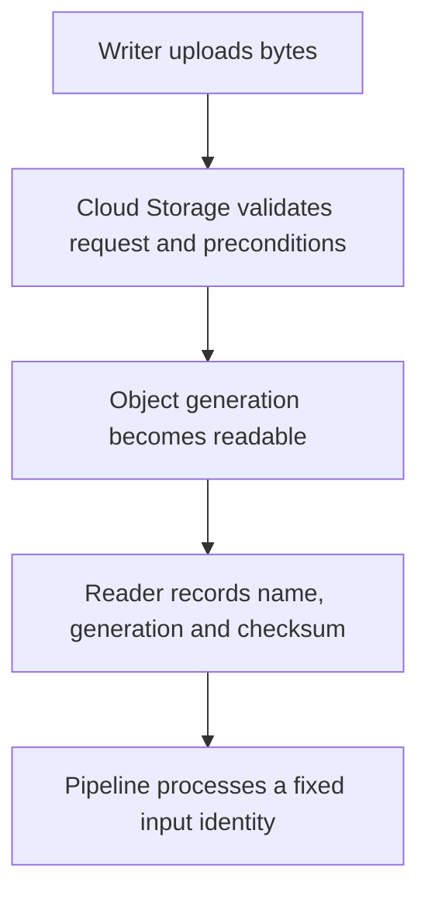

# Cloud Storage architecture, storage classes, and lifecycle management

Learn how object identity, consistency, placement and retention affect a pipeline's ability to retry and recover. Use the [lab conventions](../references/lab-conventions.md) before running cloud examples.

## An object is a versioned value

A bucket contains named objects. Each replacement creates a new generation. Record the bucket, object name and generation when defining an input batch; a URI alone can point to different bytes tomorrow. Cloud Storage provides strong consistency for object reads, writes, deletes and listing. IAM changes have different propagation behavior, and a cached public response can remain stale.

The following is a conceptual request path. Google's public object API is the contract; a particular metadata database, erasure-code layout or internal shard threshold is not a configuration you control.



A flat-namespace bucket interprets `/` as part of an object name. Moving a prefix usually requires object copy/delete work. A bucket created with hierarchical namespace has actual folders and supports atomic folder rename. Neither layout gives you a transaction that atomically publishes arbitrary changes across many objects. For a batch, publish a completion manifest after its data objects are durable. See [consistency](https://docs.cloud.google.com/storage/docs/consistency) and [hierarchical namespace](https://docs.cloud.google.com/storage/docs/hns-overview).

## Choose placement before optimizing file names

Keep the bucket location compatible with the BigQuery dataset or processing job. Regional, dual-region and multi-region buckets differ in placement and availability choices. A multi-region bucket does not mean every query runs locally to every object. Check location compatibility and transfer charges for the actual services.

Storage classes trade storage cost against access cost and minimum storage duration:

| Class | Minimum duration | Example |
| --- | --- | --- |
| Standard | None | Daily ingestion and Spark temporary output |
| Nearline | 30 days | Raw extracts read approximately monthly |
| Coldline | 90 days | Quarterly recovery archives |
| Archive | 365 days | Long-lived evidence rarely restored |

Retrieval, operations, early deletion and network transfer can outweigh a lower storage rate. Use the current [storage-class documentation](https://docs.cloud.google.com/storage/docs/storage-classes) for your region rather than memorizing a dollar price. Autoclass can manage transitions for suitable access patterns; review its own charges and constraints.

## Make a retry conditional

Set `PROJECT_ID` and choose a globally unique bucket name. These commands create a billable lab resource:

```bash
export LAKE_BUCKET="${PROJECT_ID}-storage-audit-lab"
gcloud storage buckets create "gs://${LAKE_BUCKET}" \
  --location=us-central1 --uniform-bucket-level-access
printf '%s\n' '{"event_id":"e1","amount_cents":2500}' > event.json
gcloud storage cp event.json "gs://${LAKE_BUCKET}/raw/batch-001.json" \
  --if-generation-match=0
gcloud storage objects describe "gs://${LAKE_BUCKET}/raw/batch-001.json"
```

The zero generation precondition allows creation only if there is no live object with that name. Run the upload again: expect a precondition failure rather than an overwrite. Verify the existing generation and checksum before treating that failure as a successful retry. An existing name with different bytes is a conflict. See [request preconditions](https://docs.cloud.google.com/storage/docs/request-preconditions).

## Retention and lifecycle solve different problems

Versioning preserves noncurrent versions after replacement. Soft delete retains deleted objects for its configured recovery period. A retention policy prevents premature deletion. These controls can retain billable bytes even when an application requests deletion.

Save this as `lifecycle.json`, then apply it to the lab bucket:

```json
{"rule":[
  {"action":{"type":"SetStorageClass","storageClass":"NEARLINE"},
   "condition":{"age":30,"matchesPrefix":["raw/"]}},
  {"action":{"type":"Delete"},
   "condition":{"age":120,"matchesPrefix":["raw/"]}}
]}
```

```bash
gcloud storage buckets update "gs://${LAKE_BUCKET}" --lifecycle-file=lifecycle.json
```

Lifecycle actions are asynchronous. Age 120 is an eligibility condition, not a guaranteed deletion timestamp. Retention and holds can block deletion; soft delete can preserve recoverable data afterward. Define rules for noncurrent versions if you enable versioning. See [lifecycle management](https://docs.cloud.google.com/storage/docs/lifecycle).

For high request rates, ramp traffic gradually, distribute hot prefixes where necessary and compact tiny files. Measure throttling and latency. Published initial request-rate guidance is not a permanent per-shard capacity limit.

## Recall exercise: predict, run, explain

1. A file is replaced under the same URI between load retries. What identifies the original input?
2. Why can a lifecycle delete rule fail to reduce stored bytes immediately?
3. Would atomic folder rename alone prove a downstream BigQuery load completed?

??? note "Answers"
    1. Its generation, with retained bytes and checksum for replay.
    2. Evaluation is asynchronous; retention, noncurrent versions or soft delete can retain bytes.
    3. No. Folder publication and warehouse-job completion are separate operations.

After inspecting the generation, remove this dedicated lab bucket with `gcloud storage rm --recursive "gs://${LAKE_BUCKET}"`. Review retained versions and soft-delete storage if you enabled those controls.

| Previous Lesson | Curriculum | Next Lesson |
| :--- | :---: | ---: |
| *None (First Lesson)* | [All Lessons (Index)](index.md) | [0002: Bigtable vs Spanner vs Cloud SQL](0002-bigtable-spanner-cloudsql-selection.md) |
