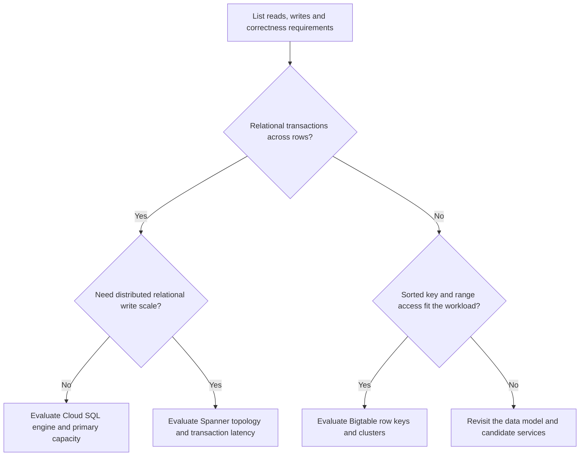

# Bigtable, Spanner and Cloud SQL: selecting an operational database

Choose an operational store from the operations that must be correct, then explain how analytics receives its changes. A table's size alone cannot choose its database.

## Start with transactions and access patterns



| Store | Mechanics that affect design | Analytics path |
| --- | --- | --- |
| Cloud SQL | Managed PostgreSQL, MySQL or SQL Server. Primary handles writes; replicas can lag. | Supported Datastream CDC or controlled extracts |
| Spanner | Distributed relational storage and transactions; topology affects commit latency. | Change streams and a supported processing connector |
| Bigtable | Sorted row keys and column families; atomic mutations within one row. Routing affects replicated-read consistency. | Change streams, Beam reads or external analysis where supported |

Do not promise fixed millisecond latency, a universal data-size cutoff or linear scaling for every workload. Indexes, hot keys, transaction scope, regional placement and client behavior change the result.

## Work through one business requirement

An online store needs to decrement stock and create an order atomically. In Cloud SQL, a transaction can lock and update the relevant relational rows. Read replicas can serve stale inventory, so route authoritative availability checks to the appropriate primary path.

If the same application requires distributed relational write capacity, evaluate Spanner. TrueTime and replication help provide external consistency; they do not eliminate distributed coordination or make a cross-region transaction free. Use keys that spread writes. A timestamp-leading primary key can concentrate new writes in one range.

A telemetry service instead needs `device_id + time range` reads and high write volume. Bigtable can fit this access pattern. An order spanning many independent Bigtable rows does not gain a general relational transaction merely because each row mutation is atomic. See [Spanner schema design](https://docs.cloud.google.com/spanner/docs/schema-design) and [Bigtable schema design](https://docs.cloud.google.com/bigtable/docs/schema-design).

## A row-key example with a real trade-off

`2026-10-28#device-42` places current writes near each other. `device-42#2026-10-28T09:00:00Z` supports device-range reads and spreads different devices across key ranges. One unusually busy device can still be hot.

Adding a hash prefix spreads that device's writes, but querying its complete time range now requires several range scans and a merge. Never add random salts without specifying how readers find all pieces. Column-family garbage collection controls versions and age; it does not replace the event-retention contract of your analytical system.

## Run a local key-design exercise

This Python example needs only the standard library:

```python
from collections import Counter
from hashlib import sha256

devices = ["device-42"] * 900 + [f"device-{i}" for i in range(100)]
prefixes = [sha256(device.encode()).hexdigest()[:2] for device in devices]
loads = Counter(prefixes)
print(max(loads.values()))
assert max(loads.values()) >= 900
```

Hashing only the device ID does not split one hot device. To split it, the shard choice must vary within that device, and range readers must fan out. For account balances, this may conflict with single-row atomicity requirements. The access pattern and transaction requirement must be considered together.

For a cloud exercise, follow the [Spanner change-stream guide](https://docs.cloud.google.com/spanner/docs/change-streams) in a disposable project. Create a table keyed by a distributed order ID, enable its change stream, insert and update one order, then explain how a downstream consumer checkpoints progress and handles retention. Provisioning the database alone does not build a CDC pipeline.

## Recall and design check

1. Why is "more than 10 TB means Spanner" an unreliable rule?
2. Why can a replica return a different inventory value from the primary?
3. A Bigtable query needs every device's sales grouped by country. What does this imply?

??? note "Answers"
    1. Transaction shape, write distribution and required operations matter more than a size threshold.
    2. Asynchronous replication can lag; routing and consistency configuration matter.
    3. This is an analytical scan/aggregation requirement. Export or replicate into an analytical system rather than assuming a row-key lookup solves it.

| Previous Lesson | Curriculum | Next Lesson |
| :--- | :---: | ---: |
| [0001: Cloud Storage Architecture](0001-cloud-storage-architecture-lifecycle.md) | [All Lessons (Index)](index.md) | [0003: BigLake & Apache Iceberg Catalogs](0003-biglake-iceberg-catalogs.md) |
