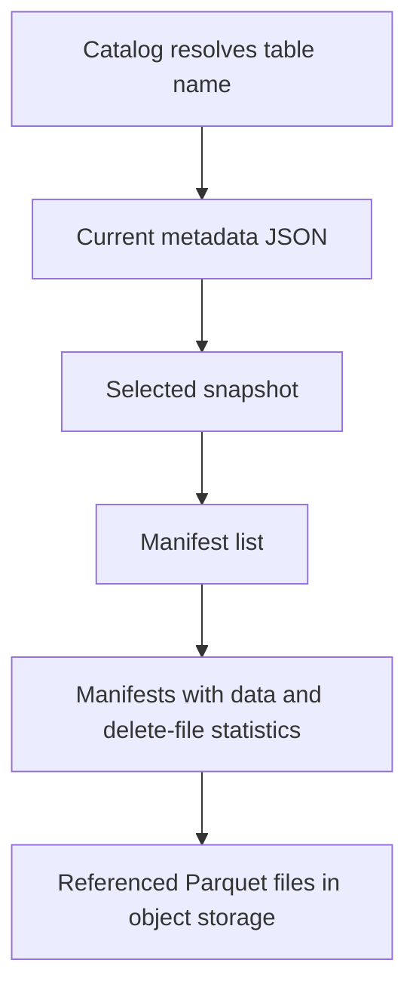

# BigLake, external tables and Apache Iceberg catalogs

Separate the storage format, catalog, query engine and authorization path. They solve different problems, even when a product presents them together.

## Files are not a transactional table

Parquet is a columnar file format. It supplies schemas, compression and statistics, but a directory of Parquet objects does not identify which files belong to one committed table version. Iceberg adds metadata, snapshots and commit rules. A catalog identifies the current table metadata and coordinates commits.



The reader prunes files using partition and column statistics. A writer creates new files and commits a new metadata reference. Readers of a previous snapshot keep a consistent file set. A concurrent writer may need to retry a conflicting commit. A random object delete bypasses this protocol and can break a table.

## Pick the table type deliberately

| Choice | Storage and writers | Access consideration |
| --- | --- | --- |
| Native BigQuery table | BigQuery manages storage and mutations | Standard warehouse workload |
| Standard external table | Engine reads your existing objects | Query identity also needs underlying object access |
| BigLake external table | Existing objects with access delegation through a connection | Separate user table access from connection-service-account bucket access |
| Iceberg external table | Another system owns Iceberg metadata and commits | Check supported catalog, format version and update method |
| BigQuery-managed Iceberg table | BigQuery manages the table over your object storage | Follow its documented writer and interoperability contract |

"Open format" does not grant arbitrary engines permission to write simultaneously. Compatible catalogs, supported operations and coordinated commits remain necessary. BigLake delegation also does not prevent exfiltration if a user independently has direct bucket access. See [BigLake access delegation](https://docs.cloud.google.com/bigquery/docs/biglake-intro) and [managed Iceberg tables](https://docs.cloud.google.com/bigquery/docs/biglake-iceberg-tables-in-bigquery).

## Create an external Iceberg reference

Prerequisites: an existing Iceberg table and metadata JSON, a compatible dataset/bucket location, a cloud resource connection, and bucket-reader access for the connection's service account. Replace every example identifier.

```bash
bq mk --connection --connection_type=CLOUD_RESOURCE \
  --location=us-central1 --project_id="$PROJECT_ID" lake-connection
bq show --connection "${PROJECT_ID}.us-central1.lake-connection"
```

Copy the returned service account into the bucket's Storage Object Viewer binding. Users still need BigQuery job and table permissions plus the applicable connection-use permission.

```sql
CREATE EXTERNAL TABLE `YOUR_PROJECT_ID.lake.orders_iceberg`
WITH CONNECTION `YOUR_PROJECT_ID.us-central1.lake-connection`
OPTIONS (
  format = 'ICEBERG',
  uris = ['gs://YOUR_BUCKET/orders/metadata/v1.metadata.json']
);
```

This statement registers metadata; it does not convert arbitrary Parquet into Iceberg. A reference to a specific metadata file can become stale when another engine commits a newer file. Use a supported catalog integration or deliberately update the reference. Confirm the current snapshot before using the table for a freshness SLO.

The current [external Iceberg guide](https://docs.cloud.google.com/bigquery/docs/iceberg-external-tables) supports historical queries over retained Iceberg snapshots using `FOR SYSTEM_TIME AS OF`. This depends on snapshots retained in Iceberg metadata, rather than BigQuery native-table time-travel retention. Snapshot expiration or deleting referenced files removes that recovery path.

## Schema evolution and maintenance example

Suppose an order table renames `customer_name` to `display_name`. Iceberg tracks columns by field ID, so a supported rename can preserve identity. Dropping a field and adding another with the same display name is different. Test how every consuming engine handles that evolution.

After 10,000 small streaming commits, compaction can combine data files into fewer larger files. Snapshot expiration later releases unreferenced files, subject to reader and rollback requirements. Compaction changes physical organization; it must preserve business rows and use the table's commit protocol. Keep old snapshots long enough for your longest reader and required recovery window.

## Exercise with expected evidence

Using a sandbox Iceberg table, record its snapshot ID and row count. Append one new order through its owning engine, then query through BigQuery. If the new row is absent, inspect the catalog/metadata reference before blaming object-store consistency. Refresh the supported reference and verify the new row. Query a retained older snapshot and predict its count.

??? note "Recall answers"
    Parquet describes files; Iceberg defines committed table state; the catalog identifies current metadata. Time travel requires retained metadata and files. A connection delegates object access but does not revoke separate bucket grants.

| Previous Lesson | Curriculum | Next Lesson |
| :--- | :---: | ---: |
| [0002: Bigtable vs Spanner vs Cloud SQL](0002-bigtable-spanner-cloudsql-selection.md) | [All Lessons (Index)](index.md) | [0004: Medallion Architecture on GCS](0004-data-lake-medallion-gcs.md) |
