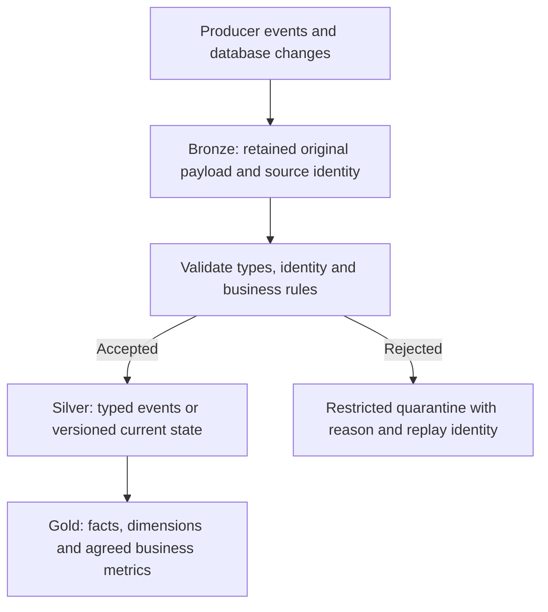

# Data lake design: medallion layers, schemas and publication

Bronze, Silver and Gold name responsibilities. Define the contract of each layer before creating buckets.

## What changes at each boundary



Bronze supports investigation and reprocessing. Store ingestion time separately from event time, plus schema version and source identity. "Immutable raw" still needs a legally permitted retention/deletion policy for personal data.

Silver enforces a grain: one row per immutable event is different from one latest row per order. Gold defines a business metric, such as paid revenue excluding cancellations. These layers can live in BigQuery or object storage; copying every dataset into three buckets is not a requirement.

## Choose a layout and file format

JSON is useful for original payloads but carries parsing cost and weak type inference. Avro carries a row-oriented schema. Parquet organizes columns and row groups for analytical projection and compression. Iceberg adds table-level metadata and commits over data files. See the [Parquet format](https://parquet.apache.org/docs/file-format/) and [external Hive partitions](https://docs.cloud.google.com/bigquery/docs/hive-partitioned-queries).

`event_date=2026-10-28/part-001.parquet` exposes a partition key. Keep the key order and type consistent across files. Choose event date for business-time queries; choose ingestion date when arrival/replay accounting is the main access path. Retain both timestamps regardless. A million tiny objects can spend more time opening files than scanning useful rows. Start with files in the hundreds of MiB, then measure rather than treating a size as universal.

## A local Silver transformation you can inspect

Save this as `silver.py`. It requires PySpark in a compatible Python/JVM environment; use `spark-submit silver.py` locally or submit it to your Dataproc runtime.

```python
from pyspark.sql import SparkSession, functions as F, Window

spark = SparkSession.builder.master("local[2]").appName("silver-fixture").getOrCreate()
raw = spark.createDataFrame([
    ("e1", "o1", "2026-10-28T09:00:00Z", 2500, 1),
    ("e1", "o1", "2026-10-28T09:00:00Z", 2500, 1),
    ("e2", "o2", "2026-10-28T09:01:00Z", -100, 1),
], "event_id string, order_id string, raw_time string, amount_cents long, version long")
typed = raw.withColumn("event_ts", F.to_timestamp("raw_time"))
valid = (F.col("event_id").isNotNull() & F.col("order_id").isNotNull()
         & F.col("event_ts").isNotNull() & (F.col("amount_cents") >= 0))
quarantine = typed.filter(~valid)
accepted = typed.filter(valid).dropDuplicates()  # exact fixture duplicates only
conflicts = accepted.groupBy("event_id").count().filter("count > 1")
if conflicts.take(1):
    raise ValueError("Conflicting payloads for an immutable event")
silver = accepted.withColumn("event_date", F.to_date("event_ts"))
silver.write.mode("overwrite").partitionBy("event_date").parquet("/tmp/silver-fixture")
assert silver.count() == 1
assert quarantine.count() == 1
spark.stop()
```

Expect one accepted event, one quarantined event and no second copy of e1. This is a bounded fixture overwrite. Replacing `/tmp/silver-fixture` with a production path without redesigning publication would be unsafe. `dropDuplicates` alone does not resolve conflicting payloads or deduplicate across independently appended batches.

In a real batch, read an explicit schema, make null validation exhaustive, write to a fresh attempt prefix, validate counts and publish a manifest or table snapshot atomically through the appropriate protocol. Readers should not discover partially written output by listing a mutable prefix.

## Work through a late event

At 00:10 on October 29, an order arrives with event time 23:58 on October 28. Bronze records both dates. Silver places it under October 28 if event-date partitioning is the contract. Gold must recompute the affected business day or apply a supported correction. Processing only the current ingestion date's Gold partition misses the sale.

Compaction has the same publication problem. Appending compacted files beside their originals doubles a wildcard reader's rows. Commit a replacement file set through Iceberg or switch consumers to a validated new prefix, then retire obsolete files according to retention.

## Recall and challenge

1. Why must you define event grain before deduplicating?
2. Why does a `_SUCCESS` marker need an agreed producer/consumer protocol?
3. Change the second e1 payload to 2600. Predict the result before running.

??? note "Answers"
    1. Entity IDs can repeat legitimately across different events.
    2. The marker must identify a complete fixed file set; its name alone proves nothing.
    3. The conflict check fails instead of arbitrarily choosing a value.

Remove `/tmp/silver-fixture` after reviewing its partition structure. Continue with [data contracts](0042-data-contracts-schema-evolution.md) and [data modeling](0041-googlesql-data-modeling.md).

| Previous Lesson | Curriculum | Next Lesson |
| :--- | :---: | ---: |
| [0003: BigLake & Apache Iceberg Catalogs](0003-biglake-iceberg-catalogs.md) | [All Lessons (Index)](index.md) | [0005: Cloud Pub/Sub Architecture](0005-pubsub-architecture-flow-control.md) |
