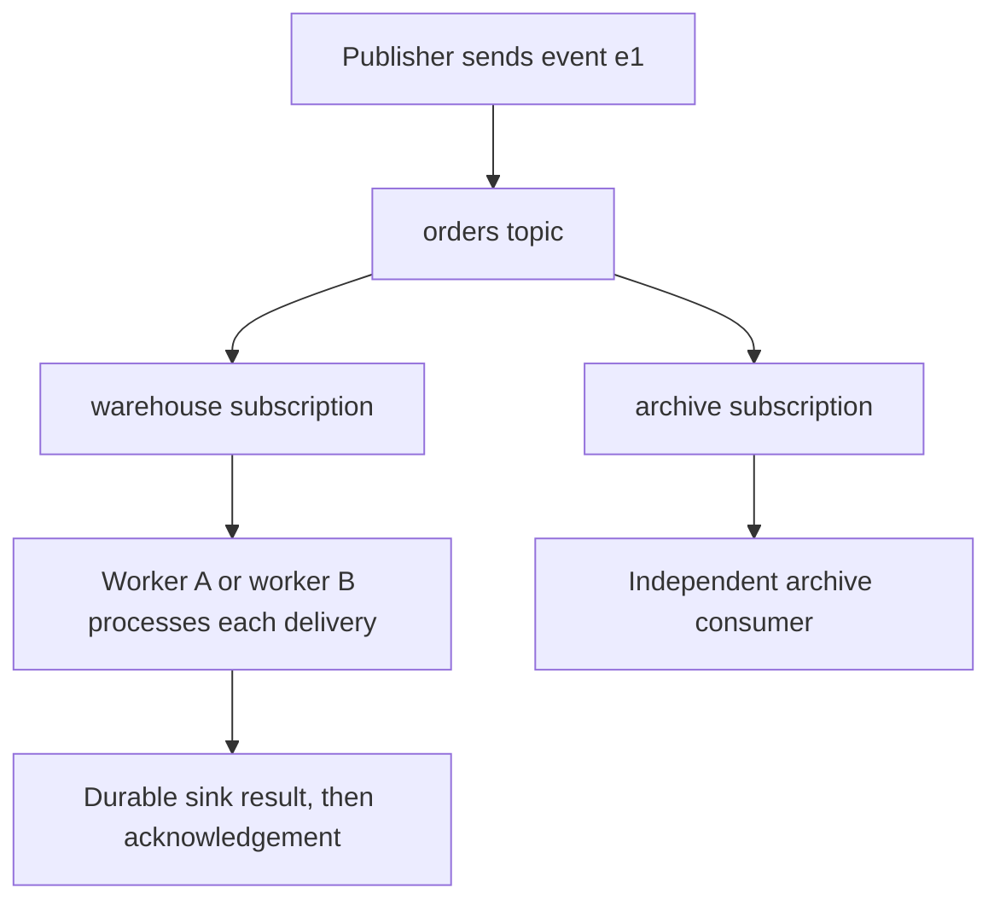

# Pub/Sub architecture, subscriptions and flow control

Pub/Sub decouples publishers from subscribers. Understand the acknowledgement boundary before choosing throughput settings.

## Topics fan out; subscribers on one subscription share work



Two subscriptions each receive their own delivery of a newly published message. Two workers sharing one subscription compete for its work. The default delivery guarantee is at least once. If a sink commits and the acknowledgement is lost, the same message can return. Store or derive a business event identity so repeated delivery does not repeat the business effect.

Pull subscribers control retrieval and concurrency. Push delivery invokes an HTTPS endpoint. BigQuery and Cloud Storage subscriptions provide managed export paths. Use Beam/Dataflow when processing requires its windows, joins, state or runtime controls; check whether supported lightweight subscription transforms already meet simpler needs.

## Retention, ordering and exactly-once are separate settings

Retention defines how long data remains available for replay. Configure topic/subscription retention and snapshot/seek behavior deliberately; an acknowledgement is not a permanent archive. Ordering keys order supported deliveries within a key, not across the whole topic. One busy key can limit concurrency.

Exactly-once delivery is supported for pull subscriptions within a cloud region. Successful acknowledgement prevents redelivery of that message under its documented conditions. Expired acknowledgement IDs can produce `INVALID_ARGUMENT`. It does not deduplicate two successful publishes of the same business event. See [exactly-once delivery](https://docs.cloud.google.com/pubsub/docs/exactly-once-delivery) and [replay](https://docs.cloud.google.com/pubsub/docs/replay-overview).

## Bound memory and acknowledge after work

Install `google-cloud-pubsub` in your lab environment. Create a topic and pull subscription, then run this consumer using ADC and a populated `PROJECT_ID` environment variable:

```python
import os
from google.cloud import pubsub_v1

subscriber = pubsub_v1.SubscriberClient()
subscription = subscriber.subscription_path(os.environ["PROJECT_ID"], "orders-lab")

def process(message):
    try:
        # Replace this print with a durable idempotent sink operation.
        print(message.message_id, message.data.decode("utf-8"))
        message.ack()
    except Exception:
        message.nack()

future = subscriber.subscribe(
    subscription, callback=process,
    flow_control=pubsub_v1.types.FlowControl(
        max_messages=100, max_bytes=10 * 1024 * 1024
    ),
)
try:
    future.result()
except KeyboardInterrupt:
    future.cancel()
    future.result()
finally:
    subscriber.close()
```

The flow-control byte limit bounds subscriber buffering, not total process memory. Decoded objects, concurrent callbacks and sink buffers require additional memory. High-level clients extend leases while processing, but lease limits and outages can still cause redelivery. Printing demonstrates delivery only; it is not durable processing. See [subscriber flow control](https://docs.cloud.google.com/pubsub/docs/subscribe-best-practices).

## Configure poison-message recovery

In a disposable project:

```bash
gcloud pubsub topics create orders-lab
gcloud pubsub topics create orders-lab-dead
gcloud pubsub subscriptions create orders-lab-dead-reader --topic=orders-lab-dead
gcloud pubsub subscriptions create orders-lab --topic=orders-lab \
  --dead-letter-topic=orders-lab-dead --max-delivery-attempts=5 \
  --min-retry-delay=10s --max-retry-delay=600s
```

Grant the project's Pub/Sub service agent Publisher on `orders-lab-dead` and Subscriber on the source `orders-lab` subscription. Both grants matter. The allowed maximum-attempt setting is 5 through 100; actual forwarding is best effort and the attempt limit is approximate. A dead-letter topic also needs a consuming subscription and an operating procedure. See [dead lettering](https://docs.cloud.google.com/pubsub/docs/dead-letter-topics).

For a sizing exercise, assume 1,000 messages/s and 0.2 seconds average processing time. Little's law gives approximately 200 concurrent in-flight messages just to sustain that rate, before headroom. If each decoded message occupies 200 KiB, those records alone use about 39 MiB. Increasing pull volume without sink capacity increases backlog in memory rather than useful throughput.

## Failure exercise and answers

Publish one event, stop the consumer before acknowledgement and restart. Explain why it can return. Then publish the same `event_id` twice and explain why transport exactly-once would not merge those publishes. For a real sink, prove that both deliveries produce one business row using an explicit key/version rule.

Monitor oldest unacknowledged message age, backlog, rejected sink writes and business freshness together. A low backlog can also mean that no producer is publishing.

Delete the two lab subscriptions and topics after the exercise. Do not use seek or retention changes on production subscriptions as a learning experiment.

| Previous Lesson | Curriculum | Next Lesson |
| :--- | :---: | ---: |
| [0004: Medallion Architecture on GCS](0004-data-lake-medallion-gcs.md) | [All Lessons (Index)](index.md) | [0006: Pub/Sub Lite retirement](0006-pubsub-lite-vs-standard.md) |
