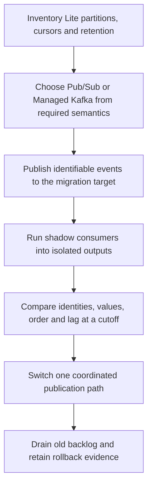

# Pub/Sub Lite retirement and choosing a migration target

!!! warning "Service lifecycle checked on 2026-10-28"
    Pub/Sub Lite is deprecated. Google lists January 31, 2027 as its shutdown date and has already closed new-customer access. This lesson covers migration, not new Lite deployment. See the [official notice](https://docs.cloud.google.com/pubsub/docs/pubsub-lite-documentation).

The original lesson recommended Lite for new high-volume systems. That recommendation is no longer appropriate. The useful concepts are partitioned logs, cursor migration and capacity-based versus volume-based cost.

## Compare the delivery models

| Concept | Existing Lite system | Pub/Sub target | Managed Kafka target |
| --- | --- | --- | --- |
| Work distribution | Explicit partitions and cursors | Subscriptions, acknowledgements and optional ordering keys | Partitions, consumer groups and offsets |
| Capacity | Provisioned throughput and storage | Managed scaling with quotas | Provisioned cluster capacity |
| Client migration | Existing Lite client or shim | Adopt Pub/Sub client and acknowledgement model | Validate Kafka protocol/client compatibility |
| Replay | Retained partition log and cursors | Configured retention, seek and snapshots | Retention and consumer-offset control |

Do not assume a Lite cursor translates to a Pub/Sub acknowledgement or Kafka offset. They refer to different logs. Business event IDs, source sequence numbers and recorded cutoffs connect the old and new systems.



Pub/Sub is a reasonable starting choice for managed messaging and Google Cloud export subscriptions. Kafka is worth evaluating when existing applications rely on its partition/offset APIs and ecosystem. Validate the target's supported security, connectors and operating limits; API familiarity alone is not sufficient. See the [messaging-model comparison and retirement notice](https://docs.cloud.google.com/pubsub/docs/choosing-pubsub-or-lite) and [Managed Kafka overview](https://docs.cloud.google.com/managed-service-for-apache-kafka/docs/overview).

## Work through a cutover

Suppose one producer emits versions 1 through 10,000 for an entity. At the cutover, Lite has processed version 9,950 while the new system has processed 9,980. Adding the two row counts does not prove coverage. The systems overlap, and some missing versions may be hidden by duplicates.

Record an agreed boundary, compare event identities and payloads, and advance the consumer only after it can account for all required versions. Dual publishing is not atomic across two services. If the first publish succeeds and the second fails, a producer needs a retry/outbox strategy rather than assuming both logs contain the same records. Use version-aware current-state writes and retain delete tombstones to tolerate overlap.

## Local reconciliation example

```python
old_seen = {f"e{i}" for i in range(1, 101)}
new_seen = {f"e{i}" for i in range(50, 106)}
expected_at_cutoff = {f"e{i}" for i in range(1, 101)}
missing_in_new = expected_at_cutoff - new_seen
ahead_of_cutoff = new_seen - expected_at_cutoff
assert len(missing_in_new) == 49
assert len(ahead_of_cutoff) == 5
print(len(missing_in_new), len(ahead_of_cutoff))
```

Expect `49 5`. The new system being ahead for some events does not mean its historical range is complete. Real reconciliation also compares payloads, multiplicity and per-entity ordering, as in [lesson 0040](0040-bigquery-failed-job-recovery-backfill.md).

## Estimate total cost without a magic threshold

For a hypothetical 50 MiB/s stream over 30 days, ingress is `50 × 60 × 60 × 24 × 30 = 129,600,000 MiB`. Add each subscription's delivery volume, retention, replication, network transfer and processing. Compare that with provisioned Kafka capacity, disk, idle headroom and operating effort. Use current regional pricing. A historical claim that Lite is always 80–90% cheaper cannot choose today's target.

## Migration exercise

Design a rollback after the new consumer has processed a delete that the old consumer has not seen. State which log retains that deletion, which identity prevents replay from recreating the entity, and when the old output is safe to retire.

??? note "Expected reasoning"
    Preserve the source change and ordering boundary. A retained tombstone/version must reject older updates. Rollback needs reconciled state and a live retained source range, not just the old consumer binary.

| Previous Lesson | Curriculum | Next Lesson |
| :--- | :---: | ---: |
| [0005: Cloud Pub/Sub Architecture](0005-pubsub-architecture-flow-control.md) | [All Lessons (Index)](index.md) | [0007: CDC with Datastream & BigQuery](0007-change-data-capture-datastream-bigquery.md) |
