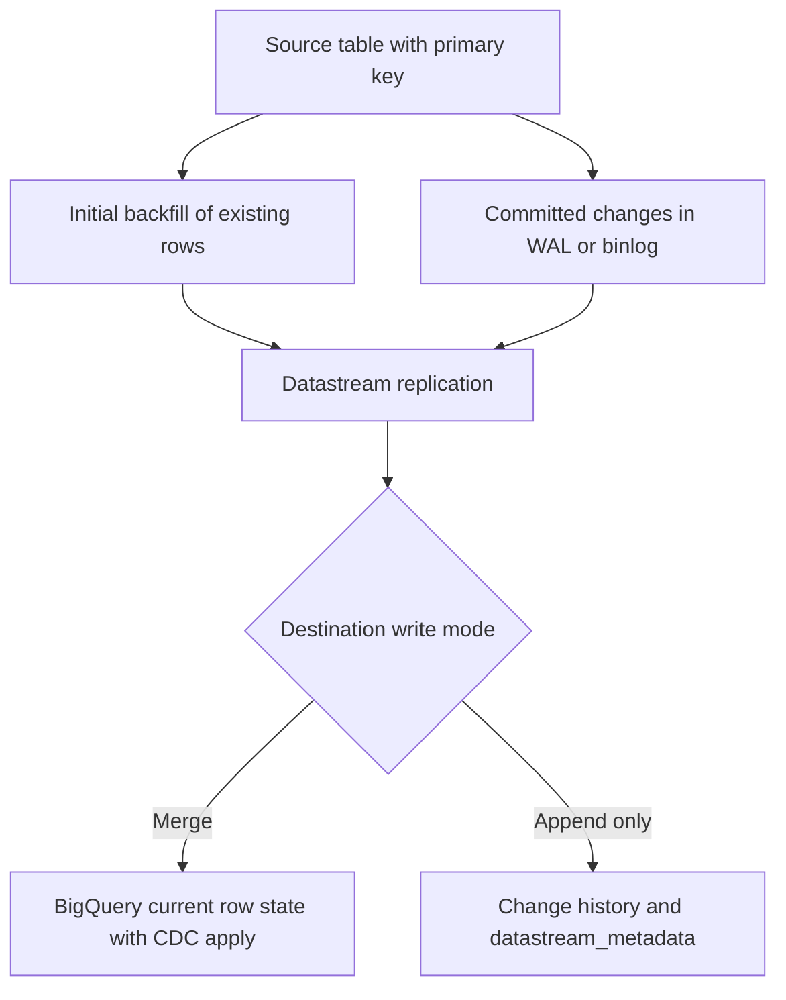

# Change data capture with Datastream and BigQuery

CDC reads committed database changes from a source log. It reduces repeated extraction scans, but still needs a snapshot boundary, keys, ordering, retention and recovery.

## Bootstrap and ongoing replication overlap



The source continues changing while the initial backfill runs. Changes can overlap with backfilled rows and arrive out of order. Source keys and sequence metadata let the destination establish current state. Arrival time is not the source order.

For PostgreSQL, configure logical replication, a publication, a supported decoding plugin and a replication slot. MySQL requires the supported row-binlog configuration. Other source engines have their own requirements; an Oracle connection is not an instruction to substitute GoldenGate metadata. Follow the source-specific guide, such as [Cloud SQL PostgreSQL preparation](https://docs.cloud.google.com/datastream/docs/configure-cloudsql-psql).

## Current state differs from history

In merge mode, BigQuery applies supported upserts and deletes to a replica. Query freshness depends on source lag and destination apply behavior; a staleness setting is not a sub-minute end-to-end guarantee. Tables without suitable keys require different handling.

Append-only mode records changes and supplies a `datastream_metadata` struct. Its fields and interpretation depend on documented destination behavior. Do not invent `_metadata_deleted` columns and assume Datastream creates them. Inspect the actual schema and use the official [destination metadata](https://docs.cloud.google.com/datastream/docs/destination-bigquery) and [event-ordering documentation](https://docs.cloud.google.com/datastream/docs/events-and-streams).

## Demonstrate ordering with an explicit teaching contract

The following is runnable GoogleSQL with no tables to create. `version` and `op` are fields of our own example envelope, not promised Datastream column names.

```sql
WITH changes AS (
  SELECT 101 AS order_id, 1 AS version, 'UPSERT' AS op, 2500 AS cents UNION ALL
  SELECT 101, 3, 'DELETE', NULL UNION ALL
  SELECT 101, 2, 'UPSERT', 2700 UNION ALL
  SELECT 102, 1, 'UPSERT', 4200
), latest AS (
  SELECT * FROM changes
  QUALIFY ROW_NUMBER() OVER (
    PARTITION BY order_id ORDER BY version DESC
  ) = 1
)
SELECT order_id, cents FROM latest WHERE op != 'DELETE';
```

Expect only `102 / 4200`. If you filter deletes before ranking, order 101 reappears at version 2. Keep the highest applied version or tombstone so a later replay of version 1 cannot recreate it. Validate that the source does not supply conflicting images for the same key/version before ranking; otherwise a tied winner is arbitrary.

## Run the actual CDC path

[Lesson 0037, method E](0037-bigquery-ingestion-etl-elt-lab.md#7-method-e-datastream-cdc-from-postgresql) supplies the complete disposable PostgreSQL setup, credentials procedure, connectivity, backfill and update/delete fixture. Run that lab rather than a connection-profile command with guessed flags.

Before starting, verify the replication identity's permissions, source publication membership, network/TLS connection, supported source types, destination location and service-agent permissions. After backfill, update one primary key, insert another and delete a third. Prove the merged table matches the source at a recorded boundary. Separately inspect append-only metadata if you choose history mode.

## Protect the source while the consumer is stopped

A PostgreSQL slot can retain WAL while Datastream is unavailable. Source disk exhaustion can become an application outage. Query retained WAL using the source database:

```sql
SELECT slot_name, active,
       pg_size_pretty(pg_wal_lsn_diff(pg_current_wal_lsn(), restart_lsn)) AS retained_wal
FROM pg_replication_slots;
```

This measures retained log distance, not a complete end-to-end freshness SLO. Monitor source disk, slot state, Datastream freshness and BigQuery apply state. If logs disappear before recovery, resume may require a controlled new snapshot/backfill. Do not drop an active replication slot merely to free space.

## Recall and failure drill

1. Why can a successful stream still serve stale analytical results?
2. Why must a deleted row's sequence survive a replay?
3. Stop a disposable stream briefly, mutate the source and resume. Which evidence proves catch-up?

??? note "Expected reasoning"
    Check both extraction lag and destination apply. Retained tombstones reject older versions. Catch-up requires matching keys and values at a common boundary, plus healthy source and apply progress. A green stream status alone is insufficient.

| Previous Lesson | Curriculum | Next Lesson |
| :--- | :---: | ---: |
| [0006: Pub/Sub Lite retirement](0006-pubsub-lite-vs-standard.md) | [All Lessons (Index)](index.md) | [0008: DTS & GCS Change Notifications](0008-bigquery-data-transfer-service-gcs-notifications.md) |
