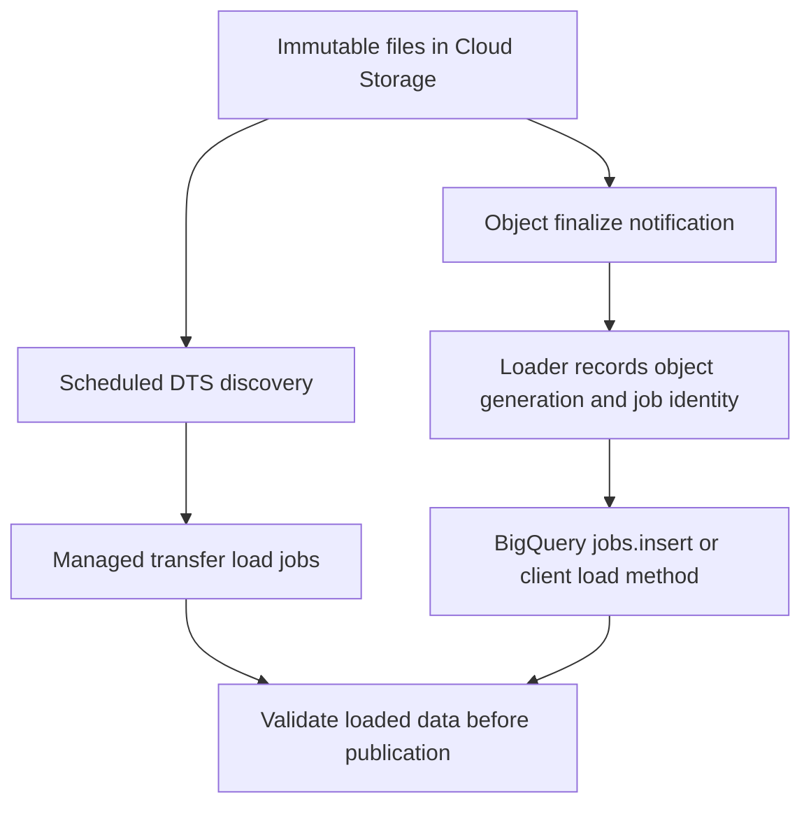

# BigQuery transfers and event-driven Cloud Storage loads

File arrival, job submission and successful publication are separate events. Choose a managed recurring transfer or a custom event loader based on its contract and recovery needs.

## Scheduled discovery versus object events



DTS is useful when a supported connector's scheduling and ingestion behavior fit. A custom loader gives control over manifests, event identity and routing, but you own retries and completion monitoring. Neither path guarantees a fixed seconds-to-query latency.

## Use the connector's actual parameter names

Create a same-location destination dataset and table first. Replace bucket/project names. With an existing Parquet schema/table:

```bash
bq --location=us-central1 mk --transfer_config \
  --project_id="$PROJECT_ID" --data_source=google_cloud_storage \
  --display_name="orders-files" --target_dataset=raw \
  --params='{"data_path_template":"gs://YOUR_BUCKET/orders/*.parquet","destination_table_name_template":"orders","file_format":"PARQUET","write_disposition":"APPEND"}'
```

The Cloud Storage connector uses `file_format`; `file_data_type` is not the documented parameter. `APPEND` and `MIRROR` describe connector write behavior. They are distinct from API `WRITE_APPEND` and `WRITE_TRUNCATE` enums. Review the resulting schedule and run manually in the console. See [transfer setup](https://docs.cloud.google.com/bigquery/docs/cloud-storage-transfer).

Append transfers track source file state according to connector behavior; they do not enforce unique business keys. Rewriting an object or running a backfill can revisit data. Mirror mode replaces destination contents with the selected source files; it does not merge rows by order ID. A runtime path template selects files; it does not prove the producer finished delivering every expected file. See [ingestion behavior](https://docs.cloud.google.com/bigquery/docs/cloud-storage-transfer-overview).

## Identify a custom load before submitting it

The following runnable helper needs `google-cloud-bigquery`, ADC, an existing table and a local caller supplying the recorded generation. It assumes the object name is immutable for the entire job/retry period. The hash identifies intended work but does not force BigQuery to read historical bytes from a mutable name.

```python
import hashlib
from google.api_core.exceptions import Conflict
from google.cloud import bigquery

def load_parquet(bucket, name, generation, table, location="us-central1"):
    identity = f"{bucket}/{name}#{generation}|{table}|parquet-v1"
    job_id = "load_" + hashlib.sha256(identity.encode()).hexdigest()
    client = bigquery.Client()
    config = bigquery.LoadJobConfig(
        source_format=bigquery.SourceFormat.PARQUET,
        write_disposition=bigquery.WriteDisposition.WRITE_APPEND,
        max_bad_records=0,
    )
    try:
        job = client.load_table_from_uri(
            f"gs://{bucket}/{name}", table, job_id=job_id,
            location=location, job_config=config,
        )
    except Conflict:
        job = client.get_job(job_id, location=location)
    job.result()  # (1)!
    return job.job_id
```

1. Wait for completion and surface failure before recording success. Submission alone does not mean data is loaded.

After a transport timeout, retrieve the same project/location/job ID. If the job definitively failed, record a new deliberate attempt ID after fixing its cause. Keep a durable manifest/ledger because job IDs are not a permanent business deduplication store. A short-lived event handler may need to hand monitoring to a durable orchestrator rather than block until completion.

Cloud Storage Pub/Sub notifications and direct Eventarc Storage events have different envelopes. Decode the specific configured event type. Standard load jobs use the jobs API, not `tables.insert`. Event notifications can repeat; return success only after durable handoff or completed processing under your acknowledgement contract. See [notifications](https://docs.cloud.google.com/storage/docs/pubsub-notifications) and [batch loads](https://docs.cloud.google.com/bigquery/docs/batch-loading-data).

## Exercise with expected outcomes

Use the helper twice with the same immutable object and generation. Both calls should identify the same successful job, with one append. Use a new job identity for the same bytes and predict a second append. Then ask what happens if the filename is replaced before the first job reads it.

??? note "Answers"
    Job identity protects retry of one job. It does not make a mutable URI immutable or prevent an intentionally different job from loading the same business events. Preserve unique source names, retained generations and a processed-input ledger.

Batch loads through the shared pool generally have no load-compute charge, but storage, transfer, custom loading capacity and connector costs can still apply. Batch processing also has load quotas. Group small files into bounded batches instead of submitting one job per tiny event file. [Lesson 0037](0037-bigquery-ingestion-etl-elt-lab.md) provides a full lab and cleanup.

| Previous Lesson | Curriculum | Next Lesson |
| :--- | :---: | ---: |
| [0007: CDC with Datastream & BigQuery](0007-change-data-capture-datastream-bigquery.md) | [All Lessons (Index)](index.md) | [0009: BigQuery Internal Architecture](0009-bigquery-internal-architecture.md) |
