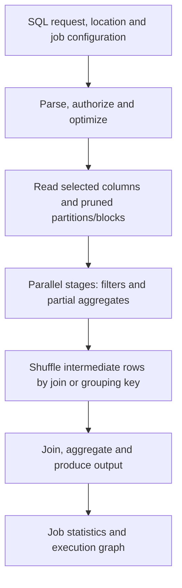

# BigQuery internals and reading an execution plan

Explain why selecting fewer columns, reducing join fan-out and removing skew can improve a query. Internal component names are useful only when they support those decisions.

## Separate the public contract from the architecture model

Dremel describes distributed analytical execution. Capacitor is BigQuery's native columnar storage format, Colossus is Google's distributed storage system, and Jupiter provides data-center networking. These explain how compute can operate separately from storage. They do not expose fixed leaf/mixer counts, per-slot memory settings or guaranteed network bandwidth to users.



Columnar storage avoids reading unrelated columns. Nested/repeated fields can represent related data without a separate distributed join. A shuffle moves rows between parallel workers so equal keys meet. When one key dominates, one part of the stage can take much longer. Shuffle can spill; it is not a promise that every intermediate byte always remains in RAM.

A slot is a virtual unit of analytical compute. A slot-second measures resource consumption, not billed dollars for every pricing model. A query can use varying numbers of slots over its execution. More slots cannot repair an incorrect many-to-many join.

## Worked join example

An orders table has 1 million rows. A customer dimension accidentally contains 10 rows for each customer. Joining on customer ID produces up to 10 million rows and inflates revenue tenfold. The solution is to establish the intended dimension grain and a valid current/as-of join, not simply increase the reservation.

Use this self-contained query to see the problem:

```sql
WITH orders AS (
  SELECT 101 AS order_id, 'c1' AS customer_id, 2500 AS cents
), customers AS (
  SELECT 'c1' AS customer_id, 'basic' AS tier UNION ALL
  SELECT 'c1', 'premium'
)
SELECT COUNT(*) AS joined_rows, SUM(cents) AS cents
FROM orders JOIN customers USING (customer_id);
```

Expect two joined rows and 5000 cents, although the input order was worth 2500. [Lesson 0041](0041-googlesql-data-modeling.md) shows how grain and validity intervals prevent this.

## Measure a real query

Run the following in the job's actual location. This example uses `us-central1` and needs permission to inspect project jobs.

```sql
SELECT job_id, state, error_result,
       total_bytes_processed, total_slot_ms,
       TIMESTAMP_DIFF(start_time, creation_time, MILLISECOND) AS queue_ms,
       SAFE_DIVIDE(total_slot_ms,
         TIMESTAMP_DIFF(end_time, start_time, MILLISECOND)) AS average_slots
FROM `region-us-central1`.INFORMATION_SCHEMA.JOBS_BY_PROJECT
WHERE creation_time >= TIMESTAMP_SUB(CURRENT_TIMESTAMP(), INTERVAL 1 DAY)
  AND job_type = 'QUERY'
  AND (statement_type IS NULL OR statement_type != 'SCRIPT')
ORDER BY total_slot_ms DESC
LIMIT 10;
```

If a completed query uses 600,000 slot-ms over 10,000 milliseconds, average usage is 60 slots. That number alone does not prove efficient parallelism; repeated work and excessive shuffle also consume slots. Inspect the graph's input/output rows, shuffle volume, spill and skew. Queue delay, execution duration and data freshness are different measures.

Compare two versions of a query with result caching disabled and the same input snapshot. Change one thing, such as moving an aggregation before a join, and confirm both result equality and reduced work. A faster query returning the wrong grain is a regression.

## Recall and practical challenge

1. A query reads few bytes but consumes many slot-seconds. Name two explanations.
2. Does `LIMIT 10` necessarily reduce a full table scan?
3. Why should script-parent and child jobs not both be summed for cost attribution?

??? note "Answers"
    1. Expensive expressions, joins, sorting or skew can require substantial compute after reading.
    2. No. Projection and partition/block pruning determine scanned data; LIMIT is not a general scan cap.
    3. Parent totals can already include child work, so the sum double-counts it.

Sources: [query-plan explanation](https://docs.cloud.google.com/bigquery/docs/query-plan-explanation), [compute optimization](https://docs.cloud.google.com/bigquery/docs/best-practices-performance-compute), and [JOBS metadata](https://docs.cloud.google.com/bigquery/docs/information-schema-jobs).

| Previous Lesson | Curriculum | Next Lesson |
| :--- | :---: | ---: |
| [0008: DTS & GCS Change Notifications](0008-bigquery-data-transfer-service-gcs-notifications.md) | [All Lessons (Index)](index.md) | [0010: Partitioning, Clustering & Indexes](0010-partitioning-clustering-search-indexes.md) |
