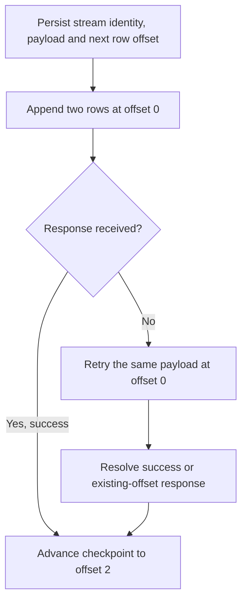

# BigQuery Storage Write API: streams, offsets and commit boundaries

An exactly-once append guarantee needs a defined identity and scope. The Storage Write API can deduplicate appends within an application-created stream when the writer supplies offsets. It does not infer unique order IDs.

## Choose a stream type

| Stream | Visibility | Recovery responsibility |
| --- | --- | --- |
| Default | Rows become available after successful writes | At-least-once writes; business deduplication outside the stream |
| Application-created committed | Immediate after successful appends | Persist stream name, payload and explicit row offsets |
| Pending | Hidden until finalized streams are batch-committed | Coordinate workers, finalize each stream and check commit results |
| Buffered | Controlled through flush offsets | Specialized visibility control; follow the API's semantics |

Rows serialize as supported Protobuf/Arrow messages rather than arbitrary JSON dictionaries. The initial writer schema must match the destination. A network request can succeed while the response is lost, so treat append outcomes as confirmed, rejected or ambiguous.



Offsets count rows, not requests. Appending three rows at offset 0 means the next append starts at 3. `ALREADY_EXISTS` can indicate the earlier append occupied that offset; `OUT_OF_RANGE` can mean there is a gap. Correct interpretation depends on the persisted stream/payload mapping. Do not silently switch streams after a timeout. See [gRPC write semantics](https://docs.cloud.google.com/bigquery/docs/write-api-grpc) and [retry guidance](https://docs.cloud.google.com/bigquery/docs/write-api-best-practices).

## Run a complete default-stream example

Create a disposable dataset in `us-central1`, then this table. The identity needs table write access and access to the BigQuery Storage API. Use ADC, not a credential file committed to the repository.

```sql
CREATE TABLE `YOUR_PROJECT_ID.raw.write_api_lab` (
  order_id STRING, version INT64
);
```

Save as `write_default.py`, install `google-cloud-bigquery-storage` and `protobuf`, and set `WRITE_TABLE` to `projects/YOUR_PROJECT_ID/datasets/raw/tables/write_api_lab`.

```python
import os
from google.cloud import bigquery_storage_v1
from google.cloud.bigquery_storage_v1 import types, writer
from google.protobuf import descriptor_pb2, descriptor_pool, message_factory

file = descriptor_pb2.FileDescriptorProto(
    name="orders.proto", package="lab", syntax="proto2"
)
message = file.message_type.add(name="Order")
message.field.add(name="order_id", number=1, label=1, type=9)
message.field.add(name="version", number=2, label=1, type=3)
pool = descriptor_pool.DescriptorPool()
Order = message_factory.GetMessageClass(
    pool.Add(file).message_types_by_name["Order"]
)
schema = types.ProtoSchema()
Order.DESCRIPTOR.CopyToProto(schema.proto_descriptor)
template = types.AppendRowsRequest(
    write_stream=os.environ["WRITE_TABLE"] + "/streams/_default",
    proto_rows=types.AppendRowsRequest.ProtoData(writer_schema=schema),
)
row = Order(order_id="o1", version=1)
request = types.AppendRowsRequest(
    proto_rows=types.AppendRowsRequest.ProtoData(
        rows=types.ProtoRows(serialized_rows=[row.SerializeToString()])
    )
)
with bigquery_storage_v1.BigQueryWriteClient() as client:
    with writer.AppendRowsStream(client, template) as stream:
        response = stream.send(request).result()
        print(response)
```

Expect one `o1 / 1` row after a successful append. Run it twice and expect two rows. This intentionally demonstrates default-stream semantics rather than falsely claiming business uniqueness. The [official Protobuf example](https://docs.cloud.google.com/bigquery/docs/samples/bigquerystorage-append-rows-raw-proto2) shows a generated-message alternative.

## Pending streams are a separate transaction boundary

For a distributed batch, create pending streams on the destination table. Workers append with their assigned offsets. The coordinator finalizes all successful streams, then calls `BatchCommitWriteStreams` and checks its per-stream errors. Rows remain invisible before commit. A worker failing does not magically roll back already-created resources, and a coordinator must not publish a partial batch because only some workers finished. This is not a transaction across arbitrary tables or external systems. See [pending-stream batch loading](https://docs.cloud.google.com/bigquery/docs/write-api-batch-load).

Schema changes, serialization errors, quotas and backpressure still matter. Validate row errors, reuse connections, bound in-flight bytes and reconcile acknowledged records with the destination. Cost depends on current ingestion pricing and workload, not a permanent percentage discount versus `insertAll`.

## Recall and failure drill

1. A request with five rows starts at offset 10. What is the next offset?
2. Would using offset 10 in a new stream deduplicate the old stream's rows?
3. Why can two distinct messages for order o1 still produce two rows?

??? note "Answers"
    1. 15.
    2. No. The offset is scoped to its stream.
    3. Append uniqueness and entity/event uniqueness are different contracts. Use a business event key or version-aware current-state transformation.

Drop the dedicated lab table after inspection. Retain stream/checkpoint evidence when testing ambiguous failures in a larger lab.

| Previous Lesson | Curriculum | Next Lesson |
| :--- | :---: | ---: |
| [0010: Partitioning, Clustering & Indexes](0010-partitioning-clustering-search-indexes.md) | [All Lessons (Index)](index.md) | [0012: Materialized Views & BI Engine](0012-materialized-views-bi-engine.md) |
