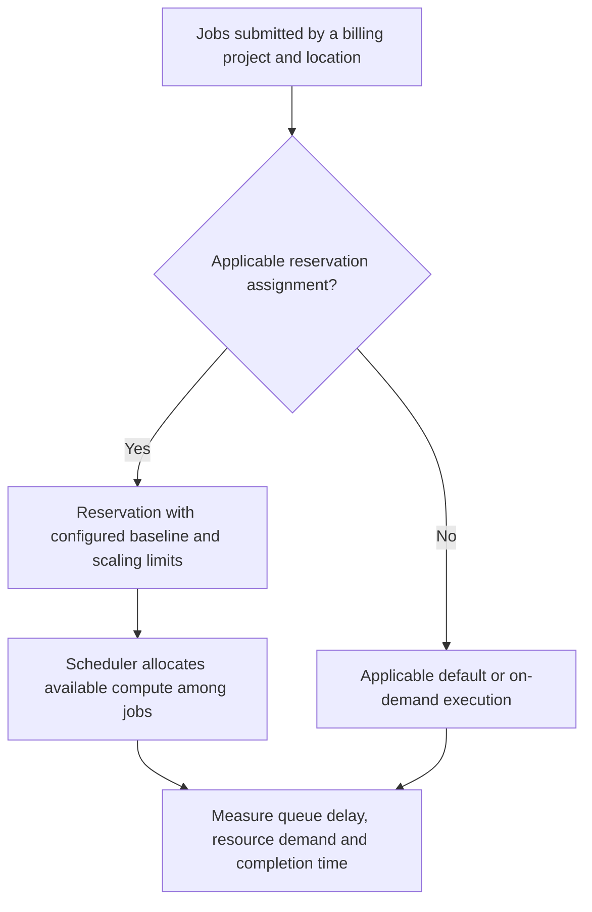

# BigQuery slots, reservations and capacity planning

Select a billing and workload-isolation model from measured demand. There is no universal monthly-byte threshold that makes capacity pricing cheaper.

## On-demand and capacity pricing measure different things

On-demand analysis bills eligible bytes processed under the applicable pricing rules. Capacity pricing bills slot capacity under the selected edition and scaling/commitment model. Storage and ingestion remain separate. Filtering fewer columns and partitions can benefit either model, but fewer scanned bytes does not translate directly into the same dollar saving under both.



A reservation organizes capacity. An assignment routes supported job types from a project, folder or organization. A capacity commitment is a purchase agreement; it is not the same resource as a reservation or assignment. Idle sharing, autoscaling and edition/location compatibility affect the capacity a reservation can use. Review current [workload management](https://docs.cloud.google.com/bigquery/docs/reservations-workload-management) before assuming a fixed maximum is always available.

## Provision without guessed command groups

In a sandbox administration project, use **BigQuery → Capacity management** to select a location and edition, create a reservation and inspect its baseline, maximum and scaling mode. Assign only the intended workload project and job type. Record the configuration and remove it after the exercise; idle capacity can still cost money.

For CLI automation, use the supported `bq mk --reservation` and assignment commands in [reservation tasks](https://docs.cloud.google.com/bigquery/docs/reservations-tasks). Check the chosen scaling mode's interpretation of baseline, maximum slots and autoscale headroom. A `gcloud bigquery reservations` command copied from another service is not a substitute for documented tooling.

Feature availability changes by edition. Verify requirements for security, continuous processing and disaster recovery in the current edition matrix instead of assuming all encryption or compliance is exclusive to the highest tier.

## Query actual demand and waiting

Run in the workload's region. You need project-wide job-list permission for this view:

```sql
SELECT job_id, reservation_id,
       TIMESTAMP_DIFF(start_time, creation_time, MILLISECOND) AS queue_ms,
       TIMESTAMP_DIFF(end_time, start_time, MILLISECOND) AS run_ms,
       total_slot_ms,
       SAFE_DIVIDE(total_slot_ms,
         TIMESTAMP_DIFF(end_time, start_time, MILLISECOND)) AS average_slots
FROM `region-us-central1`.INFORMATION_SCHEMA.JOBS_BY_PROJECT
WHERE creation_time >= TIMESTAMP_SUB(CURRENT_TIMESTAMP(), INTERVAL 1 DAY)
  AND job_type = 'QUERY' AND state = 'DONE'
  AND (statement_type IS NULL OR statement_type != 'SCRIPT')
ORDER BY queue_ms DESC;
```

A job consuming 300,000 slot-ms over 5,000 ms averages 60 slots. Ten overlapping jobs with similar demand suggest much more concurrent capacity than ten jobs spread across an hour. An average over a whole day hides this peak. Use per-second [JOBS_TIMELINE](https://docs.cloud.google.com/bigquery/docs/information-schema-jobs-timeline) and [reservation timelines](https://docs.cloud.google.com/bigquery/docs/information-schema-reservation-timeline) for time-aligned usage and runnable demand.

Queue delay does not always mean too few slots. Inspect concurrency settings, workload priority, quotas and job errors. A long-running single hot stage may need query changes. Borrowed or autoscaled usage also means observed usage is not necessarily equal to baseline capacity.

## Worked cost comparison

Use hypothetical local rates: analysis costs 5 units/TiB; capacity costs 0.05 units/slot-hour. A workload scanning 100 TiB costs 500 analysis units. A 100-slot baseline for 720 hours costs 3,600 units before autoscaling, so it is not cheaper merely because the table is large. At 1,000 TiB, analysis is 5,000 units, but capacity must still satisfy peak latency and isolation requirements. Substitute actual regional prices and measured scaling history.

## Recall and workload exercise

Create a schedule with a heavy nightly transformation and daytime BI. Compare one shared reservation with two isolated reservations. Describe when idle sharing is useful and when it risks unpredictable completion. Use a replayed representative workload, not a production traffic spike, to measure queue and completion percentiles.

??? note "Answers to the design questions"
    Isolation protects one workload from another's demand. Sharing improves utilization when peaks differ. A commitment changes purchasing terms, not query correctness. Capacity planning needs peak overlap, query efficiency, scaling behavior and a completion SLO.

| Previous Lesson | Curriculum | Next Lesson |
| :--- | :---: | ---: |
| [0012: Materialized Views & BI Engine](0012-materialized-views-bi-engine.md) | [All Lessons (Index)](index.md) | [0014: Apache Beam Fundamentals](0014-apache-beam-fundamentals.md) |
