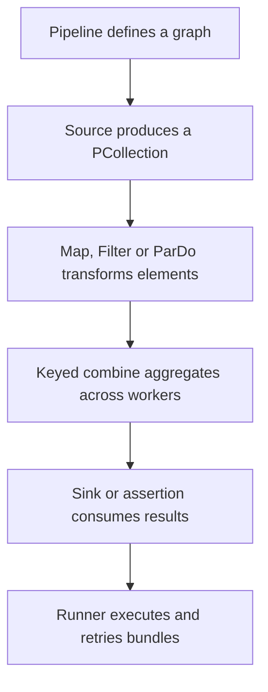

# Apache Beam fundamentals: pipelines, collections and transforms

Build a bounded pipeline locally before deploying its computation to Dataflow. The same logical model covers streaming, but runner support and I/O semantics still need verification.

## Describe a graph; let the runner execute it



A `PCollection` is an immutable distributed collection, not an iterable Python list on the driver. A `PTransform` constructs processing steps. `Map` emits one output per input, `FlatMap` can emit many, `Filter` selects records and `ParDo` supports custom `DoFn` behavior and tagged outputs. `Flatten` combines compatible collections; it is different from flattening one element's nested fields.

`GroupByKey` gathers values for a key. `CombinePerKey` can aggregate partial results before a shuffle, reducing transferred data when the operation supports correct merging. A custom combiner must remain correct under different input orders, bundle sizes and merge trees. Floating-point sums need an explicit precision tolerance; use integer minor units for the currency fixture.

## Run and verify a complete Python example

[Download batch_totals.py](../examples/beam/batch_totals.py). It uses an in-memory fixture, so no Google Cloud identity or billing is needed. The example environment pins Beam 2.69.0 and Python 3.11 for repeatability; use a separately validated supported SDK/runtime for production.

```bash
uv run --no-project --python 3.11 --with apache-beam==2.69.0 \
  docs/examples/beam/batch_totals.py
```

```python
import apache_beam as beam
from apache_beam.testing.util import assert_that, equal_to

with beam.Pipeline() as pipeline:
    totals = (
        pipeline
        | "Orders" >> beam.Create([("m1", 2500), ("m1", 4200), ("m2", 1000)])
        | "Positive amounts" >> beam.Filter(lambda item: item[1] >= 0)
        | "Sum cents" >> beam.CombinePerKey(sum)
    )
    assert_that(totals, equal_to([("m1", 6700), ("m2", 1000)]))
```

Successful completion proves these expected totals. It does not prove a cloud connector's IAM, throughput or exactly-once behavior. Change the expected m1 value and verify the assertion fails before restoring it. Assertions compare unordered distributed results rather than relying on incidental output order.

## The equivalent Java graph

[Download the Java project](../examples/beam-java/pom.xml) and [MerchantTotals.java](../examples/beam-java/src/main/java/lessons/MerchantTotals.java). Run `mvn compile exec:java` from `docs/examples/beam-java` with a compatible JDK and Maven. It creates keyed orders, applies `Sum.longsPerKey()` and checks the same result with `PAssert`. The model is the same even though Java uses explicit coders/types and different transform classes.

## Retries constrain user code

A runner can retry a bundle and invoke `process()` again. An external API call inside it can therefore repeat. `setup()` initializes an individual `DoFn` instance; it is not guaranteed to run exactly once per VM. `start_bundle()` and `finish_bundle()` apply to runner-chosen bundles, not business transactions. `teardown()` is best effort and must not hold the only copy of uncommitted output.

Use supported sink connectors or durable idempotency keys for external effects. Route malformed records to a tagged error output with source identity and a reason. Silently ignoring parse errors makes a pipeline look healthy while losing data. Avoid recording raw sensitive payloads in unrestricted logs.

The [Beam programming guide](https://beam.apache.org/documentation/programming-guide/) explains the model and lifecycle. [Pipeline testing](https://beam.apache.org/documentation/pipelines/test-your-pipeline/) covers assertions; [execution behavior](https://beam.apache.org/documentation/runtime/model/) explains retries and bundles.

## Recall and extension

1. Why can you not iterate over `totals` like a driver-side list?
2. Why can `CombinePerKey` move less data than grouping every value?
3. Would retrying a bundle safely retry a credit-card charge?

??? note "Answers"
    1. It describes distributed data evaluated by the runner.
    2. It can combine locally before shuffle and merge partial accumulators.
    3. Only if the charge operation has its own durable idempotency contract.

Extend the fixture with a malformed order and a rejected-record output. Assert accepted totals and rejected count separately. Then read local newline-delimited JSON through `ReadFromText` using an explicit parser. Move to [windowing](0016-beam-windowing-triggers.md) before grouping an unbounded stream.

## Keyed joins and bounded state

`CoGroupByKey` joins several keyed collections by collecting each input's values for a key/window. A missing dimension produces an empty side, and a dimension with two matching values can multiply facts if the consumer blindly emits every combination. Validate the relationship's intended cardinality before constructing output. For unbounded inputs, compatible windows/triggers and a bounded state policy are essential; a global forever-join can retain data indefinitely. A small bounded reference often fits a side input instead, as in lesson 0017.

For a fixture, join orders `[("c1", 2500), ("c2", 4200)]` with tiers `[("c1", "basic")]`. Predict one matched and one unmatched order. Add a second c1 tier and explain why choosing an arbitrary current tier is invalid for historical reporting.

| Previous Lesson | Curriculum | Next Lesson |
| :--- | :---: | ---: |
| [0013: Slot Management & Editions](0013-bigquery-slot-management-editions.md) | [All Lessons (Index)](index.md) | [0015: Event Time & Watermarks](0015-beam-event-time-watermarks.md) |
