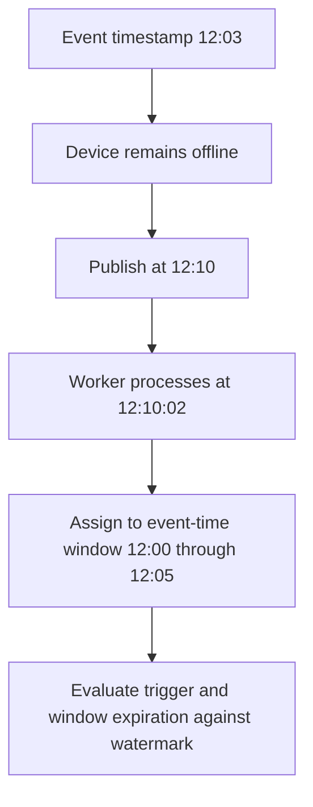

# Event time, processing time, watermarks and late data

Business metrics need an explicit time model. A sale's event timestamp, the time Pub/Sub receives it and the time a worker processes it can differ.

## Follow one delayed event

An event occurs at 12:03 on a mobile device. The device reconnects at 12:10 and the worker processes it at 12:10:02. Its event time is 12:03, its ingestion time is around 12:10, and its processing time depends on when each transform handles it. Keep these fields separate.



A watermark estimates progress through event time. It is not a guarantee that no older event can ever arrive, nor is it the worker wall clock. A downstream watermark also depends on upstream progress and pending work. One stalled input/key can hold back progress even when many workers are idle.

## Lateness belongs to a window's lifetime

For a five-minute window `[12:00,12:05)`, an event timestamped 12:03 belongs to that window even if it arrives later. Once the watermark passes 12:05, the on-time firing can occur. With ten minutes of allowed lateness, the window can retain relevant state until its expiration near watermark 12:15. Trigger configuration determines whether/when retained late data produces another pane.

| Watermark when the 12:03 event is handled | Interpretation in this example |
| --- | --- |
| 12:04 | Window has not reached its end |
| 12:08 | Past window end but within retained lateness |
| 12:16 | Window expired for this aggregation |

These are watermark values, not wall-clock arrival deadlines. Allowed lateness alone does not automatically provide a quarantine output for expired events. Retain raw events before a dropping aggregation and define a separate correction/reconciliation path for data outside the streaming contract. See [Beam windowing and watermarks](https://beam.apache.org/documentation/programming-guide/#windowing).

## Assign event time intentionally

```python
import json
import apache_beam as beam

def timestamp_order(raw):
    row = json.loads(raw)
    if not isinstance(row["event_epoch_ms"], int):
        raise ValueError("event_epoch_ms must be integer milliseconds")
    return beam.window.TimestampedValue(row, row["event_epoch_ms"] / 1000.0)
```

Apply this through `beam.Map` after a Pub/Sub source and route validation failures through an explicit error transform in a real pipeline. Check plausible timestamp ranges as well as types: seconds mistaken for milliseconds can place data decades away. When using Pub/Sub timestamp attributes, configure the source consistently; payload timestamp reassignment does not automatically make the source's watermark policy aware of arbitrary delayed payload timestamps.

## Reproduce time progression locally

Use [late_panes.py](../examples/beam/late_panes.py), introduced fully in [lesson 0016](0016-beam-windowing-triggers.md). `TestStream` adds timestamped events and explicitly advances watermarks. It tests event-time behavior without sleeping or assuming a live system advances on schedule.

```bash
uv run --no-project --python 3.11 --with apache-beam==2.69.0 \
  docs/examples/beam/late_panes.py
```

The fixture emits a total of 10 at the on-time firing, then 30 after a retained late event adds 20. A later event after window expiration contributes nothing to that aggregation. Those expected values make the policy observable.

## Diagnose freshness rather than memorize a healthy lag

Rising watermark age can reflect source backlog, slow I/O, a hot key or a stalled transform. Compare source arrival rate, processing throughput, source backlog, event timestamps and sink freshness. There is no universal healthy 2–15 second lag for all pipelines. A source carrying intentionally old timestamps may be behaving correctly while producing large event-time age.

## Recall and experiment

1. Does five minutes of allowed lateness mean "accept until five wall-clock minutes after the event arrives"?
2. Does assigning event timestamps itself deduplicate events?
3. Change the test's late event timestamp into the next window. What should happen?

??? note "Answers"
    1. No. Expiration is related to window end and watermark progress.
    2. No. Time assignment and event identity are independent.
    3. It contributes to its own window. Expected output needs that window's identity rather than treating every emitted total as one business result.

| Previous Lesson | Curriculum | Next Lesson |
| :--- | :---: | ---: |
| [0014: Apache Beam Fundamentals](0014-apache-beam-fundamentals.md) | [All Lessons (Index)](index.md) | [0016: Advanced Windowing & Triggers](0016-beam-windowing-triggers.md) |
