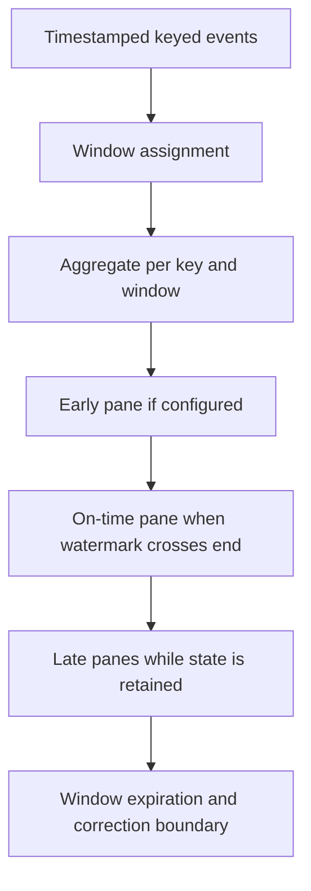

# Beam windows, triggers and emitted panes

Window assignment answers which aggregation an event belongs to. A trigger answers when that aggregation emits a result. The emitted result is a pane; one window can emit several panes.

## Work through the window choices

| Window | Assignment | Example and trade-off |
| --- | --- | --- |
| Fixed | Non-overlapping intervals | Five-minute revenue; aligned boundaries simplify replacement |
| Sliding | Overlapping intervals of width and period | Ten-minute totals every two minutes; one event contributes to several windows |
| Session | Per-key windows that merge when activity bridges gaps | User activity separated by an inactivity gap; late events can merge prior sessions |
| Global | One window over all event time | Bounded totals or explicit streaming triggers/state management |

A sliding window of width ten minutes and period two minutes can include one event in five windows. Summing every window as if it represented disjoint revenue overcounts. A session does not have a stable final boundary until its merge/late-data policy has been resolved.



## Accumulating versus discarding changes the sink contract

With values 10 and 20, accumulating panes can emit 10 and then 30. A consumer must replace/select the latest result for that key/window, rather than add both as 40. Discarding panes can emit 10 and then 20; the consumer can sum the deltas if pane delivery itself is safely deduplicated. Neither mode makes an append-only dashboard table correct automatically.

Include key, window start/end, pane metadata and a deliberate publication/revision policy in persisted output. `pane.index` can help describe firings within the job's state, but is not a universal globally durable business revision across unrelated job restarts. A session-merging design needs a way to retract or supersede earlier session outputs. Fixed windows are easier for a first streaming mart.

## Test on-time, retained-late and expired events

[Download late_panes.py](../examples/beam/late_panes.py). This complete example runs with the pinned local environment from lesson 0014:

```python
import apache_beam as beam
from apache_beam.options.pipeline_options import PipelineOptions, StandardOptions
from apache_beam.testing.test_stream import TestStream
from apache_beam.testing.util import assert_that, equal_to
from apache_beam.transforms import trigger, window

events = (TestStream()
    .advance_watermark_to(0)
    .add_elements([window.TimestampedValue(("m1", 10), 1)])
    .advance_watermark_to(60)
    .add_elements([window.TimestampedValue(("m1", 20), 2)])
    .advance_watermark_to(121)
    .add_elements([window.TimestampedValue(("m1", 99), 3)])
    .advance_watermark_to_infinity())
options = PipelineOptions()
options.view_as(StandardOptions).streaming = True
with beam.Pipeline(options=options) as pipeline:
    totals = (pipeline
        | events
        | beam.WindowInto(
            window.FixedWindows(60),
            trigger=trigger.AfterWatermark(late=trigger.AfterCount(1)),
            allowed_lateness=60,
            accumulation_mode=trigger.AccumulationMode.ACCUMULATING)
        | beam.CombinePerKey(sum))
    assert_that(totals, equal_to([("m1", 10), ("m1", 30)]))
```

The first watermark crossing emits 10. The second event belongs to the existing window and adds 20 during retained lateness. At watermark 121, the window ending at 60 is beyond its 60-second lateness allowance. The 99-valued event does not contribute. The assertion intentionally compares all emitted values; production output also needs explicit window/pane identity.

Use `AfterProcessingTime` for speculative updates when wall-clock responsiveness matters, and `AfterCount` for data-count conditions. Triggers can repeat or finish; a finishing trigger can discard later data even while a broader lateness setting suggests state could be retained. Test the full trigger composition. See [triggers](https://beam.apache.org/documentation/programming-guide/#triggers) and [TestStream](https://beam.apache.org/releases/pydoc/current/apache_beam.testing.test_stream.html).

## Exercise and answers

Change accumulation mode to discarding and predict emitted values 10 and 20. Then remove the late trigger and observe the actual behavior rather than assuming allowed lateness creates identical outputs. Finally, sketch a table contract for fixed-window merchant totals that handles repeated delivery and a controlled backfill.

??? note "Expected design"
    Use merchant and window boundaries as the business aggregation key. Define whether persisted records are deltas or replacements. Carry a publication revision/boundary that remains meaningful during replay, and reconcile against retained raw events before claiming final totals.

## Trace a late session merge

With a ten-minute gap, events for one user at minutes 0 and 18 initially form separate sessions. An event at minute 9 can bridge the first interval ending at 10 and the second interval starting at 18, producing one merged session spanning through minute 28 under the session assignment. If earlier results were already published, appending a third session row leaves stale sessions visible. Test merge/retraction or supersession behavior explicitly before using session results as an accumulating business table.

| Previous Lesson | Curriculum | Next Lesson |
| :--- | :---: | ---: |
| [0015: Event Time & Watermarks](0015-beam-event-time-watermarks.md) | [All Lessons (Index)](index.md) | [0017: Stateful Processing & Side Inputs](0017-beam-stateful-processing-side-inputs.md) |
