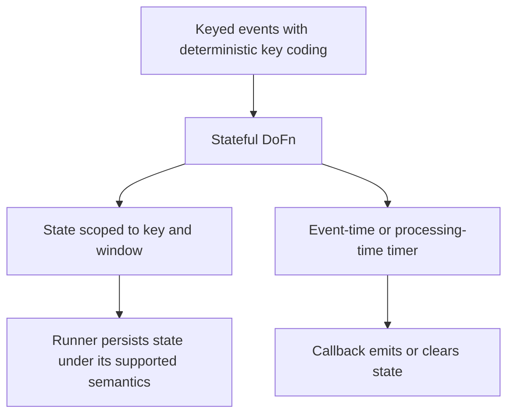

# Beam keyed state, timers, side inputs and schemas

Stateful processing stores information between elements. It needs an explicit scope and a bounded lifetime; a Python instance variable is not distributed state.

## State belongs to a key and window



Two keys cannot read each other's state. Two fixed windows for one key also have separate state. Runner storage and supported state types vary; Java `ValueState` is not a Python `ValueStateSpec` import. Python provides `ReadModifyWriteStateSpec`, `BagStateSpec` and other supported specs. Stateful transforms require keyed data and deterministic key coders.

## A threshold alert with integer money

This Python transform emits once when a merchant's total first reaches 100,000 cents within a fixed window. It assumes input events have already been deduplicated; summing state does not perform deduplication.

```python
import apache_beam as beam
from apache_beam.coders import VarIntCoder
from apache_beam.transforms.timeutil import TimeDomain
from apache_beam.transforms.userstate import ReadModifyWriteStateSpec, TimerSpec, on_timer

class Threshold(beam.DoFn):
    TOTAL = ReadModifyWriteStateSpec("total", VarIntCoder())
    SENT = ReadModifyWriteStateSpec("sent", VarIntCoder())
    EXPIRE = TimerSpec("expire", TimeDomain.WATERMARK)

    def process(self, item, window=beam.DoFn.WindowParam,
                total=beam.DoFn.StateParam(TOTAL),
                sent=beam.DoFn.StateParam(SENT),
                timer=beam.DoFn.TimerParam(EXPIRE)):
        key, cents = item
        updated = (total.read() or 0) + cents
        total.write(updated)
        timer.set(window.end)
        if updated >= 100000 and not sent.read():
            sent.write(1)
            yield key, updated

    @on_timer(EXPIRE)
    def expire(self, total=beam.DoFn.StateParam(TOTAL),
               sent=beam.DoFn.StateParam(SENT)):
        total.clear()
        sent.clear()
```

Apply after `WindowInto(FixedWindows(3600), allowed_lateness=0)` to keyed integer-cent events with an explicit tuple type. If values 60,000, 50,000 and 10,000 are processed in that order for one key/hour, expect one alert at 110,000 and no second alert at 120,000. Beam does not generally guarantee element order: another ordering can change the observed crossing total. It must still produce one alert for that key/window. An event in the next hour uses separate state. For late corrections, redesign timer/expiration behavior rather than adding allowed lateness while clearing state at the old window end.

[Download threshold.py](../examples/beam/threshold.py) for the complete local TestStream fixture with two keys and two windows. Run it with the same pinned environment as lesson 0014. It asserts three alerts and advances the watermark to exercise timer cleanup.

An event-time timer follows watermark progress. Setting it using `Timestamp.now()` confuses processing time with event time. A processing-time inactivity timer follows a different contract. Neither timer guarantees an external alert is delivered exactly once after retries. Use a durable alert identity and idempotent sink.

## Side inputs are reference data with a time policy

A side input supplies an auxiliary view, such as a small currency-rate map:

```python
rates = pipeline | "Rates" >> beam.Create([("USD", 100), ("EUR", 108)])
orders = pipeline | "Orders" >> beam.Create([("o1", "EUR", 2500)])
converted = orders | "Convert" >> beam.Map(
    lambda row, lookup: (row[0], row[2] * lookup[row[1]] // 100),
    lookup=beam.pvalue.AsDict(rates),
)
```

Expect `o1 / 2700` cents under this fixture's rounding rule. Do not silently use rate 1 for an unknown currency. A bounded file read happens once; it is not periodic reference refresh. A changing reference table needs an explicit refresh/window mapping policy. Event-time historical pricing may require an as-of join rather than whichever rates a worker most recently saw.

Keep reference data small relative to worker memory and access behavior. A universal 500 MB cutoff ignores decoded size and concurrent state. For large joins, compare distributed keyed joins, precomputed enrichment, a supported enrichment transform or bounded/cache-aware external lookups.

## Schemas make element structure explicit

`beam.Row(order_id="o1", amount_cents=2500)` is schema-aware, unlike an untyped positional tuple. Typed named tuples and schema-aware transforms can document fields and support portable operations. A schema does not prove business-key uniqueness, valid currency or deterministic source versions. Validate those separately.

## Recall and testing challenge

Use `TestStream` to drive the threshold across two keys and two windows. Assert no cross-key/window leakage, one alert per supported scope and correct behavior when the watermark advances. Then insert a duplicate event and explain why deduplication is needed before the total.

??? note "Answers"
    State scope is key plus window. Timer domain determines which clock advances it. A side input's refresh policy determines reference correctness. An external alert needs its own delivery identity even when runner state is consistent.

Sources: [state and timers](https://beam.apache.org/documentation/programming-guide/#state-and-timers), [side inputs](https://beam.apache.org/documentation/programming-guide/#side-inputs), and [schemas](https://beam.apache.org/documentation/programming-guide/#schemas).

| Previous Lesson | Curriculum | Next Lesson |
| :--- | :---: | ---: |
| [0016: Advanced Windowing & Triggers](0016-beam-windowing-triggers.md) | [All Lessons (Index)](index.md) | [0018: Dataflow Execution Internals](0018-dataflow-execution-internals.md) |
