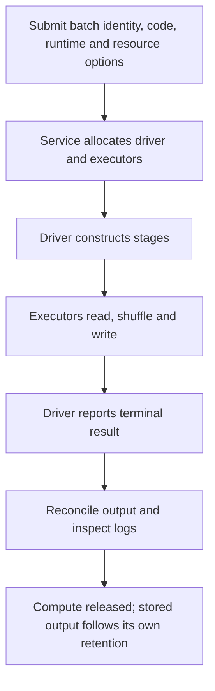

# Serverless Spark batches: runtime, resources and networking

Google's Managed Service for Apache Spark includes serverless execution formerly called Dataproc Serverless. The CLI and API can still use `dataproc`. Serverless removes cluster lifecycle management; it does not remove Spark resource planning, dependency compatibility or output correctness.

## Follow a batch's lifecycle



A batch runs one submitted workload. Interactive sessions have a different lifecycle and idle-resource considerations. Autoscaling changes executors within supported settings. A single hot key or an oversized driver result cannot be fixed by unlimited executor scaling.

## Submit a measured workload

Prerequisites: enabled Dataproc APIs, a supported runtime in your region, a subnet with required internal connectivity and Google API access, and a workload service account authorized for source/sink data. Your submitter needs permission to act as that service account. Select a supported runtime from [runtime versions](https://docs.cloud.google.com/managed-spark/docs/concepts/versions/serverless-versions); do not inherit an obsolete version silently.

Upload a self-contained Spark script, such as the fixture adapted from lesson 0004, to the code bucket. Set the values below explicitly:

```bash
export SPARK_RUNTIME="REPLACE_WITH_SUPPORTED_TESTED_RUNTIME"
export SPARK_BATCH_ID="orders-lab-001"
gcloud dataproc batches submit pyspark gs://YOUR_BUCKET/jobs/orders.py \
  --project="$PROJECT_ID" --region=us-central1 \
  --batch="$SPARK_BATCH_ID" --version="$SPARK_RUNTIME" \
  --service-account="spark-lab@${PROJECT_ID}.iam.gserviceaccount.com" \
  --subnet="projects/${PROJECT_ID}/regions/us-central1/subnetworks/data-subnet" \
  --properties=spark.dynamicAllocation.maxExecutors=10
gcloud dataproc batches describe "$SPARK_BATCH_ID" --region=us-central1
```

Record the batch ID before submission. After a transport timeout, retrieve that identity rather than blindly launching an append workload again. A definitively failed batch needs a deliberate new attempt and safe output semantics. Check terminal state and destination contents. See [batch submission](https://docs.cloud.google.com/managed-spark/docs/quickstarts/spark-batch).

## Size driver, executors and network together

Resource properties have supported CPU/memory ratios and runtime-specific limits. Set allocation properties at submission time; changing them after `SparkSession` starts cannot recreate the container. Network planning must account for driver/executor addresses, subnet capacity, DNS, firewall rules, Google APIs and dependency artifacts. A private subnet without the required API path can fail before your first transformation.

For 1 TiB of shuffle data and a starting target of 128 MiB per partition, estimate roughly 8,192 partitions. This is a starting measurement hypothesis, not a required Spark setting: skew, compression, AQE and task duration change the right count. Watch spill, executor memory, task distribution and total cost. See [Spark properties](https://docs.cloud.google.com/managed-spark/docs/concepts/spark-properties-serverless).

## Package dependencies using the supported contract

A custom container supplies compatible user libraries. The service supplies runtime components according to its documented contract. Do not invent a `gcr.io/dataproc-serverless/spark:latest` base image or bundle incompatible Spark/Java versions into an image. Follow the [custom-container guide](https://docs.cloud.google.com/managed-spark/docs/guides/custom-containers), including required utilities, user identity, Python environment and runtime compatibility. Pin image digests and dependencies after validating them.

Choose managed clusters when you need supported cluster-level customization or several coordinated frameworks. Choose serverless batches when independent Spark workloads fit its runtime/network constraints. Compare measured startup, complete runtime, idle cost and operating effort; fixed claims that serverless always starts in 10–30 seconds are not a planning guarantee.

## Recall and failure exercise

1. Why can a batch fail before creating executors?
2. Why can a successful batch still duplicate an output table?
3. What should you inspect before increasing executor memory?

??? note "Answers"
    1. IAM, artifact access, runtime availability, subnet/network or quota can block provisioning.
    2. Another attempt can append the same data under a new batch identity.
    3. Identify driver versus executor failure, heap versus overhead pressure, spill and skew. Follow supported allocation ratios instead of changing unrelated memory settings.

Run a sandbox batch twice against a staged output, prove its publication is repeatable, and delete only the dedicated artifacts after preserving logs and measurements.

| Previous Lesson | Curriculum | Next Lesson |
| :--- | :---: | ---: |
| [0020: Cloud Dataproc Architecture](0020-dataproc-architecture-ephemeral-clusters.md) | [All Lessons (Index)](index.md) | [0022: PySpark BigQuery Connector](0022-pyspark-bigquery-connector.md) |
