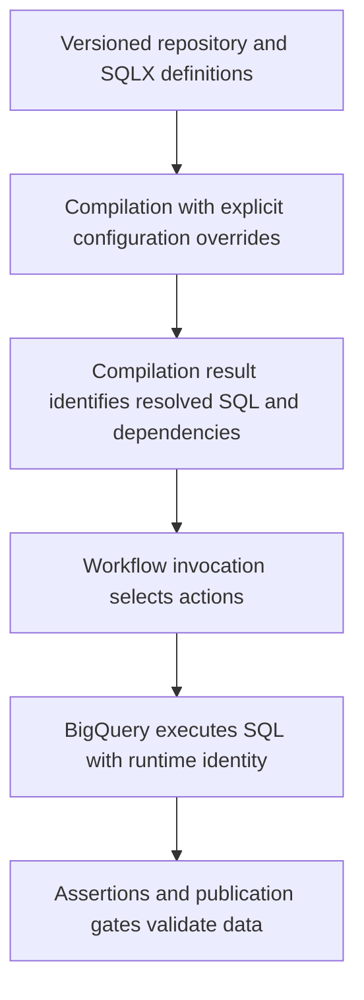

# Dataform foundations: compilation, execution and environments

Dataform compiles SQLX and JavaScript into a dependency graph, then submits SQL to BigQuery. Compilation success and data correctness are separate milestones.

## Follow one source revision through execution



A repository contains workflow code. A workspace provides a development checkout. A compilation result captures compiled definitions and configuration. A release configuration determines a repeatable release source/configuration; a workflow configuration schedules/selects execution. A workflow invocation runs a selected compiled graph.

Compilation resolves syntax, references and dependencies. It does not prove that a source table exists, that runtime IAM is sufficient, or that a query returns unique business keys. BigQuery dry runs and actual sandbox executions check different boundaries.

## Correct workflow settings

For a project using Dataform Core 3, place this at the repository root as `workflow_settings.yaml`. Pin a Core version supported and tested by your project; 3.0.0 is the version used for this teaching fixture.

```yaml
dataformCoreVersion: 3.0.0
defaultProject: YOUR_PROJECT_ID
defaultDataset: analytics_dev
defaultLocation: us-central1
defaultAssertionDataset: analytics_assertions_dev
vars:
  execution_date: "2026-10-28"
```

`vars` belongs at the top level here. It is not nested inside an invented `projectConfig` property. Refer to a variable in SQLX through `dataform.projectConfig.vars.execution_date`. Compilation variables are strings used to generate SQL, not an automatically advancing runtime checkpoint. See [repository settings](https://docs.cloud.google.com/dataform/docs/manage-repository).

## Make a minimal dependency graph

Create `definitions/orders.sqlx`:

```sql
config { type: "table" }
SELECT 101 AS order_id, 2500 AS amount_cents
```

Create `definitions/order_total.sqlx`:

```sql
config { type: "table" }
SELECT SUM(amount_cents) AS amount_cents FROM ${ref("orders")}
```

Compile from the repository directory with the matching CLI:

```bash
npx -y @dataform/cli@3.0.0 compile .
```

Expect a graph where `order_total` depends on `orders`. Execute it in a disposable BigQuery dataset through the managed Dataform workspace. Expect one total of 2500. Rename `orders` without updating the reference and confirm compilation catches the unresolved dependency. See [the CLI guide](https://docs.cloud.google.com/dataform/docs/use-dataform-cli).

## Isolate development deliberately

Configure project, schema suffix and table prefixes through compilation overrides. A workspace does not automatically guarantee a separate target dataset. An explicit project/schema in a definition can also defeat a default override. Inspect all compiled write destinations before a developer or CI run.

Separate the developer/compiler identity from the workflow service account. The runtime account needs permission to create jobs and read/write the selected datasets. Declarations describe externally managed objects; they do not grant access or create those objects. Managed service-agent and act-as requirements must match the repository's authentication configuration.

For production, record the source commit, compilation-result name, overrides, selected actions and invocation ID. An API path ending in `compilationResults/latest` is not an assumed substitute for the actual generated resource name. A release should execute the compilation you reviewed. See [compilation configuration](https://docs.cloud.google.com/dataform/docs/configure-compilation).

## Recall and exercise

1. Which engine performs the aggregation?
2. Why can a compiled graph still fail in production?
3. Which evidence proves a development run cannot overwrite a mart?

??? note "Answers"
    1. BigQuery, using its execution resources.
    2. Data, permissions, schema compatibility, location or runtime conditions can differ.
    3. Reviewed compiled destinations plus runtime permissions that restrict writes to the intended environment. A workspace name alone is insufficient.

Run the same fixture under two schema suffixes and verify separate tables. Remove only those dedicated sandbox tables/datasets after the exercise. Continue with incremental and assertion behavior in lesson 0025.

| Previous Lesson | Curriculum | Next Lesson |
| :--- | :---: | ---: |
| [0023: Spark Optimization on GCP](0023-spark-optimization-memory-tuning-gcp.md) | [All Lessons (Index)](index.md) | [0025: Writing Dataform SQLX & Assertions](0025-writing-dataform-sqlx-assertions.md) |
