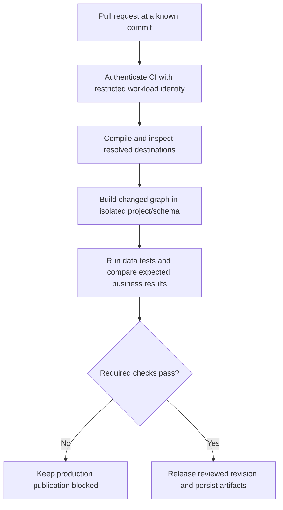

# CI/CD for SQL transformations: isolation, state and release evidence

A transformation release must demonstrate that changed logic compiles, runs on representative data, passes assertions and writes only to its intended environment. Syntax checks alone cannot prove those conditions.

## Follow one change through its gates



There are several distinct checks. SQLX/Jinja compilation validates generated structure. A BigQuery dry run checks supported SQL and estimates work without actually producing output. Fixture tests prove specific business cases. Integration runs exercise runtime data, IAM and location. Reconciliation verifies a publication boundary. Each catches different failures.

## Make a dbt CI target actually use its sandbox

In `ci/profiles.yml`, configure a target matching the `profile` in `dbt_project.yml`:

```yaml
ecommerce_analytics:
  target: ci
  outputs:
    ci:
      type: bigquery
      method: oauth
      project: "{{ env_var('CI_PROJECT_ID') }}"
      dataset: "{{ env_var('PR_DATASET') }}"
      location: us-central1
      threads: 4
```

An arbitrary `--vars ci_dataset: ...` does not change the target dataset unless project configuration explicitly uses it. Custom schema-generation macros and explicit model databases can also bypass a default. Inspect compiled destinations and restrict CI's write permissions to the sandbox project.

## Slim CI is a state comparison, not a full regression proof

Store the successful production `manifest.json` with its revision. Download that immutable artifact to a directory separate from dbt's writable `target/`. In the authenticated CI shell:

```bash
export DBT_PROFILES_DIR=./ci
export CI_PROJECT_ID=YOUR_CI_PROJECT
export PR_DATASET=ci_pr_123
dbt deps
dbt build --target ci --select state:modified+ \
  --state ./prod_state --defer
```

`state:modified+` selects changed resources and descendants under dbt's state rules. `--defer` can resolve unbuilt upstream references using the retained manifest; the identity still needs read access to those objects. If the manifest is unavailable or incompatible, explicitly run an approved full sandbox build or fail the check. Silently ignoring the missing artifact is not a valid slim build.

State selection may not cover every behavioral impact of package/macro, contract or source changes. Run broader fixtures and scheduled full regression builds where necessary. Include duplicates, NULLs, late updates and deletes in representative tests. See [state selection](https://docs.getdbt.com/reference/node-selection/methods#state) and [deferral](https://docs.getdbt.com/reference/node-selection/defer).

## Authenticate without a long-lived repository key

Configure Workload Identity Federation for the repository and trusted branch/environment. In a GitHub Actions job with the required OIDC permission, an authentication step can use the official action:

```yaml
permissions:
  contents: read
  id-token: write
steps:
  - uses: actions/checkout@v4
  - uses: google-github-actions/auth@v2
    with:
      workload_identity_provider: projects/123456789/locations/global/workloadIdentityPools/ci/providers/github
      service_account: dbt-ci@YOUR_CI_PROJECT.iam.gserviceaccount.com
```

This is an authentication fragment, not an entire runnable workflow. Provision the provider, constrain its issuer/repository/branch attributes, install pinned dbt dependencies and the Cloud CLI before running the shell commands. Pin reviewed action commit SHAs for production. Follow [deployment-pipeline federation](https://docs.cloud.google.com/iam/docs/workload-identity-federation-with-deployment-pipelines).

## Dataform release evidence

Create a compilation result for the exact reviewed revision through the managed UI or supported API. Check compilation errors and resolved destinations, then pass the actual returned resource name to the workflow invocation. Record invocation status and assertion outcomes. Do not invent a `latest` compilation ID or assume compilation executed the SQL. See [Dataform workflow creation](https://docs.cloud.google.com/dataform/docs/quickstart-create-workflow).

## Exercise and completion criteria

Introduce a duplicate order in a CI fixture and require a unique-key test to fail. Prove the production output remains unchanged. Then introduce a model with an explicit production schema and verify destination review or IAM blocks it. A successful release records commit, dependency versions, configuration, test evidence and output boundary.

Set expiration on sandbox data and use a guarded cleanup step tied to the validated project and exact CI dataset name. Never interpolate an unvalidated empty dataset variable into recursive deletion. Rollback must consider data written by the new transformation; reverting Git alone does not reverse a destructive table mutation.

| Previous Lesson | Curriculum | Next Lesson |
| :--- | :---: | ---: |
| [0026: dbt Core with dbt-bigquery](0026-dbt-core-bigquery-models-snapshots.md) | [All Lessons (Index)](index.md) | [0028: Managed Airflow architecture](0028-cloud-composer-architecture-gke.md) |
