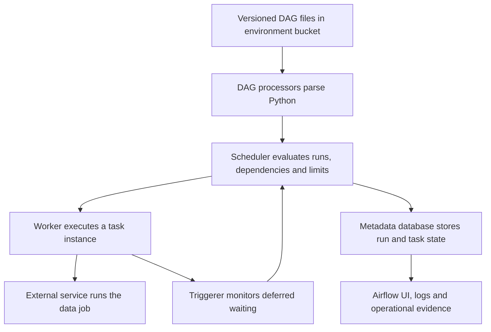

# Managed Airflow architecture and environment boundaries

Google's Managed Service for Apache Airflow was formerly Cloud Composer. Resource APIs and the CLI retain `composer`. Distinguish the managed generation from the Airflow version and Google provider version: those determine different compatibility and operational rules.

## Trace one task through the components



The worker executes the operator's Python; BigQuery or Spark performs the large data operation. A scheduler decides eligibility, not business correctness. A triggerer can monitor asynchronous waits without occupying an ordinary worker slot. Metadata stores small orchestration state and XComs, not your analytical dataset.

Older Composer 2 architecture and today's Gen 3 environment have different tenant/customer-project boundaries and networking/configuration procedures. Do not assume every environment exposes the same GKE cluster or sync implementation. Follow the selected generation's [architecture](https://docs.cloud.google.com/composer/docs/composer-3/environment-architecture).

## Match environment, DAG API and provider

List available images in the actual region:

```bash
gcloud composer image-versions list --location=us-central1
```

Select a supported Gen 3 image compatible with your DAG code and record its Airflow/Python/provider versions. The lab in [0039](0039-managed-airflow-environments-dags.md) targets Airflow 2.11 and includes complete environment creation, identities, fixtures and cleanup. Do not deploy an old `composer-2.8.5-airflow-2.7.3` image merely because an earlier example named it. Airflow 3 introduces API/import and runtime differences that require migration testing.

For an already-created disposable environment, deploy one file using its actual DAG prefix:

```bash
export ENV_NAME=YOUR_LAB_ENVIRONMENT
export DAG_PREFIX="$(gcloud composer environments describe "$ENV_NAME" \
  --location=us-central1 --format='value(config.dagGcsPrefix)')"
gcloud storage cp dags/row_taskflow.py "${DAG_PREFIX}/"
```

Use the downloadable file in lesson 0039. Upload success precedes synchronization and parsing. Verify the expected DAG ID and import errors in Airflow before triggering it. Avoid an unreviewed sync deletion flag against a shared environment bucket. See [DAG management](https://docs.cloud.google.com/composer/docs/composer-3/manage-dags).

## Security and capacity are design choices

A DAG author can execute Python with the environment's workload identity. Write access to its bucket is therefore a powerful permission. Separate environments or identities when workloads need different trust boundaries. Use ADC, supported connections and a secrets backend instead of embedding service-account keys.

Private connectivity needs an actual route/DNS/firewall design to sources, Google APIs and dependency artifacts. "Private IP" alone does not prove that the Airflow web interface is restricted as intended or that packages can be installed. Check the generation-specific network and web-access configuration.

Two schedulers can improve availability where supported, but arbitrary fixed scheduler/triggerer counts are not a universal guarantee. Measure parsing time, heartbeat health, task queue delay, worker saturation, deferred tasks and metadata-database pressure. Set pools and concurrency from downstream capacity. More workers cannot fix an invalid source path or missing table permission.

## Worked capacity example

One hundred tasks each wait 30 minutes for BigQuery. Blocking operators can occupy 100 worker slots while mostly idle. Deferrable operators can release those worker slots during the wait but still need triggerer capacity, startup/completion workers and BigQuery capacity. Deferral changes orchestration resource use; it does not speed the SQL.

## Recall and recovery exercise

1. Why can a healthy environment publish stale data?
2. Does uploading a Python file prove its provider imports work?
3. Which identity needs destination write access?

??? note "Answers"
    1. Correct scheduling does not prove input completeness, query logic or publication success.
    2. No. Parse in a matching environment and run the relevant external-service fixture.
    3. The task's effective runtime/impersonated identity, not merely the human who uploaded the file.

Deploy the tiny DAG from lesson 0039, introduce an import error and find it, then restore it. Separately break a sandbox dataset permission and distinguish runtime failure from parsing failure. Preserve external job IDs when diagnosing a worker loss.

| Previous Lesson | Curriculum | Next Lesson |
| :--- | :---: | ---: |
| [0027: Transformation CI/CD & Testing](0027-transformation-pipelines-cicd.md) | [All Lessons (Index)](index.md) | [0029: Resilient DAGs & Deferrable Operators](0029-resilient-dags-deferrable-operators.md) |
