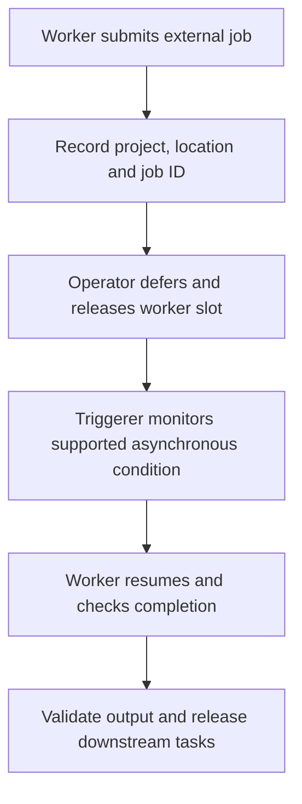

# Resilient Airflow DAGs: intervals, retries and deferrable tasks

Retry safety comes from stable inputs and deliberate external writes. A task retry can run its code again after the remote operation already committed.

## Separate execution from waiting



A rescheduling sensor repeatedly becomes runnable to check a condition. A deferrable operator delegates waiting to a triggerer and later resumes on a worker. Use only operator versions that support the selected mode. Adding `deferrable=True` to an arbitrary class is not a compatibility check. Deferral frees a worker slot; it does not mean a blocked task was previously consuming an entire CPU.

## A runnable local DAG fixture

This Airflow 2.11-style DAG demonstrates a deterministic input and failure classification. Save as `dags/resilient_fixture.py`, then parse/run it in the matching environment from lesson 0039.

```python
from datetime import timedelta
import pendulum
from airflow.decorators import dag, task
from airflow.exceptions import AirflowFailException

@dag(
    dag_id="resilient_fixture", schedule=None, catchup=False,
    start_date=pendulum.datetime(2026, 1, 1, tz="UTC"),
    max_active_runs=1,
    default_args={"retries": 2, "retry_delay": timedelta(minutes=1),
                  "retry_exponential_backoff": True,
                  "execution_timeout": timedelta(minutes=5)},
)
def fixture():
    @task
    def validate():
        cents = [2500, 4200]
        if any(value < 0 for value in cents):
            raise AirflowFailException("Invalid immutable source amount")
        return sum(cents)

    @task
    def verify(total):
        if total != 6700:
            raise AirflowFailException("Reconciliation failed")

    verify(validate())

fixture()
```

Expect success with total 6700. Introduce a negative value and expect validation to fail without spending retries on an immutable invalid payload. Transient I/O exceptions in a real task can use retries/backoff. Distinguish data errors from service outages instead of retrying every failure until it disappears.

## Apply this to warehouse publication

For a scheduled daily DAG, read `data_interval_start` and `data_interval_end`. Use a half-open interval to select the intended business data. Wall-clock `CURRENT_DATE()` can process a different day on retry. `{{ ds }}` alone also does not express the end of every custom interval.

Use the [complete deferrable BigQuery DAG](0039-managed-airflow-environments-dags.md#6-dag-2-wait-load-validate-and-publish-to-bigquery). It replaces a day-specific staging input, validates uniqueness and values, then transactionally replaces one reporting day. The resulting data is repeatable even when a retry submits a new query job. An unsafe append is still unsafe with exponential backoff.

For stable job IDs, inspect the installed provider's `force_rerun` and reattachment behavior. Retrieving a running job differs from discovering an already completed job after a lost response. A task's failed state is not proof that its external write failed. See [BigQuery operators](https://airflow.apache.org/docs/apache-airflow-providers-google/stable/operators/cloud/bigquery.html).

## Bound concurrency and failure visibility

Pools limit access to constrained destinations. `max_active_runs` limits this DAG's overlap; it does not stop a second DAG writing the same table. Task timeouts, sensor timeouts and external-job cancellation are distinct. Verify whether the selected operator cancels remote work when the task dies.

Keep network calls, source discovery and `Variable.get()` lookups out of repeated top-level parsing where possible. Use runtime task code and supported templating. Define cleanup independently from publication: a final successful `all_done` leaf can otherwise hide failed upstream work in the DAG-run status. See [Airflow best practices](https://airflow.apache.org/docs/apache-airflow/2.11.0/best-practices.html).

## Failure drill

In a disposable warehouse DAG, stop a worker after job submission. Before retry, retrieve the external job and inspect its destination. Explain how your implementation avoids duplicate business rows whether the job was running, successful or definitively failed. Confirm downstream publication remains blocked on failed quality checks.

??? note "Expected reasoning"
    Preserve job identity, immutable interval inputs and output scope. Reattach or reconcile ambiguous work. Start a new deliberate attempt only when appropriate, and use idempotent replacement/version-aware mutation. Clearing a task is not a rollback.

| Previous Lesson | Curriculum | Next Lesson |
| :--- | :---: | ---: |
| [0028: Managed Airflow architecture](0028-cloud-composer-architecture-gke.md) | [All Lessons (Index)](index.md) | [0030: Dynamic Task Mapping & XComs](0030-dynamic-task-mapping-airflow-best-practices.md) |
