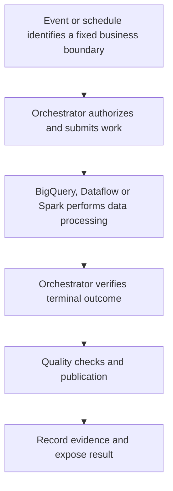

# Workflows versus managed Airflow: choose the orchestration contract

Compare data intervals, execution frequency, dependencies and operational needs before choosing an orchestrator. Neither service is the distributed engine that scans a warehouse table.

## Different units of coordination

| Requirement | Workflows | Managed Airflow |
| --- | --- | --- |
| Model | YAML/JSON steps, branches, API calls and state | Python DAGs, task instances and scheduling |
| Strong fit | Service/API coordination and event-driven executions | Data intervals, historical runs, multi-team dependencies and provider ecosystem |
| Resource lifecycle | Managed executions with step-based billing rules | Provisioned managed environment plus external jobs |
| Waiting | Connector polling/callbacks under documented limits | Blocking, reschedule or supported deferrable operators |
| Recovery | Execution state plus external idempotency contract | DAG/task state plus external idempotency contract |

An event-driven workflow still needs input completeness and deduplication. An hourly Airflow schedule still needs to wait for real upstream completion. Do not choose either service from a fixed startup-latency claim or an outdated monthly minimum price.



## Run a small Workflows example

This workflow performs a parameterized read query. It intentionally makes no table mutation. Save as `verify_day.yaml`. The deployment identity needs workflow-management permissions; the runtime service account needs BigQuery Job User and relevant read access for real source tables.

```yaml
main:
  params: [input]
  steps:
    - query:
        call: googleapis.bigquery.v2.jobs.insert
        args:
          projectId: ${sys.get_env("GOOGLE_CLOUD_PROJECT_ID")}
          body:
            jobReference:
              projectId: ${sys.get_env("GOOGLE_CLOUD_PROJECT_ID")}
              jobId: ${"wf_" + sys.get_env("GOOGLE_CLOUD_WORKFLOW_EXECUTION_ID")}
              location: us-central1
            configuration:
              query:
                query: "SELECT @business_date AS business_date, 1 AS verified"
                useLegacySql: false
                parameterMode: NAMED
                queryParameters:
                  - name: business_date
                    parameterType:
                      type: DATE
                    parameterValue:
                      value: ${input.business_date}
        connector_params:
          timeout: 600
        result: job
    - done:
        return:
          job_id: ${job.jobReference.jobId}
          state: ${job.status.state}
```

```bash
gcloud workflows deploy verify-day --location=us-central1 \
  --source=verify_day.yaml \
  --service-account="workflow-lab@${PROJECT_ID}.iam.gserviceaccount.com"
gcloud workflows run verify-day --location=us-central1 \
  --data='{"business_date":"2026-10-28"}'
```

The BigQuery connector's `jobs.insert` waits for completion under its documented polling behavior unless configured otherwise. Do not add an unnecessary custom polling loop and then assume an incomplete query is success. Expect a successful terminal job and inspect its one-row query result. The [connector reference](https://docs.cloud.google.com/workflows/docs/reference/googleapis/bigquery/v2/jobs/insert) documents timeout and errors.

## Retries need operation-specific rules

Retrying a GET after a transient response is different from retrying a mutation with an unknown outcome. A `jobs.insert` timeout can leave an accepted job running. For writes, persist a stable job identity, resolve existing state and publish repeatably. A workflow restart can repeat earlier external operations even if the first execution stopped later. Backoff reduces load; it does not deduplicate output.

For a nightly pipeline with many dependent tables, historical reruns and Airflow providers, managed Airflow can be a better fit. For a short sequence of authenticated API operations triggered by an event, Workflows can avoid a standing Airflow environment. A hybrid can be appropriate if the ownership, identity and recovery boundary between them is explicit. Avoid making one orchestrator's successful request submission the other's successful data publication signal.

## Recall and exercise

1. Does a 24-hour recurring timer prove upstream data is ready?
2. Does the connector waiting until DONE imply every custom SQL check passed?
3. What changes if this example becomes an append query?

??? note "Answers"
    1. No. Use a completion signal/manifest for the intended boundary.
    2. Inspect operation success and explicit validation; DONE alone can include failure in general job inspection.
    3. Define input identity, job resolution and repeatable output before enabling retries.

Delete `verify-day` after the lab. See [Workflows error handling](https://docs.cloud.google.com/workflows/docs/reference/syntax/catching-errors) and [managed Airflow lab](0039-managed-airflow-environments-dags.md).

| Previous Lesson | Curriculum | Next Lesson |
| :--- | :---: | ---: |
| [0030: Dynamic Task Mapping & XComs](0030-dynamic-task-mapping-airflow-best-practices.md) | [All Lessons (Index)](index.md) | [0032: Governance and data quality](0032-dataplex-architecture-data-quality.md) |
