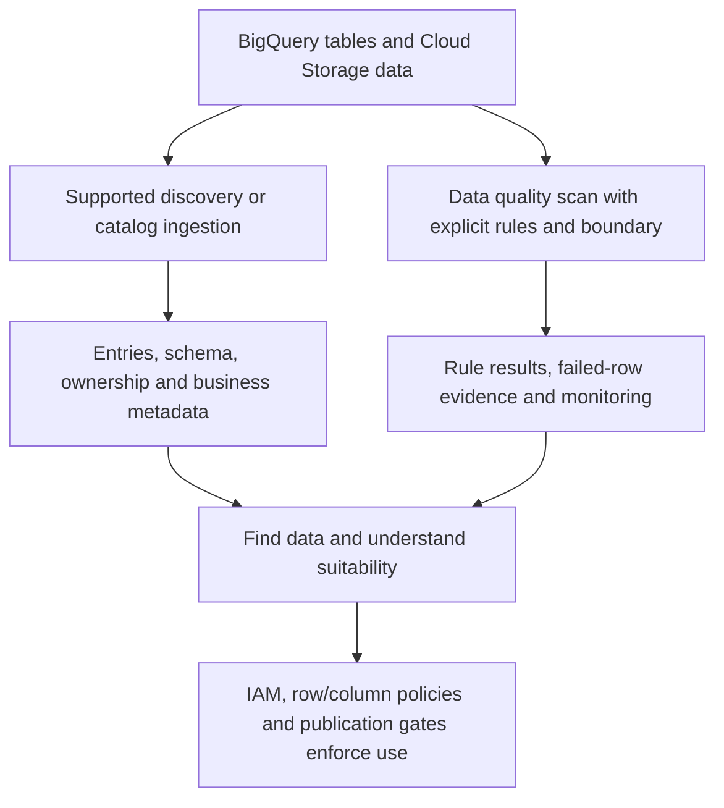

# Data governance catalog, discovery and data quality scans

Google's catalog naming has changed. Knowledge Catalog is the current name for the service formerly called Dataplex Universal Catalog. Existing `dataplex` APIs and configurations remain relevant. Older lake/zone/asset organization and current catalog entries/aspects are distinct concepts; do not treat Data Catalog discovery as today's universal workflow. See the [transition guide](https://docs.cloud.google.com/knowledge-catalog/docs/transition-dataplex-universal-catalog).

## Governance adds context; access control still enforces permission



A catalog entry describes an asset. Aspects attach structured metadata, such as ownership or classification. Discovery can infer technical metadata but cannot decide whether revenue includes tax or whether an order ID is globally unique. Assign an owner, grain, source boundary, freshness requirement and retention policy explicitly.

Where an existing design uses lakes, zones and assets, a lake groups resources and zones organize readiness. That hierarchy does not move data or automatically establish every row/column policy. Governance is not complete because an asset appears in search.

## Create a quality scan with valid rule types

Prerequisites: an existing BigQuery table with `order_id`, `customer_id`, `order_amount`, appropriate scan service-account permissions, and same-location compatibility. Save the following as `orders_quality.yaml`:

```yaml
rules:
  - column: order_id
    dimension: UNIQUENESS
    threshold: 1
    uniquenessExpectation: {}
  - column: customer_id
    dimension: COMPLETENESS
    threshold: 1
    nonNullExpectation: {}
  - column: order_amount
    dimension: VALIDITY
    threshold: 1
    rangeExpectation:
      minValue: "0"
      strictMinEnabled: true
```

```bash
gcloud dataplex datascans create data-quality orders-quality \
  --project="$PROJECT_ID" --location=us-central1 \
  --data-source-resource="//bigquery.googleapis.com/projects/${PROJECT_ID}/datasets/analytics_mart/tables/orders" \
  --data-quality-spec-file=orders_quality.yaml
gcloud dataplex datascans run orders-quality --location=us-central1
```

These rules require unique order IDs, non-null customers and positive amounts. They use `uniquenessExpectation` and `nonNullExpectation`, not invented `unique: true` or `nonNull: true` scan fields. `threshold: 1` means the required passing fraction is 100 percent. Inspect the resulting job and per-rule outcomes; successful scan execution does not itself mean all rules passed. See [quality scans](https://docs.cloud.google.com/knowledge-catalog/docs/use-auto-data-quality) and the [CLI reference](https://docs.cloud.google.com/sdk/gcloud/reference/dataplex/datascans/create/data-quality).

## A sampling example explains the limit

Suppose one duplicate exists among 10 million rows. A small sample can miss it. A passing sampled uniqueness rule is evidence about that sample, not a proof of global primary-key integrity. Choose full scans or targeted complete partitions where correctness requires them. Incremental scans also need a stable incremental field and a policy for late updates; a newly arriving row can have an old business timestamp.

Separate quality dimensions. Non-null checks measure completeness, allowed-value checks measure validity, unique-key checks measure uniqueness, and same-boundary source reconciliation measures consistency/completeness across systems. A row can pass every local rule yet represent a missing shipment because its upstream counterpart never arrived.

## Gate publication explicitly

Schedule scans at an agreed source boundary and export/retain result evidence. A quality scan does not automatically stop Dataform, Airflow or a dashboard refresh. Have the orchestrator inspect required rule outcomes before switching the published result. Keep failed-row evidence in a restricted destination; it can contain sensitive values.

## Exercise and expected results

Create a sandbox fixture with two unique positive orders, run the full scan and record passing results. Add a duplicate ID, a null customer and a negative amount, then predict which rules fail. Verify that the prior published output remains available when the new scan fails. Remove the dedicated scan and fixture after inspection.

??? note "Recall answer"
    Catalog metadata explains what data means. Scans measure selected quality conditions. IAM and data policies authorize access. Publication logic decides when consumers receive a newly validated result. None automatically substitutes for all the others.

| Previous Lesson | Curriculum | Next Lesson |
| :--- | :---: | ---: |
| [0031: Workflows vs Cloud Composer](0031-cloud-workflows-vs-composer.md) | [All Lessons (Index)](index.md) | [0033: Fine-Grained Access Control](0033-fine-grained-access-control-policy-tags-rls.md) |
