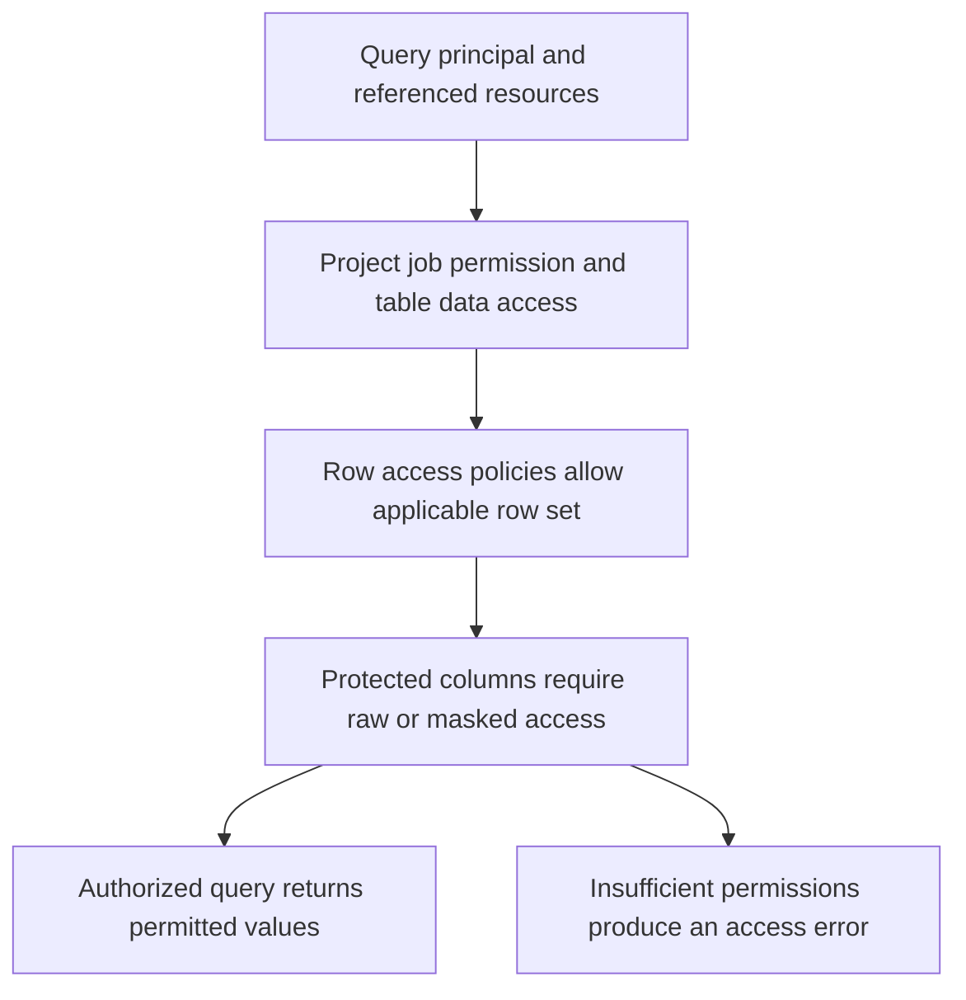

# BigQuery row access, column policies and masking

Effective access is the result of several policies evaluated together. A dataset read grant does not by itself authorize a protected column, and a row policy does not replace basic table access.

## Separate the access decisions



IAM controls which operations an identity can perform at organization, project, dataset and table scopes. Row access policies select rows for their grantees. Column policy tags and BigQuery data policies control protected column access and masking. A raw fine-grained reader and a masked reader are different authorizations. Inspect inherited and group grants when testing them.

## A row-level sandbox example

Create a disposable `security_lab.sales` table with region and amount fields. Replace the example groups with real test identities you administer before applying policies.

```sql
CREATE TABLE `YOUR_PROJECT_ID.security_lab.sales` AS
SELECT 'EMEA' AS region, 2500 AS amount_cents UNION ALL
SELECT 'APAC', 4200;

CREATE ROW ACCESS POLICY emea_sales
ON `YOUR_PROJECT_ID.security_lab.sales`
GRANT TO ('group:emea-analysts@example.com')
FILTER USING (region = 'EMEA');
```

Grant the test analyst ordinary job/table access as well. Its permitted query returns EMEA rows. A principal in several applicable policies receives the union of those allowed row sets. A policy with `FILTER USING (TRUE)` grants all rows to its grantees. A principal without applicable row-policy authorization can receive access denied; do not assert that every unauthorized query silently returns zero rows. See [row policy management](https://docs.cloud.google.com/bigquery/docs/managing-row-level-security).

## Apply column masking through supported policy controls

For the policy-tag path, create a taxonomy/tag in the table's supported location, configure a masking data policy on it and attach the tag to the column through the supported schema editor/API. Assign raw Fine-Grained Reader only to the intended group, and BigQuery Masked Reader to the intended data-policy readers. The schema representation for a tagged field includes:

```json
{
  "name": "email",
  "type": "STRING",
  "mode": "NULLABLE",
  "policyTags": {
    "names": ["projects/PROJECT/locations/LOCATION/taxonomies/TAXONOMY/policyTags/TAG"]
  }
}
```

Use the table schema editor to add that policy tag while preserving all existing fields/options. Do not replace a table's complete schema with this single field accidentally. Configure the data policy through the [masking guide](https://docs.cloud.google.com/bigquery/docs/column-data-masking). BigQuery also supports documented direct data-policy paths; follow their specific syntax and availability. An invented `CREATE MASKING POLICY ... masking_expression` statement is not the BigQuery policy-tag workflow.

## Understand what masking does to analytical meaning

A deterministic hash may preserve equality for joins but reveal repeated values, and a small input domain can be guessed. It is not reversible encryption and not automatically anonymization. A default/null mask can destroy joinability. Masking at query time does not remove raw values from stored data or from identities authorized to read them. If raw PII must never enter the warehouse, transform before loading, as in lesson 0034.

Policy interactions affect supported queries and acceleration. Do not assume a row predicate provides the same partition-pruning benefit as an explicit query predicate. Native views can also provide an authorization boundary, but logical views and materialized replicas have different storage/maintenance behavior. Evaluate the security requirement before optimizing layout.

## Test identities and export paths

Use a raw reader, a masked reader, a row-limited analyst and a principal with no applicable authorization. Execute the same queries under each identity and record returned rows, masked values or errors. Check direct bucket/export access too: protecting one BigQuery table does not secure an independently readable copy.

## Recall and expected reasoning

1. Does Masked Reader automatically override a separate raw-read grant?
2. What happens to a user authorized for both EMEA and APAC row policies?
3. Can a restricted logical view prevent direct access when the user still has raw table access?

??? note "Answers"
    1. Review the effective policy precedence and grants. Test with a principal that has only the intended masked path.
    2. Applicable allow predicates combine to permit both sets.
    3. No. Remove the independent raw access path if the view is the intended boundary.

Sources: [column security](https://docs.cloud.google.com/bigquery/docs/column-level-security-intro), [masking](https://docs.cloud.google.com/bigquery/docs/column-data-masking-intro), and [row-security best practices](https://docs.cloud.google.com/bigquery/docs/best-practices-row-level-security).

| Previous Lesson | Curriculum | Next Lesson |
| :--- | :---: | ---: |
| [0032: Governance and data quality](0032-dataplex-architecture-data-quality.md) | [All Lessons (Index)](index.md) | [0034: Automated PII Masking with Cloud DLP](0034-automated-pii-masking-cloud-dlp.md) |
