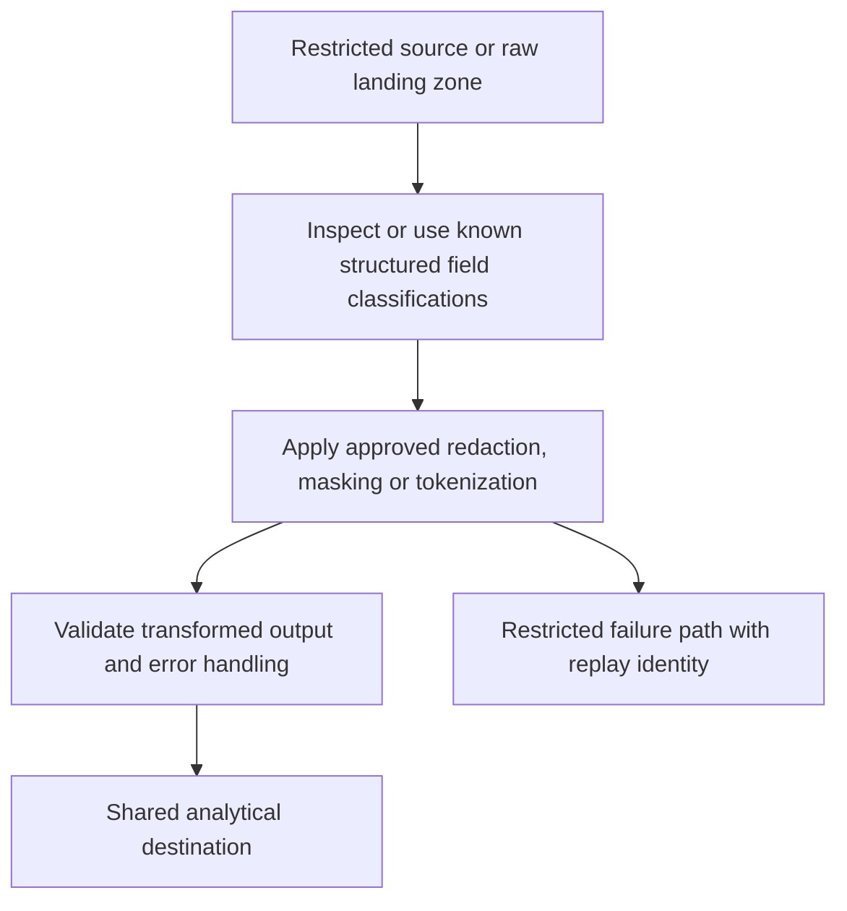

# Sensitive Data Protection: inspection, masking and tokenization

Choose a transformation from the permitted use of the data. Detecting a likely email, hiding an email and issuing a reversible token are different operations.

## Protect the actual storage boundary



Inspection uses built-in/custom infoTypes, likelihood thresholds and context. It can have false positives and false negatives. Structured fields already known to be sensitive can be transformed directly instead of assuming detection will recognize every value. Keep raw payloads and quarantine records restricted; a clean Silver table does not protect an unrestricted Bronze copy.

| Transformation | Preserves | Important limitation |
| --- | --- | --- |
| Replacement/redaction | Usually no original identity | Joins can be lost |
| Character masking | Selected characters/shape | Remaining characters can still identify someone |
| Deterministic tokenization | Equality under a consistent key/context | Pseudonymization; frequency and linkage can remain |
| Bucketing/generalization | Coarser categories | Reduces precision and can still expose rare combinations |

## Run a structured replacement example

Install `google-cloud-dlp`, enable the DLP API in a disposable project and use ADC with the required de-identification permission. Set `PROJECT_ID`. This example sends a known email field as a structured table:

```python
import os
from google.cloud import dlp_v2

client = dlp_v2.DlpServiceClient()
response = client.deidentify_content(request={
    "parent": f"projects/{os.environ['PROJECT_ID']}/locations/global",
    "item": {"table": {
        "headers": [{"name": "customer_id"}, {"name": "email"}],
        "rows": [{"values": [
            {"string_value": "c1"}, {"string_value": "learner@example.com"}
        ]}],
    }},
    "deidentify_config": {"record_transformations": {
        "field_transformations": [{
            "fields": [{"name": "email"}],
            "primitive_transformation": {"replace_config": {
                "new_value": {"string_value": "[REDACTED]"}
            }},
        }],
    }},
})
values = response.item.table.rows[0].values
assert values[0].string_value == "c1"
assert values[1].string_value == "[REDACTED]"
print(values[0].string_value, values[1].string_value)
```

Expect `c1 [REDACTED]`. `record_transformations` requires a table-shaped item. Passing an arbitrary decoded Python event dictionary to a text-oriented Beam DLP transform does not provide that shape automatically. Build an adapter and test accepted/rejected schemas. See [structured de-identification](https://docs.cloud.google.com/sensitive-data-protection/docs/deidentify-sensitive-data).

## Reversible deterministic tokens need a key lifecycle

Deterministic encryption can use a cryptographic data key wrapped by Cloud KMS. KMS protects the wrapping key; a KMS resource name alone is not the raw tokenization key. Generate and wrap a suitable key using the documented procedure, store the wrapped value/template securely and grant the required cryptographic permissions to the effective runtime identity. A fabricated `CiQA8x...` string is not a working wrapped key.

The same plaintext produces comparable tokens only when key material, context and transformation settings agree. Key rotation changes join behavior unless you plan migration/re-tokenization or preserve versions. Re-identification requires a controlled authorized path. Pseudonymized data may still be personal data; evaluate linkage and rare-value exposure rather than claiming anonymity. See [tokenization and re-identification](https://docs.cloud.google.com/sensitive-data-protection/docs/inspect-sensitive-text-de-identify) and [transformation semantics](https://docs.cloud.google.com/sensitive-data-protection/docs/transformations-reference).

## Put RPCs into a pipeline deliberately

One API call per event can hit quotas and dominate latency. Batch within request size limits, bound concurrency, reuse clients and handle retryable errors separately from invalid payloads. Repeated de-identification can repeat charges, even when output is deterministic. Log counts, errors and transformation revision without logging raw sensitive fields. Choose regional processing/residency settings that match your requirements; `global` is merely the small lab's choice.

## Recall and failure exercise

Add a second structured row and prove both emails are replaced while IDs remain intact. Then add an unrecognized sensitive field and explain why the configured transformation leaves it unchanged. Test unknown fields and failures before allowing output to enter a shared destination.

??? note "Expected reasoning"
    Replacement acts on selected fields, not every sensitive byte automatically. Detection needs validation. Token equality depends on stable cryptographic context. Query-time masking and pre-storage de-identification protect different boundaries.

| Previous Lesson | Curriculum | Next Lesson |
| :--- | :---: | ---: |
| [0033: Fine-Grained Access Control](0033-fine-grained-access-control-policy-tags-rls.md) | [All Lessons (Index)](index.md) | [0035: End-to-End Pipeline Observability](0035-pipeline-observability-lineage.md) |
