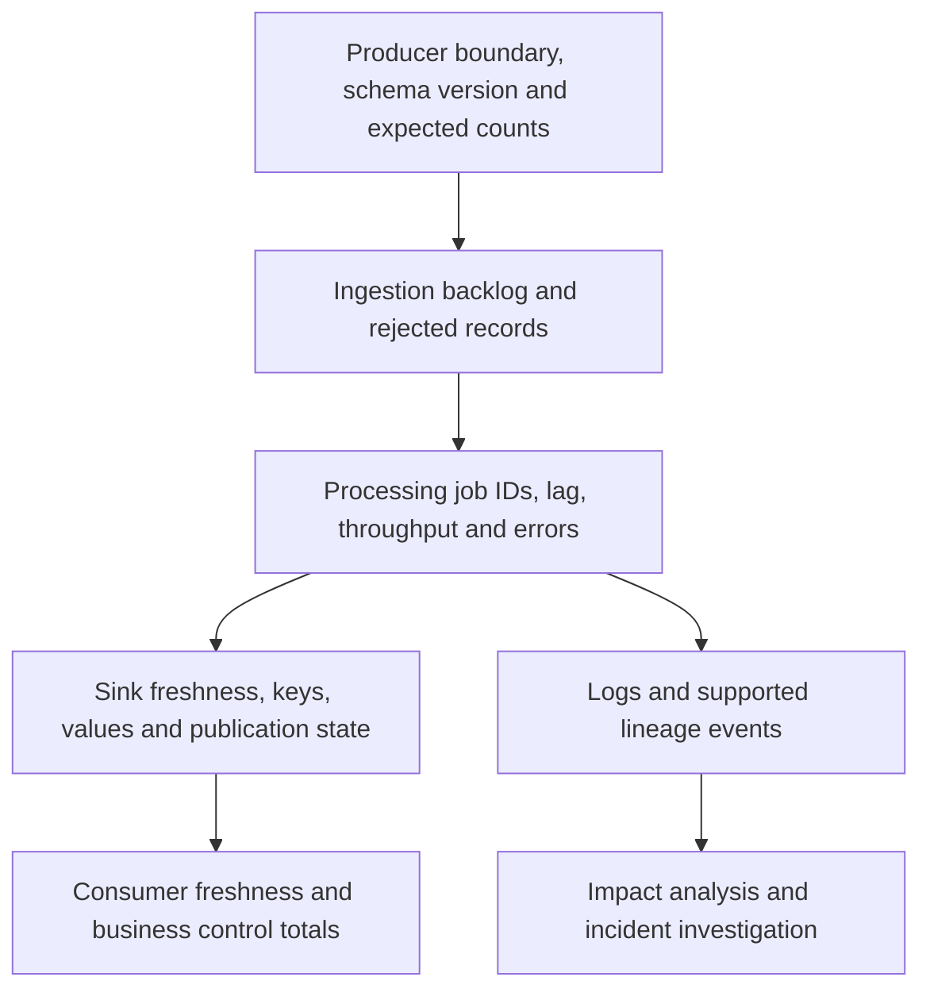

# Pipeline observability: freshness, correctness, logs and lineage

Observe the business output as well as the infrastructure. A healthy scheduler and low CPU usage do not prove that the latest orders arrived or that revenue is correct.

## Connect evidence across boundaries



Metrics describe quantities over time. Logs record operation context. Audit logs record supported administrative/data-access actions. Lineage records relationships between datasets and processes. A lineage edge does not prove row-level completeness, and a successful job does not prove the source boundary was complete.

## Define an SLO with a denominator

For a daily mart, define an objective such as "99 percent of scheduled business days publish a reconciled result by 07:00 UTC over 30 days." With 30 eligible days, even one miss gives 29/30, approximately 96.7 percent. For streaming, define eligible events and the fraction visible within a specified delay. State how idle sources, invalid timestamps and quarantined events affect the measurement.

Monitor freshness, volume, uniqueness, validity, rejection rate and reconciliation at the same source cutoff. A raw maximum event timestamp can be misleading when one future-dated record hides many missing events. A source heartbeat/control watermark provides better evidence of completeness where the producer supports one.

## Start with executable diagnostics

For an actual orders table that retains `ingested_at`:

```sql
SELECT COUNT(*) AS rows_seen,
       MAX(ingested_at) AS newest_arrival,
       TIMESTAMP_DIFF(CURRENT_TIMESTAMP(), MAX(ingested_at), SECOND) AS arrival_age_seconds
FROM `YOUR_PROJECT_ID.raw.orders`
WHERE ingested_at >= TIMESTAMP_SUB(CURRENT_TIMESTAMP(), INTERVAL 1 DAY);
```

An empty input yields a NULL maximum; treat that explicitly instead of converting it silently to "healthy." This query measures observed arrivals, not all expected source events. Add source controls and business-key checks before asserting completeness.

Read recent BigQuery audit events through Cloud Logging rather than assuming an arbitrary log-bucket SQL schema:

```bash
gcloud logging read \
  'protoPayload.serviceName="bigquery.googleapis.com"' \
  --project="$PROJECT_ID" --freshness=1h --limit=20 \
  --format='table(timestamp,protoPayload.methodName,protoPayload.authenticationInfo.principalEmail)'
```

Current detailed BigQuery audit records use `BigQueryAuditMetadata` in `protoPayload.metadata`. Older `serviceData.jobCompletedEvent` examples and exported Logging table layouts are not interchangeable. Use [audit-log documentation](https://docs.cloud.google.com/bigquery/docs/reference/auditlogs) and inspect actual records before writing a log query. Access to data-access logs needs appropriate permissions.

## Set alerts that lead to a decision

For Pub/Sub, combine oldest unacknowledged age with backlog and publish rate. For Dataflow, combine watermark/system lag with sink throughput and rejected rows. For BigQuery, inspect queue delay, errors, slot demand and the publication watermark. For Airflow, monitor scheduler/triggerer health and missed business intervals.

Choose thresholds from the SLO and normal workload, not universal "healthy" seconds or 95-percent slot usage. Add duration and missing-data behavior, a route to the responsible team, and the first diagnostic query. A transient spike and an error-budget-burning outage should not always page identically. Verify metric types and monitored-resource labels in the current [Cloud Monitoring metric catalog](https://docs.cloud.google.com/monitoring/api/metrics_gcp).

## Enable lineage where the path is supported

Check required APIs, permissions, runtime/provider versions and integration settings for BigQuery, Dataflow, Spark and Airflow. Automatic table-level and column-level coverage differs across systems and operations. Looking up a catalog entry is not the same operation as traversing lineage links. Test that an expected source → transform → destination edge appears and identify gaps for custom/external work. See [data lineage](https://docs.cloud.google.com/dataplex/docs/about-data-lineage).

## Incident exercise and answers

Stop the producer in a sandbox while leaving every worker healthy. Does the freshness objective detect it? Next inject a future-dated event and see why maximum event time alone fails. Finally reject one invalid event and verify it appears in reconciliation evidence rather than vanishing.

??? note "Expected reasoning"
    Instrument expected work, durable input boundaries and published output. Correlate DAG/run/task IDs, external job IDs, source identities and transformation revision. Alert on missing or incorrect business results, then use infrastructure metrics and logs to locate the cause.

| Previous Lesson | Curriculum | Next Lesson |
| :--- | :---: | ---: |
| [0034: Automated PII Masking with Cloud DLP](0034-automated-pii-masking-cloud-dlp.md) | [All Lessons (Index)](index.md) | [0036: BigQuery FinOps & Cost Optimization](0036-bigquery-finops-slot-reservations.md) |
