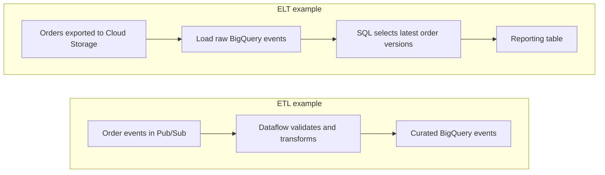
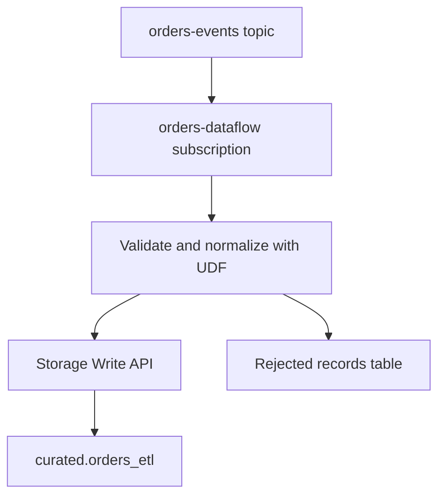
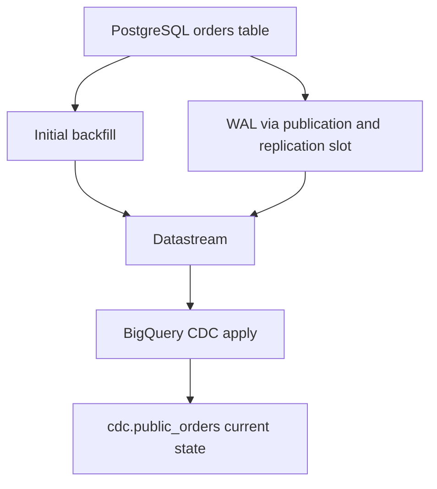
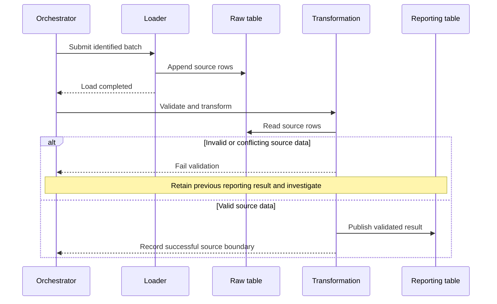

# BigQuery ingestion lab: batch, streaming, CDC, ETL and ELT

Build an orders pipeline six ways, then turn its raw records into a reliable reporting table. This capstone connects the mission's ingestion, warehouse, transformation and operations goals. Work through it over three sessions: file ingestion, streaming and CDC, then transformation and recovery.

By the end, you should be able to create each ingestion path, explain who writes to BigQuery, predict what a retry does, and choose where transformations belong.

!!! note "Lab scope"
    Commands are for a disposable, billing-enabled Google Cloud project. They are instructions to run yourself; authoring this lesson does not provision resources. Dataflow and Cloud SQL continue costing money while running. Complete the cleanup section after each session. Service documentation was checked on 2026-10-26.

## 1. Separate ingestion from transformation

**Extract** reads a source. **Load** persists data in the analytical destination. **Transform** applies business rules such as currency normalization, deduplication or aggregation.

- ETL: transform before loading the target BigQuery table. Example: Dataflow validates an event and converts cents to dollars before writing it.
- ELT: load a raw BigQuery table first, then transform with GoogleSQL, scheduled queries, Dataform or dbt.
- Hybrid: remove sensitive fields before loading, then join and aggregate inside BigQuery.

Batch and streaming describe how data arrives. CDC describes how source changes are captured. None of these alone determines ETL versus ELT. Cloud Storage holds objects; a load job, transfer configuration or processing job moves their contents.



| Requirement | Starting choice | What lands in BigQuery | Main responsibility |
| --- | --- | --- | --- |
| One file or a controlled export | Cloud Storage + load job | Rows from a finite file set | Track files and retry jobs |
| Recurring file arrivals | BigQuery Data Transfer Service | Loaded file contents | Configure identity, schedule and replay |
| JSON events already fit a table | Pub/Sub BigQuery subscription | Event rows | Schema compatibility and deduplication |
| Transform events before loading | Dataflow | Transformed event rows | Worker IAM, errors and processing cost |
| Replicate database inserts, updates and deletes | Datastream | Current state or change history, depending on mode | Source logs, connectivity and replication lag |
| Query files where they live | Cloud Storage external table | Metadata initially; rows remain in Storage | File access and query cost |

A direct Storage Write API producer is another option. The gRPC default stream provides at-least-once writes; application-created streams with offsets can provide exactly-once writes within a stream. That guarantee does not eliminate duplicate business events published with different identities. See [Storage Write API](https://cloud.google.com/bigquery/docs/write-api-grpc) and [lesson 0011](0011-bigquery-storage-write-api.md). The streaming lab below uses the API through a managed Dataflow connector.

## 2. Shared setup and sample data

Use Cloud Shell, or install Google Cloud CLI with `gcloud` and `bq`, and Python 3 locally. Authenticate locally with `gcloud auth login`. Cloud Shell already has an authenticated session. Your operator needs permission to enable APIs, create the lab resources, submit BigQuery jobs and grant the IAM bindings shown below. Organization policies can restrict public IPs or service account usage.

Run shell snippets in the same Bash session. SQL snippets use `YOUR_PROJECT_ID` as an explicit replacement token; shell variables do not expand inside the BigQuery editor.

```bash
export PROJECT_ID="your-disposable-project-id"
export REGION="us-central1"
export BUCKET="${PROJECT_ID}-bq-ingestion-lab"
gcloud config set project "$PROJECT_ID"
export PROJECT_NUMBER="$(gcloud projects describe "$PROJECT_ID" --format='value(projectNumber)')"

gcloud services enable bigquery.googleapis.com bigquerystorage.googleapis.com \
  bigquerydatatransfer.googleapis.com pubsub.googleapis.com dataflow.googleapis.com \
  compute.googleapis.com datastream.googleapis.com sqladmin.googleapis.com \
  storage.googleapis.com

gcloud storage buckets create "gs://${BUCKET}" --location="$REGION" \
  --uniform-bucket-level-access
for dataset in raw curated mart cdc; do
  bq --location="$REGION" mk --dataset "${PROJECT_ID}:${dataset}"
done
```

All datasets and the bucket use one region to avoid location mismatches. The Dataflow job and Datastream profiles will also use this region.

Create a newline-delimited JSON file. Each line is one JSON object, without an enclosing array. `event_id` identifies an event; `order_id` identifies the entity that events update. `version` is a source-assigned, increasing sequence per order.

```bash
mkdir -p bq-ingestion-lab
cd bq-ingestion-lab
cat > orders.ndjson <<'JSON'
{"event_id":"e1","order_id":101,"version":1,"customer_id":"c1","amount_cents":2500,"status":"created","event_ts":"2026-10-26T09:00:00Z"}
{"event_id":"e2","order_id":102,"version":1,"customer_id":"c2","amount_cents":4200,"status":"created","event_ts":"2026-10-26T09:01:00Z"}
{"event_id":"e3","order_id":101,"version":2,"customer_id":"c1","amount_cents":2500,"status":"paid","event_ts":"2026-10-26T09:02:00Z"}
JSON
export EVENT_SCHEMA='event_id:STRING,order_id:INTEGER,version:INTEGER,customer_id:STRING,amount_cents:INTEGER,status:STRING,event_ts:TIMESTAMP'
for table in orders_batch orders_dts orders_pubsub; do
  bq mk --table --time_partitioning_field=event_ts \
    --clustering_fields=order_id "${PROJECT_ID}:raw.${table}" "$EVENT_SCHEMA"
done
gcloud storage cp orders.ndjson "gs://${BUCKET}/orders/batch-001.ndjson"
```

Expected business state after processing all three events:

| order_id | version | status | amount in dollars |
| --- | --- | --- | --- |
| 101 | 2 | paid | 25.00 |
| 102 | 1 | created | 42.00 |

There are three events but two orders. Summing every event would count order 101 twice.

## 3. Method A: batch load from Cloud Storage

A load job reads a finite object set and writes a native BigQuery table. The job's successful completion is the point at which downstream work can proceed. JSON requires an explicit schema or autodetection; this lab supplies the schema to avoid inference surprises. See [loading JSON from Cloud Storage](https://cloud.google.com/bigquery/docs/loading-data-cloud-storage-json).

### Create and verify the load

```bash
bq --location="$REGION" load \
  --source_format=NEWLINE_DELIMITED_JSON \
  --max_bad_records=0 \
  "${PROJECT_ID}:raw.orders_batch" \
  "gs://${BUCKET}/orders/batch-001.ndjson" "$EVENT_SCHEMA"

bq --location="$REGION" query --use_legacy_sql=false \
  "SELECT order_id, version, status FROM \`${PROJECT_ID}.raw.orders_batch\` ORDER BY order_id, version"
```

Expected rows are `101 / 1 / created`, `101 / 2 / paid`, and `102 / 1 / created`. This command appends by default. Running it again creates six raw rows.

!!! tip "A file replay is different from a job retry"
    For an orchestrated pipeline, derive a stable BigQuery job ID from the object URI and generation. After a timeout, retrieve that job before submitting another. Keep a manifest of successfully processed generations. A new job ID loading the same file can append its rows again.

For a deliberate full snapshot replacement, use `bq load --replace` against a dedicated staging table, validate it, then publish it. Never replace an event-history table merely to make a retry pass.

The job identity needs `roles/bigquery.jobUser` on the project, `roles/bigquery.dataEditor` on the target dataset and `roles/storage.objectViewer` on the bucket. Retain immutable source objects so you can rebuild the table.

### Exercise

Run the append command twice. Query `COUNT(*)` and `COUNT(DISTINCT event_id)`. Expect `6` and `3`. Keep these duplicates for the ELT lab; the final order state should still contain two rows.

## 4. Method B: BigQuery Data Transfer Service

DTS manages recurring loads. For this exercise, use a separate table so its results cannot be confused with the manual load. The Cloud Storage connector uses `JSON` for its file-format parameter, and `APPEND` or `MIRROR` for write disposition. These are connector parameters, distinct from load-job enums. See [Cloud Storage transfers](https://cloud.google.com/bigquery/docs/cloud-storage-transfer).

### Create the transfer

1. In BigQuery, open **Data transfers → Create transfer**.
2. Choose **Cloud Storage** and name the transfer `orders-files`.
3. Select a daily schedule, destination dataset `raw`, and the lab region.
4. Set source URI to `gs://YOUR_BUCKET/orders/*.ndjson` and destination table to `orders_dts`.
5. Select JSON format, append disposition, and zero bad records. Keep source-file deletion disabled.
6. Use your current user for this disposable lab. That identity needs the bucket and dataset permissions from method A, plus permission to create transfer configurations. For automation, select a dedicated service account with those data permissions; the creator also needs permission to act as that account.
7. Save, open the transfer, choose **Run transfer now**, and inspect the run's status and associated load job.

CLI equivalent using the current user:

```bash
bq --location="$REGION" mk --transfer_config \
  --target_dataset=raw \
  --display_name=orders-files \
  --data_source=google_cloud_storage \
  --params="{\"data_path_template\":\"gs://${BUCKET}/orders/*.ndjson\",\"destination_table_name_template\":\"orders_dts\",\"file_format\":\"JSON\",\"write_disposition\":\"APPEND\",\"max_bad_records\":\"0\"}"
```

Use either the console or CLI creation path, not both. The documented CLI creation path defaults to a 24-hour schedule; edit scheduling in the console. Follow any authorization prompt presented by `bq`.

### Add a second file

```bash
cat > orders-next.ndjson <<'JSON'
{"event_id":"e4","order_id":102,"version":2,"customer_id":"c2","amount_cents":4200,"status":"paid","event_ts":"2026-10-26T09:03:00Z"}
JSON
gcloud storage cp orders-next.ndjson "gs://${BUCKET}/orders/batch-002.ndjson"
```

Trigger another transfer run. Query `raw.orders_dts`; after both runs, expect four distinct event IDs. Use new immutable filenames for arrivals. Append-mode file tracking is not a business-key uniqueness constraint. Rewritten objects and backfills need an explicit replay policy. `MIRROR` replaces destination contents with the selected source data; it does not merge individual order keys. See [Cloud Storage ingestion behavior](https://cloud.google.com/bigquery/docs/cloud-storage-transfer-overview).

Do not equate a transfer-run notification with a Cloud Storage object notification. A scheduled transfer discovers matching objects at its run time. An object-event workflow requires its own configured event-driven mechanism.

## 5. Method C: Pub/Sub BigQuery subscription

This path delivers JSON messages directly into `raw.orders_pubsub`. No Dataflow job is required. Use table schema mode to map JSON fields to columns. The Pub/Sub service agent needs write access to the destination. See [creating BigQuery subscriptions](https://cloud.google.com/pubsub/docs/create-bigquery-subscription).

### Grant table access and create the subscription

```bash
gcloud beta services identity create --service=pubsub.googleapis.com --project="$PROJECT_ID"
export PUBSUB_AGENT="service-${PROJECT_NUMBER}@gcp-sa-pubsub.iam.gserviceaccount.com"
```

In BigQuery, open `raw.orders_pubsub` → **Share → Manage permissions**. Add the principal stored in `PUBSUB_AGENT` with **BigQuery Data Editor** on this table.

```bash
gcloud pubsub topics create orders-events
gcloud pubsub subscriptions create orders-to-bq \
  --topic=orders-events \
  --bigquery-table="${PROJECT_ID}:raw.orders_pubsub" \
  --use-table-schema

while IFS= read -r event; do
  gcloud pubsub topics publish orders-events --message="$event"
done < orders.ndjson
```

Wait for delivery, then run:

```sql
SELECT event_id, COUNT(*) AS deliveries
FROM `YOUR_PROJECT_ID.raw.orders_pubsub`
GROUP BY event_id
ORDER BY event_id;
```

Expect e1, e2 and e3. Republish e1 and observe that business duplicates can reach the table. Pub/Sub BigQuery subscriptions use at-least-once delivery. See [BigQuery subscription behavior](https://cloud.google.com/pubsub/docs/bigquery).

### Deliberately break a message

```bash
gcloud pubsub topics publish orders-events \
  --message='{"event_id":"bad1","order_id":"not-an-integer"}'
gcloud pubsub subscriptions describe orders-to-bq
```

The publish can succeed because the topic has no schema. Delivery fails when the table rejects `order_id`. Inspect subscription state, backlog and oldest unacknowledged message age. A healthy subscription state alone does not prove every message is valid.

For a dead-letter path, create topic `orders-dead` and a pull subscription on it. Edit `orders-to-bq`, enable dead lettering to that topic, and set the maximum delivery attempts. Grant the Pub/Sub service agent Pub/Sub Publisher on the dead-letter topic and Pub/Sub Subscriber on `orders-to-bq`. Inspect messages through the dead-letter subscription; forwarding is best effort and the attempt threshold is approximate. See [dead-letter topics](https://cloud.google.com/pubsub/docs/dead-letter-topics).

!!! note "Choose based on processing requirements"
    Direct subscriptions support message transforms for some lightweight work. Dataflow becomes useful when you need Beam processing such as windows, joins or state, or want its pipeline execution controls. Do not choose it solely because one field needs renaming.

## 6. Method D: Dataflow streaming ETL

Create a separate subscription on the same topic. Both subscriptions receive their own copy of future events. Sharing a single pull subscription between two consumers would split its messages.

This exercise normalizes status and converts cents before loading a curated event table. It uses the provided Pub/Sub-to-BigQuery Flex Template, a JavaScript UDF and the Storage Write API. See the [template parameters](https://cloud.google.com/dataflow/docs/guides/templates/provided/pubsub-to-bigquery).



### Prepare table, worker identity and transform

```bash
bq mk --table "${PROJECT_ID}:curated.orders_etl" \
  'event_id:STRING,order_id:INTEGER,version:INTEGER,customer_id:STRING,amount:NUMERIC,status:STRING,event_ts:TIMESTAMP'
gcloud pubsub subscriptions create orders-dataflow --topic=orders-events
gcloud iam service-accounts create orders-dataflow-worker
export WORKER_SA="orders-dataflow-worker@${PROJECT_ID}.iam.gserviceaccount.com"
gcloud projects add-iam-policy-binding "$PROJECT_ID" \
  --member="serviceAccount:${WORKER_SA}" --role=roles/dataflow.worker
gcloud projects add-iam-policy-binding "$PROJECT_ID" \
  --member="serviceAccount:${WORKER_SA}" --role=roles/bigquery.jobUser
gcloud pubsub subscriptions add-iam-policy-binding orders-dataflow \
  --member="serviceAccount:${WORKER_SA}" --role=roles/pubsub.subscriber
gcloud storage buckets add-iam-policy-binding "gs://${BUCKET}" \
  --member="serviceAccount:${WORKER_SA}" --role=roles/storage.objectAdmin
```

In BigQuery, grant `WORKER_SA` BigQuery Data Editor on dataset `curated`, allowing creation of the error table. The launching user needs Dataflow Developer and Service Account User on the worker account. The worker network must permit access to Google APIs and the template container; for this lab use an available default VPC, or supply your approved subnetwork.

```bash
cat > transform.js <<'JS'
function transform(line) {
  var row = JSON.parse(line);
  var cents = row.amount_cents;
  if (typeof cents !== 'number' || !isFinite(cents) ||
      Math.floor(cents) !== cents || cents < 0 || cents > 1000000000) {
    throw new Error('amount_cents must be a nonnegative integer up to 1 billion');
  }
  if (!row.event_id || !row.order_id || !row.version || !row.event_ts) {
    throw new Error('missing event identity or timestamp');
  }
  var status = String(row.status).toLowerCase();
  if (['created', 'paid', 'cancelled'].indexOf(status) === -1) {
    throw new Error('unsupported status');
  }
  return JSON.stringify({
    event_id: row.event_id,
    order_id: row.order_id,
    version: row.version,
    customer_id: row.customer_id,
    amount: (cents / 100).toFixed(2),
    status: status,
    event_ts: row.event_ts
  });
}
JS
gcloud storage cp transform.js "gs://${BUCKET}/udf/transform.js"
```

The amount bound keeps this small JavaScript example away from unsafe integer ranges. A production currency contract should specify currency and supported precision.

### Launch and publish

```bash
gcloud dataflow flex-template run "orders-etl-$(date +%Y%m%d-%H%M%S)" \
  --region="$REGION" \
  --template-file-gcs-location=gs://dataflow-templates/latest/flex/PubSub_to_BigQuery_Flex \
  --staging-location="gs://${BUCKET}/dataflow/staging" \
  --temp-location="gs://${BUCKET}/dataflow/temp" \
  --service-account-email="$WORKER_SA" \
  --parameters="inputSubscription=projects/${PROJECT_ID}/subscriptions/orders-dataflow,outputTableSpec=${PROJECT_ID}:curated.orders_etl,outputDeadletterTable=${PROJECT_ID}:curated.orders_etl_errors,javascriptTextTransformGcsPath=gs://${BUCKET}/udf/transform.js,javascriptTextTransformFunctionName=transform,useStorageWriteApi=true,useStorageWriteApiAtLeastOnce=false,numStorageWriteApiStreams=1"

while IFS= read -r event; do
  gcloud pubsub topics publish orders-events --message="$event"
done < orders.ndjson
```

Use `latest` for exploration only. Record and pin a tested dated template version for repeatable deployments. The job remains running after these three messages.

Query `curated.orders_etl`. Expect amounts `25.00`, `42.00`, `25.00`. Publish the following and inspect `curated.orders_etl_errors`:

```bash
gcloud pubsub topics publish orders-events \
  --message='{"event_id":"bad2","order_id":103,"version":1,"amount_cents":-500,"status":"created","event_ts":"2026-10-26T09:04:00Z"}'
```

This row fails the UDF's amount check. Error routing does not repair it; correct the source event and replay with an explicit identity policy. Sink write guarantees do not deduplicate two separately published copies of e1.

For batch ETL, use a bounded Beam pipeline: `ReadFromText` on the Storage files → validation and transformation → `WriteToBigQuery` with file loads and a temporary Storage location. The transformation is still before the destination load. Start with [Beam fundamentals](0014-apache-beam-fundamentals.md) when you need custom batch processing beyond this streaming template.

## 7. Method E: Datastream CDC from PostgreSQL

CDC reads database changes from a transaction log. An initial backfill copies existing rows; ongoing replication follows later mutations. This lab uses a primary key and merge mode, so BigQuery represents current order state rather than all application events. See [Datastream's PostgreSQL-to-BigQuery quickstart](https://cloud.google.com/datastream/docs/quickstart-replication-to-bigquery).



### Create and prepare the database

1. Open **Cloud SQL → Create instance → PostgreSQL**. Use a disposable instance named `orders-source`, PostgreSQL 15 or later supported by Datastream, and region `us-central1`. Select a small development configuration.
2. Set an administrator password through the console. Create database `shop`.
3. Edit database flags, add `cloudsql.logical_decoding=on`, save and allow the restart.
4. Connect to `shop` as `postgres` with Cloud SQL Studio or `psql`. Create the source data below.

```sql
CREATE TABLE public.orders (
  order_id BIGINT PRIMARY KEY,
  customer_id TEXT NOT NULL,
  amount_cents BIGINT NOT NULL,
  status TEXT NOT NULL,
  updated_at TIMESTAMPTZ NOT NULL DEFAULT now()
);
INSERT INTO public.orders(order_id, customer_id, amount_cents, status)
VALUES (101, 'c1', 2500, 'created'), (102, 'c2', 4200, 'created');

CREATE USER datastream_user WITH REPLICATION LOGIN;
GRANT CONNECT ON DATABASE shop TO datastream_user;
GRANT USAGE ON SCHEMA public TO datastream_user;
GRANT SELECT ON public.orders TO datastream_user;
CREATE PUBLICATION orders_publication FOR TABLE public.orders;
SELECT pg_create_logical_replication_slot('orders_slot', 'pgoutput');
```

In `psql`, run `\password datastream_user` to set its password interactively. Supply it in the Datastream connection profile. Do not commit credentials to the lesson or shell scripts. For new tables, grant SELECT and add them to the publication and stream inclusion list. See [Cloud SQL PostgreSQL CDC setup](https://cloud.google.com/datastream/docs/configure-cloudsql-psql).

### Create connection profiles and stream

1. Open **Datastream → Connection profiles → Create profile**. Select PostgreSQL, region `us-central1`, profile ID `orders-postgres`, database `shop`, port `5432`, and the replication user's credentials.
2. Establish connectivity before testing. For a disposable public-IP lab, select IP allowlisting in the profile, copy Datastream's regional outgoing IP addresses, and add only those addresses to the instance's authorized networks. Configure the profile's SSL settings to match the source. A successful SQL Studio connection does not prove Datastream can reach it. For a private deployment, configure Datastream private connectivity to the source VPC instead.
3. Run the profile connection test. Resolve routing, TLS or credentials errors before continuing. See [Datastream connectivity](https://cloud.google.com/datastream/docs/network-connectivity-options).
4. Create a BigQuery connection profile `orders-bigquery` in the same region.
5. Open **Streams → Create stream**, ID `orders-cdc`. Select those profiles. Enter publication `orders_publication` and slot `orders_slot`.
6. Include only `public.orders`. Enable automatic backfill for the included table.
7. Choose **Single dataset for all schemas**, select `cdc`, choose **Merge** write mode and a staleness limit of 1 minute. Review and validate, then create and start the stream.

Datastream's service agent role supplies destination permissions within its project. Cross-project destinations need additional grants. Single-dataset mode names this table `public_orders`. The staleness setting controls acceptable freshness during CDC apply; it is not an end-to-end latency promise. See [BigQuery destination settings](https://cloud.google.com/datastream/docs/configure-bigquery-destination).

### Verify backfill, update, insert and delete

Wait for the backfill to complete, then query `YOUR_PROJECT_ID.cdc.public_orders`. Expect orders 101 and 102. In PostgreSQL run:

```sql
UPDATE public.orders SET status = 'paid', updated_at = now() WHERE order_id = 101;
INSERT INTO public.orders(order_id, customer_id, amount_cents, status)
VALUES (103, 'c3', 1800, 'created');
DELETE FROM public.orders WHERE order_id = 102;
```

After replication and apply, expect 101 as paid and 103 as created. Order 102 should disappear in merge mode. Repeated application events and database row changes are different datasets; do not union `cdc.public_orders` with raw event history.

!!! tip "Inspect the source when replication falls behind"
    A retained replication slot can hold WAL on the source while the consumer is stopped. Monitor source disk space, slot lag, Datastream freshness and BigQuery apply lag. After deleting the stream permanently, drop its unused slot. A raw event table is useful for history; a merged replica alone cannot reconstruct deleted business history.

## 8. Method F: query Cloud Storage through an external table

An external table initially loads metadata, not file contents into native BigQuery storage. The query reads the objects. For a standard external table, the querying identity needs access to both BigQuery and the bucket. See [Cloud Storage external tables](https://cloud.google.com/bigquery/docs/external-data-cloud-storage).

Replace both project and bucket placeholders in the SQL editor:

```sql
CREATE OR REPLACE EXTERNAL TABLE `YOUR_PROJECT_ID.raw.orders_external` (
  event_id STRING, order_id INT64, version INT64, customer_id STRING,
  amount_cents INT64, status STRING, event_ts TIMESTAMP
)
OPTIONS (
  format = 'NEWLINE_DELIMITED_JSON',
  uris = ['gs://YOUR_BUCKET/orders/batch-001.ndjson']
);

SELECT * FROM `YOUR_PROJECT_ID.raw.orders_external` ORDER BY event_ts;

CREATE OR REPLACE TABLE `YOUR_PROJECT_ID.raw.orders_materialized` AS
SELECT * FROM `YOUR_PROJECT_ID.raw.orders_external`;
```

The first query reads the original three events. The final statement materializes them into a native table. The exact object path intentionally excludes the second DTS file. A wildcard would change the input set.

Choose this for occasional inspection or a file-based architecture. For repeated reporting, compare materialization and BigLake access delegation with the requirements in [lesson 0003](0003-biglake-iceberg-catalogs.md).

## 9. Build ELT in BigQuery

Use `raw.orders_batch` from method A as the one input for this section. To try another event loader, replace that table name with `orders_dts` or `orders_pubsub`. Do not union all lab tables: they intentionally contain copies of the same data.

### Validate before selecting the latest version

Run this script in BigQuery after replacing `YOUR_PROJECT_ID`. It rejects null identity, invalid values and conflicting payloads at the same order version. Exact duplicate events are harmless for current-state reconstruction. Conflicting versions require source investigation.

```sql
ASSERT (
  SELECT COUNT(*) = 0
  FROM `YOUR_PROJECT_ID.raw.orders_batch`
  WHERE event_id IS NULL OR order_id IS NULL OR version IS NULL
     OR version < 1 OR customer_id IS NULL OR event_ts IS NULL
     OR amount_cents IS NULL OR amount_cents < 0
     OR status IS NULL OR LOWER(status) NOT IN ('created', 'paid', 'cancelled')
) AS 'Invalid source events';

ASSERT (
  SELECT COUNT(*) = 0 FROM (
    SELECT order_id, version
    FROM `YOUR_PROJECT_ID.raw.orders_batch`
    GROUP BY order_id, version
    HAVING COUNT(DISTINCT TO_JSON_STRING(
      STRUCT(customer_id, amount_cents, LOWER(status) AS status, event_ts)
    )) > 1
  )
) AS 'Conflicting payloads for one order version';

CREATE OR REPLACE TABLE `YOUR_PROJECT_ID.curated.orders_current`
CLUSTER BY order_id AS
SELECT
  order_id, version, customer_id,
  CAST(amount_cents AS NUMERIC) / 100 AS amount,
  LOWER(status) AS status, event_ts
FROM `YOUR_PROJECT_ID.raw.orders_batch`
QUALIFY ROW_NUMBER() OVER (
  PARTITION BY order_id ORDER BY version DESC, event_ts DESC, event_id DESC
) = 1; -- (1)!

CREATE OR REPLACE TABLE `YOUR_PROJECT_ID.mart.order_totals` AS
SELECT status, COUNT(*) AS orders, SUM(amount) AS total_amount
FROM `YOUR_PROJECT_ID.curated.orders_current`
GROUP BY status;
```

1. Rank versions before aggregating. Ranking by arrival time would let a late version 1 overwrite version 2.

Expected mart rows are `paid / 1 / 25.00` and `created / 1 / 42.00`, even if the batch file was appended twice. This is a small full rebuild: it scans all input history on every run. Use it to establish correctness before optimizing incrementally.

### Schedule the ELT script

1. Run the script manually and inspect both outputs.
2. In the query editor, choose the scheduled query option. Name it `orders-elt`, use the dataset region and choose an hourly schedule.
3. Select a dedicated execution service account with BigQuery Job User on the project, Data Viewer on `raw`, and Data Editor on `curated` and `mart`. The configuring user needs permission to act as that account and create the scheduled-query transfer.
4. Keep destination-table settings empty because the script's DDL names its output tables.
5. Run once and inspect scheduled-query history. An assertion failure should fail the run before either table is replaced.

Scheduled queries use BigQuery Data Transfer Service. A clock schedule does not establish a dependency on a file-transfer run. If input completion matters, orchestrate load completion → validation → transformation → publish using Workflows or Composer. See [scheduled queries](https://cloud.google.com/bigquery/docs/scheduling-queries) and [lesson 0029](0029-resilient-dags-deferrable-operators.md).

### Make incremental processing safe

For a larger pipeline, select newly ingested records plus an intentional late-arrival lookback, reduce them to one row per order, then merge. Add `ingested_at` and source object/message metadata to the production raw schema so ingestion progress is separate from event time.

```sql
-- delta_orders must already have one row per order_id and validated versions.
MERGE `YOUR_PROJECT_ID.curated.orders_current` AS target
USING `YOUR_PROJECT_ID.curated.delta_orders` AS source
ON target.order_id = source.order_id
WHEN MATCHED AND source.version > target.version THEN
  UPDATE SET version = source.version, customer_id = source.customer_id,
    amount = source.amount, status = source.status, event_ts = source.event_ts
WHEN NOT MATCHED THEN
  INSERT (order_id, version, customer_id, amount, status, event_ts)
  VALUES (source.order_id, source.version, source.customer_id,
          source.amount, source.status, source.event_ts);
```

This is an adaptation pattern, not an additional runnable lab step: first create and populate `delta_orders` under that contract. Serialize writes to the current-state target. If the source includes deletions, carry an operation type and sequence, retain tombstones, and prevent older events from resurrecting deleted rows. A timestamp-only watermark can miss late events.

### Move the SQL to Dataform when dependencies grow

For a version-controlled ELT project, follow [Dataform setup](0024-dataform-foundations-workflow-settings.md), declare the raw source, then build a model such as `definitions/orders_current.sqlx`:

```sql
config {
  type: "table",
  schema: "curated",
  assertions: {
    uniqueKey: ["order_id"],
    nonNull: ["order_id", "version", "amount"],
    rowConditions: ["amount >= 0", "version >= 1"]
  }
}

SELECT order_id, version, customer_id,
       CAST(amount_cents AS NUMERIC) / 100 AS amount,
       LOWER(status) AS status, event_ts
FROM ${ref("orders_batch")}
QUALIFY ROW_NUMBER() OVER (
  PARTITION BY order_id ORDER BY version DESC, event_ts DESC, event_id DESC
) = 1
```

Declare `orders_batch` in a separate SQLX file with `config { type: "declaration", database: "YOUR_PROJECT_ID", schema: "raw", name: "orders_batch" }`. Add the source-quality checks as assertions and explicitly make the output model depend on them. A model's output assertions run after its creation; they do not automatically protect every downstream consumer. Configure dependent assertions before publishing the mart. See [Dataform assertion behavior](https://cloud.google.com/dataform/docs/assertions) and [assertions and dependencies](0025-writing-dataform-sqlx-assertions.md).

Compile, run with the same dataset permissions, and inspect assertion results. Configure a release and workflow schedule after a successful manual run. This replaces the scheduled-query implementation for these outputs; running both would give two writers for the same tables. dbt offers the same warehouse-transformation pattern through models, tests and an external job scheduler; see [lesson 0026](0026-dbt-core-bigquery-models-snapshots.md).

## 10. Operate and recover the pipeline



| Symptom | First check | Recovery action |
| --- | --- | --- |
| Load fails | Job error, schema and object location | Fix schema/data and retry with tracked file identity |
| DTS run succeeds but new order absent | URI match and run/file selection | Inspect the specific object, then run a controlled replay |
| Pub/Sub backlog increases | Table IAM, schema and malformed messages | Repair permissions or route bad messages for correction |
| Dataflow job fails to start | Worker IAM, network, quota and template parameters | Fix launch conditions before resubmitting |
| Dataflow error rows grow | UDF error and original payload | Correct producer contract; replay corrected data |
| CDC state is stale | Source slot/WAL, stream status and destination apply | Restore connectivity, measure catch-up and protect source disk |
| Revenue doubles | Duplicate events or aggregation before latest-version selection | Rebuild from raw with the correct entity key |
| Older status replaces newer status | Arrival-based merge or missing sequence check | Use source version ordering and retain delete tombstones |

Record source row counts, accepted and rejected rows, distinct business keys, job IDs and freshness. Compare counts at the same source boundary. A database that continues changing cannot be reconciled against an earlier snapshot with a blind `COUNT(*)` comparison.

## 11. Recall and failure exercises

Close the lesson before answering:

1. Why is a Pub/Sub-to-raw-table pipeline only the loading part of ELT?
2. What happens if the same file is submitted as two different append load jobs?
3. Why can a valid Pub/Sub publish fail BigQuery delivery?
4. Which data do you lose if you keep only Datastream's merged current-state table?
5. Does exactly-once sink writing prevent two independently published copies of e1?
6. Why does a source version help more than arrival time for an order update?
7. Does creating an external table copy its files into native BigQuery storage?

??? note "Check your reasoning"
    1. ELT still needs a transformation after loading.
    2. Rows can be appended twice; job execution and business deduplication are separate concerns.
    3. The topic and destination enforce different contracts, and destination IAM can also fail.
    4. Prior versions and deleted records may no longer be available for historical analysis.
    5. No. Write retry guarantees do not establish business-event uniqueness.
    6. A late older version must not overwrite a newer state.
    7. No. Materialization requires an explicit load or query that writes a native table.

Try these experiments and keep the observed SQL results:

- Replay e1 after e3, rebuild the mart, and prove that order 101 stays paid.
- Add a conflicting payload for order 101 version 2. Confirm the assertion fails and the previous mart survives.
- Stop a disposable CDC stream briefly, mutate the source, then resume. Measure recovery and inspect retained WAL.
- Explain your choice for a daily 500 GB export versus events needing windowed fraud checks. Include replay, freshness and operating cost in the explanation.

Completion means you can predict these results before running the commands. Creating this lesson does not count as demonstrated mastery in `learning-records/`.

## 12. Cleanup

Stop active producers first. In Dataflow, select the lab job and **Drain** it, then verify it reaches a terminal state. Cancel if you deliberately want to discard remaining processing. Disable/delete the DTS transfer and scheduled query so they cannot recreate outputs.

Delete the Datastream stream, then its connection profiles and any lab-only connectivity configuration. In PostgreSQL, after the stream is deleted and the slot is inactive, run:

```sql
SELECT pg_drop_replication_slot('orders_slot');
DROP PUBLICATION orders_publication;
REVOKE SELECT ON public.orders FROM datastream_user;
REVOKE USAGE ON SCHEMA public FROM datastream_user;
REVOKE CONNECT ON DATABASE shop FROM datastream_user;
DROP USER datastream_user;
```

Delete the disposable Cloud SQL instance through the console after checking its name. If you are keeping that instance, revoke the replication user's privileges and remove only the lab table and database objects you created.

For the remaining disposable lab resources:

```bash
gcloud pubsub subscriptions delete orders-to-bq orders-dataflow
gcloud pubsub topics delete orders-events
# If you created the optional dead-letter topic and subscription, delete those too.
for dataset in raw curated mart cdc; do
  bq rm -r -f -d "${PROJECT_ID}:${dataset}"
done
gcloud storage rm --recursive "gs://${BUCKET}"
gcloud iam service-accounts delete "$WORKER_SA"
```

Run these only in the dedicated lab project. Remove the worker's project IAM bindings and any other lab-specific grants if retaining the project. Deleting the disposable project after reviewing its resources is an alternative cleanup path.

## Official references and follow-up lessons

The [reference catalog](../references/resources.md#bigquery-ingestion-and-transformation-lab) records the official sources for this capstone. For deeper implementation detail, revisit [CDC](0007-change-data-capture-datastream-bigquery.md), [DTS](0008-bigquery-data-transfer-service-gcs-notifications.md), [Storage Write API](0011-bigquery-storage-write-api.md), [Dataflow templates](0019-dataflow-flex-templates-cloud-build.md) and [SQLX assertions](0025-writing-dataform-sqlx-assertions.md).

## Extend the lab with a compatible schema change

Add an optional `coupon_code` to one producer event and predict the effect on each ingestion path before changing any table. Check the topic validation, BigQuery subscription unknown-field policy, UDF output projection, load schema and downstream SQL independently. A producer publish succeeding does not mean each sink accepts the addition. Use [lesson 0042](0042-data-contracts-schema-evolution.md) to define the rollout order and preserve the original schema version for replay.

Then add `currency` and decide whether existing cents are guaranteed to be USD. A default is valid only if the old contract establishes that meaning. Reconcile accepted plus rejected event identities at the same source boundary after the change. A total row count alone can hide one missing event and one duplicate.

| Previous Lesson | All Lessons | Next Lesson |
| :--- | :---: | ---: |
| [0036: BigQuery FinOps](0036-bigquery-finops-slot-reservations.md) | [Lesson catalog](index.md) | [0038: ETL architecture and load–transform–export](0038-bigquery-etl-architecture-load-transform-export.md) |
