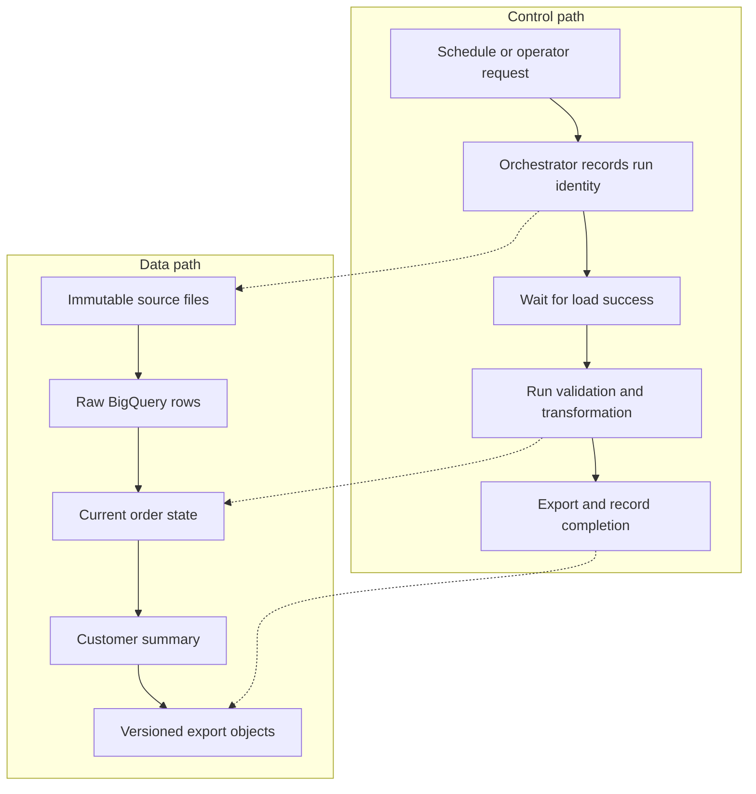
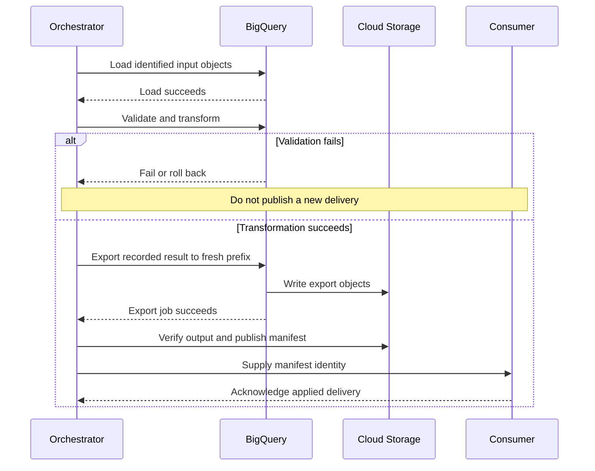

# Designing BigQuery ETL architecture: load, transform and export

This lesson develops the architecture behind [lesson 0037's ingestion labs](0037-bigquery-ingestion-etl-elt-lab.md). You will separate orchestration from data processing, choose ETL or ELT for a specific requirement, and build a repeatable batch pipeline that exports a validated customer summary.

It supports the workspace mission of designing and operating production GCP data platforms. Work through the architecture first, run the lab second, and finish with the recovery exercises.

## 1. Read the two sources with their dates in mind

The [2017 architecture article](https://cloud.google.com/blog/products/bigquery/designing-etl-architecture-for-a-cloud-native-data-warehouse-on-google-cloud-platform) combines scheduled commands, a Pub/Sub control topic, Dataflow ingestion and BigQuery staging and aggregation. It distinguishes control messages from business events. Its overlapping extraction windows reduce gaps but require deduplication. These are useful architecture concepts independent of the particular launcher.

The [current load, transform and export introduction](https://docs.cloud.google.com/bigquery/docs/load-transform-export-intro) recommends ELT for most customers. It separates extraction/loading from transformation, identifies Dataform and BigQuery pipelines as transformation tools, and includes exports to operational destinations as reverse ETL. ETL remains useful when transformation must precede warehouse loading or an existing processing system already meets the requirement.

!!! note "Historical example, current implementation"
    The article was published on May 11, 2017. Treat its App Engine cron handler and streaming pipeline launcher as historical implementation choices. The examples below are a new teaching design, not a reproduction of its code. Sources were checked on 2026-10-26.

The article's caution about updates and deletes should not become a rule against modern warehouse mutation. BigQuery supports `INSERT`, `UPDATE`, `DELETE` and `MERGE`. In this lesson, a version-aware `MERGE` maintains current state. Its cost and correctness depend on the data scanned and the source-key contract. See [GoogleSQL DML](https://cloud.google.com/bigquery/docs/reference/standard-sql/dml-syntax).

## 2. Separate the control path from the data path

A business event says that order 101 changed. A control request says to process a particular input batch. They need different schemas, permissions and retry policies.



An example control request for our design:

```json
{
  "run_id": "orders-20261026-b02",
  "source_uri": "gs://EXAMPLE_BUCKET/input/batch-02.ndjson",
  "source_generation": "RECORD_THE_ACTUAL_OBJECT_GENERATION",
  "source_cutoff": "2026-10-26T10:00:00Z",
  "transform_revision": "RECORD_THE_DEPLOYED_GIT_COMMIT"
}
```

Those fields answer different questions. The object generation identifies the input bytes; the cutoff defines the source boundary; the code revision identifies the transformation. A run ID alone cannot prove that a rerun processed the same data.

For a small batch pipeline, sequential commands are enough to demonstrate dependencies. For a deployed system, choose an orchestrator according to the work it must coordinate. [Lesson 0031](0031-cloud-workflows-vs-composer.md) develops the Workflows/Composer comparison. SQL model dependencies belong in the transformation graph, as discussed in [Dataform foundations](0024-dataform-foundations-workflow-settings.md).

## 3. Decide where transformation belongs

Use a specific rule to decide placement. "We use streaming" is not a placement rule.

| Requirement in our orders system | Placement | Why |
| --- | --- | --- |
| Raw values are needed for audit and future rule changes | Load raw, then SQL ELT | Preserve inputs for reprocessing |
| A sensitive field must never reach warehouse storage | ETL before loading | A downstream view cannot undo raw storage |
| Latest order state and customer totals use relational rules | BigQuery SQL | Ranking, joins and aggregation fit the warehouse |
| An event must join a time window before warehouse delivery | Stream processing before load | The output depends on stream-time semantics |
| A partner needs an hourly file of approved customer totals | Transform, validate, then export | The delivery contract is a derived dataset |

These are design choices for the example, not a claim that a service is the only implementation.

A hybrid design might remove prohibited fields in Dataflow, load permitted event history into BigQuery, and use Dataform for customer summaries. Name the boundary when discussing ETL: "transformation before the curated table" can still happen after a raw table has been loaded elsewhere.

!!! tip "Compare the whole pipeline cost"
    Count ingestion, worker runtime, warehouse scans, stored copies, export storage and operational effort. Moving a transformation outside BigQuery changes where compute is paid for; it does not remove that work.

## 4. Define the lab's data contract

We will process two finite batches. Each source row carries a full order image, and `version` increases for each `order_id`. Versions in this exercise are unique and immutable. Source deletions are outside this lab's contract.

Batch 1 contains two paid orders worth 25.00 and 42.00. Batch 2 overlaps with batch 1, changes the second order to 45.00 and adds a cancelled order. The exported total should be 70.00, not 112.00 or 130.00.

| Field | Meaning |
| --- | --- |
| `order_id` | Business entity key |
| `version` | Source ordering within an order |
| `customer_id` | Owner of the order |
| `amount_cents` | Integer amount in the lab's single currency, USD |
| `status` | `paid` or `cancelled` |
| `source_updated_at` | Source timestamp, separate from ingestion time |

Why use both a key and a version? Deduplicating only by order ID would discard legitimate updates. Deduplicating only identical rows would keep both old and new amounts.

## 5. Create the isolated lab and load two batches

Use a disposable, billing-enabled project with authenticated `gcloud` and `bq`. Run the shell examples in one Bash session. The operator needs API-enablement and resource-creation permissions; job execution needs BigQuery Job User on the project, Data Editor on the lab dataset, and Storage Object Viewer on the input bucket. Export also requires table export/read permissions and permission to create destination objects. See [exporting table data](https://cloud.google.com/bigquery/docs/exporting-data).

```bash
export PROJECT_ID="your-disposable-project-id"
export REGION="us-central1"
export ARCH_BUCKET="${PROJECT_ID}-bq-architecture-lab"
gcloud config set project "$PROJECT_ID"
gcloud services enable bigquery.googleapis.com storage.googleapis.com
bq --location="$REGION" mk --dataset "${PROJECT_ID}:architecture_lab"
gcloud storage buckets create "gs://${ARCH_BUCKET}" \
  --location="$REGION" --uniform-bucket-level-access
mkdir -p architecture-lab
cd architecture-lab

cat > batch-01.ndjson <<'JSON'
{"order_id":101,"version":1,"customer_id":"c1","amount_cents":2500,"status":"paid","source_updated_at":"2026-10-26T09:00:00Z"}
{"order_id":102,"version":1,"customer_id":"c2","amount_cents":4200,"status":"paid","source_updated_at":"2026-10-26T09:01:00Z"}
JSON
cat > batch-02.ndjson <<'JSON'
{"order_id":102,"version":1,"customer_id":"c2","amount_cents":4200,"status":"paid","source_updated_at":"2026-10-26T09:01:00Z"}
{"order_id":102,"version":2,"customer_id":"c2","amount_cents":4500,"status":"paid","source_updated_at":"2026-10-26T09:30:00Z"}
{"order_id":103,"version":1,"customer_id":"c1","amount_cents":1800,"status":"cancelled","source_updated_at":"2026-10-26T09:40:00Z"}
JSON

gcloud storage cp batch-01.ndjson batch-02.ndjson "gs://${ARCH_BUCKET}/input/"
export ORDER_SCHEMA='order_id:INTEGER,version:INTEGER,customer_id:STRING,amount_cents:INTEGER,status:STRING,source_updated_at:TIMESTAMP'
for batch in 01 02; do
  bq --location="$REGION" load --source_format=NEWLINE_DELIMITED_JSON \
    "${PROJECT_ID}:architecture_lab.raw_orders" \
    "gs://${ARCH_BUCKET}/input/batch-${batch}.ndjson" "$ORDER_SCHEMA" || exit 1
done
```

The first load creates the raw table from the supplied schema. The next appends. `bq load` waits for job completion by default, so the loop's successful exit is the load dependency for this manual lab. See [JSON load jobs](https://cloud.google.com/bigquery/docs/loading-data-cloud-storage-json).

```bash
bq --location="$REGION" query --use_legacy_sql=false \
  "SELECT COUNT(*) AS raw_rows, COUNT(DISTINCT order_id) AS orders FROM \`${PROJECT_ID}.architecture_lab.raw_orders\`"
```

Expect five raw rows and three distinct orders. Overlap is intentional.

## 6. Validate, merge and publish in BigQuery

Replace `YOUR_PROJECT_ID` below and save the script as `transform.sql`. The script snapshots raw inputs into a temporary table so validation and transformation examine the same rows. It checks for conflicting order versions before selecting the latest one.

```sql
CREATE TEMP TABLE source_snapshot AS
SELECT * FROM `YOUR_PROJECT_ID.architecture_lab.raw_orders`;

ASSERT (
  SELECT COUNT(*) = 0 FROM source_snapshot
  WHERE order_id IS NULL OR version IS NULL OR version < 1
    OR customer_id IS NULL OR amount_cents IS NULL OR amount_cents < 0
    OR status IS NULL OR status NOT IN ('paid', 'cancelled')
    OR source_updated_at IS NULL
) AS 'Invalid source row';

ASSERT (
  SELECT COUNT(*) = 0 FROM (
    SELECT order_id, version
    FROM source_snapshot
    GROUP BY order_id, version
    HAVING COUNT(DISTINCT TO_JSON_STRING(
      STRUCT(customer_id, amount_cents, status, source_updated_at)
    )) > 1
  )
) AS 'Conflicting images for one order version';

CREATE TEMP TABLE latest_orders AS
SELECT * FROM source_snapshot
QUALIFY ROW_NUMBER() OVER (
  PARTITION BY order_id ORDER BY version DESC
) = 1;

CREATE TABLE IF NOT EXISTS `YOUR_PROJECT_ID.architecture_lab.orders_current` (
  order_id INT64, version INT64, customer_id STRING,
  amount_cents INT64, status STRING, source_updated_at TIMESTAMP
);
CREATE TABLE IF NOT EXISTS `YOUR_PROJECT_ID.architecture_lab.customer_summary` (
  customer_id STRING, paid_orders INT64, total_paid NUMERIC
);

BEGIN TRANSACTION;

MERGE `YOUR_PROJECT_ID.architecture_lab.orders_current` AS target
USING latest_orders AS source
ON target.order_id = source.order_id
WHEN MATCHED AND source.version > target.version THEN
  UPDATE SET version = source.version, customer_id = source.customer_id,
    amount_cents = source.amount_cents, status = source.status,
    source_updated_at = source.source_updated_at
WHEN NOT MATCHED THEN
  INSERT (order_id, version, customer_id, amount_cents, status, source_updated_at)
  VALUES (source.order_id, source.version, source.customer_id,
          source.amount_cents, source.status, source.source_updated_at);

DELETE FROM `YOUR_PROJECT_ID.architecture_lab.customer_summary` WHERE TRUE;
INSERT INTO `YOUR_PROJECT_ID.architecture_lab.customer_summary`
SELECT customer_id, COUNT(*) AS paid_orders,
       SUM(CAST(amount_cents AS NUMERIC)) / 100 AS total_paid
FROM `YOUR_PROJECT_ID.architecture_lab.orders_current`
WHERE status = 'paid'
GROUP BY customer_id;

ASSERT (
  SELECT COALESCE(SUM(total_paid), 0) = 70
  FROM `YOUR_PROJECT_ID.architecture_lab.customer_summary`
) AS 'Lab reconciliation failed'; -- (1)!

COMMIT TRANSACTION;
```

1. The value 70 is a fixture-specific check. In production, reconcile against a source control total at the same cutoff rather than a hard-coded number.

```bash
bq --location="$REGION" query --use_legacy_sql=false < transform.sql
```

The transaction groups the current-state update and summary refresh. If the reconciliation assertion fails and the script terminates, the transaction rolls back. Permanent table creation stays outside it. See [BigQuery transactions](https://cloud.google.com/bigquery/docs/transactions).

Expected `orders_current`:

| order_id | version | status | amount_cents |
| --- | --- | --- | --- |
| 101 | 1 | paid | 2500 |
| 102 | 2 | paid | 4500 |
| 103 | 1 | cancelled | 1800 |

Expected `customer_summary`:

| customer_id | paid_orders | total_paid |
| --- | --- | --- |
| c1 | 1 | 25.00 |
| c2 | 1 | 45.00 |

Run the script again. These rows should remain unchanged. The cancelled order stays in current state but contributes nothing to the paid summary.

!!! note "Correctness boundary"
    Run one writer at a time in this lab. This implementation scans all retained raw data, which makes version conflicts visible but becomes costly at scale. A production incremental design needs an ingestion watermark, retained conflict checks, and a serialized publication policy. An absent order is not a deletion under this contract; support deletes with explicit sequenced tombstones.

## 7. Export the validated result

Exporting a summary makes it available outside the warehouse. An operational consumer still needs a delivery and acknowledgement protocol before this becomes a complete reverse-ETL integration.

Create a fresh attempt identifier and run an export. The shell expands the project, bucket and attempt variables in the heredoc.

```bash
export EXPORT_ATTEMPT="$(python3 -c 'import uuid; print(uuid.uuid4().hex)')"
bq --location="$REGION" query --use_legacy_sql=false <<SQL
EXPORT DATA OPTIONS (
  uri='gs://${ARCH_BUCKET}/exports/${EXPORT_ATTEMPT}/part-*.parquet',
  format='PARQUET',
  overwrite=false
) AS
SELECT customer_id, paid_orders, total_paid
FROM \`${PROJECT_ID}.architecture_lab.customer_summary\`;
SQL
```

Use a wildcard because the output can contain multiple files. A fresh prefix isolates each attempt. `overwrite=true` would overwrite matching object names; it would not remove every stale object under a previous prefix. See [EXPORT DATA options](https://cloud.google.com/bigquery/docs/reference/standard-sql/export-statements).

After the export succeeds, list the exact objects:

```bash
gcloud storage ls "gs://${ARCH_BUCKET}/exports/${EXPORT_ATTEMPT}/*.parquet"
```

For a stronger check, load the exported files into a separate verification table:

```bash
bq --location="$REGION" load --replace --source_format=PARQUET \
  "${PROJECT_ID}:architecture_lab.export_check" \
  "gs://${ARCH_BUCKET}/exports/${EXPORT_ATTEMPT}/*.parquet"
bq --location="$REGION" query --use_legacy_sql=false \
  "SELECT COUNT(*) AS customers, SUM(total_paid) AS total_paid FROM \`${PROJECT_ID}.architecture_lab.export_check\`"
```

Expect two customers and 70.00 total paid. Native Parquet schema carries the column types, so no JSON schema argument is needed for this reload.

A production consumer should receive a manifest only after export and verification succeed. Include the business cutoff, transformation revision, object names and generations, row count, and control total. Consume the manifest's files rather than a broad wildcard over all attempts. For reproducible retries, export from an immutable per-run result or a recorded table snapshot; the mutable summary in this single-writer lab is not a durable historical export source.

## 8. Make retry decisions explicit



| Failure point | What may already exist | Recovery in this design |
| --- | --- | --- |
| Client times out during load | A running or successful BigQuery job | Retrieve its known job ID before resubmitting |
| Source validation fails | Raw data and previous output | Correct source data; do not advance publication |
| Transaction fails | Previous committed state | Diagnose, then rerun the transaction |
| Export fails | Some objects in the attempt prefix | Use a fresh attempt from the same recorded result |
| Notification is repeated | A complete existing delivery | Consumer recognizes the manifest identity |
| Consumer applies data but acknowledgement is lost | Updated downstream state | Retry with destination keys and delivery identity |

For automation, record job IDs and source boundaries before moving to the next stage. Successful submission is not successful completion. A scheduled task at 10:05 cannot prove that the 10:00 load completed.

## 9. Challenge the extraction window

Suppose a database extractor runs hourly using `source_updated_at >= previous_cutoff - 2 hours`. That overlap is a recovery allowance, not a proof of completeness.

Consider a row committed now with a source timestamp from yesterday. It falls outside the lookback even though it is new to the pipeline. Depending on the source, you may need a commit-position cursor, CDC, or periodic reconciliation. Timestamps also need a tie-breaking key when pagination splits records with equal timestamps.

For a senior design review, state:

- Which source boundary proves completeness?
- Which identity makes retries safe?
- How are updates and deletes ordered?
- How long can a record arrive late and still be processed?
- Which output remains available when a new run fails?

Do not claim exactly-once business results from an isolated connector guarantee. The source extraction, transformation, export and consumer each have their own failure boundary.

## 10. Active recall and experiments

Before looking back, explain why the two source documents are complementary: one is an architecture example; the other defines current integration choices.

1. Why should an orchestration command use a different contract from an order event?
2. Why does batch 2 contain three rows but add only one new order?
3. Why is selecting the latest version necessary before aggregation?
4. What does the transaction protect, and what is outside it?
5. Why use a fresh export prefix rather than overwriting yesterday's files?
6. Why does an exported file alone not prove that a customer system applied the update?

??? note "Answers"
    1. Commands identify work to execute; events describe business changes. Their authorization and retry behavior differ.
    2. One row overlaps and another updates an existing order.
    3. Otherwise old and new amounts both contribute.
    4. It commits or rolls back the state and summary mutations together. Source loading, permanent table creation, export and downstream delivery are separate.
    5. It avoids mixing old objects with a new export attempt and gives the attempt a distinct identity.
    6. Delivery still needs consumer application, idempotency and acknowledgement.

Run these exercises in the disposable dataset:

- Append batch 2 again and rerun `transform.sql`. Predict the raw row count and summary before querying them. Expect eight raw rows and the same 70.00 summary.
- Insert a different amount for order 102 version 2. The conflict assertion should fail before publication. Remove only the deliberately inserted bad fixture before continuing.
- Change the reconciliation check to 999, execute the script, then confirm the previous committed outputs remain available.
- Design the deletion of order 102. Explain why physically deleting its current-state row without a retained tombstone can let an old event recreate it.

Keep your results and reasoning. Add a learning record only after demonstrating the behavior, not simply after reading this lesson.

## 11. Cleanup and next steps

This lab creates no continuous processing job. After reviewing the project and resource names, remove its dedicated dataset and bucket:

```bash
bq rm -r -f -d "${PROJECT_ID}:architecture_lab"
gcloud storage rm --recursive "gs://${ARCH_BUCKET}"
```

For the next practice session, replace the manual command sequence with a workflow that records input generations and BigQuery job IDs. Keep the SQL validation and publication contract unchanged while changing the orchestration implementation.

## Sources

- [Designing ETL architecture for a cloud-native data warehouse, 2017](https://cloud.google.com/blog/products/bigquery/designing-etl-architecture-for-a-cloud-native-data-warehouse-on-google-cloud-platform)
- [Introduction to loading, transforming and exporting data](https://docs.cloud.google.com/bigquery/docs/load-transform-export-intro)
- [Official reference catalog](../references/resources.md#bigquery-architecture-and-load-transform-export)

| Previous Lesson | All Lessons | Next Lesson |
| :--- | :---: | ---: |
| [0037: BigQuery ingestion lab](0037-bigquery-ingestion-etl-elt-lab.md) | [Lesson catalog](index.md) | [0039: Managed Airflow and DAG examples](0039-managed-airflow-environments-dags.md) |
