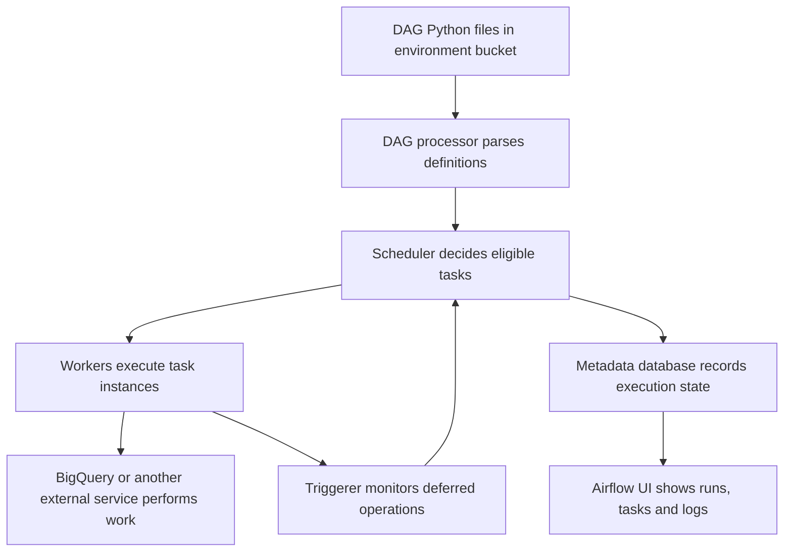
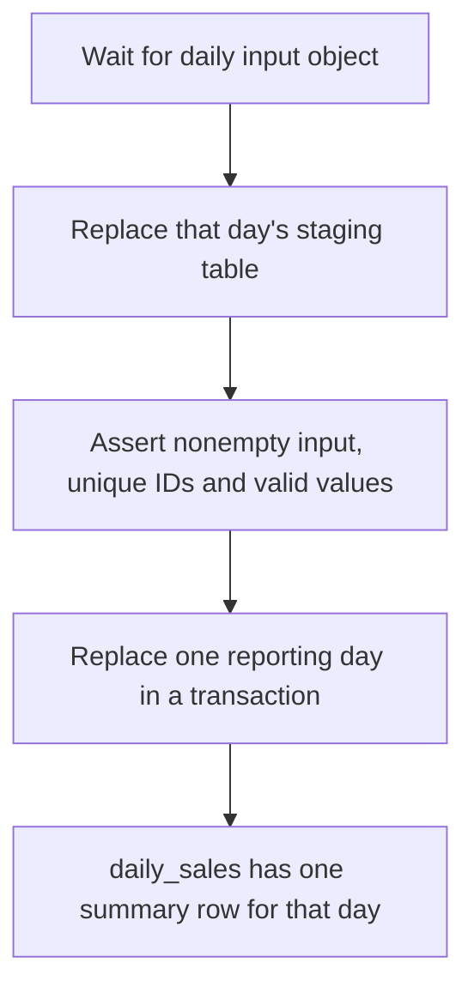
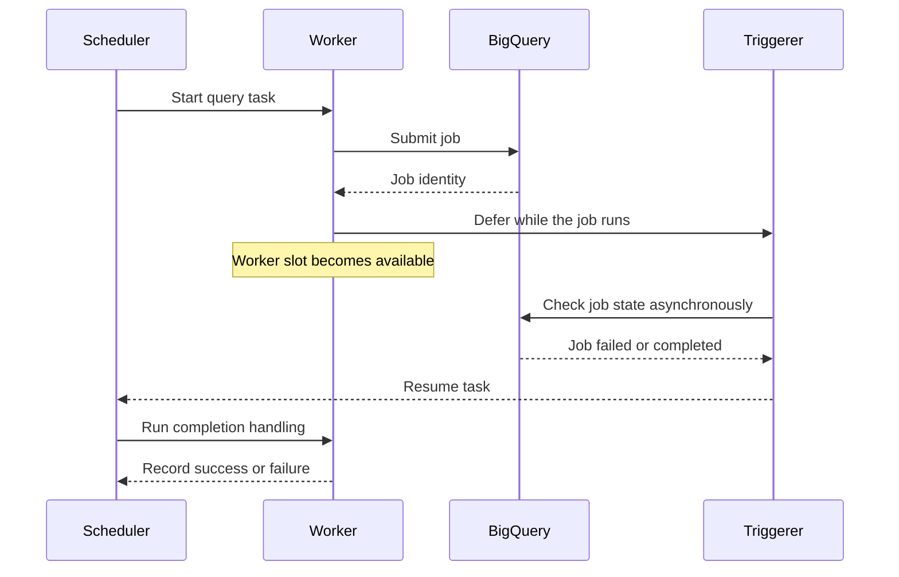

# Managed Service for Apache Airflow: environments, DAGs and BigQuery orchestration

Google Cloud's managed Apache Airflow service is now named **Managed Service for Apache Airflow**, formerly Cloud Composer. The API, CLI and many resource names still use `composer`. This lesson uses Managed Airflow Gen 3 and Airflow 2.11-style Python DAGs. See the [managed environment creation guide](https://docs.cloud.google.com/composer/docs/composer-3/create-environments).

You will create an environment, deploy three complete DAG files, inspect task execution and recover a failed BigQuery pipeline. This extends [lesson 0028](0028-cloud-composer-architecture-gke.md) and applies the load/transform boundaries from [lesson 0038](0038-bigquery-etl-architecture-load-transform-export.md).

The examples include a tiny row-processing DAG, a daily warehouse DAG, and a DAG that creates parallel file-check tasks at runtime. Downloadable Python files appear beside each example.

!!! note "Version and execution scope"
    These examples target Airflow 2.11 on a compatible managed image, with its bundled Google provider. Select and record an available image before deployment. Airflow 3 has API and import changes; do not assume that changing the environment image alone migrates a DAG. The instructions below create billable resources when you run them. No environment was provisioned while authoring this lesson. Sources were checked on 2026-10-26.

## 1. What the managed service does

Airflow coordinates tasks and records their state. A task can submit a BigQuery job and wait for it; the warehouse does the scan and aggregation. Running a large data transformation inside an Airflow worker makes worker capacity part of your data-processing bottleneck.

The managed service operates the Airflow environment infrastructure. You still own DAG logic, provider compatibility, input contracts, IAM, retries, data quality and monitoring. Generation-specific architecture matters: do not apply an older Composer cluster-management procedure to Gen 3 without checking the documentation. See [environment architecture](https://docs.cloud.google.com/composer/docs/composer-3/environment-architecture).



| Component | What you should reason about |
| --- | --- |
| DAG processor | Import errors and slow top-level Python code |
| Scheduler | Dependencies, scheduling delay and concurrency limits |
| Worker | Task code, memory, external requests and execution time |
| Triggerer | Asynchronous waiting for deferrable tasks |
| Metadata database | Run/task state and small inter-task messages |
| Web interface | Graph, Grid, rendered templates, logs and task actions |

Managed does not mean a zero-cost idle environment. Use one disposable environment for these exercises and delete it afterward. For a short sequence of HTTP calls with no Airflow ecosystem requirement, compare [Workflows and Composer](0031-cloud-workflows-vs-composer.md) before adopting Airflow.

## 2. Learn the execution vocabulary

A **DAG** is a directed acyclic graph of tasks. A **DAG run** is one execution of that graph. A **task instance** is one task's execution within a run, with a map index as well when it is dynamically mapped.

An **operator** defines a kind of task, such as submitting a query. A **hook** gives Python code access to a service connection. A **sensor** waits for a condition. An **XCom** carries a small value between tasks, such as an object name or job ID.

Writing `load >> validate` creates a dependency. It does not execute either operation while Python parses the DAG. Airflow repeatedly imports DAG definitions, so keep network calls and data reads inside task execution. See [Airflow best practices](https://airflow.apache.org/docs/apache-airflow/2.11.0/best-practices.html).

For a daily schedule, the run for the interval `2026-10-25 00:00 UTC` through `2026-10-26 00:00 UTC` becomes eligible after that interval ends. `data_interval_start` identifies the beginning of the data interval; it is not the wall-clock time at which a worker starts. `catchup=False` prevents automatic creation of all historical scheduled intervals. See [DAG run and interval semantics](https://airflow.apache.org/docs/apache-airflow/2.10.5/core-concepts/dag-run.html).

!!! tip "Why the date belongs in the input path"
    A retry tomorrow should read the same day's input as the original task. Derive business paths from the data interval or an explicit validated run parameter, rather than calling `datetime.now()` inside the loader.

## 3. Create the environment and identities

Use an authenticated Cloud Shell session or a local Google Cloud CLI. The creating user needs environment creation permission, permission to enable services and manage the lab resources, and permission to act as the environment service account. Keep the deployer identity separate from the identity executing DAGs.

```bash
export PROJECT_ID="your-disposable-project-id"
export REGION="us-central1"
export ENV_NAME="airflow-learning"
export INPUT_BUCKET="${PROJECT_ID}-airflow-input"
export ENV_SA="airflow-learning@${PROJECT_ID}.iam.gserviceaccount.com"
gcloud config set project "$PROJECT_ID"
gcloud services enable composer.googleapis.com bigquery.googleapis.com storage.googleapis.com

gcloud iam service-accounts create airflow-learning
gcloud projects add-iam-policy-binding "$PROJECT_ID" \
  --member="serviceAccount:${ENV_SA}" --role=roles/composer.worker
gcloud projects add-iam-policy-binding "$PROJECT_ID" \
  --member="serviceAccount:${ENV_SA}" --role=roles/bigquery.jobUser

bq --location="$REGION" mk --dataset "${PROJECT_ID}:airflow_lab"
gcloud storage buckets create "gs://${INPUT_BUCKET}" \
  --location="$REGION" --uniform-bucket-level-access
gcloud storage buckets add-iam-policy-binding "gs://${INPUT_BUCKET}" \
  --member="serviceAccount:${ENV_SA}" --role=roles/storage.objectViewer
```

In BigQuery, open dataset `airflow_lab` → **Sharing → Permissions** and grant the environment service account **BigQuery Data Editor** on that dataset. The service account can now submit jobs, read the input objects and write lab tables. It does not need Owner on the project.

In the managed Airflow console, choose **Create environment → Gen 3**, region `us-central1`, a supported Airflow 2.11 image, the service account above and a small workload configuration. Enable at least one triggerer for the BigQuery tasks that defer. Use the networking configuration allowed by your project; private sources require appropriate routes, DNS and access to Google APIs.

Alternatively, list available image versions and create through the CLI:

```bash
gcloud composer image-versions list --location="$REGION"
export IMAGE_VERSION="REPLACE_WITH_AVAILABLE_COMPOSER_3_AIRFLOW_2_11_BUILD"
gcloud composer environments create "$ENV_NAME" \
  --location="$REGION" \
  --image-version="$IMAGE_VERSION" \
  --service-account="$ENV_SA"
```

Use one creation method. The placeholder deliberately requires selection from the available images rather than silently choosing a different Airflow major version. Record the environment image, Python version and Google provider version in your lab notes. In the environment's configuration, verify triggerer capacity before running DAG 2. Environment creation can take many minutes. See [environment setup and service account requirements](https://docs.cloud.google.com/composer/docs/composer-3/create-environments).

DAG authors who can upload Python into the environment can execute code with its service account permissions. Restrict write access to the environment bucket accordingly. Do not place service account key files in DAG code; the examples use `google_cloud_default` with the environment identity.

## 4. DAG 1: process a few sample rows with TaskFlow

[Download row_taskflow.py](../examples/managed-airflow/row_taskflow.py).

This example is intentionally tiny. It demonstrates function tasks, automatic dependencies and small XCom results. The final task validates and logs the summary; it does not persist a warehouse table. TaskFlow constructs task instances when the decorated functions are called in the DAG definition. See [TaskFlow](https://airflow.apache.org/docs/apache-airflow/2.11.0/tutorial/taskflow.html).

```python
"""Tiny row-processing example for Airflow 2.11; no external services."""
from datetime import timedelta
import logging

import pendulum
from airflow.decorators import dag, task


@dag(
    dag_id="lab_row_taskflow",
    start_date=pendulum.datetime(2026, 1, 1, tz="UTC"),
    schedule=None,
    catchup=False,
    max_active_runs=1,
    default_args={"retries": 1, "retry_delay": timedelta(seconds=30)},
    tags=["lesson-0039", "taskflow"],
)
def row_taskflow():
    @task
    def sample_rows():
        return [
            {"order_id": 101, "amount_cents": 2500, "status": "paid"},
            {"order_id": 102, "amount_cents": 4200, "status": "paid"},
            {"order_id": 103, "amount_cents": 1800, "status": "cancelled"},
        ]

    @task
    def summarize(rows):
        for row in rows:
            if row["amount_cents"] < 0:
                raise ValueError(f"Negative amount for order {row['order_id']}")
        paid = [row for row in rows if row["status"] == "paid"]
        return {"paid_orders": len(paid), "paid_cents": sum(r["amount_cents"] for r in paid)}

    @task
    def verify(summary):
        if summary != {"paid_orders": 2, "paid_cents": 6700}:
            raise ValueError(f"Unexpected sample result: {summary}")
        logging.info("Verified sample: %s", summary)

    verify(summarize(sample_rows()))  # (1)!


row_taskflow()
```

1. Passing a task result into another decorated task creates both an XCom reference and a dependency.

Expected graph: `sample_rows → summarize → verify`. The verify task should log two paid orders and 6,700 cents. The cancelled order contributes nothing.

Change one amount to a negative number and redeploy. The summarize task should fail and retry once; verify must not run successfully. Restore the fixture afterward. A retry cannot fix deterministically invalid data.

!!! note "Rows in XCom are a teaching shortcut"
    Three small dictionaries are appropriate here. For a real table, pass a Storage URI, partition identifier or BigQuery job ID. Tasks can run on different workers, so do not use a worker's local file as an inter-task contract.

## 5. Prepare the daily warehouse fixture

DAG 2 treats each input file as the complete set of orders for one business day. It is not a CDC stream. Order IDs must be unique within the file, and input objects must remain immutable while a run or retry is in progress.

Create yesterday's UTC fixture so it matches the latest completed daily interval. An explicit date is used so you can inspect the path before publishing it.

```bash
export LAB_DAY="$(python3 -c 'from datetime import datetime,timedelta,timezone; print((datetime.now(timezone.utc)-timedelta(days=1)).date())')"
cat > orders.ndjson <<'JSON'
{"order_id":101,"amount_cents":2500,"status":"paid"}
{"order_id":102,"amount_cents":4200,"status":"paid"}
{"order_id":103,"amount_cents":1800,"status":"cancelled"}
JSON
gcloud storage cp orders.ndjson "gs://${INPUT_BUCKET}/daily/${LAB_DAY}/orders.ndjson"
```

Use `LAB_DAY` only to create the fixture. The DAG derives its path from the scheduled data interval. If you run the lab after another UTC day starts, create the fixture for that run's rendered interval instead.

## 6. DAG 2: wait, load, validate and publish to BigQuery

[Download daily_orders.py](../examples/managed-airflow/daily_orders.py). Replace `YOUR_PROJECT_ID` and `YOUR_INPUT_BUCKET` in your copy before uploading it.



The sensor uses reschedule mode to release its worker slot between checks. BigQuery operators use deferrable mode, which requires a triggerer and compatible provider. These are different waiting mechanisms. See the [GCS sensor API](https://airflow.apache.org/docs/apache-airflow-providers-google/stable/_api/airflow/providers/google/cloud/sensors/gcs/index.html) and [BigQuery operator API](https://airflow.apache.org/docs/apache-airflow-providers-google/stable/_api/airflow/providers/google/cloud/operators/bigquery/index.html).

```python
"""Airflow 2.11: immutable daily file -> staging -> validated partition."""
from datetime import timedelta

import pendulum
from airflow import DAG
from airflow.providers.google.cloud.operators.bigquery import BigQueryInsertJobOperator
from airflow.providers.google.cloud.sensors.gcs import GCSObjectExistenceSensor

PROJECT = "YOUR_PROJECT_ID"
BUCKET = "YOUR_INPUT_BUCKET"
REGION = "us-central1"
DATASET = "airflow_lab"
DAY = "{{ data_interval_start | ds }}"
DAY_ID = "{{ data_interval_start | ds_nodash }}"
RAW_TABLE = f"orders_raw_{DAY_ID}"

SCHEMA = [
    {"name": "order_id", "type": "INTEGER", "mode": "REQUIRED"},
    {"name": "amount_cents", "type": "INTEGER", "mode": "REQUIRED"},
    {"name": "status", "type": "STRING", "mode": "REQUIRED"},
]

with DAG(
    dag_id="lab_daily_orders",
    start_date=pendulum.datetime(2026, 1, 1, tz="UTC"),
    schedule="@daily",
    catchup=False,
    max_active_runs=1,
    dagrun_timeout=timedelta(hours=2),
    default_args={
        "retries": 2,
        "retry_delay": timedelta(minutes=2),
        "retry_exponential_backoff": True,
        "execution_timeout": timedelta(minutes=45),
    },
    tags=["lesson-0039", "bigquery"],
) as daily_orders:
    wait_for_file = GCSObjectExistenceSensor(
        task_id="wait_for_file",
        bucket=BUCKET,
        object=f"daily/{DAY}/orders.ndjson",
        google_cloud_conn_id="google_cloud_default",
        mode="reschedule",
        deferrable=False,
        poke_interval=60,
        timeout=1800,
    )

    load_raw = BigQueryInsertJobOperator(
        task_id="load_raw",
        project_id=PROJECT,
        location=REGION,
        gcp_conn_id="google_cloud_default",
        deferrable=True,
        force_rerun=True,
        configuration={
            "load": {
                "sourceUris": [f"gs://{BUCKET}/daily/{DAY}/orders.ndjson"],
                "destinationTable": {
                    "projectId": PROJECT,
                    "datasetId": DATASET,
                    "tableId": RAW_TABLE,
                },
                "sourceFormat": "NEWLINE_DELIMITED_JSON",
                "schema": {"fields": SCHEMA},
                "writeDisposition": "WRITE_TRUNCATE",
                "createDisposition": "CREATE_IF_NEEDED",
                "maxBadRecords": 0,
            }
        },
    )

    validate = BigQueryInsertJobOperator(
        task_id="validate",
        project_id=PROJECT,
        location=REGION,
        deferrable=True,
        configuration={
            "query": {
                "useLegacySql": False,
                "query": f"""
                ASSERT (SELECT COUNT(*) > 0 FROM `{PROJECT}.{DATASET}.{RAW_TABLE}`)
                  AS 'Empty daily file';
                ASSERT (
                  SELECT COUNT(*) = COUNT(DISTINCT order_id)
                  FROM `{PROJECT}.{DATASET}.{RAW_TABLE}`
                ) AS 'Duplicate order IDs';
                ASSERT (
                  SELECT COUNT(*) = 0 FROM `{PROJECT}.{DATASET}.{RAW_TABLE}`
                  WHERE amount_cents < 0 OR status NOT IN ('paid', 'cancelled')
                ) AS 'Invalid order values';
                """,
            }
        },
    )

    publish = BigQueryInsertJobOperator(
        task_id="publish",
        project_id=PROJECT,
        location=REGION,
        deferrable=True,
        force_rerun=True,
        configuration={
            "query": {
                "useLegacySql": False,
                "query": f"""
                CREATE TABLE IF NOT EXISTS `{PROJECT}.{DATASET}.daily_sales` (
                  business_date DATE, paid_orders INT64, paid_amount NUMERIC
                ) PARTITION BY business_date;
                BEGIN TRANSACTION;
                DELETE FROM `{PROJECT}.{DATASET}.daily_sales`
                  WHERE business_date = DATE('{DAY}');
                INSERT INTO `{PROJECT}.{DATASET}.daily_sales`
                SELECT DATE('{DAY}'), COUNT(*),
                       COALESCE(SUM(CAST(amount_cents AS NUMERIC)), 0) / 100
                FROM `{PROJECT}.{DATASET}.{RAW_TABLE}`
                WHERE status = 'paid';
                COMMIT TRANSACTION;
                """,
            }
        },
    )

    wait_for_file >> load_raw >> validate >> publish
```

The job configuration is a BigQuery API request, embedded in an Airflow task. Airflow renders Jinja templates inside it before submission. `DAY_ID` chooses a distinct staging table for each interval; `DAY` chooses the reporting partition.

For the sample input, query the output:

```sql
SELECT business_date, paid_orders, paid_amount
FROM `YOUR_PROJECT_ID.airflow_lab.daily_sales`
ORDER BY business_date DESC;
```

Expect `LAB_DAY`, `2`, `67.00`. There should be one row for that day, even after clearing and rerunning publish.

### Why these writes tolerate a retry

The load uses `WRITE_TRUNCATE` on a day-specific staging table. Publication deletes and reinserts only the target business date within a transaction. Repeating the work against unchanged inputs produces the same table contents. See [BigQuery transactions](https://cloud.google.com/bigquery/docs/transactions).

`force_rerun=True` allows a new BigQuery job on another attempt. That may repeat compute; it does not promise one job execution. Here we deliberately make the writes repeatable instead of claiming exactly-once orchestration.

For a production design using stable job IDs and `force_rerun=False`, examine the installed provider's reattachment behavior. Reattaching to running jobs and recovering an already completed job are separate cases. Do not copy `reattach_states` settings without testing the worker-loss and completed-job paths against that provider version. See [BigQuery job submission behavior](https://airflow.apache.org/docs/apache-airflow-providers-google/stable/operators/cloud/bigquery.html).

`max_active_runs=1` prevents concurrent runs of this DAG. It does not prevent another DAG or user from writing these tables. Give each output one coordinated publication path. Keep staging tables long enough for investigation, then expire them through a retention policy.

### What happens when quality fails

If a daily file repeats an order ID, validate fails before publish. The previous published day remains intact. If a task is cleared, it becomes eligible for execution again according to its dependencies. Clearing a task is not a rollback of its previous external side effects.

The existence sensor proves that one named object exists. For a multi-file batch, use a producer-published completion manifest rather than assuming the first object means the whole batch is complete.

## 7. DAG 3: map checks over a runtime file list

[Download mapped_file_checks.py](../examples/managed-airflow/mapped_file_checks.py). Replace `YOUR_INPUT_BUCKET` in your copy.

Create two small fixture objects:

```bash
gcloud storage cp orders.ndjson "gs://${INPUT_BUCKET}/mapped/part-01.ndjson"
gcloud storage cp orders.ndjson "gs://${INPUT_BUCKET}/mapped/part-02.ndjson"
```

The discovery task lists objects at execution time. `.expand()` creates a mapped task instance per filename. Only filenames and summaries cross XCom. See [dynamic task mapping](https://airflow.apache.org/docs/apache-airflow/2.10.5/authoring-and-scheduling/dynamic-task-mapping.html).

```python
"""Airflow 2.11: map over small, immutable fixture files at runtime."""
from datetime import timedelta
import json
import logging

import pendulum
from airflow.decorators import dag, task
from airflow.exceptions import AirflowFailException
from airflow.providers.google.cloud.hooks.gcs import GCSHook

BUCKET = "YOUR_INPUT_BUCKET"


@dag(
    dag_id="lab_mapped_file_checks",
    start_date=pendulum.datetime(2026, 1, 1, tz="UTC"),
    schedule=None,
    catchup=False,
    max_active_runs=1,
    default_args={"retries": 1, "retry_delay": timedelta(seconds=30)},
    tags=["lesson-0039", "mapping"],
)
def mapped_file_checks():
    @task
    def discover():
        names = GCSHook(gcp_conn_id="google_cloud_default").list(
            bucket_name=BUCKET, prefix="mapped/"
        )
        files = sorted(name for name in names if name.endswith(".ndjson"))
        if not files:
            raise AirflowFailException("No input files; check the fixture prefix")
        if len(files) > 20:
            raise AirflowFailException("This lab is limited to 20 small files")
        return files

    @task(max_active_tis_per_dag=2)
    def check_file(object_name):
        payload = GCSHook(gcp_conn_id="google_cloud_default").download(
            bucket_name=BUCKET, object_name=object_name
        )
        rows = [json.loads(line) for line in payload.decode("utf-8").splitlines() if line.strip()]
        if not rows:
            raise AirflowFailException(f"Empty file: {object_name}")
        for row in rows:
            if row["amount_cents"] < 0:
                raise AirflowFailException(f"Negative amount in {object_name}")
        return {"object": object_name, "rows": len(rows)}

    @task
    def report(results):
        summaries = list(results)
        logging.info("Validated %s files, %s rows", len(summaries), sum(x["rows"] for x in summaries))

    report(check_file.expand(object_name=discover()))


mapped_file_checks()
```

Expect two mapped instances and a report of two files and six rows. The files intentionally contain the same fixture; this example checks files independently and does not perform business deduplication.

A negative amount raises `AirflowFailException`, which fails that task without spending its retry allowance on invalid data. A transient service exception can still use the configured retry. The report task uses the default all-success dependency, so it should not report successful completion when a mapped check fails.

This lab downloads small files into worker memory. For large objects, have each mapped task submit a bounded Dataflow or BigQuery job instead. Map partitions or batches rather than millions of individual rows. The `max_active_tis_per_dag=2` setting limits concurrent instances of the mapped checker across its DAG runs; it is not a file-size limit.

## 8. Deploy and inspect the DAGs

Save the three Python files in a local directory named `dags`. Keep their filenames distinct. Upload to the environment's DAG prefix:

```bash
export DAG_PREFIX="$(gcloud composer environments describe "$ENV_NAME" \
  --location="$REGION" --format='value(config.dagGcsPrefix)')"
gcloud storage cp dags/row_taskflow.py dags/daily_orders.py \
  dags/mapped_file_checks.py "${DAG_PREFIX}/"
```

Managed Airflow synchronizes DAG files from this bucket to its components. Upload completion does not mean parsing has already completed. Open the Airflow UI from the environment page and wait for the DAG IDs to appear. Check import errors if they do not. See [adding and updating DAGs](https://docs.cloud.google.com/composer/docs/composer-3/manage-dags).

1. Unpause and trigger `lab_row_taskflow`. Inspect each task's logs and its small XCom return value.
2. Unpause `lab_daily_orders`. Let the scheduler create the latest eligible daily run. Inspect the rendered `sourceUris` to confirm it matches `LAB_DAY` before diagnosing a sensor timeout.
3. Trigger `lab_mapped_file_checks`. Open the mapped task and inspect map indexes 0 and 1, then the report log.
4. For DAG 2, compare task state with the external BigQuery job state and job error details. A task log provides the orchestration context; the job details provide the warehouse failure.

A manual daily DAG run can have interval semantics that surprise you. Inspect its rendered interval and source path rather than assuming the day you clicked Trigger is the business date. For a controlled historical reprocessing exercise, choose a known interval through the version-specific backfill controls and keep `max_active_runs=1`.

## 9. Check code before deploying it

Python compilation catches syntax errors but cannot verify Airflow/provider imports:

```bash
python3 -m compileall -q dags
```

In a disposable development environment that matches the selected managed image's Python, Airflow and provider versions, save this as `check_dags.py`:

```python
from airflow.models import DagBag

bag = DagBag(dag_folder="dags", include_examples=False)
assert not bag.import_errors, bag.import_errors
expected = {"lab_row_taskflow", "lab_daily_orders", "lab_mapped_file_checks"}
assert expected <= set(bag.dags), set(bag.dags)
assert bag.get_dag("lab_daily_orders").get_task("publish").upstream_task_ids == {"validate"}
print("DAG imports and publication dependency passed")
```

Run `python check_dags.py` there, then exercise the managed environment with disposable input. Do not replace the managed environment's core Airflow packages with an arbitrary pip upgrade. A green import check is necessary but does not exercise IAM, networking, templates or external jobs.

## 10. Diagnose the failure boundary



| Symptom | Inspect first | Likely action |
| --- | --- | --- |
| DAG does not appear | Import errors and synchronized file | Fix syntax/imports or wait for synchronization |
| Task stays scheduled or queued | Worker capacity, pools, task concurrency | Find the actual capacity limit before scaling |
| Sensor keeps rescheduling | Rendered path and object permissions | Fix the day/path or grant object read access |
| Deferred query does not resume | Triggerer health and external job | Restore triggerer capacity; inspect job state |
| BigQuery access denied | Environment identity and dataset grants | Grant the missing permission at its resource scope |
| Validation fails | Raw staging rows and assertion error | Repair the source contract before rerunning |
| Duplicate reporting rows | Write semantics and other writers | Restore partition replacement and one writer policy |
| Run appears successful after failure | Leaf tasks and trigger rules | Keep failure visible to the final DAG state |

A final cleanup task using `all_done` can make a successful leaf hide an earlier task failure in the DAG-run result. Keep publication on success-only dependencies and design cleanup separately. See [DAG run status and leaf tasks](https://airflow.apache.org/docs/apache-airflow/2.10.5/core-concepts/dag-run.html).

## 11. Production changes to justify before rollout

- Pin the managed image and record provider versions. Test upgrades with these DAGs and representative failures.
- Use separate environments or identities when DAGs need different trust boundaries. DAG editing is code execution with the environment identity.
- Set pools and concurrency from downstream quotas. More worker capacity cannot fix a BigQuery permission failure.
- Keep credentials in supported connections or a secrets backend. Pass resource identifiers through XCom and keep bulk data in external storage.
- Alert on data freshness and failed publication, as well as scheduler/worker health. A healthy scheduler can repeatedly run an incorrect DAG.
- Define input completeness, immutable source identities and replay policy. The sample daily-file convention is deliberately simpler than a production manifest.

## 12. Recall and recovery exercises

Before reopening the code, answer:

1. Which process executes a Python task, and which system executes its submitted SQL?
2. How is a DAG different from a DAG run and a mapped task instance?
3. Why does the daily run use the start of its data interval in the file path?
4. What state is held in XCom, and why should a large DataFrame not be put there?
5. How do reschedule mode and deferrable mode release worker capacity differently?
6. Why does clearing publish not duplicate the day's reporting row?
7. Does retrying a task automatically make its external writes safe?

??? note "Check your answers"
    1. The Airflow worker runs task code; BigQuery executes the SQL job.
    2. The DAG is the definition; the run is one execution; a mapped instance adds a specific expanded input index.
    3. It identifies the data being processed independently of the attempt's wall-clock time.
    4. Small results or identifiers. Bulk data increases metadata/storage pressure and serialization work.
    5. A rescheduled sensor periodically becomes a runnable task again; a deferred operator delegates waiting to a triggerer before resuming.
    6. Publication transactionally replaces that date's row rather than appending another result.
    7. No. Safe retries require stable inputs and deliberate external write semantics.

Try these experiments:

- Remove the daily fixture before a new run and observe rescheduling, then restore the object before timeout.
- Add a duplicate order to a new disposable day's file. Prove validation blocks publication.
- Clear publish after a successful run. Query the target day and prove there is still exactly one row with 67.00.
- Add a third small mapped file. Predict the number of mapped instances and the final row count.
- Describe how you would recover if a worker died immediately after BigQuery accepted a job. Separate duplicate compute from duplicate business output.

Record observations before claiming mastery. Reading the DAG files alone does not demonstrate that their runtime behavior is understood.

## 13. Cleanup

Pause the lab DAGs and let their tasks and external jobs finish, or explicitly cancel those jobs. Delete the environment after reviewing its name:

```bash
gcloud composer environments delete "$ENV_NAME" --location="$REGION"
```

Inspect retained environment storage and logs after deletion; do not assume every associated object is removed. Delete the dedicated input bucket and dataset when no lab task needs them:

```bash
bq rm -r -f -d "${PROJECT_ID}:airflow_lab"
gcloud storage rm --recursive "gs://${INPUT_BUCKET}"
gcloud projects remove-iam-policy-binding "$PROJECT_ID" \
  --member="serviceAccount:${ENV_SA}" --role=roles/bigquery.jobUser
gcloud projects remove-iam-policy-binding "$PROJECT_ID" \
  --member="serviceAccount:${ENV_SA}" --role=roles/composer.worker
gcloud iam service-accounts delete "$ENV_SA"
```

Remove the retained environment bucket only after confirming it belongs to this disposable lab. Deleting the dedicated project is another option after reviewing its contents.

## References and related lessons

The [reference catalog](../references/resources.md#managed-airflow-environment-and-dag-lab) records the official sources. Continue with [resilient DAGs](0029-resilient-dags-deferrable-operators.md), [mapping and XComs](0030-dynamic-task-mapping-airflow-best-practices.md), and [BigQuery load-transform-export](0038-bigquery-etl-architecture-load-transform-export.md).

| Previous Lesson | All Lessons | Next Lesson |
| :--- | :---: | ---: |
| [0038: BigQuery ETL architecture](0038-bigquery-etl-architecture-load-transform-export.md) | [Lesson catalog](index.md) | None yet |
