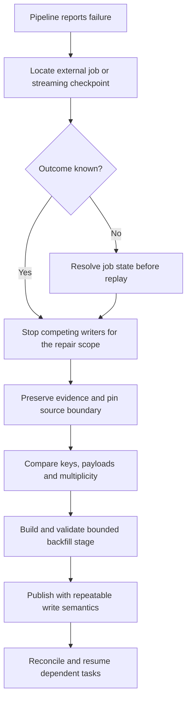
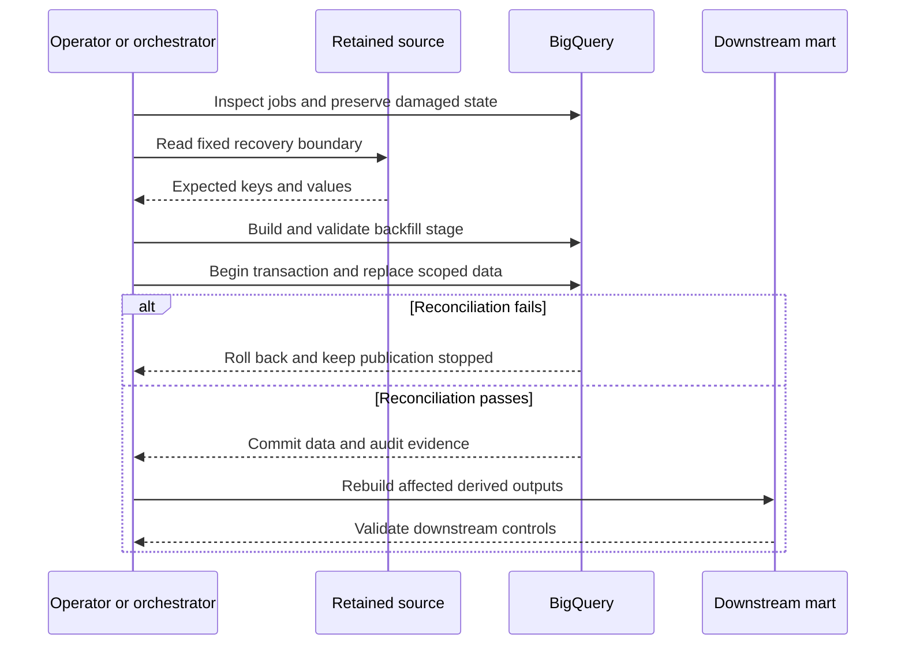

# Recovering failed BigQuery pipelines: duplicates, missing rows and safe backfills

A failed Airflow task does not tell you whether BigQuery committed its work. Before restarting, establish the external job's outcome, identify which records are already present, and define exactly what the recovery will replace or append.

This lesson extends [the managed Airflow lab](0039-managed-airflow-environments-dags.md) and the mission's production-debugging goals. You will reproduce a failed pipeline, find duplicate and missing events, repair one partition, and prove that repeating the recovery does not duplicate business data.

!!! note "Lab scope"
    The examples use a disposable dataset and deliberately introduce bad data. Replace `YOUR_PROJECT_ID` in all SQL files. No cloud jobs were executed while authoring this lesson. Official source behavior was checked on 2026-10-26. Run the numbered SQL files in order; only the repair and reconciliation steps are intended to be repeated.

## 1. First determine what actually failed

Distinguish these three states:

| Observation | What it means | What to do before replay |
| --- | --- | --- |
| BigQuery job is still running | Outcome is not final | Inspect or wait for that job; do not launch a competing repair |
| BigQuery job completed successfully but the client timed out | The external write may already be committed | Reconcile the destination and repair orchestration state |
| BigQuery job ended with an error | That operation failed | Determine its atomicity boundary and inspect earlier successful operations |

`DONE` means the job has finished, not necessarily that it succeeded. Inspect `status.errorResult`, the job configuration and its statistics. Keep the job's project, region and ID together. See [managing BigQuery jobs](https://docs.cloud.google.com/bigquery/docs/managing-jobs).

```bash
export PROJECT_ID="your-disposable-project-id"
export REGION="us-central1"
export JOB_ID="the-actual-bigquery-job-id"
bq --project_id="$PROJECT_ID" --location="$REGION" show \
  --job=true --format=prettyjson "$JOB_ID"
```

Record the DAG ID, run ID, task ID, try number, BigQuery job IDs, destination table/partition, source object generations or source offset range, and code revision. A screenshot of a red task alone cannot establish which rows were committed.

### Query the job history

Run this query in `us-central1`, replacing the project. Use the region where the job ran; `region-us` and `region-us-central1` are different locations.

```sql
SELECT creation_time, job_id, parent_job_id, job_type, statement_type,
       state, error_result.reason AS reason, error_result.message AS message,
       destination_table, total_bytes_processed, total_slot_ms
FROM `YOUR_PROJECT_ID.region-us-central1.INFORMATION_SCHEMA.JOBS_BY_PROJECT`
WHERE creation_time >= TIMESTAMP_SUB(CURRENT_TIMESTAMP(), INTERVAL 1 DAY)
ORDER BY creation_time DESC
LIMIT 100;
```

For a multi-statement script, inspect its child jobs as well:

```sql
SELECT job_id, statement_type, state, error_result, query
FROM `YOUR_PROJECT_ID.region-us-central1.INFORMATION_SCHEMA.JOBS_BY_PROJECT`
WHERE parent_job_id = 'REPLACE_WITH_SCRIPT_JOB_ID'
ORDER BY creation_time;
```

Project-wide inspection needs permission to list all project jobs, such as BigQuery Resource Viewer, as well as permission to run the metadata query. An operator can use the user-scoped jobs view when authorized only for their own jobs. Job history gives execution evidence; it is not an inventory of every event delivered by streaming APIs. See [INFORMATION_SCHEMA.JOBS](https://docs.cloud.google.com/bigquery/docs/information-schema-jobs).

## 2. Know the write's atomicity boundary

| Ingestion or execution path | Recovery implication |
| --- | --- |
| One batch load job | Its destination change is atomic. A failed load does not leave half of that job's accepted data committed. Earlier successful load jobs remain. |
| Multiple load jobs in one pipeline | File A may have committed while file B failed. Replaying both with append can duplicate A. |
| SQL script without an explicit transaction | Earlier successful DML statements may have committed before a later statement fails. |
| Explicit BigQuery transaction | Its included mutations commit together or roll back on an unhandled failure. |
| `tabledata.insertAll` | Inspect row-indexed errors. Request-level success does not imply every row succeeded. A transport failure may leave the outcome unknown. |
| Storage Write API gRPC | Retry semantics depend on stream type and use of offsets. An offset is meaningful within its stream. |
| Pub/Sub, Dataflow or CDC pipeline | Some records may already be delivered while later processing fails. Recover using event identities and source/checkpoint state. |

Batch atomicity applies to the records accepted under the load configuration. If bad records are permitted, a successful job can still omit rejected rows. Use `max_bad_records=0` for strict lab loads and reconcile against source controls. See [batch loading](https://docs.cloud.google.com/bigquery/docs/batch-loading-data).

For row-level errors, retain the original request-to-row mapping and inspect each error before retrying. Best-effort `insertId` deduplication is not a durable business-key constraint. See [insertAll response fields](https://docs.cloud.google.com/bigquery/docs/reference/rest/v2/tabledata/insertAll) and [REST streaming behavior](https://docs.cloud.google.com/bigquery/docs/write-api-rest). For gRPC, application-created streams with offsets support deduplication within the stream; the default stream uses at-least-once semantics. See [Storage Write API](https://docs.cloud.google.com/bigquery/docs/write-api-grpc).



## 3. Define what counts as a duplicate or missing row

For this lab, `(event_day, event_id)` identifies an immutable event. An order can have multiple legitimate versions with different event IDs. The expected source is a complete export for one day.

- An exact duplicate repeats the event identity and business payload. Ingestion-attempt metadata can differ.
- A conflicting duplicate repeats an event identity with different business values. Picking an arbitrary row hides corruption.
- A missing event has an expected identity that is absent from the destination.
- An incorrect event has the expected identity but the wrong payload.
- An unexpected event exists in the target but is outside the authoritative source set for the same boundary.

The phrase "remaining rows" needs a definition. Rows not yet present and rows present with wrong values are different repair sets. A queue backlog measures another boundary again; it is not automatically the list of missing warehouse events.

!!! tip "You need an authoritative expected set"
    If the source is still changing, first identify a retained export, source snapshot, commit position or bounded event range. Target counts alone cannot tell you what is missing. If you only have an expected count, you can detect a count discrepancy but cannot name all missing IDs or prove value equality.

## 4. Create the incident fixture

Use a billing-enabled disposable project and authenticated `gcloud`/`bq`. The lab operator needs BigQuery Job User plus dataset read/write and snapshot creation permissions. Create a separate dataset:

```bash
gcloud config set project "$PROJECT_ID"
gcloud services enable bigquery.googleapis.com
bq --location="$REGION" mk --dataset "${PROJECT_ID}:recovery_lab"
```

The source contains e1 through e6, worth 21,000 cents in total. A row in a different target partition will prove that recovery stays within its date boundary.

[Download 00_setup.sql](../examples/bigquery-recovery/00_setup.sql).

```sql
-- Run once in a new recovery_lab dataset. Replace YOUR_PROJECT_ID throughout.
CREATE TABLE `YOUR_PROJECT_ID.recovery_lab.expected_events` (
  event_day DATE, event_id STRING, order_id INT64, version INT64,
  amount_cents INT64, status STRING
);
INSERT INTO `YOUR_PROJECT_ID.recovery_lab.expected_events` VALUES
  ('2026-10-25', 'e1', 101, 1, 1000, 'paid'),
  ('2026-10-25', 'e2', 102, 1, 2000, 'paid'),
  ('2026-10-25', 'e3', 103, 1, 3000, 'paid'),
  ('2026-10-25', 'e4', 104, 1, 4000, 'paid'),
  ('2026-10-25', 'e5', 105, 1, 5000, 'paid'),
  ('2026-10-25', 'e6', 106, 1, 6000, 'paid');

CREATE TABLE `YOUR_PROJECT_ID.recovery_lab.actual_events` (
  event_day DATE, event_id STRING, order_id INT64, version INT64,
  amount_cents INT64, status STRING, ingest_attempt STRING
) PARTITION BY event_day CLUSTER BY event_id;
-- A different day's row must survive the repair.
INSERT INTO `YOUR_PROJECT_ID.recovery_lab.actual_events`
VALUES ('2026-10-24', 'keep-me', 999, 1, 999, 'paid', 'earlier-run');

CREATE TABLE `YOUR_PROJECT_ID.recovery_lab.recovery_audit` (
  recovery_id STRING, event_day DATE, source_boundary STRING,
  verified_rows INT64, verified_cents INT64, verified_at TIMESTAMP
);
```

Run the setup once. Then run the following incident simulation exactly once. It deliberately performs committed inserts before failing. This simulates several pipeline attempts, not a partially committed batch load job.

[Download 01_simulate_failure.sql](../examples/bigquery-recovery/01_simulate_failure.sql).

```sql
-- Run exactly once. This script deliberately fails AFTER committed writes.
-- There is no explicit transaction around the script.
INSERT INTO `YOUR_PROJECT_ID.recovery_lab.actual_events`
SELECT *, 'attempt-1'
FROM `YOUR_PROJECT_ID.recovery_lab.expected_events`
WHERE event_id IN ('e1', 'e2');

INSERT INTO `YOUR_PROJECT_ID.recovery_lab.actual_events` VALUES
  ('2026-10-25', 'e2', 102, 1, 2000, 'paid', 'unsafe-retry'),
  ('2026-10-25', 'e3', 103, 1, 3500, 'paid', 'bad-transform'),
  ('2026-10-25', 'e4', 104, 1, 4000, 'paid', 'attempt-2'),
  ('2026-10-25', 'unexpected', 9999, 1, 6000, 'paid', 'wrong-input');

ASSERT FALSE AS 'Simulated orchestration failure after committed inserts';
```

The script should end with `Simulated orchestration failure after committed inserts`. Inspect its child jobs. Both inserts succeeded; the final assertion failed. SQL scripts are not automatically one transaction. See [transaction boundaries](https://docs.cloud.google.com/bigquery/docs/transactions).

In Cloud Shell, after saving and substituting the downloaded files:

```bash
bq --location="$REGION" query --use_legacy_sql=false < 00_setup.sql
bq --location="$REGION" query --use_legacy_sql=false < 01_simulate_failure.sql
# The second command is expected to fail. Do not rerun it to retry the lab.
```

The damaged day contains:

| Event | What happened |
| --- | --- |
| e1 | Correct |
| e2 | Correct payload inserted twice |
| e3 | Incorrect amount, 3,500 instead of 3,000 |
| e4 | Correct |
| e5 and e6 | Missing |
| unexpected | Does not belong to the source set |

There are six physical destination rows for the day, exactly the source row count. This is why `expected_count - actual_count` is not a reliable missing-row calculation.

## 5. Reconcile the actual rows

Freeze writers for the affected scope before using these results to plan a repair. Pausing an Airflow DAG prevents future scheduling but does not prove already-running tasks or external jobs have stopped. Verify those jobs separately.

The following script creates temporary observations and returns six result sets. In the console, inspect each statement's results. The command-line presentation of script results can differ; execute individual diagnostic SELECTs in the same editor script/session when inspecting them interactively.

[Download 02_reconcile.sql](../examples/bigquery-recovery/02_reconcile.sql).

```sql
DECLARE repair_day DATE DEFAULT DATE '2026-10-25';

-- Materialize the observation once. Freeze writers before relying on it.
CREATE TEMP TABLE expected AS
SELECT * FROM `YOUR_PROJECT_ID.recovery_lab.expected_events`
WHERE event_day = repair_day;
CREATE TEMP TABLE observed AS
SELECT * FROM `YOUR_PROJECT_ID.recovery_lab.actual_events`
WHERE event_day = repair_day;

-- First result: counts alone do not establish equality.
SELECT 'source' AS side, COUNT(*) AS physical_rows,
       COUNT(DISTINCT event_id) AS distinct_ids, SUM(amount_cents) AS cents
FROM expected
UNION ALL
SELECT 'target', COUNT(*), COUNT(DISTINCT event_id), SUM(amount_cents)
FROM observed;

-- Second result: duplicate event IDs and whether their payloads disagree.
SELECT event_id, COUNT(*) AS copies,
       COUNT(DISTINCT TO_JSON_STRING(STRUCT(order_id, version, amount_cents, status))) AS payload_variants,
       ARRAY_AGG(ingest_attempt ORDER BY ingest_attempt) AS attempts
FROM observed
GROUP BY event_id
HAVING COUNT(*) > 1;

-- Third result: expected IDs with no target representation.
SELECT e.* FROM expected e
WHERE NOT EXISTS (SELECT 1 FROM observed o WHERE o.event_id = e.event_id)
ORDER BY event_id;

-- Fourth result: unexpected target IDs.
SELECT o.* FROM observed o
WHERE NOT EXISTS (SELECT 1 FROM expected e WHERE e.event_id = o.event_id)
ORDER BY event_id;

-- Fifth result: matching IDs with incorrect values.
SELECT e.event_id, e.amount_cents AS expected_cents, o.amount_cents AS observed_cents,
       o.ingest_attempt
FROM expected e JOIN observed o USING (event_id)
WHERE TO_JSON_STRING(STRUCT(e.order_id, e.version, e.amount_cents, e.status))
   != TO_JSON_STRING(STRUCT(o.order_id, o.version, o.amount_cents, o.status));

-- Sixth result: IDs needing insertion OR correction, not just missing IDs.
SELECT e.* FROM expected e
WHERE NOT EXISTS (
  SELECT 1 FROM observed o
  WHERE e.event_id = o.event_id
    AND TO_JSON_STRING(STRUCT(e.order_id, e.version, e.amount_cents, e.status))
      = TO_JSON_STRING(STRUCT(o.order_id, o.version, o.amount_cents, o.status))
)
ORDER BY event_id;
```

Expected evidence before repair:

| Diagnostic | Expected result |
| --- | --- |
| Source count / distinct IDs / cents | 6 / 6 / 21000 |
| Target count / distinct IDs / cents | 6 / 5 / 18500 |
| Duplicate identity | e2, two copies, one payload variant |
| Missing IDs | e5, e6 |
| Unexpected ID | unexpected |
| Payload mismatch | e3, expected 3000, observed 3500 |
| IDs needing insertion or value correction | e3, e5, e6 |

The e2 duplicate and unexpected row also require removal. Inserting only the two missing events would leave the target incorrect.

Comparing `STRUCT` values serialized to JSON here is a convenient explicit payload comparison for a small fixed schema. For a production schema, define field order, null handling, numeric precision and nested-field semantics. A stored canonical hash can accelerate comparison, but a control total or hash alone does not replace key-level reconciliation.

!!! note "Do not deduplicate by the wrong key"
    `ROW_NUMBER() OVER (PARTITION BY order_id ...)` is appropriate for building one current order state, not for preserving all historical events. For immutable event history, deduplicate event identity. Resolve conflicting values with an authoritative source/version rule rather than `ANY_VALUE`.

## 6. Pick the repair strategy from the evidence

| Evidence and source contract | Suitable repair | What it does not fix automatically |
| --- | --- | --- |
| Target has correct unique rows; a few append-only events are missing | Deduplicated stage plus insert-only `MERGE` | Existing duplicates, incorrect values and unexpected rows |
| Source export completely represents one partition | Replace that partition transactionally | Data outside that partition |
| Latest-state table has source versions | Version-aware upsert with delete/tombstone policy | Historical event completeness |
| Source completeness is unknown | Preserve evidence and obtain a trustworthy boundary | A guessed replay cannot prove recovery |

A `MERGE` matching existing target rows does not collapse duplicates already in the target. An insert-only merge should be used only after validating target uniqueness and source uniqueness. For its syntax and behavior, see [BigQuery DML](https://docs.cloud.google.com/bigquery/docs/reference/standard-sql/dml-syntax).

This lab has a complete immutable source for one day and several kinds of corruption. We will replace that day. This is a design choice based on the source contract, not a generic instruction to truncate damaged tables.

## 7. Preserve evidence and stage the backfill

Run this preparation once after stopping competing writers. Keep the snapshot until verification and downstream recovery are complete.

[Download 03_prepare_repair.sql](../examples/bigquery-recovery/03_prepare_repair.sql).

```sql
-- Run once after stopping writers. Preserve evidence; do not overwrite it.
CREATE SNAPSHOT TABLE `YOUR_PROJECT_ID.recovery_lab.before_repair`
CLONE `YOUR_PROJECT_ID.recovery_lab.actual_events`;

-- In production, read a retained, verified source export at a recorded boundary.
CREATE TABLE `YOUR_PROJECT_ID.recovery_lab.backfill_20261025` AS
SELECT * FROM `YOUR_PROJECT_ID.recovery_lab.expected_events`
WHERE event_day = DATE '2026-10-25';
```

A table snapshot preserves the table state for investigation. Snapshot behavior has limitations for streaming-buffer data; do not assume every recently acknowledged streaming record is included. This lab uses committed SQL inserts. See [creating table snapshots](https://docs.cloud.google.com/bigquery/docs/table-snapshots-create).

For a real source, load `backfill_20261025` from the exact retained export objects, with recorded object generations and schema. Verify completion markers, accepted/rejected row counts and source controls before touching the destination. Do not overwrite the original raw landing data to make an incident disappear.

The fixture's six rows and 21,000 cents stand in for an independently produced source manifest. The manifest must cover the entire replacement partition. A three-row missing-events extract is not a valid input for complete partition replacement.

## 8. Publish the repair atomically

Run the following script against the prepared stage. The script validates the stage, replaces only the damaged day, verifies values and multiplicity, and records successful reconciliation in one transaction.

[Download 04_repair.sql](../examples/bigquery-recovery/04_repair.sql).

```sql
DECLARE repair_day DATE DEFAULT DATE '2026-10-25';
DECLARE recovery_key STRING DEFAULT 'orders-20261025-repair-v1';

CREATE TEMP TABLE stage AS
SELECT * FROM `YOUR_PROJECT_ID.recovery_lab.backfill_20261025`;

ASSERT (SELECT COUNT(*) = 6 FROM stage) AS 'Source control row count differs';
ASSERT (SELECT SUM(amount_cents) = 21000 FROM stage) AS 'Source control total differs';
ASSERT (SELECT COUNT(*) = 0 FROM stage
        WHERE event_day IS NULL OR event_day != repair_day
          OR event_id IS NULL OR order_id IS NULL OR version IS NULL
          OR amount_cents IS NULL OR amount_cents < 0 OR status IS NULL)
  AS 'Invalid source contract';
ASSERT (SELECT COUNT(*) = COUNT(DISTINCT event_id) FROM stage)
  AS 'Source keys are not unique';

BEGIN TRANSACTION;
DELETE FROM `YOUR_PROJECT_ID.recovery_lab.actual_events`
WHERE event_day = repair_day;
INSERT INTO `YOUR_PROJECT_ID.recovery_lab.actual_events`
SELECT *, recovery_key FROM stage;

-- Check multiplicity as well as values; EXCEPT DISTINCT alone hides duplicates.
ASSERT (
  SELECT COUNT(*) = 6 AND COUNT(DISTINCT event_id) = 6 AND SUM(amount_cents) = 21000
  FROM `YOUR_PROJECT_ID.recovery_lab.actual_events` WHERE event_day = repair_day
) AS 'Post-repair count/key/amount check failed';
ASSERT (
  SELECT COUNT(*) = 0 FROM (
    SELECT event_day, event_id, order_id, version, amount_cents, status FROM stage
    EXCEPT DISTINCT
    SELECT event_day, event_id, order_id, version, amount_cents, status
    FROM `YOUR_PROJECT_ID.recovery_lab.actual_events` WHERE event_day = repair_day
  )
) AS 'Expected values absent from target';
ASSERT (
  SELECT COUNT(*) = 0 FROM (
    SELECT event_day, event_id, order_id, version, amount_cents, status
    FROM `YOUR_PROJECT_ID.recovery_lab.actual_events` WHERE event_day = repair_day
    EXCEPT DISTINCT
    SELECT event_day, event_id, order_id, version, amount_cents, status FROM stage
  )
) AS 'Unexpected values remain in target';

-- Keep the data repair and its completion record in the same transaction.
DELETE FROM `YOUR_PROJECT_ID.recovery_lab.recovery_audit`
WHERE recovery_id = recovery_key;
INSERT INTO `YOUR_PROJECT_ID.recovery_lab.recovery_audit`
VALUES (recovery_key, repair_day, 'fixture-export-20261025-v1', 6, 21000, CURRENT_TIMESTAMP());
COMMIT TRANSACTION;
```

The audit key is fixed for this source boundary and repair revision. Repeating the repair replaces the same rows and updates one completion record; it does not append another copy of the day. Serialize repair writers. The audit table is evidence of completion, not a distributed lock.

If an assertion inside the transaction fails and the script exits without handling it, the mutations roll back. A failed pre-transaction assertion leaves the target unchanged. The snapshot and staging-table creation are intentionally outside the publication transaction. See [BigQuery multi-statement transactions](https://docs.cloud.google.com/bigquery/docs/transactions).

Run `02_reconcile.sql` again. Both sides should show six rows, six IDs and 21,000 cents. All anomaly result sets should be empty. Then check the unaffected day and audit record:

```sql
SELECT event_id, amount_cents, ingest_attempt
FROM `YOUR_PROJECT_ID.recovery_lab.actual_events`
WHERE event_day = DATE '2026-10-24';
-- Expected: keep-me, 999, earlier-run.

SELECT recovery_id, COUNT(*) AS records
FROM `YOUR_PROJECT_ID.recovery_lab.recovery_audit`
GROUP BY recovery_id;
-- Expected: orders-20261025-repair-v1, 1.
```

Run `04_repair.sql` a second time and repeat these checks. The business rows must be unchanged; the audit verification timestamp can advance.

## 9. Restart the job at the right boundary

"Restart" may mean reattempting a failed operation, starting a new historical run, or continuing after a successful write whose acknowledgement was lost. Decide which case applies first.

| External evidence | Restart action |
| --- | --- |
| Job still pending or running | Reattach or inspect that same job; avoid a second writer |
| Job succeeded, Airflow task failed | Verify its outputs; rerun only repeatable work or repair the task state under an audited procedure |
| Job definitively failed | Correct the cause, then submit a new deliberate attempt with recorded lineage |
| Some source files committed | Replay only uncommitted files, or load the full bounded source into staging and publish safely |
| Input identity cannot be established | Resolve the source boundary before claiming a complete backfill |

For an ambiguous submit/response failure, use the same intended job identity to retrieve or resolve the existing operation. Once a job is definitively failed, a new attempt needs its own job ID. Do not regenerate IDs on every network retry and blindly append. See [batch retry behavior](https://docs.cloud.google.com/bigquery/docs/batch-loading-data) and [job management](https://docs.cloud.google.com/bigquery/docs/managing-jobs).

### Recover an Airflow pipeline

1. Pause scheduling and identify all in-flight writers to the affected partition. Wait for terminal external-job states or explicitly cancel and verify them.
2. Preserve the original DAG run, task attempt logs and BigQuery job IDs. Identify the first failed business operation, not just the first red UI element.
3. Complete the scoped reconciliation and stage preparation above.
4. Run the repeatable repair as a dedicated manual recovery run. Do not rerun fixture setup or incident simulation.
5. Verify the destination and affected downstream marts at the same source boundary.
6. Clear only the necessary failed/downstream tasks, or rerun a bounded historical interval. Inspect the selection before clearing upstream tasks that append.
7. Resume normal ingestion after checking its next checkpoint/interval does not leave a gap or overwrite the repaired boundary.

In Airflow, clearing a task makes it eligible to run again; it does not undo external writes. Catchup controls automatic historical scheduling, while an explicit backfill is a deliberate historical run request. Use the CLI/UI supported by your deployed Airflow version. See [Airflow DAG runs and re-runs](https://airflow.apache.org/docs/apache-airflow/2.11.0/core-concepts/dag-run.html).

For the Airflow 2.11 environment from lesson 0039, this small DAG can run the already-prepared repair. Put the project-substituted `04_repair.sql` beside it in a `sql` directory. The stage must already exist and writers must be stopped.

```python
from pathlib import Path
from datetime import timedelta
import pendulum
from airflow import DAG
from airflow.providers.google.cloud.operators.bigquery import BigQueryInsertJobOperator

with DAG(
    dag_id="lab_repair_orders_20261025",
    start_date=pendulum.datetime(2026, 1, 1, tz="UTC"),
    schedule=None,
    catchup=False,
    max_active_runs=1,
    template_searchpath=[str(Path(__file__).parent / "sql")],
    default_args={"retries": 1, "retry_delay": timedelta(minutes=2)},
    tags=["recovery", "bounded-backfill"],
) as recovery:
    repair = BigQueryInsertJobOperator(
        task_id="repair_and_verify",
        project_id="YOUR_PROJECT_ID",
        location="us-central1",
        deferrable=True,
        force_rerun=True,
        configuration={
            "query": {
                "query": "",
                "useLegacySql": False,
            }
        },
    )  # (1)!
```

1. A retry may submit another BigQuery job. Safety comes from the fixed validated input, bounded transaction and serialized writers, not from assuming the task runs once.

The environment identity needs the dataset permissions used by the SQL. Deferrable execution requires a functioning triggerer and compatible provider. This DAG's concurrency limit does not stop a different ingestion DAG; enforce the repair boundary across all writers.

## 10. Adapt recovery for streaming and CDC

Do not equate a streaming worker restart with replaying a file-load job. Before changing a Pub/Sub subscription, Dataflow job or Datastream stream, record its source checkpoint and retention window.

| Path | Evidence to preserve | Recovery question |
| --- | --- | --- |
| Pub/Sub delivery | Event IDs, publish metadata, backlog, dead-letter records | Are missing events still retained and replayable? |
| Dataflow streaming | Job ID, checkpoint/state, sink errors, dead-letter output | Can this job recover normally, or will a new job reprocess inputs? |
| Datastream CDC | Stream state, source log position, key/version contract | Is the required source log range retained? |
| Direct gRPC writer | Stream name, offsets, acknowledgements | Which appends are confirmed, rejected or ambiguous? |

A missing row in a current-state CDC replica can be a valid deletion. Compare against the same source snapshot or log boundary. If you backfill older versions into current state, guard against overwriting newer versions and retain delete sequencing/tombstones.

For `tabledata.insertAll`, recently streamed rows can have DML restrictions. Check the ingestion method and current [DML limitations](https://docs.cloud.google.com/bigquery/docs/data-manipulation-language) before applying a delete/merge repair. When in-place mutation is unsuitable, use a separate validated replacement table and an explicit consumer-switch plan. Preserve the live stream's boundary during that switch.

## 11. Verify recovery beyond the raw table



A recovered ingestion table does not automatically fix a previously materialized aggregate or an exported file. Recompute affected marts, identify consumers that saw incorrect results, and publish a corrected export version where necessary. Avoid replaying notifications that trigger irreversible downstream actions without their own deduplication keys.

Record these as the recovery completion criteria:

- No missing expected identities at the recorded boundary.
- No unexpected identities for a full-replacement scope.
- No duplicate identities under the table's contract.
- Matching business payloads and independent source control totals.
- Unaffected partitions unchanged.
- Downstream outputs reconciled and source ingestion resumed from an explicit boundary.

## 12. Active recall and failure drills

Answer before looking back:

1. Can a failed SQL script leave committed rows? Can a failed individual batch load leave half its accepted rows committed?
2. Why do six expected and six observed rows not prove completeness in this fixture?
3. Which events need insertion, which need value correction, and which rows need removal?
4. Why would an insert-only `MERGE` leave this incident unresolved?
5. What proves that replacing a partition will not delete legitimate rows?
6. Why is `EXCEPT DISTINCT` insufficient as the only verification query?
7. Does pausing a DAG stop an external BigQuery job already running?

??? note "Answers"
    1. A script without an explicit transaction can retain earlier committed statements. One failed batch load has an atomic destination change.
    2. Missing rows are hidden by a duplicate and an unexpected row; another row has the wrong value.
    3. Insert e5/e6, correct e3, remove the extra e2 copy and the unexpected row.
    4. It does not repair existing duplicates or mismatched rows and does not remove unexpected data.
    5. A complete authoritative source for exactly that partition, with concurrent writers excluded.
    6. Set comparison removes multiplicity and can conceal duplicates.
    7. No. Inspect and control external jobs separately.

Run these drills:

- Execute the repair twice. Prove that the damaged day still has six rows and one audit record.
- Change the expected source control count in a copy of the repair script to seven. Confirm failure before target mutation.
- Insert `ASSERT FALSE AS 'rollback drill';` immediately before the audit write in a copy of the repair script. Confirm that the destination and audit retain their previous committed state.
- Explain how to recover if a load succeeded but Airflow lost the acknowledgement. Include the job-ID lookup and destination verification.
- Describe a case where you cannot name the missing rows because no authoritative source boundary exists. State the evidence you need rather than inventing a remaining-row count.

Record the observed evidence before adding a mastery entry to `learning-records/`.

## 13. Cleanup and source references

Keep incident evidence until the exercise is complete. Then remove only the dedicated lab dataset:

```bash
bq rm -r -f -d "${PROJECT_ID}:recovery_lab"
```

The [official reference catalog](../references/resources.md#bigquery-failed-job-recovery-and-backfill) records the sources. Related lessons cover [ingestion methods](0037-bigquery-ingestion-etl-elt-lab.md), [load-transform-export](0038-bigquery-etl-architecture-load-transform-export.md), and [managed Airflow](0039-managed-airflow-environments-dags.md).

## Measure the recovery objective

Time the incident drill from detection through downstream reconciliation and service resumption, separating investigation, staging, repair and verification. Define the last trustworthy source boundary and any unavailable source range. These measurements support RTO and RPO respectively; six repaired rows alone do not prove either objective.

Repeat the planning exercise with only three hours of source retention after a four-hour outage. Identify the unavailable hour and the authoritative archive/snapshot needed before claiming completeness. [Lesson 0044](0044-reliability-disaster-recovery.md) extends this into retention, regional recovery and catch-up sizing. Preserve the key/value/multiplicity checks here when moving the recovery to another region.

| Previous Lesson | All Lessons | Next Lesson |
| :--- | :---: | ---: |
| [0039: Managed Airflow](0039-managed-airflow-environments-dags.md) | [Lesson catalog](index.md) | [0041: SQL and data modeling](0041-googlesql-data-modeling.md) |
