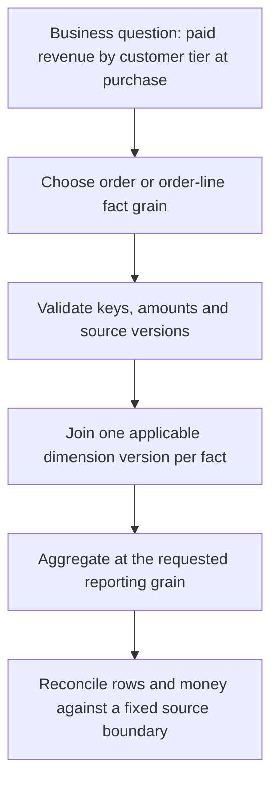

# GoogleSQL and data modeling: grain, joins, nested rows and history

Warehouse layout optimization cannot repair an incorrect metric. Define what one row means, then prove joins and aggregations preserve that meaning. This lesson supplies the modeling foundation used by the BigQuery, Dataform, dbt and architecture lessons.

Use the [lab conventions](../references/lab-conventions.md). The SQL fixtures below are self-contained GoogleSQL queries unless a temporary table is explicitly created. Run them in BigQuery with standard SQL.

## Define keys, grain and additive measures

A fact records a business observation at a stated grain. `fct_order` can have one row per order; `fct_order_line` can have one row per order line. A dimension supplies descriptive context such as customer tier. A snapshot records state at a cutoff; an event records a change. An order's identifier is not an event's identifier.



Some measures add across dimensions and time, such as event counts or signed transaction amounts under a defined contract. An account balance is a state: summing daily balances over a month does not produce monthly revenue. Ratios need numerator/denominator logic; averaging merchants' average order values gives the wrong weighted average when their order counts differ.

Primary/foreign-key declarations in BigQuery are not enforced as ordinary OLTP constraints. Validate actual uniqueness and relationships before relying on them. A claimed unique dimension can otherwise multiply facts and even mislead optimization assumptions.

## Reproduce join fan-out

An order-level amount repeats when joined to multiple lines:

```sql
WITH orders AS (
  SELECT 101 AS order_id, 2500 AS cents UNION ALL SELECT 102, 4200
), lines AS (
  SELECT 101 AS order_id, 1 AS line_id UNION ALL
  SELECT 101, 2 UNION ALL SELECT 102, 1
)
SELECT COUNT(*) AS joined_rows, SUM(orders.cents) AS incorrect_cents
FROM orders JOIN lines USING (order_id);
```

Expect three rows and 9200 cents, although true order revenue is 6700. `COUNT(DISTINCT order_id)` fixes the count but leaves the sum wrong. `SUM(DISTINCT cents)` is also wrong when two legitimate orders have the same amount.

If the question needs order revenue, aggregate at order grain and use line existence through `EXISTS` when only filtering. If it needs product revenue, use each line's allocated net amount and reconcile the line totals to the order. Discounts, tax, returns and currency conversion need a stated allocation rule.

## Preserve facts when a dimension is missing

An inner join drops facts without a matching dimension. A left join preserves them, but a later `WHERE dimension.tier = 'premium'` removes unmatched rows again. Define an unknown-dimension policy and monitor the unmatched rate.

`NULL` is unknown, not zero or an empty string. `COUNT(*)` counts rows; `COUNT(column)` excludes NULL values; `SUM` skips NULL inputs and can return NULL on an empty/all-NULL set. Use `COALESCE` only when the business meaning permits substitution. `SAFE_CAST` returns NULL for an invalid cast; route/measure failures rather than silently treating corrupt money as zero. `SAFE_DIVIDE` can avoid a division error while still requiring a policy for a NULL ratio.

## Model changing dimensions with validity intervals

Slowly changing dimension Type 1 overwrites the old value. Type 2 retains versions with non-overlapping validity intervals and a durable version key. Use the version valid at purchase for historical reporting:

```sql
WITH facts AS (
  SELECT 101 AS order_id, 'c1' AS customer_id,
         TIMESTAMP '2026-10-10 09:00:00+00' AS purchased_at, 2500 AS cents
  UNION ALL SELECT 102, 'c1', TIMESTAMP '2026-10-25 09:00:00+00', 4200
), customer_history AS (
  SELECT 'c1' AS customer_id, 'basic' AS tier,
         TIMESTAMP '2026-10-01 00:00:00+00' AS valid_from,
         TIMESTAMP '2026-10-20 00:00:00+00' AS valid_to
  UNION ALL SELECT 'c1', 'premium', TIMESTAMP '2026-10-20 00:00:00+00', NULL
)
SELECT order_id, tier, cents
FROM facts f LEFT JOIN customer_history d
  ON f.customer_id = d.customer_id
 AND f.purchased_at >= d.valid_from
 AND (f.purchased_at < d.valid_to OR d.valid_to IS NULL)
ORDER BY order_id;
```

Expect `101 / basic / 2500` and `102 / premium / 4200`. Joining every order to today's customer tier would rewrite historical interpretation. Overlapping intervals can match a fact twice; gaps can leave it unmatched. Test both, plus exactly one current version where the contract requires it. A late dimension correction may require rebuilding historical joins, rather than merely appending the new dimension row.

## Nested data changes row counts too

BigQuery `STRUCT` groups fields and `ARRAY<STRUCT<...>>` holds repeated children. Nesting a bounded set of order lines can avoid repeatedly joining a separate line table, but `UNNEST` still emits one row per child:

```sql
WITH orders AS (
  SELECT 101 AS order_id,
    [STRUCT('sku-a' AS sku, 1000 AS cents), STRUCT('sku-b', 1500)] AS items
)
SELECT order_id, SUM(item.cents) AS line_total
FROM orders CROSS JOIN UNNEST(items) AS item
GROUP BY order_id;
```

Expect 2500. A cross join with an empty array removes that parent; use the appropriate left-unnest pattern when empty parents must survive. Unnesting two independent repeated fields together creates their Cartesian product unless paired/related explicitly.

## Order versions and window functions

`ROW_NUMBER() OVER (PARTITION BY entity_id ORDER BY source_version DESC)` can choose current state only after the source guarantees or validates a unique payload per version. A tie without a deterministic authority can hide conflicts. `QUALIFY` filters after window calculation. Do not confuse analytical windows with Beam event-time windows: SQL ranks rows in a query result; Beam manages streaming assignment, triggers and retained state.

Store instants as `TIMESTAMP` and local civil values intentionally. `DATE(purchased_at, 'Asia/Kolkata')` can differ from its UTC date. Define the business timezone before creating daily facts. Use `NUMERIC` or integer minor units for money, with explicit currency, precision and rounding; a floating-point result that looks correct on one fixture is insufficient.

## Practice and answers

1. Add a second customer-history interval overlapping October 10. Predict the fact duplication, then detect it with a grouped count per order.
2. Give both orders 2500 cents. Show why `SUM(DISTINCT cents)` undercounts.
3. Add an order with no lines. Compare cross versus left unnest behavior.
4. Calculate a weighted average from total cents and total order count rather than averaging averages.

??? note "Expected reasoning"
    A correct join matches the intended number of dimension rows per fact. Measures must retain their grain. Missing data and invalid values require explicit handling. Rerun counts, unique keys and money totals at the same boundary after every transformation.

Sources: [nested/repeated fields](https://docs.cloud.google.com/bigquery/docs/best-practices-performance-nested), [query syntax](https://docs.cloud.google.com/bigquery/docs/reference/standard-sql/query-syntax), [GoogleSQL data types](https://docs.cloud.google.com/bigquery/docs/reference/standard-sql/data-types), and [unenforced keys](https://docs.cloud.google.com/bigquery/docs/primary-foreign-keys).

| Previous Lesson | All Lessons | Next Lesson |
| --- | :---: | ---: |
| [0040: Recovery and backfill](0040-bigquery-failed-job-recovery-backfill.md) | [Lesson catalog](index.md) | [0042: Data contracts and evolution](0042-data-contracts-schema-evolution.md) |
