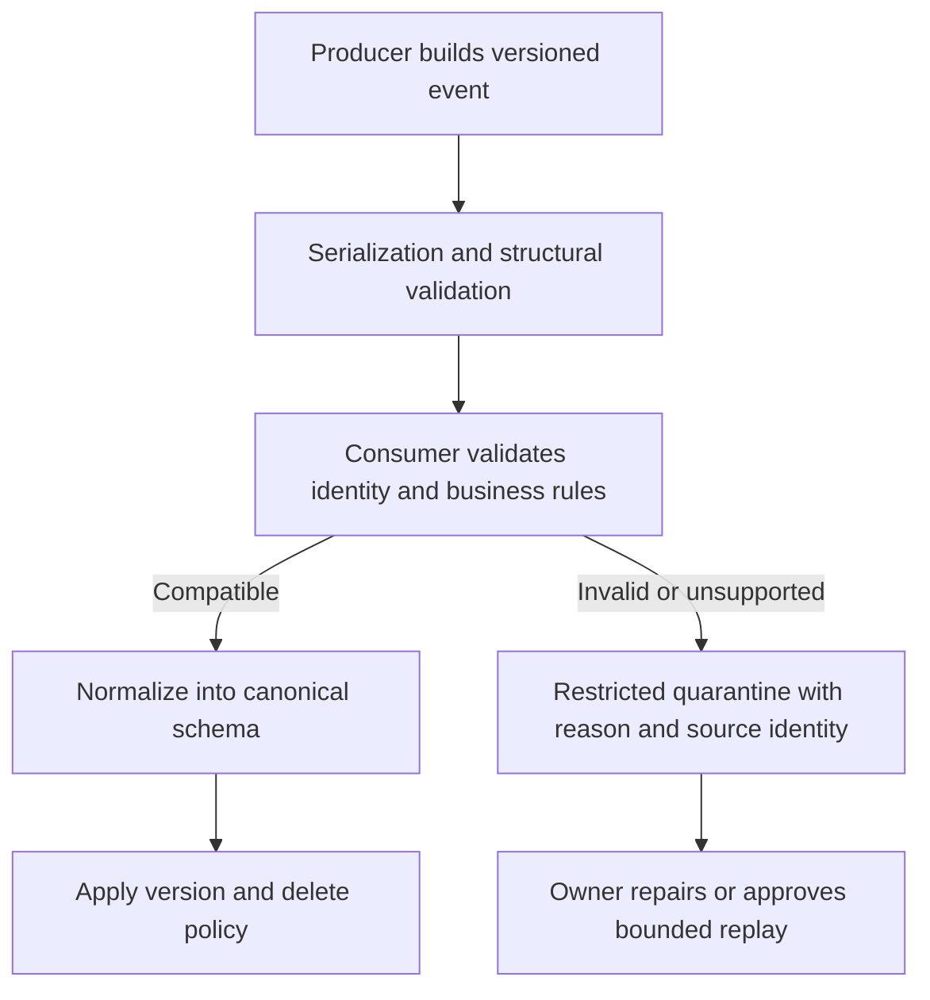

# Data contracts, serialization and schema evolution

A schema says which fields/types a record contains. A data contract also states identity, ordering, meaning, compatibility, freshness, ownership and replay behavior. A syntactically valid message can still double revenue or resurrect a deleted customer.

## Write the event envelope before the producer

For an order change, define the following fields and rules:

| Field | Example | Contract |
| --- | --- | --- |
| `schema_version` | 1 | Selects decoding/compatibility rules |
| `event_id` | e101-v2 | Immutable event identity; retries preserve it |
| `order_id` | o101 | Entity key, possibly scoped by tenant |
| `version` | 2 | Source-assigned order within that entity |
| `operation` | UPSERT | Full image or tombstone semantics are explicit |
| `amount_cents`, `currency` | 2500, USD | Exact unit, precision, sign and allowed currencies |
| `event_time` | 2026-10-28T09:00:00Z | Source event time with timezone |
| ingestion metadata | object generation or source offset | Arrival/replay boundary assigned by ingestion |

Do not use a timestamp as a unique sequence unless the source truly guarantees its ordering and tie-breaking rules. A record's event ID and its transport message ID are different identities. The contract must also explain whether updates are full images, patches or immutable business events; merging a patch as a full image can erase fields.



## Test a contract locally

This standard-library validator intentionally supports one narrow contract. Save it as `contract.py` and run with Python 3.11 or later:

```python
from datetime import datetime

def validate(event):
    if not isinstance(event, dict):
        raise ValueError("event must be an object")
    required = {"schema_version", "event_id", "order_id", "version",
                "operation", "amount_cents", "currency", "event_time"}
    if not required <= event.keys():
        raise ValueError("missing required field")
    if type(event["schema_version"]) is not int or event["schema_version"] != 1:
        raise ValueError("unsupported schema version")
    for key in ("event_id", "order_id"):
        if not isinstance(event[key], str) or not event[key].strip():
            raise ValueError(f"invalid {key}")
    if type(event["version"]) is not int or event["version"] < 1:
        raise ValueError("invalid entity version")
    if event["operation"] != "UPSERT":
        raise ValueError("this fixture supports full-image UPSERT only")
    if type(event["amount_cents"]) is not int or event["amount_cents"] < 0:
        raise ValueError("invalid integer cents")
    if event["currency"] != "USD":
        raise ValueError("unsupported currency")
    if not isinstance(event["event_time"], str):
        raise ValueError("event_time must be a timestamp string")
    stamp = datetime.fromisoformat(event["event_time"].replace("Z", "+00:00"))
    if stamp.utcoffset() is None:
        raise ValueError("event_time must have a timezone")
    return {key: event[key] for key in required}

good = dict(schema_version=1, event_id="e1", order_id="o1", version=1,
            operation="UPSERT", amount_cents=2500, currency="USD",
            event_time="2026-10-28T09:00:00Z")
assert validate(good)["amount_cents"] == 2500
try:
    validate({**good, "amount_cents": True})
except ValueError:
    print("invalid boolean money rejected")
else:
    raise AssertionError("boolean money was accepted")
```

Python booleans are subclasses of integer, so `isinstance(True, int)` would accept them. This is a concrete reason to test the actual decoder/type contract. The validator allows extra fields and projects known fields by policy; retain the original envelope securely for replay. A production validator also defines payload size, timestamp plausibility, identifier scope and error categories.

## Compare serialization choices

JSON is readable but needs explicit interpretation for decimals, timestamps, missing versus NULL and large integers. Avro carries a writer schema and has defined reader/writer resolution, defaults and union rules. Protobuf uses numbered fields and presence rules; reserve removed field numbers and do not reuse them for another meaning. Parquet is an analytical file layout, while an Iceberg schema uses persistent field IDs and table evolution rules. These layers are not interchangeable schema registries.

Pub/Sub schema validation supports its documented Avro/Protobuf contract. It does not validate an arbitrary business JSON Schema or check whether an order's version is newer than stored state. BigQuery load schemas and Beam/Spark schemas enforce their own conversion rules downstream. Test the entire chain, including nullability and numeric ranges.

## Roll out an additive change

Suppose version 1 adds optional `coupon_code`. Backward compatibility asks whether a new reader can handle old events. Forward compatibility asks whether an old reader can handle new events. "Optional" is not enough if an old decoder rejects unknown fields or a table subscription rejects extra payload fields.

First deploy consumers that tolerate/understand the addition under the selected serialization rules. Add the destination field without changing existing meaning. Canary the new producer, compare error/rejection rates, and only then expand. Retain fixtures for both versions. A rename or integer-to-string change can require a new field/version and a temporary translation period; changing the destination schema alone does not migrate every producer and replay file.

Deletes need a separate tombstone contract. If version 3 deletes an order, replaying version 2 must not recreate it. Keep a high-water sequence or tombstone long enough for the source replay horizon. Changing an event's payload under an existing immutable event ID is a conflict, not a convenient correction.

## Quarantine and replay without hiding loss

Record error reason, parser revision, schema version, source identity and access-controlled original bytes. Count rejected records in reconciliation. A dead-letter queue is a retained repair backlog with an owner, retention and replay policy. It is not automatic eventual correctness.

For an exercise, add `coupon_code`, then rename `amount_cents` to `amount` without changing its unit. Predict how the old and new consumers behave. Next represent the money as `25.00` and explain why merely accepting its type changes the metric by 100 times. Require a deliberate compatibility decision rather than silent coercion.

??? note "Recall answers"
    Structural validity does not establish business ordering or uniqueness. Defaults and unknown-field behavior depend on serialization and reader configuration. Safe rollout preserves meaning across old/new readers and retained historical events. Replay needs the original schema and transformation revision as well as bytes.

Sources: [Pub/Sub schemas](https://docs.cloud.google.com/pubsub/docs/schemas), [Avro specification](https://avro.apache.org/docs/1.12.0/specification/), [Protobuf evolution](https://protobuf.dev/programming-guides/proto3/#updating), and [BigQuery schema management](https://docs.cloud.google.com/bigquery/docs/managing-table-schemas).

| Previous Lesson | All Lessons | Next Lesson |
| --- | :---: | ---: |
| [0041: SQL and modeling](0041-googlesql-data-modeling.md) | [Lesson catalog](index.md) | [0043: Platform identity and networking](0043-platform-iam-networking-infrastructure.md) |
