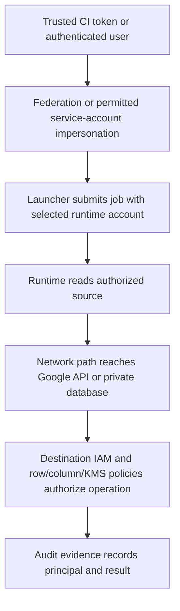

# Platform identity, networking and infrastructure as code

A production pipeline needs more than SQL or a DAG. Identify who performs each operation, which resource authorizes it and how the request reaches that resource. This lesson supplies the platform foundation behind the service-specific IAM examples.

## Draw principals before granting roles

| Principal | Responsibility | Typical scoped authorization |
| --- | --- | --- |
| Developer | Inspect/compile and submit permitted work | Development datasets and selected deploy/act-as permissions |
| CI builder | Build artifacts and run sandbox checks | Artifact push and sandbox writes |
| Job launcher | Submit a Dataflow/Spark/workflow job | Job creation plus act-as on the intended runtime account |
| Runtime service account | Read source and write destination | Bucket/table/subscription permissions at their scopes |
| Managed service agent | Operate managed-service integration | Documented service-agent grants, including cross-project cases |

An account allowed to submit BigQuery jobs is not automatically allowed to read every table or write every dataset. The job-billing project, source-data project, destination project and service-account project can differ. Grant the effective identity permission at each actual resource boundary.



Service Account User/act-as and token-creation permissions are different capabilities. Do not hand a broad token-creation role to every DAG author. A workload identity provider must constrain trusted issuer, audience and repository/branch attributes. ADC is a credential-discovery mechanism, not a promise of least privilege. Follow [service-account impersonation](https://docs.cloud.google.com/iam/docs/service-account-impersonation) and [deployment federation](https://docs.cloud.google.com/iam/docs/workload-identity-federation-with-deployment-pipelines).

## Work through an access-denied failure

A Spark job can read `gs://raw/orders/` but cannot write `mart.daily_sales`. First find the effective runtime/impersonated principal in the denied request or audit log. Then identify the missing permission and target resource. The developer's successful console query is irrelevant if the executor uses another account.

For BigQuery, check job creation on the billing project, source read, destination write and relevant column/row policies. For CMEK, check the documented service encryption identity, key location and required key permissions. A KMS grant on the human account may not authorize the service. Inspect organization-level deny policies and conditions if an allow binding seems correct.

## A small Terraform example with visible scope

This example provisions an account, a regional dataset, an existing-bucket read grant and scoped warehouse permissions. It is intentionally not a complete Dataflow/Spark network deployment. Use an existing sandbox project and bucket; the operator needs permissions to manage these resources.

```hcl
terraform {
  required_providers {
    google = {
      source  = "hashicorp/google"
      version = "~> 6.0"
    }
  }
}
variable "project_id" { type = string }
variable "raw_bucket" { type = string }
provider "google" { project = var.project_id }

resource "google_service_account" "pipeline" {
  account_id   = "pipeline-lab"
  display_name = "Sandbox pipeline runtime"
}
resource "google_bigquery_dataset" "mart" {
  dataset_id                 = "platform_lab"
  location                   = "us-central1"
  delete_contents_on_destroy = false
}
resource "google_project_iam_member" "jobs" {
  project = var.project_id
  role    = "roles/bigquery.jobUser"
  member  = "serviceAccount:${google_service_account.pipeline.email}"
}
resource "google_bigquery_dataset_iam_member" "write" {
  project    = var.project_id
  dataset_id = google_bigquery_dataset.mart.dataset_id
  role       = "roles/bigquery.dataEditor"
  member     = "serviceAccount:${google_service_account.pipeline.email}"
}
resource "google_storage_bucket_iam_member" "read" {
  bucket = var.raw_bucket
  role   = "roles/storage.objectViewer"
  member = "serviceAccount:${google_service_account.pipeline.email}"
}
```

Save as `main.tf`, run `terraform init`, `terraform fmt -check`, `terraform validate` and a sandbox `terraform plan -var='project_id=YOUR_PROJECT_ID' -var='raw_bucket=YOUR_BUCKET'`. Review before applying. The plan should show the runtime account, one dataset and the scoped grants, not a project-wide Owner binding. Commit a reviewed provider lockfile for a real deployment. See the [official Google provider resources](https://registry.terraform.io/providers/hashicorp/google/latest/docs).

Terraform state can contain sensitive configuration. Use an access-controlled remote backend with supported locking and separate environment state. Do not combine authoritative and additive IAM resources for the same scope without understanding overwrite behavior. Preserve resources when adopting existing infrastructure through import; a plan's proposed deletion must be reviewed before apply.

## Diagnose network access in order

For a private source, resolve DNS, verify route/subnet selection, inspect firewall rules, confirm TLS and then authenticate to the application. A successful TCP connection does not prove database permissions, and a correct SQL password does not create a route.

Private workers need an approved path to Google APIs, often through Private Google Access or the selected supported private connectivity design. Artifact pulls and package repositories are separate destinations; Cloud NAT can help public egress where permitted but is not a universal substitute for API routing. VPC Service Controls add a service-perimeter boundary distinct from IAM. An identity can be authorized and still be denied by the perimeter. See [Private Google Access](https://docs.cloud.google.com/vpc/docs/private-google-access) and [VPC Service Controls](https://docs.cloud.google.com/vpc-service-controls/docs/overview).

## Exercise and expected evidence

Create a permission matrix for Pub/Sub → Dataflow → BigQuery. Include submitter, worker, service agent, source subscription, staging bucket, target dataset, artifact registry and any encryption key. For each denied request, name the effective principal, permission, resource and network boundary. Grant one missing scoped permission and prove the result changes without granting Owner.

Then remove the sandbox worker's source read grant. Predict whether compilation, job submission and source consumption fail at the same point. They should be checked independently. Revert the temporary permission change and clean up only the dedicated infrastructure after verifying the plan and retained data.

??? note "Recall answers"
    Authentication establishes an identity; IAM authorizes operations; network controls provide/restrict reachability; data policies and KMS can add further authorization boundaries. Successful setup at one layer does not establish all the others.

| Previous Lesson | All Lessons | Next Lesson |
| --- | :---: | ---: |
| [0042: Contracts and evolution](0042-data-contracts-schema-evolution.md) | [Lesson catalog](index.md) | [0044: Recovery objectives and replay](0044-reliability-disaster-recovery.md) |
