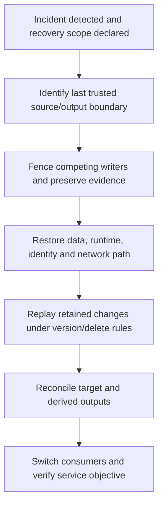

# Reliability, replay and disaster recovery objectives

Define the data you can lose and how long recovery may take before choosing backups, replicas and retention. A replication feature is useful only if its complete recovery path meets those requirements.

## State recovery objectives precisely

Recovery point objective, or RPO, is the maximum acceptable data loss relative to a defined source boundary. Recovery time objective, or RTO, is the acceptable time to restore the agreed service. Freshness measures how current normally served data is. Availability measures successful service against an agreed denominator. These are related but different promises.

For example, "restore a reconciled paid-orders mart within two hours, losing at most five minutes of committed source changes" is testable. "Multi-region, therefore highly available" leaves source capture, compute, identity, networking and consumer switching undefined.



## Match the failure to the protection

| Failure | Useful control | What it does not automatically solve |
| --- | --- | --- |
| Accidental table mutation | Time travel, snapshots, retained source | Incorrect downstream exports already consumed |
| Deleted object | Configured soft delete/versioning/retained copy | An unretained expired generation |
| Worker or zone failure | Managed retries and supported zonal redundancy | A bug that deterministically corrupts every retry |
| Region outage | Supported cross-region replication/DR plus tested failover | Source connectivity, capacity and identity in the other region |
| Missing source log range | Retained archive or authoritative new snapshot | Guessing the absent business events |

BigQuery multi-region storage is not by itself a user-controlled cross-region failover plan. Native time travel, table snapshots, dataset replication and managed disaster recovery have different limitations, locations, retention and edition requirements. Verify the current [disaster recovery guide](https://docs.cloud.google.com/bigquery/docs/managed-disaster-recovery) and [dataset replication](https://docs.cloud.google.com/bigquery/docs/data-replication).

## Practice snapshot recovery in one location

Run this in a disposable `reliability_lab` dataset after creating it in a chosen location:

```sql
CREATE TABLE `YOUR_PROJECT_ID.reliability_lab.orders` AS
SELECT 101 AS order_id, 2500 AS cents UNION ALL SELECT 102, 4200;

CREATE SNAPSHOT TABLE `YOUR_PROJECT_ID.reliability_lab.before_change`
CLONE `YOUR_PROJECT_ID.reliability_lab.orders`
OPTIONS (expiration_timestamp = TIMESTAMP_ADD(CURRENT_TIMESTAMP(), INTERVAL 7 DAY));

UPDATE `YOUR_PROJECT_ID.reliability_lab.orders` SET cents = 0 WHERE order_id = 101;

CREATE TABLE `YOUR_PROJECT_ID.reliability_lab.restored_orders`
CLONE `YOUR_PROJECT_ID.reliability_lab.before_change`;

ASSERT (SELECT SUM(cents) = 6700
        FROM `YOUR_PROJECT_ID.reliability_lab.restored_orders`)
AS 'Snapshot recovery differs from expected source';
```

Expect the damaged original to total 4200 and the restored table to total 6700. This proves a small same-location data recovery, not regional failover. Snapshots preserve documented table data state; they do not copy every external dependency, IAM grant, DAG or object. Streaming-buffer limitations also matter. See [table snapshots](https://docs.cloud.google.com/bigquery/docs/table-snapshots-intro).

## Retention must cover the time until each source record is read

At 1,000 events/s, a four-hour outage accumulates 14.4 million events. Recovery capacity of 1,500 events/s leaves net catch-up capacity of 500 events/s while producers continue. Catch-up takes about eight hours, assuming the source and sink sustain those rates and no further failures occur. A two-hour RTO cannot be met by that configuration.

If retention was only three hours, the earliest outage data may already be gone when processing resumes after four hours. With longer retention, evaluate each partition's oldest unread record and the actual replay order. Outage plus full catch-up time is a conservative planning allowance in some designs, not a universal proof that every record needs that much age: ordered consumption can read oldest records first. Include detection delay, restore time, stalled partitions, safety margin and the complete replay contract.

A source database replication slot may retain changes but threaten source disk capacity. An archive can extend replayability but also needs schema/cryptographic context and a trustworthy complete boundary. Source retention, processing state and sink deduplication must be designed together.

## Recovery needs more than restored rows

Recreate infrastructure from reviewed configuration, restore required secrets/key access through the approved path, and verify network/API reachability and target-region quotas. Confirm runtime/artifact availability. Fence the old writer before enabling another region; two independent writers can publish competing versions.

Replay immutable events by event identity. Apply entity updates using source versions and tombstones. Rebuild derived marts and corrected export versions. Switch consumers only after key/value/multiplicity checks at the same source boundary. Record source cutoff, replica lag, data loss actually observed and the time the service objective was restored.

## Drill and recall

Use the bounded repair fixture in [0040](0040-bigquery-failed-job-recovery-backfill.md). Time detection, evidence preservation, staging, replay, verification and consumer resumption separately. Compare the measured total with your RTO. State the earliest unavailable source range for the RPO measurement.

1. Why is a same-location snapshot insufficient for a full regional failover design?
2. Why can a replica faithfully replicate bad data?
3. Why should a rollback preserve delete sequencing?

??? note "Answers"
    1. Compute, regional access, metadata/configuration and target availability still require a separate plan.
    2. Replication copies state changes; it does not know the intended business result.
    3. Otherwise replayed older updates can recreate a deleted entity.

Remove the dedicated reliability dataset after the exercise. Preserve recovery evidence separately when it is needed for incident review.

| Previous Lesson | All Lessons | Next Lesson |
| --- | :---: | ---: |
| [0043: Platform foundations](0043-platform-iam-networking-infrastructure.md) | [Lesson catalog](index.md) | [0045: Architecture and sizing capstone](0045-platform-architecture-capstone.md) |
