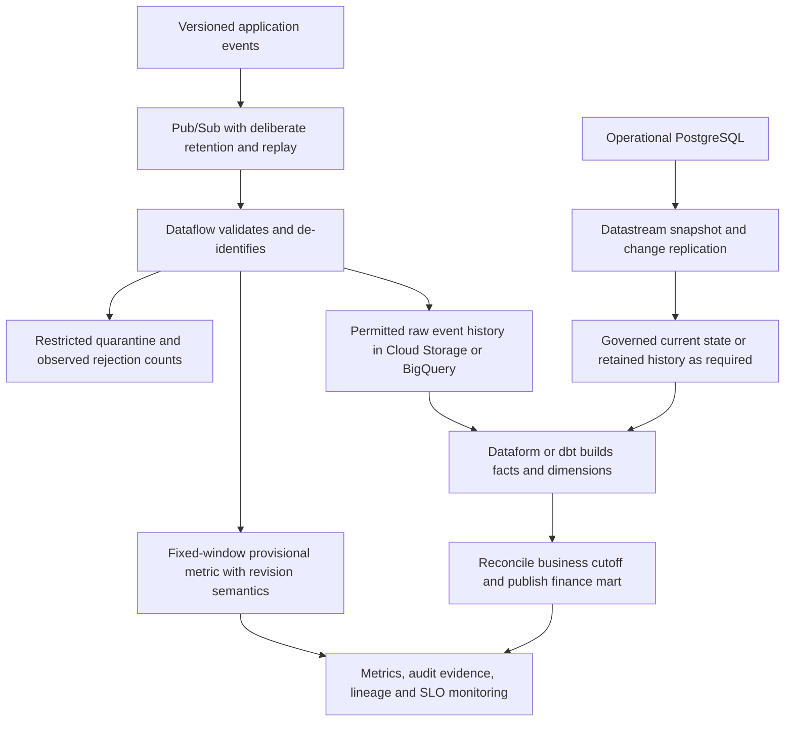

# Platform architecture capstone: requirements, sizing and trade-offs

Design one platform from explicit requirements, then defend its correctness, capacity, cost and recovery boundaries. This completes the mission's architecture goals by connecting individual service lessons into a reviewable design.

## Start with a concrete workload

An online store produces 10,000 one-KiB order events each second on average and peaks at 50,000. Operational PostgreSQL also holds mutable customer/stock tables. Finance needs a reconciled daily mart by 07:00 UTC. Operations needs a provisional five-minute merchant metric with a 60-second freshness objective. Customer PII must not appear in shared analytical storage.

Assume events can arrive up to 15 minutes late for the provisional stream, while older corrections arrive through retained raw reconciliation. The company requires a five-minute RPO and two-hour RTO for the agreed reporting service. These are exercise requirements, not service guarantees.



The raw path contains only fields permitted by the storage contract. If compliance permits a restricted original archive, define its separate access and retention; otherwise plan replay from the permitted canonical form. Do not assume "raw" exempts data from privacy requirements.

## Size messages, processing and storage

Compute average raw payload volume without confusing bits, bytes and binary units:

```python
events_per_second = 10_000
bytes_per_event = 1024
daily_bytes = events_per_second * bytes_per_event * 86_400
print(round(daily_bytes / 1024**3, 2), "GiB/day")
assert daily_bytes == 884_736_000_000
backlog = events_per_second * 3600
recovery_rate = 20_000
catchup_seconds = backlog / (recovery_rate - events_per_second)
assert catchup_seconds == 3600
```

Expect about 823.97 GiB/day before serialization overhead, replication, compression or rejected records. A one-hour outage at the average rate creates 36 million events; consuming at 20,000/s while arrivals remain 10,000/s needs an hour to catch up after processing resumes. Recovery rate must exceed arrival rate. At a sustained 50,000/s peak, that recovery configuration falls behind instead.

Seven raw days are roughly 5.63 TiB before overhead/compression. A second independent subscription introduces additional deliveries and possibly another retained copy. Include those in cost, plus Dataflow workers/backend charges, BigQuery ingestion/analysis/storage, source log retention, orchestration and network transfer. Use actual region-specific rates and measured compression. Peak demand and burst duration matter more than a daily average alone.

## Explain each service decision

| Decision | Starting design | What would change it |
| --- | --- | --- |
| Event transport | Pub/Sub | Kafka-client/offset ecosystem or other explicit requirements |
| Stream transform | Dataflow/Beam | A managed direct subscription suffices if no window/state/complex transform is needed |
| Batch SQL | BigQuery plus Dataform/dbt | Specialized code or engine requirements can justify Spark |
| Spark | Serverless batches for fitting independent workloads | Required cluster customization or multi-framework use |
| Analytical storage | Native BigQuery for the reporting workload | Supported multi-engine open-table requirements can justify Iceberg/catalog ownership |
| Orchestration | Airflow for interval dependencies and historical runs | Short API/event coordination may fit Workflows |

Service choice follows the processing contract. Avoid running an always-on custom subscriber merely to copy already compatible events, or a large Spark job solely to perform a warehouse-native aggregation. Conversely, do not force a streaming temporal join into a direct export subscription that cannot express it.

## Define the correctness boundaries

Use immutable event IDs for delivery deduplication and entity versions for current-state updates. Treat CDC replica state and application event history as different datasets. Validate one source image per key/version, retain delete ordering, and explicitly reconcile the daily finance cutoff.

For the provisional metric, choose fixed windows, explicit event timestamps, early/on-time/late behavior and a bounded lateness policy. Persist replacement/delta semantics so repeated panes do not inflate totals. A backfill that revises an older day needs a new publication revision and a consumer-switch policy. The daily mart's fact grain and currency rules must match finance, not whatever schema the producer found convenient.

## Put operations and recovery into the design

Assign the deployer, launcher, service agent and runtime identities. Scope access to source subscriptions, artifacts, staging buckets, datasets and keys. Specify private connectivity and service perimeters where required. Keep configuration and dependency revisions in version control; deploy through sandbox-tested CI with retained artifacts.

Monitor expected source progress, backlog, rejected data, processing lag, sink freshness and business reconciliation. Define who repairs quarantine and how its retention compares to the recovery horizon. For cross-region reporting recovery, identify the supported replication/DR mechanism, current lag, target capacity, IAM/network dependencies, writer fencing and consumer switching.

## Deliverables and assessment

Produce a one-page architecture plus a calculation sheet, contract examples, IAM matrix, retry/recovery table and cost model. Record each assumption that requires measurement. Run the local Beam fixtures and the appropriate disposable warehouse lab before claiming implementation success.

Review these cases without looking back at earlier lessons:

1. Pub/Sub acknowledgement is lost after a sink write.
2. A customer is deleted, then an older version is replayed.
3. Source timestamps are backdated beyond the incremental lookback.
4. A five-minute window emits 10 early and 15 on time.
5. An upstream file is replaced while its load is running.
6. The region fails while the replica is ten minutes behind a five-minute RPO.
7. Worker scaling reaches its limit during the sustained peak.

??? note "Expected answers"
    Resolve repeated delivery with identity-aware sink behavior. Retain version/tombstone state. Reconcile/backfill beyond bounded timestamp assumptions. Apply pane replacement/delta semantics rather than summing 10 and 15 indiscriminately. Read immutable source identities. Declare the observed RPO breach rather than hiding replica lag. Reduce/queue eligible work or provision supported capacity while preserving the deadline and cost model.

Completion means you can defend these outcomes with data and demonstrate selected failure cases. It does not mean every Google Cloud feature is covered or that a managed service guarantees the exercise's SLO without validation.

Sources: [Google Cloud Architecture Center](https://docs.cloud.google.com/architecture), [reliable data processing](https://docs.cloud.google.com/dataflow/docs/concepts/exactly-once), [Pub/Sub reliability](https://docs.cloud.google.com/pubsub/docs/reliability-intro), and the service-specific [reference catalog](../references/resources.md).

## Extend the architecture across clouds

A partner delivers a daily complete Parquet export in Amazon S3. Compare a supported BigQuery DTS S3 transfer with a controlled transfer into Cloud Storage followed by the existing manifest/load path. Airflow should wait for the selected transfer's terminal success and source completion boundary before running finance transformations; a successful API submission or a five-minute timer is insufficient.

Use a dedicated source credential with the connector's required permissions and approved secret handling. Google-side workload federation does not automatically authorize reads in the partner's AWS account. Include AWS egress, repeated-transfer behavior, schema compatibility, source file identity and region/residency constraints in the design. Test a small representative transfer before moving the daily export. The [S3 connector guide](https://docs.cloud.google.com/bigquery/docs/s3-transfer) documents its scheduling, credentials and write behavior; they differ from the Cloud Storage connector parameters. As a failure exercise, let transfer A succeed and transform B fail, then explain how replay avoids transferring and appending A's files a second time.

| Previous Lesson | All Lessons | Next Lesson |
| --- | :---: | ---: |
| [0044: Recovery objectives](0044-reliability-disaster-recovery.md) | [Lesson catalog](index.md) | None yet |
