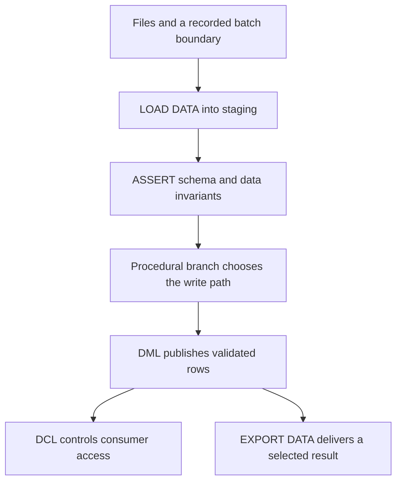

# BigQuery statement families: DDL, DML, DCL, load, export, and debugging

Module 11 starts with the work each statement performs. A query reads rows. DDL changes objects, DML changes rows, and DCL changes access. A script can coordinate those operations, but putting statements in one file does not make them one transaction.

Read [GoogleSQL and data modeling](0041-googlesql-data-modeling.md) first. Use the [lab conventions](../references/lab-conventions.md). The temporary-table exercise needs only a BigQuery query session. Permanent-object examples require a disposable project, a `script_lab` dataset, and the permissions for the operation. Replace `YOUR_PROJECT_ID` and `YOUR_BUCKET` before execution.

## Choose a statement family

| Family | Main statements | What changes | Typical pipeline use |
| --- | --- | --- | --- |
| Query | `SELECT`, `WITH` | Returns a relation | Filter, join, aggregate, or inspect data |
| DDL | `CREATE`, `ALTER`, `DROP` | Schemas, tables, views, routines, and other objects | Provision tables and deploy procedures |
| DML | `INSERT`, `UPDATE`, `DELETE`, `MERGE`, `TRUNCATE TABLE` | Stored rows | Apply deltas, replace a partition, or reconcile a backfill |
| DCL | `GRANT`, `REVOKE` | Resource access bindings | Grant a reporting group table access |
| Procedural language | `DECLARE`, `SET`, `IF`, `CASE`, loops, `CALL`, exception blocks | Execution order and script state | Validate a batch and choose a write path |
| Transaction control | `BEGIN TRANSACTION`, `COMMIT TRANSACTION`, `ROLLBACK TRANSACTION` | Commit boundary for supported statements | Publish related DML changes together |
| Export | `EXPORT DATA`, `EXPORT MODEL` | Objects outside the query result | Deliver query output or a supported trained model |
| Load | `LOAD DATA INTO`, `LOAD DATA OVERWRITE` | Table contents loaded from files | Ingest a Cloud Storage delivery |
| Debugging | `ASSERT` | Stops execution when a condition fails | Reject a missing batch or broken invariant |

`TRUNCATE TABLE` belongs to DML in BigQuery. `BEGIN ... END` groups statements and defines scope. `BEGIN TRANSACTION` starts a transaction. Those differences matter when you need rollback.



The official [DDL](https://docs.cloud.google.com/bigquery/docs/reference/standard-sql/data-definition-language), [DML](https://docs.cloud.google.com/bigquery/docs/reference/standard-sql/dml-syntax), and [DCL](https://docs.cloud.google.com/bigquery/docs/reference/standard-sql/data-control-language) references define the supported objects and syntax.

## DDL defines the objects

Run this setup only in your lab project. The dataset location must match the jobs you submit.

```sql
CREATE SCHEMA IF NOT EXISTS `YOUR_PROJECT_ID.script_lab`
OPTIONS (location = 'US');

CREATE TABLE IF NOT EXISTS `YOUR_PROJECT_ID.script_lab.orders` (
  order_id INT64,
  order_date DATE,
  amount NUMERIC
)
PARTITION BY order_date
OPTIONS (description = 'Disposable scripting exercise');

ALTER TABLE `YOUR_PROJECT_ID.script_lab.orders`
ADD COLUMN IF NOT EXISTS source_batch STRING;
```

| Pattern | Behavior | Gotcha |
| --- | --- | --- |
| `CREATE TABLE ... AS SELECT ...` | Creates a table from query output | The `SELECT` reads data and can incur query charges |
| `CREATE TABLE IF NOT EXISTS` | Keeps an existing object | Does not verify that its schema matches your intended definition |
| `CREATE OR REPLACE TABLE` | Replaces the object using the new definition | Do not treat it as a schema migration or assume all metadata survives |
| `CREATE VIEW` | Stores a query definition | A normal view does not store the query result |
| `CREATE TEMP TABLE` | Creates intermediate data for the script or session | Other Dataform actions cannot use that temporary table as a shared output |
| `ALTER TABLE` | Applies a supported metadata or schema change | Some type, partitioning, and constraint changes need a different migration |
| `DROP TABLE IF EXISTS` | Removes the named table if present | Scope cleanup to the lab objects you created |

A BigQuery primary key declaration does not enforce uniqueness. Prove the key in an assertion before a merge or join depends on it.

## DML changes rows

This complete exercise uses temporary tables. The merge keeps the latest source version for each order and handles deletion through an explicit operation flag.

```sql
CREATE TEMP TABLE target_orders (
  order_id INT64, version INT64, amount NUMERIC
);
INSERT INTO target_orders VALUES (101, 1, 10), (102, 1, 20);

CREATE TEMP TABLE incoming (
  order_id INT64, version INT64, amount NUMERIC, op STRING
);
INSERT INTO incoming VALUES
  (101, 2, 12, 'upsert'),
  (103, 1, 30, 'upsert'),
  (102, 2, NULL, 'delete');

ASSERT (
  SELECT COUNT(*) = COUNT(DISTINCT order_id) FROM incoming
) AS 'Resolve duplicate source keys before MERGE';

MERGE target_orders AS t
USING incoming AS s
ON t.order_id = s.order_id
WHEN MATCHED AND s.version > t.version AND s.op = 'delete' THEN
  DELETE
WHEN MATCHED AND s.version > t.version AND s.op = 'upsert' THEN
  UPDATE SET version = s.version, amount = s.amount
WHEN NOT MATCHED AND s.op = 'upsert' THEN
  INSERT (order_id, version, amount)
  VALUES (s.order_id, s.version, s.amount);

SELECT * FROM target_orders ORDER BY order_id;
```

Expect `101 / 2 / 12` and `103 / 1 / 30`. Order 102 disappears. This fixture demonstrates one merge, not a complete CDC system. A production current-state table also needs retained deletion versions so an older replay cannot resurrect order 102.

| Statement | Example shape | What to check |
| --- | --- | --- |
| `INSERT` | `INSERT INTO target SELECT ...` | A retry can append the same rows again |
| `UPDATE` | `UPDATE target SET amount = 12 WHERE order_id = 101` | Use the intended key and a partition filter where appropriate |
| `DELETE` | `DELETE FROM target WHERE order_date = DATE '2026-11-01'` | Confirm the deletion boundary before execution |
| `MERGE` | Match a source relation to a target and apply ordered clauses | Multiple source matches can make an update ambiguous; deduplicate before merging |
| `TRUNCATE TABLE` | `TRUNCATE TABLE target` | Removes all rows while retaining the table definition |

A single successful DML statement commits its changes. If statement two fails after statement one commits, an ordinary script retains statement one's changes. [Lesson 0048](0048-bigquery-procedures-transactions-debugging.md) adds an explicit transaction where BigQuery supports it.

## DCL changes who can access a resource

These are examples to adapt, not prerequisites for the temporary-table exercise. The principal must exist and the caller must have permission to change access.

```sql
GRANT `roles/bigquery.dataViewer`
ON SCHEMA `YOUR_PROJECT_ID.script_lab`
TO 'group:analytics@example.com';

REVOKE `roles/bigquery.dataViewer`
ON SCHEMA `YOUR_PROJECT_ID.script_lab`
FROM 'group:analytics@example.com';
```

`SCHEMA` means a BigQuery dataset in this syntax. A table-level grant uses `ON TABLE`. Removing a direct binding does not remove access inherited through another group or resource. Table read access also does not supply permission to create a query job in the execution project.

Keep access deployment separate from ordinary transformation runs when their runtime account should not administer IAM.

## Load files with SQL

Assume a compatible-location bucket contains Parquet with fields matching the target. A load is one operation. A list of files is not evidence that an upstream delivery is complete; use a manifest or another explicit completion boundary.

```sql
LOAD DATA INTO `YOUR_PROJECT_ID.script_lab.orders`
FROM FILES (
  format = 'PARQUET',
  uris = ['gs://YOUR_BUCKET/orders/2026-11-01/*.parquet']
);
```

| Form | Existing target behavior | Retry consequence |
| --- | --- | --- |
| `LOAD DATA INTO target` | Appends | A second successful submission can duplicate the input |
| `LOAD DATA OVERWRITE target` | Replaces data | The file set must represent the complete intended replacement |
| `LOAD DATA ... PARTITIONS (...)` | Targets a supported partition load | Follow the documented partition syntax and restrictions |
| `LOAD DATA INTO TEMP TABLE incoming` | Uses a temporary target | The current reference supports temporary targets; older guidance may differ |

A failed load leaves the target unchanged. Schema compatibility, location, file format, permissions, and source identity still need validation. `LOAD DATA` is separate from DML and from a client-side `bq load` command, even though they both ingest files. See the [load reference](https://docs.cloud.google.com/bigquery/docs/reference/standard-sql/load-statements).

## Export a selected result

This example reads the permanent `orders` table from the setup. It exports only the selected day, rather than the whole table.

```sql
EXPORT DATA OPTIONS (
  uri = 'gs://YOUR_BUCKET/exports/run-20261101-001/orders-*.parquet',
  format = 'PARQUET',
  compression = 'SNAPPY',
  overwrite = true
) AS
SELECT order_id, order_date, amount
FROM `YOUR_PROJECT_ID.script_lab.orders`
WHERE order_date = DATE '2026-11-01';
```

| Gotcha | Consequence | Better practice |
| --- | --- | --- |
| Reusing an export prefix | `overwrite=true` replaces matching objects but does not remove every old object under that prefix | Give each delivery attempt its own prefix and publish its manifest |
| Assuming one output file | BigQuery can shard output and choose the shard count | Have consumers read the completed file set |
| Exporting nested data to CSV | CSV cannot represent nested or repeated fields | Use Parquet, Avro, JSON, or flatten deliberately |
| Exporting metadata directly | `EXPORT DATA` restricts metadata and wildcard-table queries | Materialize a permitted intermediate table first |
| Assuming rollback includes files | Object writes are outside a DML transaction | Publish only after successful export and validation |

`EXPORT MODEL` exports supported model families and uses a different statement shape. Module 12 covers that lifecycle. The [export reference](https://docs.cloud.google.com/bigquery/docs/reference/standard-sql/export-statements) lists Cloud Storage and other supported destinations. Each destination has its own connection and option rules.

## Stop on broken assumptions with debugging statements

`ASSERT` is the debugging statement in the reference. Its expression must be `BOOL`. It succeeds only for `TRUE`; both `FALSE` and `NULL` raise an error. The optional description must be a string literal.

```sql
CREATE TEMP TABLE checked_rows AS
SELECT 101 AS order_id, NUMERIC '12.00' AS amount;

ASSERT (SELECT COUNT(*) > 0 FROM checked_rows)
  AS 'The input batch must contain rows';

ASSERT (SELECT COUNTIF(amount < 0 OR amount IS NULL) = 0 FROM checked_rows)
  AS 'Amounts must be present and nonnegative';

SELECT 'validation passed' AS result;
```

Change the amount to `NULL` and predict which assertion fails. Earlier committed statements do not roll back merely because an assertion fails.

`RAISE` belongs to the procedural language and can report or rethrow an exception. `ERROR()` is an expression function. A diagnostic `SELECT` returns data; it is not a durable log. An `ASSERT` that scans a table can incur query charges, and its result is not cached. See the [debugging reference](https://docs.cloud.google.com/bigquery/docs/reference/standard-sql/debugging-statements).

## Advantages and limits

| SQL in the warehouse helps when | It becomes awkward when |
| --- | --- |
| Data already lives in BigQuery and the operation is relational | A loop performs one mutation for each of millions of rows |
| SQL review should show schema, validation, and data changes together | The job needs external API calls, files, or long waits between attempts |
| A supported DML transaction must commit related writes together | A workflow needs atomic changes across DDL, IAM, exports, and other services |
| A statement's metadata and query job provide useful evidence | A single script hides all external scheduling and publication decisions |

## Practice and expected results

1. Replay the DML fixture's merge without recreating its temporary tables. Explain why surviving rows keep their versions, then explain the missing deletion-version problem.
2. Remove the unique-source assertion and add another incoming row for order 101. Predict the ambiguous merge failure.
3. Decide whether a failed assertion after `LOAD DATA INTO` reverses the load.
4. Explain why `REVOKE` from a table can leave a user's query access intact.
5. Design an export retry that cannot mix yesterday's shards with today's.

??? note "Answer check"
    Version conditions protect the surviving rows in this fixture. A deleted row has no retained version, so an old upsert can reinsert it. Resolve conflicting source matches before mutation. An assertion after a committed load does not reverse that load. Other IAM bindings can still grant access. A distinct export prefix and a completion manifest identify one delivery attempt.

Clean up only the named lab objects after the exercises. Temporary data has its own service-managed lifetime; do not use it as a cross-action contract.

| Previous lesson | All lessons | Next lesson |
| --- | :---: | ---: |
| [0045: Platform architecture capstone](0045-platform-architecture-capstone.md) | [Lesson catalog](index.md) | [0047: IF, CASE, and WHILE](0047-bigquery-if-case-while.md) |
