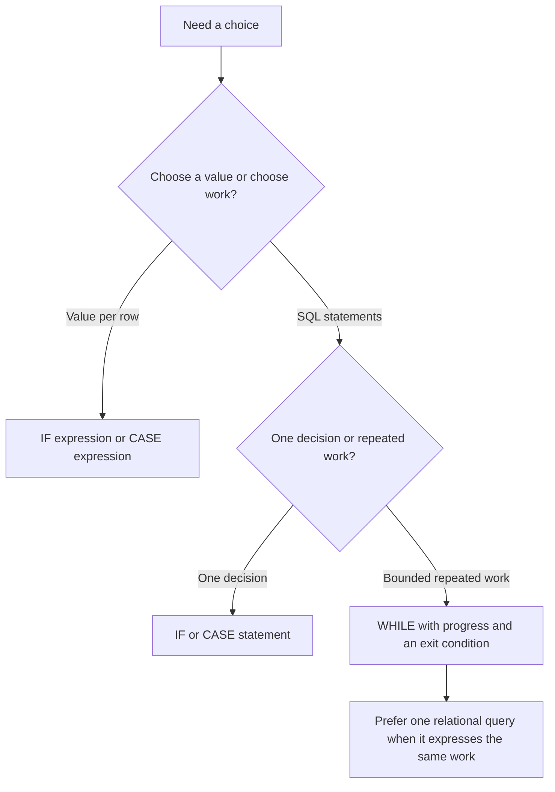

# BigQuery control flow: IF, CASE, and WHILE

Use a procedural statement to choose which SQL statements run. Use an expression to choose a value inside a query. Confusing those two jobs produces invalid SQL and makes cost reasoning harder.

This lesson progresses from scalar decisions to bounded loops. Each fixture is a complete independent GoogleSQL script. Run it in the BigQuery editor or with `bq query --use_legacy_sql=false < exercise.sql`. It uses temporary data and needs no permanent tables. Read [statement families](0046-bigquery-sql-statement-families.md) first.

## Statements and expressions solve different problems

| Construct | Returns or executes | Allowed inside a `SELECT` expression? | Ending |
| --- | --- | --- | --- |
| `IF(condition, yes, no)` | One value | Yes | Closing function parenthesis |
| `CASE ... WHEN ... THEN value ... END` | One value | Yes | `END` |
| `IF condition THEN ... END IF` | A list of statements | No | `END IF;` |
| `CASE ... WHEN ... THEN statements ... END CASE` | A list of statements | No | `END CASE;` |
| `WHILE condition DO ... END WHILE` | Repeated statement execution | No | `END WHILE;` |



The [conditional expression reference](https://docs.cloud.google.com/bigquery/docs/reference/standard-sql/conditional_expressions) covers value expressions. The [procedural reference](https://docs.cloud.google.com/bigquery/docs/reference/standard-sql/procedural-language) covers statement control flow.

## Variables, initialization, and scope

```sql
DECLARE v_amount NUMERIC DEFAULT 75;
DECLARE v_mode STRING DEFAULT 'incremental';
DECLARE v_result STRING;

BEGIN
  DECLARE v_threshold NUMERIC DEFAULT 50;
  SET v_result = IF(v_amount >= v_threshold, 'large', 'small');
END;

SELECT v_mode AS mode, v_result AS result;
```

Expect `incremental / large`. `v_threshold` stops existing at `END`. `v_result` starts as `NULL` because it has no default.

Declare variables before other statements in their scope. A variable cannot reuse a name declared in its containing block. Prefixing variables with `v_` also helps avoid column-name collisions. In a query with the same column and variable name, BigQuery gives the column precedence.

You can infer a type with `DECLARE v_count DEFAULT 0`, assign several values with `SET (v_a, v_b) = (...)`, and read system variables such as `@@row_count`. System variables have their own read and write rules; do not declare them yourself.

## Basic IF expressions

```sql
SELECT
  IF(80 >= 50, 'pass', 'retry') AS decision,
  IF(CAST(NULL AS BOOL), 'yes', 'no') AS null_condition,
  IF(0 = 0, NULL, 10 / 0) AS guarded_division;
```

Expect `pass`, `no`, and `NULL`. The condition must be `BOOL`. An `IF` expression chooses its else value for `FALSE` or `NULL`. The two result expressions must have a common compatible type.

Conditional expressions preserve the documented short-circuit error semantics, so the unused division above does not raise division by zero. This does not promise that an expensive subquery in an unchosen expression consumes no resources. The current reference allows execution strategies that preserve the final result and error behavior. Use an `IF` statement when the requirement is to choose which query statements run.

Do not rely on `AND` or `OR` evaluation order to protect unsafe expressions. `SAFE_DIVIDE`, `SAFE_CAST`, and explicit conditional expressions state error handling more clearly.

## Basic IF statements

```sql
DECLARE v_count INT64 DEFAULT 5;
DECLARE v_action STRING;

IF v_count IS NULL THEN
  RAISE USING MESSAGE = 'The input count is unknown';
ELSEIF v_count = 0 THEN
  SET v_action = 'skip';
ELSEIF v_count < 10 THEN
  SET v_action = 'small_batch';
ELSE
  SET v_action = 'normal_batch';
END IF;

SELECT v_action AS action;
```

Expect `small_batch`. Only the first branch whose condition is `TRUE` runs. Spell `ELSEIF` as one keyword. Put semicolons after the statements inside a branch and after `END IF`.

An empty branch can contain only a comment. A bare semicolon is not an empty no-op statement. For a missing required setting, fail explicitly instead of letting a `NULL` condition fall through.

## Advanced IF chooses a write strategy

The input mode is a control-plane decision. The individual rows still use a relational query.

```sql
DECLARE v_mode STRING DEFAULT 'replace';
DECLARE v_new_rows INT64;

CREATE TEMP TABLE source_rows AS SELECT 1 AS id UNION ALL SELECT 2;
CREATE TEMP TABLE output_rows AS SELECT 99 AS id;

ASSERT v_mode IN ('append', 'replace') AS 'Unsupported write mode';
SET v_new_rows = (SELECT COUNT(*) FROM source_rows);

IF v_new_rows = 0 THEN
  SELECT 'no input' AS status;
ELSEIF v_mode = 'replace' THEN
  TRUNCATE TABLE output_rows;
  INSERT INTO output_rows SELECT id FROM source_rows;
ELSE
  INSERT INTO output_rows SELECT id FROM source_rows;
END IF;

SELECT ARRAY_AGG(id ORDER BY id) AS ids FROM output_rows;
```

Expect `[1, 2]`. Change the mode to `append` and expect `[1, 2, 99]`. The `ASSERT` also rejects a `NULL` mode. The truncate and insert are separate changes unless you add a supported transaction. [Lesson 0048](0048-bigquery-procedures-transactions-debugging.md) covers that failure boundary.

## CASE expressions: simple and searched

Simple `CASE` compares one input with candidate values. Searched `CASE` tests boolean conditions. Both choose the first matching branch.

```sql
WITH inputs AS (
  SELECT 1 AS id, 'paid' AS status, NUMERIC '120' AS amount UNION ALL
  SELECT 2, 'pending', NUMERIC '20' UNION ALL
  SELECT 3, NULL, NULL
)
SELECT
  id,
  CASE status
    WHEN 'paid' THEN 'recognized'
    WHEN 'pending' THEN 'waiting'
    ELSE 'unknown'
  END AS status_group,
  CASE
    WHEN amount IS NULL THEN 'missing'
    WHEN amount >= 100 THEN 'large'
    WHEN amount >= 10 THEN 'normal'
    ELSE 'small'
  END AS amount_group
FROM inputs
ORDER BY id;
```

| id | status_group | amount_group |
| --- | --- | --- |
| 1 | recognized | large |
| 2 | waiting | normal |
| 3 | unknown | missing |

Put narrower or higher-priority conditions first. If `amount >= 10` came before `amount >= 100`, the 120 row would be `normal`.

| CASE expression gotcha | Explanation |
| --- | --- |
| `WHEN NULL` in a simple CASE | Equality with `NULL` is not `TRUE`. Use searched `WHEN value IS NULL` |
| Missing `ELSE` | An expression returns `NULL` if no branch matches |
| Incompatible result types | Unchosen branches still need valid types and a common result type |
| `CASE` used to run DML in a query | An expression returns a value; use a procedural CASE statement for DML |
| Conditional aggregation | `SUM(CASE WHEN ... THEN amount ELSE 0 END)` changes which values contribute, not the query's scan boundary |

## CASE statements dispatch several operations

```sql
DECLARE v_mode STRING DEFAULT 'validate';
DECLARE v_message STRING;
DECLARE v_checked BOOL DEFAULT FALSE;

CASE v_mode
  WHEN 'validate' THEN
    SET v_checked = TRUE;
    SET v_message = 'checked';
  WHEN 'skip' THEN
    SET v_message = 'skipped';
  ELSE
    RAISE USING MESSAGE = 'Unknown operation mode';
END CASE;

CASE
  WHEN v_checked THEN
    SET v_message = CONCAT(v_message, ': ready');
  ELSE
    SET v_message = CONCAT(v_message, ': no publication');
END CASE;

SELECT v_message AS message;
```

Expect `checked: ready`. The first CASE uses equality dispatch; the second uses boolean predicates. A statement branch can contain several statements. End each CASE statement with `END CASE;`, not the expression's `END`.

Use an explicit `ELSE` for an operational mode. It documents how unknown and `NULL` values behave and prevents a new mode from silently bypassing required work.

## WHILE basics

```sql
DECLARE v_i INT64 DEFAULT 1;
DECLARE v_total INT64 DEFAULT 0;

WHILE v_i <= 4 DO
  SET v_total = v_total + v_i;
  SET v_i = v_i + 1;
END WHILE;

ASSERT v_total = 10 AS 'Unexpected loop total';
SELECT v_i AS next_i, v_total AS total;
```

Expect `5 / 10`. `WHILE` checks its condition before each iteration, so its body can run zero times. A condition that is `FALSE` or `NULL` does not enter the body. A missing increment can keep the job running until a service or configured limit stops it.

## Advanced WHILE: bound the range and advance before CONTINUE

This exercise processes a small list of dates and deliberately skips one date. Advancing the cursor before a possible `CONTINUE` prevents that branch from repeating the same date forever.

```sql
DECLARE v_cursor DATE DEFAULT DATE '2026-11-01';
DECLARE v_last DATE DEFAULT DATE '2026-11-03';
DECLARE v_current DATE;
DECLARE v_iterations INT64 DEFAULT 0;

CREATE TEMP TABLE raw_orders AS
SELECT DATE '2026-11-01' AS order_date, 100 AS cents UNION ALL
SELECT DATE '2026-11-02', 200 UNION ALL
SELECT DATE '2026-11-03', 500;

CREATE TEMP TABLE daily_totals (order_date DATE, cents INT64);

ASSERT v_cursor IS NOT NULL AND v_last IS NOT NULL AND v_cursor <= v_last
  AS 'Invalid date range';

date_loop: WHILE v_cursor <= v_last DO
  SET v_current = v_cursor;
  SET v_cursor = DATE_ADD(v_cursor, INTERVAL 1 DAY);
  SET v_iterations = v_iterations + 1;
  ASSERT v_iterations <= 7 AS 'Loop exceeded the allowed date range';

  IF v_current = DATE '2026-11-02' THEN
    CONTINUE date_loop;
  END IF;

  INSERT INTO daily_totals
  SELECT v_current, COALESCE(SUM(cents), 0)
  FROM raw_orders
  WHERE order_date = v_current;
END WHILE date_loop;

SELECT * FROM daily_totals ORDER BY order_date;
```

Expect November 1 with 100 cents and November 3 with 500 cents. The cursor finishes on November 4. This loop is useful for learning control flow. One grouped query with a date filter is the better implementation for this aggregation.

For a production backfill that must commit each date independently, use an idempotent partition replacement or merge and record progress after success. An `INSERT` per date can duplicate work on replay. Do not hide a partial backfill behind a caught error.

## Labels and other loop forms

| Construct | When it fits | Important behavior |
| --- | --- | --- |
| `BREAK` or `LEAVE` | Exit a loop once its goal is reached | A label can target an enclosing loop |
| `CONTINUE` or `ITERATE` | Skip the rest of this iteration | Progress must still happen before the next condition check |
| `LOOP ... END LOOP` | The termination check belongs inside the body | It needs an explicit exit path |
| `REPEAT ... UNTIL condition END REPEAT` | The body must run at least once | The condition is checked after the body |
| `FOR row IN (query) DO ... END FOR` | Iterate over a small metadata or work list | The query runs once; add a top-level `ORDER BY` when iteration order matters |

`CONTINUE` targets a loop, not a plain `BEGIN` block. A `BREAK` outside an applicable block or loop is an error. Repeated row-by-row DML is usually a poor substitute for a join, window function, or merge.

## Advantages, limitations, and debugging checks

| Feature | Advantage | Limitation or gotcha |
| --- | --- | --- |
| IF statement | Explicitly selects a query or mutation path | Each branch still needs valid SQL and permissions when it runs |
| CASE statement | Keeps a mode dispatch readable | Branch order and `NULL` handling require deliberate design |
| WHILE | Expresses bounded repeated work with state | Repeated queries add jobs, reads, and failure boundaries |
| Variables | Carry small counts, dates, and control settings | Maximum 1 MB per variable and 10 MB across script variables |
| Nested blocks and control statements | Limit variable scope | The documented nesting limit is 50 |
| Dynamic SQL | Handles changing object identifiers | IF, CASE, and loops cannot be dynamically nested through `EXECUTE IMMEDIATE` |
| Script dry run | Helps inspect supported statements | It stops at IF, FOR, or WHILE without validating their bodies or following statements |

The [multi-statement guide](https://docs.cloud.google.com/bigquery/docs/multi-statement-queries) documents variable and dry-run limits.

!!! tip "Test the branches you expect to run"
    A successful dry run does not test every control-flow path. Use bounded fixtures to exercise the empty-input, normal, missing-setting, and failure cases before running a larger script.

## Practice and expected reasoning

1. Set the IF fixture's mode to `NULL`. Explain why an assertion is better than a silent else path.
2. Put `amount >= 10` before `amount >= 100`. Predict the changed CASE result before running it.
3. Move cursor advancement below the `CONTINUE` in the date loop. Identify the exact date where progress stops.
4. Replace the date loop with one `GROUP BY` query that produces the same rows.
5. Add an outer customer loop and label both loops. Explain which loop a labeled `LEAVE` exits.
6. Explain whether a dry run proves that the final `INSERT` in a WHILE body works.

??? note "Answer check"
    `ASSERT` rejects a missing mode because its boolean result is not TRUE. CASE stops at the first match. The skipped November 2 iteration repeats forever if advancement happens only after CONTINUE. A grouped query filters out November 2 and aggregates the remaining dates. A labeled exit targets that named enclosing loop. A script dry run does not validate a WHILE body.

| Previous lesson | All lessons | Next lesson |
| --- | :---: | ---: |
| [0046: SQL statement families](0046-bigquery-sql-statement-families.md) | [Lesson catalog](index.md) | [0048: Procedures, transactions, and debugging](0048-bigquery-procedures-transactions-debugging.md) |
