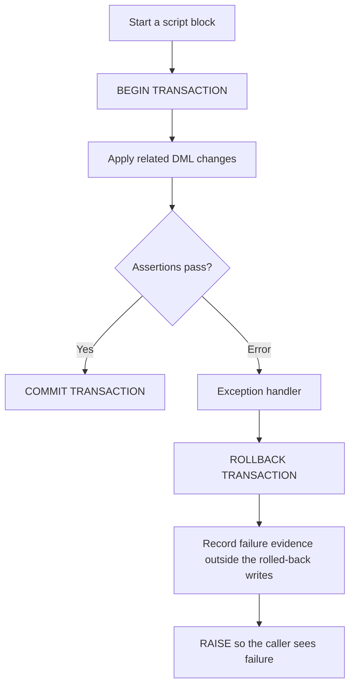

# BigQuery procedures, transactions, dynamic SQL, and debugging

A production script needs a clear success condition and a known failure boundary. A procedure packages logic. A transaction controls supported writes. An exception handler decides what evidence survives and whether the caller sees a failure. These mechanisms do different work.

Read [control flow](0047-bigquery-if-case-while.md) first. Temporary-table examples below are independent scripts. The procedure example supplies its own disposable permanent fixtures. Use the [lab conventions](../references/lab-conventions.md) and replace `YOUR_PROJECT_ID` before execution.

## Package a reusable operation in a procedure

Run this deployment script once in a lab project. The table name `procedure_orders` belongs to this exercise.

```sql
CREATE SCHEMA IF NOT EXISTS `YOUR_PROJECT_ID.script_lab`
OPTIONS (location = 'US');

CREATE OR REPLACE TABLE `YOUR_PROJECT_ID.script_lab.procedure_orders` AS
SELECT 101 AS order_id, NUMERIC '10' AS amount UNION ALL
SELECT 102, NUMERIC '20';

CREATE OR REPLACE PROCEDURE `YOUR_PROJECT_ID.script_lab.count_large_orders`(
  IN p_minimum NUMERIC,
  OUT p_count INT64
)
BEGIN
  ASSERT p_minimum IS NOT NULL AND p_minimum >= 0
    AS 'A nonnegative minimum is required';

  SET p_count = (
    SELECT COUNT(*)
    FROM `YOUR_PROJECT_ID.script_lab.procedure_orders` AS o
    WHERE o.amount >= p_minimum
  );
END;
```

Call it in a separate script. Declarations come before the call.

```sql
DECLARE v_count INT64;
CALL `YOUR_PROJECT_ID.script_lab.count_large_orders`(15, v_count);
ASSERT v_count = 1 AS 'Unexpected procedure result';
SELECT v_count AS large_orders;
```

Expect one order. An `IN` parameter supplies an input. An `OUT` parameter writes to the caller's variable. `INOUT` does both. Pass a variable of the correct type for an output parameter.

| Procedure advantage | Boundary to remember |
| --- | --- |
| Reuses warehouse logic across callers | Version the definition and test its contract before replacing it |
| Can return values through output arguments | It is not a scalar function usable in a `SELECT` expression |
| Can contain SQL control flow and DML | A call is not automatically a transaction |
| Keeps implementation near the data | It does not automatically grant callers privileged data access |

Authorized routines require a separate access configuration. The documented maximum procedure-call depth is 50 frames. See the [procedural reference](https://docs.cloud.google.com/bigquery/docs/reference/standard-sql/procedural-language) and [procedure DDL](https://docs.cloud.google.com/bigquery/docs/reference/standard-sql/data-definition-language#create_procedure).

## BEGIN is a block, not a commit boundary



This complete fixture transfers 25 units between accounts and records the successful transfer. Temporary tables make it safe to repeat in a new session.

```sql
DECLARE v_transfer NUMERIC DEFAULT 25;

CREATE TEMP TABLE balances AS
SELECT 'a' AS account_id, NUMERIC '100' AS balance UNION ALL
SELECT 'b', NUMERIC '100';

CREATE TEMP TABLE transfers (amount NUMERIC);

BEGIN
  BEGIN TRANSACTION;

  UPDATE balances SET balance = balance - v_transfer WHERE account_id = 'a';
  UPDATE balances SET balance = balance + v_transfer WHERE account_id = 'b';

  ASSERT (SELECT COUNTIF(balance < 0) = 0 FROM balances)
    AS 'A balance would become negative';
  ASSERT (SELECT SUM(balance) = 200 FROM balances)
    AS 'The transfer changed the total balance';

  INSERT INTO transfers VALUES (v_transfer);
  COMMIT TRANSACTION;
EXCEPTION WHEN ERROR THEN
  ROLLBACK TRANSACTION;
  SELECT @@error.message AS message, @@error.statement_text AS failed_statement;
  RAISE;
END;

SELECT * FROM balances ORDER BY account_id;
```

Expect `a / 75` and `b / 125`. Change the transfer to 150. The nonnegative assertion fails, the handler rolls back both updates, and `RAISE` reports failure. To inspect balances after that failed script, keep the same BigQuery session or put an outer test handler around the exercise. A fresh query job normally cannot find the previous script's temporary tables.

### What a transaction can contain

| Supported work | Work to put outside the transaction |
| --- | --- |
| `SELECT` | Permanent `CREATE TABLE`, `ALTER TABLE`, and `DROP TABLE` deployments |
| `INSERT`, `UPDATE`, `DELETE`, `MERGE`, `TRUNCATE TABLE` | `CREATE MODEL` training |
| Supported DDL for temporary tables and temporary functions | `LOAD DATA`, `EXPORT DATA`, IAM changes, and external service calls |

BigQuery transactions use snapshot isolation and cannot nest. They do not make external data sources stable snapshots. Concurrent mutations can conflict; retries must rerun the transaction with the same business boundary and idempotent input rules. `CURRENT_TIMESTAMP`, `CURRENT_DATE`, and `CURRENT_TIME` refer to transaction start within a transaction. The [transaction guide](https://docs.cloud.google.com/bigquery/docs/transactions) defines the supported statement list and conflict behavior.

## Catch an error without hiding it

| Mechanism | What it provides | Common mistake |
| --- | --- | --- |
| `BEGIN ... EXCEPTION WHEN ERROR ... END` | A handler for failures in that block | Catching an error, printing it, and returning success |
| `@@error.message` | Human-readable error text | Parsing its changing wording as a stable error code |
| `@@error.statement_text` | Text of the failing statement | Logging sensitive SQL to an unrestricted destination |
| `@@error.stack_trace` | Structured stack frames with locations | Treating formatted text as a stable schema |
| `@@error.formatted_stack_trace` | A readable stack trace | Depending on its exact display format |
| `RAISE;` in a handler | Rethrows the original exception and preserves its stack | Replacing it unnecessarily with a generic new error |
| `RAISE USING MESSAGE = ...` | Creates an explicit failure | Assuming it keeps the original exception's stack |

A variable declared inside a block's main section is not available in that block's exception handler. Declare shared diagnostic state in an outer scope. If a handler itself fails, an enclosing handler must catch that new error; it cannot catch itself.

An audit row written inside a transaction disappears if that transaction rolls back. Roll back first, then persist failure evidence outside the failed transaction if your design requires a durable audit table. Re-raise after logging. A diagnostic `SELECT` alone does not create a durable log record.

## Dynamic SQL binds values, not object names

Use static SQL when the target is known. Dynamic SQL is useful for a short metadata-driven list of tables, schema-maintenance tasks, or an intentionally selected target.

```sql
DECLARE v_table STRING DEFAULT 'orders';
DECLARE v_minimum NUMERIC DEFAULT 15;
DECLARE v_count INT64;

CREATE TEMP TABLE orders AS
SELECT 101 AS order_id, NUMERIC '10' AS amount UNION ALL
SELECT 102, NUMERIC '20';

ASSERT v_table IN ('orders') AS 'Target table is not allowed';

EXECUTE IMMEDIATE FORMAT(
  'SELECT COUNT(*) FROM `_SESSION.%s` WHERE amount >= @minimum',
  v_table
)
INTO v_count
USING v_minimum AS minimum;

ASSERT v_count = 1 AS 'Unexpected dynamic query result';
SELECT v_count AS matching_orders;
```

`_SESSION` explicitly addresses the temporary table. `USING` binds the value for `@minimum`; it cannot substitute a table or column name. The table name above comes from an allowlist. Quoting an arbitrary identifier is not a substitute for deciding which resources the caller may select.

| Dynamic SQL rule | Consequence |
| --- | --- |
| Local values need `USING` unless they are system variables | A dynamic query does not inherit every local variable |
| `INTO` receives one row by position | Zero rows sets output variables to `NULL`; more than one row raises an error |
| Parameters represent values | `FROM @table_name` does not bind a table identifier |
| Dynamic execution has statement restrictions | Do not generate nested `EXECUTE IMMEDIATE`, `CALL`, IF, CASE, or loop statements |
| A string is not a reviewed dependency | Dataform cannot infer source or target dependencies from a constructed SQL string |

The procedural reference documents a single parsed dynamic statement and its permitted forms. A semicolon-separated arbitrary script is not a general dynamic execution interface.

## Debug the parent script and its child jobs

Run a script using the [bq cheatsheet](../cheatsheet/09-bq-cli.md), preserve its job ID, and inspect the failed child rather than only the parent message.

```bash
bq --project_id=YOUR_PROJECT_ID --location=US \
  query --use_legacy_sql=false < exercise.sql

bq --project_id=YOUR_PROJECT_ID --location=US --format=prettyjson \
  show --job YOUR_SCRIPT_JOB_ID
```

Use this metadata query in location `US`. Access to other users' jobs requires the appropriate metadata permissions.

```sql
SELECT
  job_id,
  parent_job_id,
  statement_type,
  state,
  error_result.message AS error_message,
  total_bytes_processed,
  total_slot_ms
FROM `YOUR_PROJECT_ID.region-us.INFORMATION_SCHEMA.JOBS_BY_PROJECT`
WHERE creation_time >= TIMESTAMP_SUB(CURRENT_TIMESTAMP(), INTERVAL 1 DAY)
  AND (
    job_id = 'YOUR_SCRIPT_JOB_ID'
    OR parent_job_id = 'YOUR_SCRIPT_JOB_ID'
  )
ORDER BY creation_time, job_id;
```

`DONE` includes failures. Check `error_result`. When summing execution statistics, avoid adding a parent `SCRIPT` summary to its child statistics. `jobs.getQueryResults` returns the last executed statement's result; use child jobs to retrieve earlier result sets. Capture `@@row_count` immediately after the DML you want to measure.

### A dry run is not a script test

| Statement encountered | Documented dry-run behavior |
| --- | --- |
| `CALL` | Checks that the procedure exists and its signature matches; does not validate the body or subsequent statements |
| DDL | Checks the first DDL, then stops; dry runs of `CREATE TEMP TABLE` are unsupported |
| DML | Continues validation, but estimates use original table sizes rather than simulated mutations |
| `EXECUTE IMMEDIATE` | Checks the expression, not the generated SQL, and skips following statements |
| `IF`, `FOR`, `WHILE` | Stops without validating conditions, bodies, or following statements |
| A variable in a partition filter | Cannot resolve its runtime value for a reliable bytes estimate |

See [multi-statement execution](https://docs.cloud.google.com/bigquery/docs/multi-statement-queries) and [job metadata](https://docs.cloud.google.com/bigquery/docs/information-schema-jobs). Test relevant branches against disposable data. Passing a documentation build proves neither SQL execution nor rollback behavior.

## Practice and expected reasoning

1. Remove `RAISE` from the failed transfer's handler. Explain the success signal the scheduler might receive.
2. Write an audit row before rollback. Predict whether it survives if it belongs to the same transaction.
3. Return two rows from the dynamic SELECT with an `INTO` variable. Predict the error.
4. Add permanent `CREATE TABLE` inside the transaction. Explain why deployment belongs outside it.
5. Make two Dataform actions begin and commit what you intend to be one transaction. Explain why that is not a valid transaction boundary.

??? note "Answer check"
    A handled error can make the surrounding job appear successful unless you rethrow or fail explicitly. Transaction rollback discards its own audit writes. INTO requires at most one result row. Permanent DDL is outside the supported transaction statement list. Separate Dataform actions use separate execution contexts, so a transaction cannot span them.

After the permanent procedure exercise, drop only `count_large_orders` and `procedure_orders` when you no longer need them. Keep the dataset if another lesson uses it.

| Previous lesson | All lessons | Next lesson |
| --- | :---: | ---: |
| [0047: IF, CASE, and WHILE](0047-bigquery-if-case-while.md) | [Lesson catalog](index.md) | [0049: Scripting with Dataform](0049-bigquery-scripting-dataform.md) |
