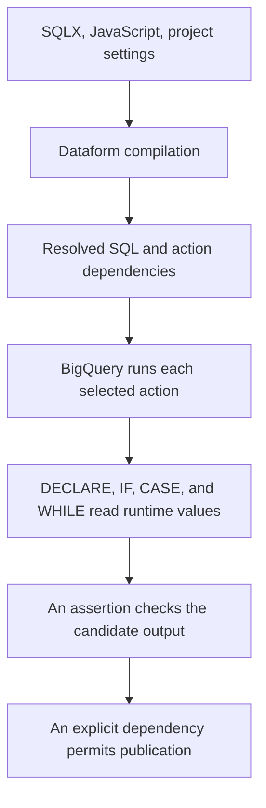

# Use BigQuery scripting in Dataform

Dataform compiles a dependency graph and runs its actions in BigQuery. BigQuery executes the SQL inside each action. Keep those responsibilities visible: JavaScript generates SQL, a procedural statement makes a decision during query execution, and the graph decides which action must finish first.

Read [Dataform SQLX](0025-writing-dataform-sqlx-assertions.md) and [BigQuery failure boundaries](0048-bigquery-procedures-transactions-debugging.md) first. This lesson includes a [complete project](../examples/dataform-scripting/workflow_settings.yaml) with three source events, an incremental table, a procedural backfill, an assertion, and a publication table.

## Separate compilation from execution



| Mechanism | When it acts | What it can know |
| --- | --- | --- |
| `js { ... }`, `${...}` | Compilation | Project configuration, helper outputs, declared definitions |
| `when(incremental(), ...)` | Generation of full and incremental SQL variants | The build context, not the current source row count |
| `ref("raw_events")` | Compilation | A resolved identifier and a dependency edge |
| `resolve(...)` | Compilation | A resolved identifier without automatically adding a dependency |
| `IF`, `CASE`, `WHILE`, `DECLARE` in SQL | BigQuery execution | Variables, query results, and other available runtime state |
| `dependencies: [...]` | Workflow execution ordering | Which action must succeed before this action can run |

Do not use JavaScript `if` to branch on today's warehouse contents. That data is not available to ordinary SQLX compilation. Use a runtime SQL condition, or let the external orchestrator choose actions from a recorded control decision.

## Choose where the SQL belongs

| Need | Dataform location | Reason |
| --- | --- | --- |
| Define a table from a query | `type: "table"` main query | Dataform creates the destination |
| Maintain supported keyed incremental rows | `type: "incremental"` with `uniqueKey` | Dataform generates the incremental write |
| Declare a checkpoint before a table query | `pre_operations` | The variable can feed that action's main SQL |
| Set properties or run checks after writing a table | `post_operations` | The destination exists by that point |
| Run DDL, DCL, procedure calls, or a full script | `type: "operations"` | The SQL is custom work rather than a generated table query |
| Return invalid rows as a quality check | `type: "assertion"` | Zero result rows means the assertion passes |

Do not place a complete `DECLARE ... WHILE ...` script where a normal table action expects its defining query. Use an operations action for that script. The [operations guide](https://docs.cloud.google.com/dataform/docs/custom-sql) documents that operations in one BigQuery SQLX file share a context and are joined with semicolons.

## Use pre_operations for a runtime checkpoint

The fixture's [events_incremental.sqlx](../examples/dataform-scripting/definitions/events_incremental.sqlx) contains the following pattern. The source contract is one immutable row per `event_id`, with a retained arrival timestamp `ingested_at`.

```sql
config {
  type: "incremental",
  uniqueKey: ["event_id"],
  bigquery: { partitionBy: "event_date" }
}

pre_operations {
  DECLARE v_cutoff TIMESTAMP DEFAULT (
    ${when(incremental(),
      `SELECT COALESCE(TIMESTAMP_SUB(MAX(ingested_at), INTERVAL 3 DAY),
        TIMESTAMP '1970-01-01') FROM ${self()}`,
      `SELECT TIMESTAMP '1970-01-01'`)}
  );
}

SELECT event_id, event_date, amount, ingested_at
FROM ${ref("raw_events")}
WHERE ingested_at >= v_cutoff
```

On an initial build, the cutoff uses the epoch. On an incremental build, it uses the target's latest arrival timestamp minus three days. `COALESCE` handles an existing empty target. The scalar variable also gives the source query a runtime constant to use for partition filtering where the partition layout permits it.

The [table guide](https://docs.cloud.google.com/dataform/docs/create-tables) documents this checkpoint technique. Check the compiled SQL for both initial and incremental paths.

| Incremental gotcha | What the fixture assumes or requires |
| --- | --- |
| A business timestamp is not an arrival cursor | Filter on a retained arrival boundary when late data matters |
| A three-day overlap is finite | An outage or correction beyond it needs backfill or reconciliation |
| `uniqueKey` is not a uniqueness constraint | Validate the source key and resolve conflicting payloads before merging |
| Matching keys outside a target filter can become new inserts | Add `updatePartitionFilter` only if its range covers every possible matching target row |
| An old mutable event can overwrite new state | This fixture assumes immutable events; mutable entities need version comparisons and deletion handling |
| A post-operation fails after the table write | The earlier write can remain; failure does not imply rollback |

The fixture includes a post-operation `ASSERT` for nonnegative amounts. It illustrates the last failure boundary. It is not a publication gate for an unrelated action unless that action depends on the relevant success condition.

## Put a bounded procedural backfill in operations

[rebuild_daily.sqlx](../examples/dataform-scripting/definitions/rebuild_daily.sqlx) creates a candidate table, then rebuilds two days. The script starts as follows.

```sql
config {
  type: "operations",
  hasOutput: true,
  tags: ["backfill"]
}

DECLARE v_day DATE DEFAULT DATE '2026-11-01';
DECLARE v_last DATE DEFAULT DATE '2026-11-02';
DECLARE v_steps INT64 DEFAULT 0;

CREATE OR REPLACE TABLE ${self()} (
  event_date DATE, event_count INT64, total_amount NUMERIC
);

WHILE v_day <= v_last DO
  SET v_steps = v_steps + 1;
  ASSERT v_steps <= 7 AS 'Backfill range exceeds the exercise limit';

  MERGE ${self()} AS t
  USING (
    SELECT v_day AS event_date, COUNT(*) AS event_count,
      COALESCE(SUM(amount), 0) AS total_amount
    FROM ${ref("raw_events")}
    WHERE event_date = v_day
  ) AS s
  ON t.event_date = s.event_date
  WHEN MATCHED THEN UPDATE SET
    event_count = s.event_count, total_amount = s.total_amount
  WHEN NOT MATCHED THEN INSERT (event_date, event_count, total_amount)
    VALUES (s.event_date, s.event_count, s.total_amount);

  SET v_day = DATE_ADD(v_day, INTERVAL 1 DAY);
END WHILE;
```

`hasOutput: true` makes the operation's output referenceable. It must create a table or view with the action's name; `${self()}` resolves that name. A procedure deployment, grant, export, or model-only operation should not claim a table output it does not create.

This example replaces its entire disposable candidate output each run. It demonstrates a bounded script and leaves the last published table alone until validation succeeds. A real large backfill often needs persistent progress, per-partition retries, and immutable source boundaries. Do not recreate its production target at the start of every retry.

For the two-day fixture, expect the following candidate rows.

| event_date | event_count | total_amount |
| --- | --- | --- |
| 2026-11-01 | 2 | 30 |
| 2026-11-02 | 1 | 30 |

A single grouped query would compute these totals more efficiently. The loop exists to teach scripting and the failure boundaries of repeated statements.

## Make assertions block publication

The custom [assertion](../examples/dataform-scripting/definitions/assert_daily_complete.sqlx) rejects a candidate with the wrong number of dates or events. The [publication action](../examples/dataform-scripting/definitions/published_daily.sqlx) must name that assertion as a dependency.

```sql
config {
  type: "table",
  dependencies: ["assert_daily_complete"]
}

SELECT event_date, event_count, total_amount
FROM ${ref("rebuild_daily")}
```

`ref("rebuild_daily")` adds the source dependency. It does not automatically add every assertion about that source. The explicit assertion dependency makes publication wait for its success. The [dependency guide](https://docs.cloud.google.com/dataform/docs/dependencies) also documents automatic assertion-dependency options; use the option deliberately and inspect the resulting graph.

Built-in `uniqueKey` or `nonNull` assertions usually check a materialized result. They do not retroactively roll it back. Keep an existing published version until a replacement candidate passes the required checks.

## Procedure calls and hidden dependencies

This is a separate fragment for a repository that already deploys the procedure from lesson 0048 through an action named `deploy_count_large_orders`.

```sql
config {
  type: "operations",
  dependencies: ["deploy_count_large_orders"]
}

DECLARE v_count INT64;
CALL `YOUR_PROJECT_ID.script_lab.count_large_orders`(15, v_count);
ASSERT v_count > 0 AS 'Expected at least one matching order';
```

The procedure name in that `CALL` is a SQL identifier, not a `ref` edge. Its internal table reads are also hidden from Dataform's static dependency graph. Declare those dependencies or expose a table output that the next action can reference. Apply environment substitutions to the procedure path as well as table paths.

Variables, temporary tables, and transactions stay within their execution context. An action named `begin_transaction` cannot open a transaction for another action named `commit_transaction`. Use one operations script for a supported transaction. A workflow invocation is not one transaction across its actions.

## Compile and inspect the supplied project

The fixture pins Dataform CLI and Core `3.1.3` in [package.json](../examples/dataform-scripting/package.json). This is the tested compiler version for these new examples, separate from the older introductory fixture.

```bash
cd docs/examples/dataform-scripting
npm install --ignore-scripts
npm run compile
```

Compilation does not submit BigQuery jobs. Before cloud execution, set `defaultProject` in `workflow_settings.yaml` to your disposable project, verify the dataset locations, and grant the runtime account the required BigQuery job, source-read, and destination-write permissions. Dataform repository editing access is a separate permission boundary.

Inspect the compiled graph for these conditions.

| Check | Expected result |
| --- | --- |
| `raw_events` | Produces three fixture events |
| `events_incremental` | Contains separate initial and incremental SQL plus its pre/post operations |
| `rebuild_daily` | Depends on `raw_events` and creates its own named output |
| `assert_daily_complete` | Depends on `rebuild_daily` |
| `published_daily` | Depends on both the candidate and the named assertion |
| Every destination | Resolves to the intended lab project and datasets |

Execute the selected graph through your configured Dataform workflow only after that inspection. Expect three incremental events and the two daily rows above. Change one amount to a negative number, rerun the candidate path, and confirm publication is blocked. Afterward restore the fixture and demonstrate a successful rerun.

## Advantages and limits

| Dataform plus scripting provides | It does not provide automatically |
| --- | --- |
| Versioned SQL and ordered dependencies | A transaction across actions |
| Runtime branch and loop logic near the data | Retry-safe writes or a complete source boundary |
| Explicit assertion gates | Rollback of a table that a failed assertion already inspected |
| Configurable deployment targets | Correct substitutions inside hard-coded or dynamically constructed identifiers |
| One place to review custom SQL operations | Automatic discovery of procedure internals, dynamic SQL dependencies, or external effects |

Choose normal table and incremental actions for ordinary relational transforms. Use operations for the work that needs procedural statements. For API calls, long waits, or coordination across services, use the orchestration module.

## Practice and expected reasoning

1. Delete `dependencies: ["assert_daily_complete"]` from publication. Explain the ordering guarantee that disappears.
2. Move `DECLARE v_cutoff` into another action. Predict why the main query cannot read it.
3. Replace `ref("raw_events")` with a hard-coded table path. Inspect which graph edge disappears.
4. Add an event four days before the recorded checkpoint. Design the reconciliation run needed to include it.
5. Fail a post-operation after the table write. Explain why the caller sees failure while rows can still be present.

??? note "Answer check"
    A model reference alone does not make assertions prerequisites. Runtime variables do not cross action contexts. A hard-coded path adds no dependency edge. A finite arrival overlap needs an explicit backfill for data outside its boundary. Failure after a committed write is not a rollback; build candidates and gate publication when consumers need a validated version.

Remove only the fixture's tables and assertion views after cloud exercises. Keep job IDs and observed results if you plan to record demonstrated understanding.

| Previous lesson | All lessons | Next lesson |
| --- | :---: | ---: |
| [0048: Procedures, transactions, and debugging](0048-bigquery-procedures-transactions-debugging.md) | [Lesson catalog](index.md) | [0050: BigQuery ML foundations](0050-bigquery-ml-foundations-training.md) |
