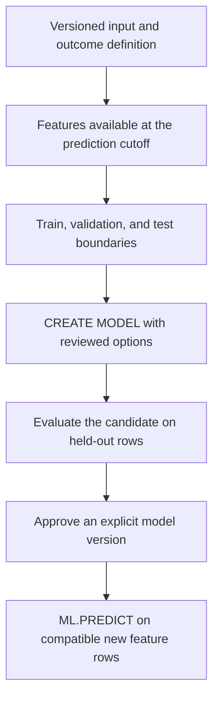

# BigQuery ML foundations: model types, features, and training SQL

Module 12 treats a model as a versioned data-pipeline artifact. Features need a defined grain and cutoff, training needs a reproducible input, and prediction needs an identifiable model version. SQL makes those boundaries reviewable, but it does not choose the business target or prevent leakage for you.

Read [data modeling](0041-googlesql-data-modeling.md) and [SQL statement families](0046-bigquery-sql-statement-families.md) first. This module focuses on BigQuery ML SQL and its pipeline integration. It does not try to replace a general course in statistical modeling.

## What BigQuery ML does

BigQuery ML lets you create, inspect, evaluate, and use supported models through SQL. Some models train with BigQuery-managed processing. Other model families use external managed training or remote inference services. A SQL entry point does not imply the same execution engine, price, location support, or permissions for every family.



See the [ML introduction](https://docs.cloud.google.com/bigquery/docs/bigqueryml-intro) and [CREATE MODEL reference](https://docs.cloud.google.com/bigquery/docs/reference/standard-sql/bigqueryml-syntax-create).

## Choose a model family

These are model types from the current CREATE MODEL catalog. Their individual option lists differ.

| Task | Model types or interface | Starting use | Important limit |
| --- | --- | --- | --- |
| Numeric prediction | `LINEAR_REG` | A readable baseline for cost or demand features | A linear relationship may not fit the business process |
| Classification | `LOGISTIC_REG` | Binary or multiclass labels | A probability threshold is a business decision |
| Tree models | `BOOSTED_TREE_CLASSIFIER`, `BOOSTED_TREE_REGRESSOR`, `RANDOM_FOREST_CLASSIFIER`, `RANDOM_FOREST_REGRESSOR` | Nonlinear tabular relationships | Training options, cost, and explainability support differ |
| Neural models | `DNN_CLASSIFIER`, `DNN_REGRESSOR`, `DNN_LINEAR_COMBINED_CLASSIFIER`, `DNN_LINEAR_COMBINED_REGRESSOR` | Supported neural and wide-and-deep workflows | More configuration does not fix weak labels or leakage |
| Automated tabular training | `AUTOML_CLASSIFIER`, `AUTOML_REGRESSOR` | Managed architecture and tuning search | Check current availability, budget controls, and region support |
| Clustering | `KMEANS` | Segment rows using feature distance | Cluster IDs are not stable business labels |
| Dimensionality reduction | `PCA`, `AUTOENCODER` | Compress features or support reconstruction analysis | Scaling and input compatibility matter |
| Recommendation | `MATRIX_FACTORIZATION` | Learn user-item interaction structure | Feedback type, capacity requirements, and cold starts need planning |
| Forecasting | `ARIMA_PLUS`, `ARIMA_PLUS_XREG` | Time-series forecasts, with optional regressors | Future regressor values must be available for XREG inference |
| Contribution analysis | `CONTRIBUTION_ANALYSIS` | Explain supported aggregate changes across segments | This is a specialized analysis model, not ordinary regression |
| Imported models | `TENSORFLOW`, `TENSORFLOW_LITE`, `ONNX`, `XGBOOST` | Use a compatible pre-trained artifact | Import registers an artifact; it does not retrain it in BigQuery |
| Remote models | `REMOTE WITH CONNECTION` | Invoke a supported remote endpoint or service | Connection identity, endpoint support, quotas, and remote charges apply |
| Built-in forecasting | `AI.FORECAST` | Use the built-in TimesFM forecasting interface | It is a function call, not an `ARIMA_PLUS` model you create |

Start with the simplest model that can answer the stated question. Measure it against a baseline before choosing a more expensive family. [Lesson 0052](0052-bigquery-ml-advanced-sql-reference.md) covers specialized and remote interfaces.

## State the prediction contract

For the lab, predict the final shipping cost using distance and service level known when an order is dispatched. One row represents one completed delivery. The label is the observed final cost.

| Field | Role | Why |
| --- | --- | --- |
| `order_id` | Join key and output identity | Carry it through predictions; do not train on an arbitrary identifier |
| `feature_date` | Availability boundary | Defines which data could have existed at prediction time |
| `distance_km` | Numeric feature | Known before the delivery completes |
| `service_level` | Categorical feature | Known when the delivery is requested |
| `shipping_cost` | Label | Observed after completion; unavailable for a new prediction |
| `split_name` | Training control | Keeps training, validation, and test rows separate |

Real features need both event time and availability time. A corrected historical value can have an old event date while becoming known only later. A join that uses today's customer record for last month's decision leaks information unless the training contract permits it.

## Build a bounded synthetic dataset

Run this in a disposable billing-enabled project. The dataset is `US`; submit the later jobs in that location. Replace `YOUR_PROJECT_ID`. The setup creates only the named `bqml_lab` table, but training and queries can incur charges.

```sql
CREATE SCHEMA IF NOT EXISTS `YOUR_PROJECT_ID.bqml_lab`
OPTIONS (location = 'US');

CREATE OR REPLACE TABLE `YOUR_PROJECT_ID.bqml_lab.delivery_features` AS
WITH inputs AS (
  SELECT
    id AS order_id,
    DATE_ADD(DATE '2026-01-01', INTERVAL DIV(id - 1, 10) DAY) AS feature_date,
    CAST(1 + MOD(id, 30) AS FLOAT64) AS distance_km,
    IF(MOD(id, 2) = 0, 'express', 'standard') AS service_level,
    CASE
      WHEN id <= 800 THEN 'train'
      WHEN id <= 900 THEN 'validation'
      ELSE 'test'
    END AS split_name
  FROM UNNEST(GENERATE_ARRAY(1, 1000)) AS id
)
SELECT *,
  3.0 + 0.7 * distance_km
    + IF(service_level = 'express', 5.0, 0.0)
    + 0.1 * (MOD(order_id, 7) - 3) AS shipping_cost
FROM inputs;

SELECT split_name, COUNT(*) AS row_count,
  MIN(feature_date) AS first_day, MAX(feature_date) AS last_day
FROM `YOUR_PROJECT_ID.bqml_lab.delivery_features`
GROUP BY split_name
ORDER BY first_day;
```

Expect 800 training rows, 100 validation rows, and 100 test rows in non-overlapping chronological blocks. The data is synthetic and easy to predict. It tests SQL mechanics, not whether a real shipping model is useful.

## Train a version with stored preprocessing

Run this training statement after setup. Choose a new model name for a new candidate. `CREATE MODEL` fails if that name already exists, so an accidental rerun does not silently replace the previous artifact.

```sql
CREATE MODEL `YOUR_PROJECT_ID.bqml_lab.delivery_cost_v1`
TRANSFORM (
  ML.STANDARD_SCALER(distance_km) OVER () AS distance_scaled,
  service_level,
  shipping_cost
)
OPTIONS (
  model_type = 'LINEAR_REG',
  input_label_cols = ['shipping_cost'],
  data_split_method = 'NO_SPLIT' -- (1)!
) AS
SELECT distance_km, service_level, shipping_cost
FROM `YOUR_PROJECT_ID.bqml_lab.delivery_features`
WHERE split_name = 'train';
```

1. The input query below contains only the training partition. Validation and test rows remain outside this statement.

The `TRANSFORM` clause includes the label unchanged and specifies the preprocessing applied to the feature inputs. Prediction supplies the raw `distance_km` and `service_level`; the model applies its stored transform. Supported categorical automatic preprocessing handles `service_level` for this family.

The scaler learns statistics from this training input. Do not separately fit a scaler on all rows or recompute different serving statistics. The [preprocessing guide](https://docs.cloud.google.com/bigquery/docs/reference/standard-sql/bigqueryml-preprocessing-functions) explains how analytic preprocessing inside TRANSFORM reuses training statistics.

`NO_SPLIT` means all rows passed into CREATE MODEL serve as its training input. This lab creates validation and test sets outside the training statement. It does not mean that evaluating on the training input becomes an honest test.

## Understand splitting and training options

| Option | What it controls | Gotcha |
| --- | --- | --- |
| `INPUT_LABEL_COLS` | The target column or supported label set | An omitted control column can become an unintended feature if you use `SELECT *` |
| `DATA_SPLIT_METHOD='AUTO_SPLIT'` | Family-specific automatic splitting | It is not automatically a time-aware or entity-aware evaluation boundary |
| `RANDOM` | Randomly separates input rows | The same customer or future information can appear across splits |
| `CUSTOM` with `DATA_SPLIT_COL` | Uses an explicit split marker | The marker's required type and meaning vary with model and tuning settings |
| `SEQ` with `DATA_SPLIT_COL` | Uses ordering to separate data | Validate the cutoff and family-specific semantics |
| `NO_SPLIT` | Uses the supplied training input without an internal holdout | Supply an external holdout yourself |
| `MAX_ITERATIONS`, `EARLY_STOP` | Controls supported iterative training | Not every model uses the same optimizer or stopping rule |
| `L1_REG`, `L2_REG` | Regularization for supported families | Interpret values in the context of feature preprocessing |
| `AUTO_CLASS_WEIGHTS`, `CLASS_WEIGHTS` | Classification imbalance handling | Changing weights does not choose an appropriate serving threshold |
| `NUM_TRIALS`, hyperparameter ranges | Tuning search for supported families | Multiple trials increase training work and need a separate final test |
| `WARM_START` | Reuses supported previous training state | It is not a universal online-learning or incremental-training switch |

The [linear and logistic model reference](https://docs.cloud.google.com/bigquery/docs/reference/standard-sql/bigqueryml-syntax-create-glm) is the source for the lab's options. Read the model-specific page before transferring an option to a different family.

## Inspect and manage the model

| SQL or CLI | What it does | Limit |
| --- | --- | --- |
| `CREATE MODEL name ...` | Trains a new named artifact | Fails if that name exists |
| `CREATE MODEL IF NOT EXISTS name ...` | Creates only when absent | An existing model can hide changed training SQL or input |
| `CREATE OR REPLACE MODEL name ...` | Replaces the named artifact after training | A mutable name makes historical score reproduction harder |
| `ALTER MODEL ... SET OPTIONS (...)` | Changes supported metadata or management settings | It does not retrain learned weights |
| `DROP MODEL IF EXISTS name` | Deletes the artifact | Identify downstream scoring users before cleanup |
| `EXPORT MODEL name OPTIONS(uri=...)` | Exports supported model families | Export format and preprocessing support depend on the family |
| `bq ls --models PROJECT_ID:DATASET` | Lists dataset models | Use the selected project and account |
| `bq --format=prettyjson show --model PROJECT_ID:DATASET.MODEL` | Prints model metadata | Inspect the actual schema rather than assuming every ML output matches |

```sql
ALTER MODEL `YOUR_PROJECT_ID.bqml_lab.delivery_cost_v1`
SET OPTIONS (
  description = 'Synthetic shipping-cost teaching model',
  labels = [('purpose', 'learning')]
);
```

Use model APIs or the CLI for model metadata and job metadata for training execution. Do not substitute a metadata view from another database product merely because its name sounds plausible. The [ALTER MODEL](https://docs.cloud.google.com/bigquery/docs/reference/standard-sql/bigqueryml-syntax-alter-model) and [DROP MODEL](https://docs.cloud.google.com/bigquery/docs/reference/standard-sql/bigqueryml-syntax-drop-model) references define management syntax.

## Advantages and limitations

| Advantage | Limit to plan for |
| --- | --- |
| SQL can build features and train a supported model near warehouse data | Training can still be expensive or use another managed execution service |
| Stored TRANSFORM logic reduces training and serving mismatches | Unsupported preprocessing or manual external changes can still introduce skew |
| Model versions and query jobs give reviewable artifacts | A mutable source query alone is not a reproducible training snapshot |
| Dataform can order feature, training, and scoring work | A training action is not a transaction with all its feature and score tables |
| Many common tabular and forecasting families have SQL interfaces | Arbitrary Python packages, custom training loops, and every model architecture are outside that SQL interface |

## Practice and expected reasoning

1. Add `order_id` and `split_name` to an unqualified `SELECT *` training query without TRANSFORM. Explain why that changes the feature contract.
2. Move validation rows into training, then evaluate on those same rows. Explain what the reported error can no longer establish.
3. Replace the model with the same name and a different source cutoff. Identify the evidence missing from old prediction rows.
4. Add a feature named `delivered_at` that becomes known only after delivery. Decide whether it is valid for a dispatch-time prediction.
5. Explain why `ALTER MODEL` cannot update the learned distance coefficient after new deliveries arrive.

??? note "Answer check"
    Explicit feature projection prevents accidental identifier and split-marker features. Training-set evaluation is not a held-out estimate. Reproducible scores need the exact model artifact and feature snapshot. A post-delivery feature leaks information into a dispatch-time prediction. Updating learned parameters requires supported training, not a metadata ALTER.

Keep the lab model and table for the next lesson. Its cleanup instructions distinguish these artifacts from the specialized models created later.

| Previous lesson | All lessons | Next lesson |
| --- | :---: | ---: |
| [0049: Scripting with Dataform](0049-bigquery-scripting-dataform.md) | [Lesson catalog](index.md) | [0051: Evaluate, predict, and explain](0051-bigquery-ml-evaluation-prediction.md) |
