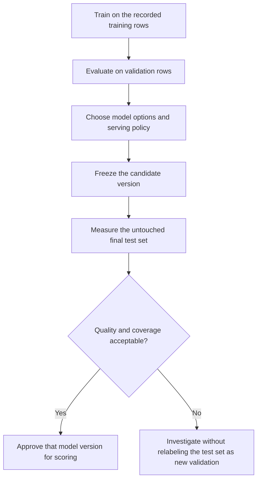

# BigQuery ML SQL: evaluation, prediction, and explanations

A training job finishing successfully proves that BigQuery created a model. It does not prove that the predictions beat a baseline, cover the intended population, or use information available at serving time. This lesson adds those checks and a SQL reference for inspecting supported models.

Run the self-contained setup and training in [lesson 0050](0050-bigquery-ml-foundations-training.md) first. They create `delivery_features` and `delivery_cost_v1` in your disposable `US` dataset. Replace `YOUR_PROJECT_ID` in the examples below. All SQL uses GoogleSQL.

## Keep validation and final testing separate



Use validation results to choose options and thresholds. Use the final test for an estimate after those choices. Repeatedly inspecting and optimizing against the test turns it into another validation set.

## Evaluate the regression model

```sql
SELECT *
FROM ML.EVALUATE(
  MODEL `YOUR_PROJECT_ID.bqml_lab.delivery_cost_v1`,
  (
    SELECT distance_km, service_level, shipping_cost
    FROM `YOUR_PROJECT_ID.bqml_lab.delivery_features`
    WHERE split_name = 'validation'
  )
);
```

The evaluation input includes the observed label. The model applies its stored transform to the raw features. Expect one regression metrics row, not one row per delivery. Do not expect bit-for-bit identical learned metrics across every service revision or training option.

| Regression metric | Interpretation | Check |
| --- | --- | --- |
| `mean_absolute_error` | Average absolute prediction error in the label's units | Compare it with a baseline and business tolerance |
| `mean_squared_error` | Average squared error | Large misses receive more weight |
| `r2_score` | Fit relative to variation in the evaluated outcome | It can be negative on a held-out population |
| `explained_variance` | Fraction of variation explained under its definition | It is not a substitute for absolute-error checks |
| `mean_squared_log_error` | Error in a log-transformed scale where supported | Interpret it only where the target and function behavior make it meaningful |

The [ML.EVALUATE reference](https://docs.cloud.google.com/bigquery/docs/reference/standard-sql/bigqueryml-syntax-evaluate) lists output fields by model family. Classification, regression, clustering, and forecasting do not share one metrics schema.

Calling `ML.EVALUATE(MODEL ...)` without explicit input can use the model's recorded evaluation data or training-dependent behavior. Supply the intended holdout when you need a particular evaluation boundary.

## Compare with a baseline on the same rows

This baseline always predicts the training set's mean shipping cost. It uses no validation labels to fit the prediction.

```sql
WITH baseline AS (
  SELECT AVG(shipping_cost) AS prediction
  FROM `YOUR_PROJECT_ID.bqml_lab.delivery_features`
  WHERE split_name = 'train'
)
SELECT AVG(ABS(v.shipping_cost - b.prediction)) AS baseline_mae
FROM `YOUR_PROJECT_ID.bqml_lab.delivery_features` AS v
CROSS JOIN baseline AS b
WHERE v.split_name = 'validation';
```

The synthetic data should favor a model that uses distance and service level, but record the measured results. A model must beat a relevant baseline on the same time boundary and population. A low global error can still hide poor performance for a service level or distance range.

## Predict while preserving row identity

```sql
SELECT order_id, feature_date, predicted_shipping_cost
FROM ML.PREDICT(
  MODEL `YOUR_PROJECT_ID.bqml_lab.delivery_cost_v1`,
  (
    SELECT order_id, feature_date, distance_km, service_level
    FROM `YOUR_PROJECT_ID.bqml_lab.delivery_features`
    WHERE split_name = 'test'
  )
)
ORDER BY order_id;
```

Expect 100 predictions with IDs 901 through 1000. For this model, unused input identity columns pass through to the output, while `predicted_shipping_cost` names the predicted label. Input feature names and types must match the raw inputs expected by the model's TRANSFORM clause. Do not manually scale `distance_km` again.

The [ML.PREDICT reference](https://docs.cloud.google.com/bigquery/docs/reference/standard-sql/bigqueryml-syntax-predict) defines output schemas and options per family. Inspect the actual result schema before downstream casts or field extraction.

For a durable scoring table, store the model's full version identifier, source snapshot or batch ID, feature cutoff, scoring time, and prediction key. Re-running the same partition needs deliberate replacement or merge semantics; a plain append duplicates scores.

## Add a classification exercise

This separate model predicts whether observed shipping cost is at least 20 units. It uses the same training boundary. The numeric 0/1 label gives the positive class an explicit meaning.

```sql
CREATE MODEL `YOUR_PROJECT_ID.bqml_lab.expensive_delivery_v1`
OPTIONS (
  model_type = 'LOGISTIC_REG',
  input_label_cols = ['is_expensive'],
  data_split_method = 'NO_SPLIT',
  max_iterations = 20
) AS
SELECT distance_km, service_level,
  IF(shipping_cost >= 20, 1, 0) AS is_expensive
FROM `YOUR_PROJECT_ID.bqml_lab.delivery_features`
WHERE split_name = 'train';
```

Use a higher positive-class threshold in this prediction example. The threshold here is an exercise setting, not a recommended operating policy.

```sql
SELECT
  order_id,
  predicted_is_expensive,
  (
    SELECT p.probability
    FROM UNNEST(predicted_is_expensive_probs) AS p
    WHERE CAST(p.label AS STRING) = '1'
  ) AS probability_expensive
FROM ML.PREDICT(
  MODEL `YOUR_PROJECT_ID.bqml_lab.expensive_delivery_v1`,
  (
    SELECT order_id, distance_km, service_level
    FROM `YOUR_PROJECT_ID.bqml_lab.delivery_features`
    WHERE split_name = 'validation'
  ),
  STRUCT(0.8 AS threshold)
);
```

Select a probability by its label. Do not assume that array element zero is the positive class. Threshold adjustment changes the decision, not the underlying class probabilities. Binary and multiclass output and threshold support differ.

## Evaluate classification at the intended threshold

```sql
SELECT *
FROM ML.CONFUSION_MATRIX(
  MODEL `YOUR_PROJECT_ID.bqml_lab.expensive_delivery_v1`,
  (
    SELECT distance_km, service_level,
      IF(shipping_cost >= 20, 1, 0) AS is_expensive
    FROM `YOUR_PROJECT_ID.bqml_lab.delivery_features`
    WHERE split_name = 'validation'
  ),
  STRUCT(0.8 AS threshold)
);
```

| Function or metric | What it answers | Gotcha |
| --- | --- | --- |
| `ML.CONFUSION_MATRIX` | How actual and predicted classes intersect | Its output columns depend on the model's labels |
| `ML.ROC_CURVE` | How binary true-positive and false-positive rates change with threshold | A curve does not choose the business threshold |
| Precision | How many predicted positives were positive | It can look good while missing many positives |
| Recall | How many actual positives were found | Higher recall can increase false positives |
| Accuracy | Fraction classified correctly | Class imbalance can make a useless majority-class predictor look strong |
| Log loss | Quality of predicted class probabilities under the defined metric | Good classification accuracy does not imply calibrated probabilities |

Use the [confusion matrix](https://docs.cloud.google.com/bigquery/docs/reference/standard-sql/bigqueryml-syntax-confusion) and [ROC](https://docs.cloud.google.com/bigquery/docs/reference/standard-sql/bigqueryml-syntax-roc) references for syntax and supported families. Evaluate thresholds on validation data using the cost of the two error types, then freeze the decision before final testing.

## Inspect transformations and explanations

```sql
SELECT *
FROM ML.TRANSFORM(
  MODEL `YOUR_PROJECT_ID.bqml_lab.delivery_cost_v1`,
  (
    SELECT distance_km, service_level, shipping_cost
    FROM `YOUR_PROJECT_ID.bqml_lab.delivery_features`
    WHERE split_name = 'validation'
    LIMIT 5
  )
);

SELECT *
FROM ML.EXPLAIN_PREDICT(
  MODEL `YOUR_PROJECT_ID.bqml_lab.delivery_cost_v1`,
  (SELECT 12.0 AS distance_km, 'express' AS service_level),
  STRUCT(2 AS top_k_features)
);
```

`ML.TRANSFORM` requires a model created with TRANSFORM. It exposes that preprocessing result; it is not a universal function for every automatic feature pipeline. `ML.EXPLAIN_PREDICT` returns supported local prediction explanations. Those contributions describe the model's calculation, not a causal effect of changing a feature in the real world.

## Reference for model inspection

| Function | Purpose | Compatibility or interpretation |
| --- | --- | --- |
| `ML.TRAINING_INFO` | Training iteration or progress information | Output varies by family; not every imported or remote model trains in BigQuery |
| `ML.FEATURE_INFO` | Statistics and information about model features | Use it to inspect the actual feature contract |
| `ML.TRANSFORM` | Apply a stored TRANSFORM definition | The model must contain that definition |
| `ML.WEIGHTS` | Weights or embeddings for supported model families | Coefficient magnitude depends on preprocessing and representation |
| `ML.EXPLAIN_PREDICT` | Explain individual predictions | Supported models and options vary |
| `ML.GLOBAL_EXPLAIN` | Aggregate feature attributions | Requires the model and training settings to support global explanations |
| `ML.EVALUATE` | Model-family-specific metrics | Use explicit evaluation input when you need a particular holdout |
| `ML.PREDICT` | Batch inference for supported model families | Forecasting and recommendations have specialized functions |

Primary references: [training information](https://docs.cloud.google.com/bigquery/docs/reference/standard-sql/bigqueryml-syntax-train), [feature information](https://docs.cloud.google.com/bigquery/docs/reference/standard-sql/bigqueryml-syntax-feature), [transform](https://docs.cloud.google.com/bigquery/docs/reference/standard-sql/bigqueryml-syntax-transform), [weights](https://docs.cloud.google.com/bigquery/docs/reference/standard-sql/bigqueryml-syntax-weights), [prediction explanations](https://docs.cloud.google.com/bigquery/docs/reference/standard-sql/bigqueryml-syntax-explain-predict), and [global explanations](https://docs.cloud.google.com/bigquery/docs/reference/standard-sql/bigqueryml-syntax-global-explain).

## Gotchas to test before publishing scores

| Failure | Detection or correction |
| --- | --- |
| Missing or renamed feature | Compare the input schema with model metadata and test a small prediction batch |
| An ID accidentally becomes a feature | Use an explicit training projection or TRANSFORM contract |
| Training and serving apply different scaling | Use stored transforms and inspect ML.TRANSFORM output |
| A metric is `NULL`, missing, or based on zero relevant rows | Validate evaluation cardinality, label presence, and finite metric values |
| The label column enters a prediction feature query | Project the required raw features and output identity explicitly |
| Prediction counts differ from input counts | Reconcile expected keys, uniqueness, and any function-specific row failures |
| A successful score table has no model version | Add the version identifier and source boundary before publication |
| The model changed under a shared name | Use immutable candidate versions and a separately controlled approval record |

## Practice and expected reasoning

1. Compare the validation baseline MAE with model MAE, then inspect error by service level.
2. Drop `order_id` from inference. Explain why prediction values alone cannot support a reliable merge back to deliveries.
3. Change the classification threshold from 0.5 to 0.8. Predict the usual precision and recall tradeoff before measuring it.
4. Try ML.TRANSFORM on the classifier, which this exercise trained without a TRANSFORM clause. Explain the expected incompatibility.
5. Describe why a large distance contribution is not proof that changing a route causes that exact cost change.

??? note "Answer check"
    Compare the same rows and units, then inspect subgroups. Prediction identity is required for reconciliation. Raising a positive-class threshold generally reduces positive predictions; measure the resulting precision and recall rather than assuming their values. ML.TRANSFORM requires a stored TRANSFORM clause. Attribution explains a fitted model, while a causal claim requires additional assumptions and evidence.

Keep the two lab models for pipeline exercises if needed. Otherwise drop only `delivery_cost_v1` and `expensive_delivery_v1`, then the fixture table when no other lesson uses it.

| Previous lesson | All lessons | Next lesson |
| --- | :---: | ---: |
| [0050: ML foundations and training](0050-bigquery-ml-foundations-training.md) | [Lesson catalog](index.md) | [0052: Advanced ML SQL reference](0052-bigquery-ml-advanced-sql-reference.md) |
