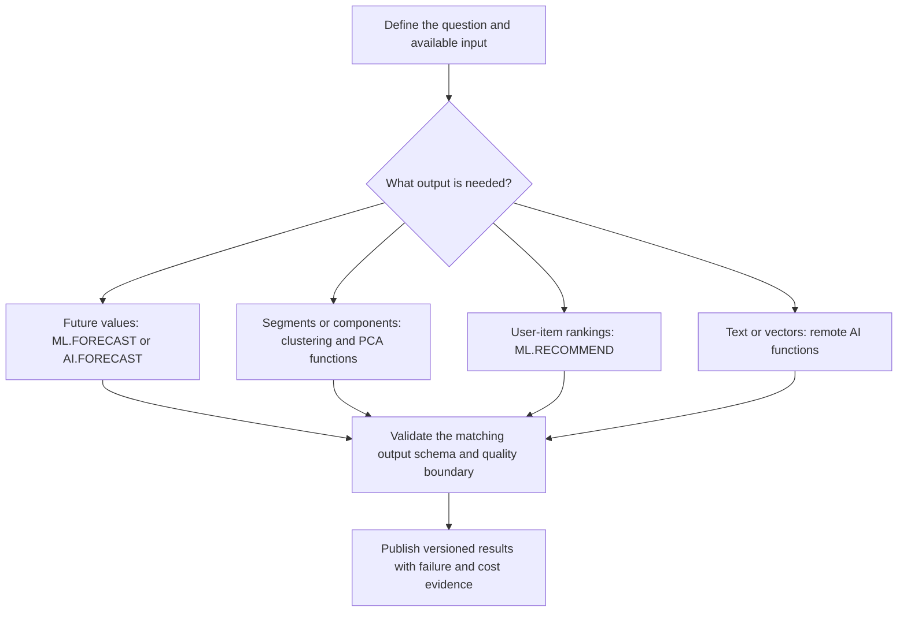

# BigQuery ML advanced SQL reference: forecasts, segments, embeddings, and monitoring

Choose the function that matches the model's job. `ML.PREDICT` is useful for many supervised and unsupervised models, but forecasting, recommendation, contribution analysis, and remote generation have specialized interfaces. Their argument order and result schemas differ.

Use the `bqml_lab` dataset and `delivery_features` fixture from [lesson 0050](0050-bigquery-ml-foundations-training.md). Replace project, bucket, connection, and endpoint placeholders. Each training example creates a new named model and can incur charges. The remote-inference example also needs a supported endpoint and its service permissions.

## Follow the model-specific path



## Forecast multiple time series

This setup creates 210 days for each of three stores. Train on the first 180 days and reserve the last 30 for evaluation. The deterministic weekly pattern makes the mechanics inspectable.

```sql
CREATE OR REPLACE TABLE `YOUR_PROJECT_ID.bqml_lab.daily_demand` AS
SELECT
  store_id,
  DATE_ADD(DATE '2026-01-01', INTERVAL day_number DAY) AS day,
  100.0 + 10.0 * store_id + 0.2 * day_number
    + IF(MOD(day_number, 7) IN (5, 6), 20.0, 0.0) AS units
FROM UNNEST([1, 2, 3]) AS store_id
CROSS JOIN UNNEST(GENERATE_ARRAY(0, 209)) AS day_number;

CREATE MODEL `YOUR_PROJECT_ID.bqml_lab.demand_arima_v1`
OPTIONS (
  model_type = 'ARIMA_PLUS',
  time_series_timestamp_col = 'day',
  time_series_data_col = 'units',
  time_series_id_col = 'store_id',
  horizon = 30,
  auto_arima_max_order = 1
) AS
SELECT store_id, day, units
FROM `YOUR_PROJECT_ID.bqml_lab.daily_demand`
WHERE day < DATE_ADD(DATE '2026-01-01', INTERVAL 180 DAY);

SELECT *
FROM ML.FORECAST(
  MODEL `YOUR_PROJECT_ID.bqml_lab.demand_arima_v1`,
  STRUCT(30 AS horizon, 0.9 AS confidence_level)
);
```

Expect 30 forecast points for each store, for 90 rows. Inspect forecast timestamps, values, and prediction intervals. A confidence setting describes the model's interval construction; it is not a guarantee that a business deadline or exact value will occur.

The [ARIMA_PLUS training reference](https://docs.cloud.google.com/bigquery/docs/reference/standard-sql/bigqueryml-syntax-create-time-series) explains its preprocessing and candidate selection. It can combine duplicate timestamps and fill gaps, so validate time-series grain before training instead of letting repairs conceal ingestion defects.

| Function or model | Purpose | Important distinction |
| --- | --- | --- |
| `ARIMA_PLUS` | Learns a univariate series per configured identifier | Multiple series share one SQL model object but have distinct series identities |
| `ARIMA_PLUS_XREG` | Adds explanatory variables | Inference needs compatible future regressor values for the requested horizon |
| `ML.FORECAST` | Returns forecasts and intervals | For ARIMA_PLUS, training computes forecasts; retrieval horizon is bounded by what training prepared |
| `ML.EXPLAIN_FORECAST` | Exposes supported forecast components | It is different from per-row supervised feature attribution |
| `ML.ARIMA_EVALUATE` | Inspects fitted candidates and diagnostics | Fitted-model diagnostics alone are not held-out forecast accuracy |
| `ML.EVALUATE` with appropriate future actuals | Measures supported forecast error | Use the documented time-series arguments and actual future boundary |
| `ML.DETECT_ANOMALIES` | Marks unlikely observations under supported models | Time-series arguments differ from the contamination-based interface for KMEANS, PCA, or autoencoders |
| `AI.FORECAST` | Forecasts with built-in TimesFM | It does not require creating and managing an ARIMA model artifact |

```sql
SELECT *
FROM AI.FORECAST(
  (
    SELECT store_id, day, units
    FROM `YOUR_PROJECT_ID.bqml_lab.daily_demand`
    WHERE day < DATE_ADD(DATE '2026-01-01', INTERVAL 180 DAY)
  ),
  data_col => 'units',
  timestamp_col => 'day',
  id_cols => ['store_id'],
  horizon => 30
);
```

This uses the same input cutoff as the ARIMA exercise. Compare forecasts only after aligning the training boundary, identifiers, horizon, and evaluation rows. Check current availability and location restrictions before using a built-in model in a production dependency.

Primary references: [ML.FORECAST](https://docs.cloud.google.com/bigquery/docs/reference/standard-sql/bigqueryml-syntax-forecast), [ARIMA diagnostics](https://docs.cloud.google.com/bigquery/docs/reference/standard-sql/bigqueryml-syntax-arima-evaluate), [anomaly detection](https://docs.cloud.google.com/bigquery/docs/reference/standard-sql/bigqueryml-syntax-detect-anomalies), and [AI.FORECAST](https://docs.cloud.google.com/bigquery/docs/reference/standard-sql/bigqueryml-syntax-ai-forecast).

## Cluster completed rows and inspect centroids

```sql
CREATE MODEL `YOUR_PROJECT_ID.bqml_lab.delivery_segments_v1`
OPTIONS (
  model_type = 'KMEANS',
  num_clusters = 3,
  standardize_features = true
) AS
SELECT distance_km,
  IF(service_level = 'express', 1.0, 0.0) AS express_flag
FROM `YOUR_PROJECT_ID.bqml_lab.delivery_features`
WHERE split_name = 'train';

SELECT *
FROM ML.CENTROIDS(MODEL `YOUR_PROJECT_ID.bqml_lab.delivery_segments_v1`);

SELECT order_id, centroid_id, nearest_centroids_distance
FROM ML.PREDICT(
  MODEL `YOUR_PROJECT_ID.bqml_lab.delivery_segments_v1`,
  (
    SELECT order_id, distance_km,
      IF(service_level = 'express', 1.0, 0.0) AS express_flag
    FROM `YOUR_PROJECT_ID.bqml_lab.delivery_features`
    WHERE split_name = 'validation'
  )
);
```

Expect 100 assignments to the configured cluster set. Cluster IDs can change across retraining. Interpret centroid characteristics before naming a business segment, and version the mapping from a cluster to its label. Standardization changes the distances that define the clusters.

## Reduce dimensions without inventing semantic labels

```sql
CREATE MODEL `YOUR_PROJECT_ID.bqml_lab.delivery_pca_v1`
OPTIONS (
  model_type = 'PCA',
  num_principal_components = 1
) AS
SELECT distance_km,
  IF(service_level = 'express', 1.0, 0.0) AS express_flag
FROM `YOUR_PROJECT_ID.bqml_lab.delivery_features`
WHERE split_name = 'train';

SELECT *
FROM ML.PRINCIPAL_COMPONENTS(MODEL `YOUR_PROJECT_ID.bqml_lab.delivery_pca_v1`);
```

PCA components describe directions in the fitted feature representation. They are not class labels. Use the documented prediction or embedding interface to transform compatible rows, and inspect explained variance before deciding that the compressed representation retains enough information.

| Function | Compatible use | What it exposes |
| --- | --- | --- |
| `ML.CENTROIDS` | KMEANS | Cluster feature values |
| `ML.PREDICT` | KMEANS | Assignment and nearest-centroid distances |
| `ML.PRINCIPAL_COMPONENTS` | PCA | Component loadings |
| `ML.PREDICT` | PCA | Projected component values, with family-specific input-column options |
| `ML.DETECT_ANOMALIES` | Supported PCA, KMEANS, autoencoder, and time-series models | Model-specific anomaly evidence |
| `ML.RECOMMEND` | MATRIX_FACTORIZATION | Predicted user-item preference or rating |
| `ML.GET_INSIGHTS` | CONTRIBUTION_ANALYSIS | Segment contributions to a supported metric change |

Recommendation needs a meaningful interaction grain and explicit versus implicit feedback semantics. Missing interactions are not automatically negative preferences. Plan for users or items absent from training. Check the current capacity and training requirements before choosing matrix factorization.

References: [KMEANS](https://docs.cloud.google.com/bigquery/docs/reference/standard-sql/bigqueryml-syntax-create-kmeans), [centroids](https://docs.cloud.google.com/bigquery/docs/reference/standard-sql/bigqueryml-syntax-centroids), [PCA](https://docs.cloud.google.com/bigquery/docs/reference/standard-sql/bigqueryml-syntax-create-pca), [principal components](https://docs.cloud.google.com/bigquery/docs/reference/standard-sql/bigqueryml-syntax-principal-components), [recommendations](https://docs.cloud.google.com/bigquery/docs/reference/standard-sql/bigqueryml-syntax-recommend), and [contribution insights](https://docs.cloud.google.com/bigquery/docs/reference/standard-sql/bigqueryml-syntax-get-insights).

## Feature-engineering function reference

Use these functions where supported by the model and TRANSFORM syntax. Analytic ML preprocessing functions require an empty `OVER ()` clause. Scalar functions have their own arguments and do not all use OVER.

| Purpose | Functions | Gotcha |
| --- | --- | --- |
| Missing-value handling | `ML.IMPUTER` | Choose a strategy that matches the feature meaning |
| Scale numeric values | `ML.STANDARD_SCALER`, `ML.ROBUST_SCALER`, `ML.MIN_MAX_SCALER`, `ML.MAX_ABS_SCALER` | Fit statistics on training data and reuse them at serving time |
| Numeric structure | `ML.BUCKETIZE`, `ML.QUANTILE_BUCKETIZE`, `ML.NORMALIZER`, `ML.POLYNOMIAL_EXPAND` | Quantile boundaries, vector norms, and expanded dimensions have different meanings |
| Categorical representation | `ML.ONE_HOT_ENCODER`, `ML.MULTI_HOT_ENCODER`, `ML.LABEL_ENCODER`, `ML.HASH_BUCKETIZE`, `ML.FEATURE_CROSS` | Cardinality and unseen categories need deliberate treatment |
| Text representation | `ML.NGRAMS`, `ML.BAG_OF_WORDS`, `ML.TF_IDF` | Tokenization and fitted vocabulary affect serving compatibility |
| Image preprocessing | `ML.DECODE_IMAGE`, `ML.RESIZE_IMAGE`, `ML.CONVERT_IMAGE_TYPE`, `ML.CONVERT_COLOR_SPACE` | Use supported object and array formats for the chosen model |
| Historical features | `ML.FEATURES_AT_TIME` | The source history must express the intended availability cutoff |
| Inspect stored preprocessing | `ML.TRANSFORM` | Requires a model that stores a TRANSFORM definition |

The [manual preprocessing reference](https://docs.cloud.google.com/bigquery/docs/reference/standard-sql/bigqueryml-preprocessing-functions) links the individual signatures and export restrictions. A scalar cleanup function, an analytic fitted transform, and a table-valued historical lookup are not interchangeable.

## Tune without consuming the final test boundary

Supported models can use `NUM_TRIALS` with `HPARAM_RANGE` or `HPARAM_CANDIDATES` options. This is an options fragment for a model family that supports tuning.

```sql
OPTIONS (
  model_type = 'LINEAR_REG',
  input_label_cols = ['shipping_cost'],
  num_trials = 4,
  max_parallel_trials = 2,
  l2_reg = HPARAM_RANGE(0.01, 1.0)
)
```

The surrounding CREATE MODEL still needs a reviewed feature query and split policy. More trials consume more work. A failed or infeasible trial is not evidence that the whole search found the best practical model.

Use [ML.TRIAL_INFO](https://docs.cloud.google.com/bigquery/docs/reference/standard-sql/bigqueryml-syntax-trial-info) to inspect trial status, selected hyperparameters, evaluation metrics, and the chosen trial. Where supported, prediction and export can select a `trial_id`. Record it if results must reproduce a particular trial. Choose with validation data, then evaluate the frozen candidate on the final test.

## Remote text and embedding functions

| Interface | Main job | Output contract to inspect |
| --- | --- | --- |
| `AI.GENERATE` | Scalar text or structured generation | A STRUCT with generated fields, response, and status |
| `AI.GENERATE_TEXT` | Table-oriented text generation through supported models | Model-specific generated output and row status |
| `AI.GENERATE_EMBEDDING` | Vector generation through supported embedding or other model families | Embedding values and per-row status |
| `ML.GENERATE_TEXT`, `ML.GENERATE_EMBEDDING` | Existing ML-prefixed generation interfaces | Do not assume their field names equal the newer AI-prefixed interfaces |

Check the current [text-generation comparison](https://docs.cloud.google.com/bigquery/docs/choose-text-generation-function), [AI.GENERATE](https://docs.cloud.google.com/bigquery/docs/reference/standard-sql/bigqueryml-syntax-ai-generate), and [AI.GENERATE_EMBEDDING](https://docs.cloud.google.com/bigquery/docs/reference/standard-sql/bigqueryml-syntax-ai-generate-embedding) references before choosing an interface.

The following is a remote setup and one-row inference example. It requires an existing cloud resource connection in `US`, a supported embedding endpoint, and grants for the connection's service account. Replace `YOUR_SUPPORTED_EMBEDDING_ENDPOINT` with an endpoint supported in the selected location. This example does not provision those prerequisites.

```sql
CREATE MODEL `YOUR_PROJECT_ID.bqml_lab.delivery_text_embedding_v1`
REMOTE WITH CONNECTION `YOUR_PROJECT_ID.us.CONNECTION_ID`
OPTIONS (endpoint = 'YOUR_SUPPORTED_EMBEDDING_ENDPOINT');

CREATE TEMP TABLE embedding_attempt AS
SELECT *
FROM AI.GENERATE_EMBEDDING(
  MODEL `YOUR_PROJECT_ID.bqml_lab.delivery_text_embedding_v1`,
  (SELECT 101 AS note_id, 'The delivery arrived one day late.' AS content),
  STRUCT('RETRIEVAL_DOCUMENT' AS task_type)
);

SELECT note_id, status, ARRAY_LENGTH(embedding) AS dimensions
FROM embedding_attempt;
```

For successful supported text embedding output, expect an empty status and the endpoint's configured embedding dimension. A successful query job can still return rows with remote quota or inference errors. Reconcile every input identity with either a valid result or a recorded failure.

Retry only retryable failed identities, with bounded attempts and a retained input/model identity. Reissuing an entire successful batch can repeat remote charges and duplicate outputs. Avoid a WHILE loop that hammers an exhausted endpoint; put delays and service coordination in an orchestrator when needed. The [remote-model reference](https://docs.cloud.google.com/bigquery/docs/reference/standard-sql/bigqueryml-syntax-create-remote-model) defines connection and endpoint requirements.

## Detect skew and drift without confusing them with accuracy

| Function | Comparison | Limit |
| --- | --- | --- |
| `ML.VALIDATE_DATA_SKEW` | Supported model training statistics versus serving inputs | Needs compatible stored statistics and feature preprocessing |
| `ML.VALIDATE_DATA_DRIFT` | A baseline data population versus a study population | Its arguments differ from the model-first skew signature |
| `ML.EVALUATE` | Predictions versus known outcomes for supported models | Delayed labels can make immediate quality evaluation impossible |

Distribution change can warn that a contract changed. It does not prove that accuracy fell, and an unchanged distribution does not prove the model remains useful. Monitor feature nulls, ranges, categories, score distributions, volume, and delayed outcome metrics.

See [skew validation](https://docs.cloud.google.com/bigquery/docs/reference/standard-sql/bigqueryml-syntax-validate-data-skew) and [drift validation](https://docs.cloud.google.com/bigquery/docs/reference/standard-sql/bigqueryml-syntax-validate-data-drift).

## Export, cost, and compatibility limits

```sql
EXPORT MODEL `YOUR_PROJECT_ID.bqml_lab.delivery_cost_v1`
OPTIONS (uri = 'gs://YOUR_BUCKET/models/delivery_cost_v1/');
```

The destination is a model directory, not the wildcard shard URI used by `EXPORT DATA`. The service chooses the supported artifact format for the family. Model export is not available for every family; for example, ARIMA_PLUS models cannot be exported. Stored preprocessing also has export restrictions.

| Limit | Practical response |
| --- | --- |
| Model and function compatibility differ | Use the function's model-specific signature and inspect its result schema |
| Training size, time, concurrent jobs, and regional quotas vary | Check the current quota entry for the selected family before scaling |
| Remote services have separate quotas and permissions | Track remote statuses and enforce a bounded retry policy |
| A model's endpoint can evolve or retire | Record endpoint/version information and test migration with a candidate |
| Training work is not ordinary SELECT work | Review model training and remote pricing separately from query estimates |
| A dry run is not a complete training-cost or endpoint-call simulation | Use a bounded representative trial and record actual job evidence |

Primary references: [model export](https://docs.cloud.google.com/bigquery/docs/reference/standard-sql/bigqueryml-syntax-export-model), [exportable families and formats](https://docs.cloud.google.com/bigquery/docs/exporting-models), and [quotas](https://docs.cloud.google.com/bigquery/quotas).

## Practice and expected reasoning

1. Train forecasts on all 210 days, then score them against days 181 through 210. Identify the leakage.
2. Retrain KMEANS and compare cluster IDs. Explain why `cluster 1 = premium` is not a durable business contract.
3. Return one remote row with a quota error while the query succeeds. Define the batch success condition.
4. Compare ML.VALIDATE_DATA_DRIFT with supervised evaluation. State what each can establish when labels arrive a week later.
5. Plan an export of the forecasting model. Explain why the artifact cannot follow the linear-model export example.

??? note "Answer check"
    A holdout cannot also be in the fitted training history. Cluster identity needs a versioned interpretation rather than a stable numeric assumption. Every remote input needs a valid result or an explicitly handled failure. Drift concerns input populations, while supervised evaluation needs observed outcomes. ARIMA_PLUS is not an exportable model family.

Drop only the named specialized models and `daily_demand` after these exercises. Remove the remote model and any separately provisioned endpoint or connection only when this lab owns them and no other workflow uses them.

| Previous lesson | All lessons | Next lesson |
| --- | :---: | ---: |
| [0051: Evaluate, predict, and explain](0051-bigquery-ml-evaluation-prediction.md) | [Lesson catalog](index.md) | [0053: BigQuery ML with Dataform](0053-bigquery-ml-dataform-pipelines.md) |
