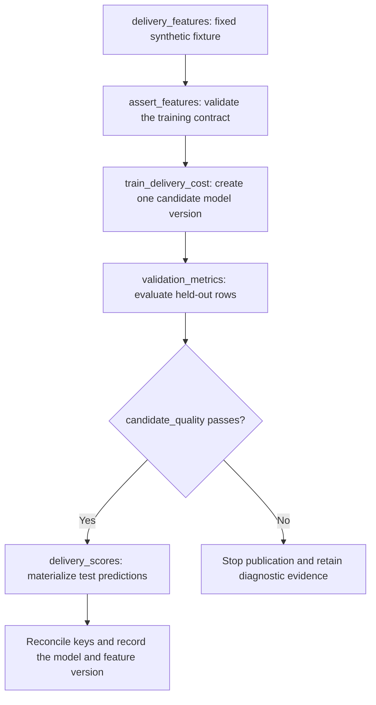

# Operate BigQuery ML pipelines with Dataform

Treat feature construction, training, validation, and scoring as distinct actions. Keep a candidate model's name stable for that attempt, make quality checks prerequisites for publication, and record which version produced each score. A failed candidate should not overwrite the currently approved production model.

Read [scripting with Dataform](0049-bigquery-scripting-dataform.md) and [ML evaluation](0051-bigquery-ml-evaluation-prediction.md) first. The [supplied project](../examples/dataform-bqml/workflow_settings.yaml) reproduces the synthetic shipping-cost exercise as a six-action graph. It needs no public source dataset or remote endpoint.

## Design the training graph



The fixture demonstrates candidate validation. A real promotion policy also compares with an approved baseline, evaluates relevant subgroups, and reserves an untouched final test. The exercise's MAE limit of 2.0 is a teaching condition for synthetic data, not a production acceptance standard.

## Give a model its own identifier contract

The project pins Dataform CLI and Core `3.1.3`. Change both the default project and model path before cloud execution.

```yaml
defaultProject: your-project-id
defaultLocation: US
defaultDataset: bqml_lab
defaultAssertionDataset: bqml_assertions
vars:
  model_path: your-project-id.bqml_lab.delivery_cost_v1
  feature_snapshot_id: synthetic_delivery_v1
```

`model_path` is a fully qualified SQL model identifier. It is not automatically rewritten by a table schema suffix or a workspace compilation override. If development and production use different projects or schemas, provide the matching model path in each environment and inspect the compiled SQL.

[ml_names.js](../examples/dataform-bqml/includes/ml_names.js) validates the simple `project.dataset.model` identifier form accepted by this fixture and quotes it. It deliberately does not accept arbitrary SQL fragments. Project variables are compile-time settings, not parameter bindings or warehouse query results.

`feature_snapshot_id` describes this fixed synthetic fixture. In a production pipeline, the controller must verify that an identifier names an immutable feature boundary. A string label alone does not freeze a mutable table.

## Train through an operations action

[train_delivery_cost.sqlx](../examples/dataform-bqml/definitions/train_delivery_cost.sqlx) defines the model-creation action.

```sql
config {
  type: "operations",
  dependencies: ["assert_features"],
  tags: ["train"]
}

CREATE MODEL ${ml_names.modelIdentifier(dataform.projectConfig.vars.model_path)}
TRANSFORM (
  ML.STANDARD_SCALER(distance_km) OVER () AS distance_scaled,
  service_level,
  shipping_cost
)
OPTIONS (
  model_type = 'LINEAR_REG',
  input_label_cols = ['shipping_cost'],
  data_split_method = 'NO_SPLIT'
) AS
SELECT distance_km, service_level, shipping_cost
FROM ${ref("delivery_features")}
WHERE split_name = 'train';
```

The feature `ref` creates a source dependency. The named assertion adds a separate quality dependency. The operation creates a model, so it does not advertise a referenceable table through `hasOutput: true`.

The [Dataform operations guide](https://docs.cloud.google.com/dataform/docs/custom-sql) documents referenceable output tables. For a model-only operation, keep the model identifier explicit and add ordering dependencies to consumers. Do not invent a table output to make a model name look like a table reference.

`CREATE MODEL` intentionally fails when the configured model name already exists. A new training attempt needs a new reviewed model version. `IF NOT EXISTS` would let an old artifact hide changed features or SQL; `OR REPLACE` would mutate a version already used by historical scores.

!!! note "Compilation does not run training"
    The local project checks validate generated SQLX and graph dependencies. Execute the BigQuery examples separately in a lab project before claiming that training, metrics, or retry behavior passed.

## Evaluate only after training succeeds

[validation_metrics.sqlx](../examples/dataform-bqml/definitions/validation_metrics.sqlx) contains an explicit dependency on the training operation. A model identifier embedded in SQL does not create that graph edge by itself.

```sql
config {
  type: "table",
  dependencies: ["train_delivery_cost"]
}

SELECT *
FROM ML.EVALUATE(
  MODEL ${ml_names.modelIdentifier(dataform.projectConfig.vars.model_path)},
  (
    SELECT distance_km, service_level, shipping_cost
    FROM ${ref("delivery_features")}
    WHERE split_name = 'validation'
  )
)
```

The [candidate_quality assertion](../examples/dataform-bqml/definitions/candidate_quality.sqlx) rejects a metrics table that does not contain exactly one row, contains a missing or nonfinite MAE, or exceeds the exercise limit. A comparison such as `metric > limit` alone does not reject every invalid metric.

| Quality gate | Why it matters |
| --- | --- |
| Expected evaluation row count | An empty result must not pass as success |
| Present, finite metric | `NULL`, NaN, or infinity is not acceptable evidence |
| Recorded validation population | A good metric on the wrong dates or customers answers the wrong question |
| Baseline and subgroup checks in production | An average can hide a regression for a service level or population |
| Explicit dependency from scoring to the assertion | A completed metrics table alone is not approval |

## Score with model and feature identity

[delivery_scores.sqlx](../examples/dataform-bqml/definitions/delivery_scores.sqlx) depends on `candidate_quality`. It sends only raw model features and identity columns into ML.PREDICT. It writes `model_path`, `feature_snapshot_id`, and `scored_at` alongside each prediction.

| Expected fixture result | Value |
| --- | --- |
| Feature rows | 1,000 |
| Training rows | 800 |
| Validation rows | 100 |
| Final test score rows | 100 |
| Prediction keys | Order IDs 901 through 1000 |
| Score model identity | The configured `model_path` |

Reconcile counts and unique keys after scoring. In a production partitioned score table, define a key such as `model_version + feature_snapshot + entity_id` and use a supported replacement or merge strategy. An incremental append alone does not make repeated scoring idempotent.

## Compile and run the bounded lab

```bash
cd docs/examples/dataform-bqml
npm install --ignore-scripts
npm run compile
```

Compilation checks SQLX generation and graph construction. It does not execute training, check all GoogleSQL semantics, validate IAM, or estimate the full cost of training. Before running the graph, verify the compiled project, dataset, model path, and location.

| Action | Must depend on |
| --- | --- |
| `assert_features` | `delivery_features` |
| `train_delivery_cost` | `delivery_features` and `assert_features` |
| `validation_metrics` | `delivery_features` and `train_delivery_cost` |
| `candidate_quality` | `validation_metrics` |
| `delivery_scores` | `delivery_features` and `candidate_quality` |

Use your configured Dataform workflow to execute the graph once with a fresh model version. If the quality assertion fails, inspect the metric and training child jobs before changing the threshold. A second full run with the same model identifier is expected to fail at CREATE MODEL. To repeat the whole training experiment, choose a new version and recompile all consumers.

Production training and daily scoring usually need separate execution selections or workflows. Daily scoring should read a deliberately approved existing model rather than recreating it. An approval record must name the model, feature contract, validation evidence, code revision, and effective time. Do not bypass a failed dependency merely to make the daily run finish.

## Failure, retries, and permissions

| Failure point | State that can remain | Recovery |
| --- | --- | --- |
| Feature assertion fails | The candidate feature table | Repair or rebuild the source boundary before training |
| Training fails | Feature data and a failed job | Inspect the terminal model-creation job before deciding whether a model exists |
| Training succeeds but evaluation fails | A valid candidate model with no quality decision | Rerun evaluation against the same model and holdout boundary |
| Quality fails | Candidate model and rejected metrics | Preserve evidence; keep the approved production model unchanged |
| Scoring fails after model approval | The approved model and possibly earlier score partitions | Retry the recorded scoring boundary with idempotent writes |
| Remote inference returns partial row errors | A successful query with failed result rows | Reconcile identities and retry eligible failed rows with bounded attempts |

Feature tables, CREATE MODEL, metrics tables, assertions, and score publication are not one transaction. Permanent model DDL cannot go into the DML transaction from module 11. An exception handler that swallows an error can incorrectly release dependent work, so let failures propagate.

| Identity | Required access category |
| --- | --- |
| Developer compiling the repository | Repository and workspace access |
| Dataform runtime service account | Job creation, feature reads, model creation or use, and destination writes as required by selected actions |
| Remote connection service account, when used | Supported endpoint or external service permissions |
| Consumer of published scores | Access to approved score tables, with broader training-data access only if required |

Scope grants to the intended projects and datasets. Compilation privileges are not runtime data privileges. A connection introduces another principal rather than inheriting every permission of the author.

## Observe the pipeline after deployment

Record Dataform invocation ID, code revision, compilation variables, model identifier, feature boundary, relevant BigQuery job IDs, validation metrics, and score reconciliation results. The [job metadata reference](https://docs.cloud.google.com/bigquery/docs/information-schema-jobs) helps identify CREATE_MODEL work and errors. Use model metadata for model properties rather than assuming a table metadata view describes a model artifact.

Monitor source freshness, feature schema and null changes, model age, prediction counts, score distributions, remote row statuses where relevant, and delayed outcome quality. A terminal successful training job and a green Dataform invocation are necessary execution evidence; they do not replace business quality checks.

## Practice and expected reasoning

1. Remove the training dependency from `validation_metrics`. Explain why its model path does not preserve ordering.
2. Change only `defaultProject`, leaving `model_path` untouched. Inspect where training and table writes would go.
3. Run the graph twice with the same version. Explain why failing at CREATE MODEL is useful here.
4. Force a `NULL` metric or an empty metrics table. Confirm that the candidate assertion would return a failure row.
5. Let training succeed and evaluation fail. Plan a retry that does not retrain an already completed candidate.
6. Replace the native model with remote inference. Add input-to-status reconciliation and bounded retries before declaring batch success.

??? note "Answer check"
    A literal or generated model identifier adds no automatic training dependency. Model paths need their own environment configuration. Immutable candidate names expose accidental repeated training. Gate checks must reject missing and nonfinite evidence. Retry evaluation against the known successful model and the same holdout boundary. Remote batch success requires handling per-row status as well as the query job state.

After cloud execution, remove only the fixture tables, assertion views, and model versions you created. Keep any model still referenced by retained scoring or recovery requirements. Module sources are collected in the [reference catalog](../references/resources.md#bigquery-ml-sql-and-pipeline-module).

| Previous lesson | All lessons | Next lesson |
| --- | :---: | ---: |
| [0052: Advanced ML SQL reference](0052-bigquery-ml-advanced-sql-reference.md) | [Lesson catalog](index.md) | [0054: Medallia feedback ingestion](0054-medallia-cloud-functions-ingestion.md) |
