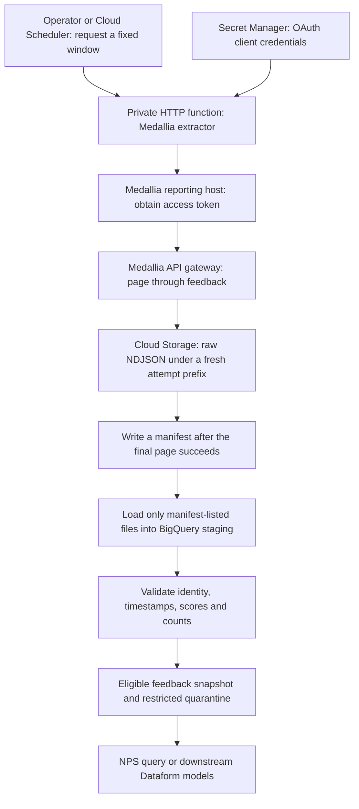
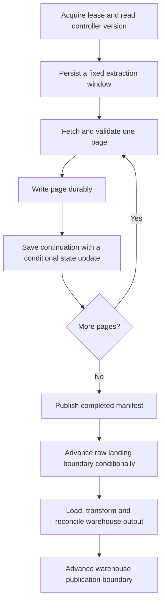

# Medallia feedback ingestion with GCP Cloud Functions

Medallia Experience Cloud holds customer feedback. Your data platform needs a recoverable copy that analysts can join to orders, stores, or support cases. In this lesson, a Python function reads a bounded set of completed feedback records, lands them in Cloud Storage, and hands a complete file set to BigQuery.

This applies the [workspace mission](../mission.md) to a SaaS source. You will explain the authentication boundaries, extract every page without publishing a partial result, validate the warehouse rows, and design recovery for a recurring integration.

Read [Cloud Storage](0001-cloud-storage-architecture-lifecycle.md), [ingestion and ELT](0037-bigquery-ingestion-etl-elt-lab.md), and [data contracts](0042-data-contracts-schema-evolution.md) first. Plan one session for the offline exercise and a second for the optional cloud lab. Follow the [lab conventions](../references/lab-conventions.md).

!!! note "Which Cloud Functions?"
    Google now calls second-generation Cloud Functions **Cloud Run functions**. This lab uses the supported Cloud Functions v2 deployment path, `gcloud functions deploy --gen2`. Its HTTP endpoint requires `roles/run.invoker`. A first-generation function has different invocation permissions. See Google's [function comparison](https://docs.cloud.google.com/run/docs/functions/comparison).

## 1. Give the function a small job



The function makes network calls and writes small batches. BigQuery performs analytical SQL. Keeping raw data lets you repair a transformation without spending another Medallia extraction request.

The diagram describes the whole pipeline. The supplied function implements extraction through manifest publication. The cloud lab runs loading and SQL explicitly; it does not install an automatic warehouse consumer.

Choose the source interface before writing code. Medallia documents [batch export, HTTP push, and Query API extraction](https://developer.medallia.com/medallia-apis/docs/extract-survey-responses-for-offline-analysis-data-warehousing).

| Requirement | Starting choice | Engineering consequence |
| --- | --- | --- |
| Small periodic warehouse extracts | Query API pull through a function | You own pagination, limits, replay, and completeness checks |
| Low latency after feedback arrives | Medallia-configured HTTP push | Verify the actual delivery contract and authenticate the receiver |
| Large historical backfill | An available bulk export | Process files rather than thousands of function invocations |
| Extraction takes longer than a bounded request | Cloud Run Job, with Workflows or Airflow as needed | Persist progress outside the worker and keep the same source contract |

These are design choices for this pipeline, not a claim that every Medallia tenant has every export destination or feature enabled.

## 2. Establish the Medallia contract

An API result can be technically successful yet incomplete for your business purpose. Confirm the program and data scope with the Medallia administrator before accepting record counts.

| Configuration | What to verify |
| --- | --- |
| Reporting host and tenant | The environment that issues OAuth tokens |
| API gateway | The exact production or sandbox Query API URL |
| OAuth account | Query API capability and access to the required programs and records |
| Record identity | `feedback.nodes.id`, kept as a string and qualified by tenant |
| Time field | Meaning, filterability, sort support, time zone, and returned representation |
| Score field | The intended 0-to-10 recommendation question, its value encoding, and cardinality |
| Source changes | How edits, delayed visibility, deletions, and permission changes will be reconciled |

Medallia's [`feedback` object](https://developer.medallia.com/medallia-apis/reference/query-api-overview) selects completed records. Invitations include other statuses. Use the live tenant schema and field metadata to verify field IDs. A query such as this inspects candidate fields; `e_initialfinishdate` and `e_ltr` are examples that must be checked in your environment.

```graphql
query InspectExtractionFields {
  fields(ids: ["e_initialfinishdate", "e_ltr", "a_surveyid"]) {
    nodes { id name dataType multivalued }
  }
}
```

The lab assumes the selected time field accepts the UTC timestamp bounds shown below and returns a timestamp BigQuery can parse. It assumes score values encode integers from 0 through 10. If your tenant returns epoch values or a different date representation, adapt both the source filters and warehouse parser to the verified contract.

Do not copy a question's display label into `fieldId`. Preserve the `values` array until you have checked whether a field has one value or several. A scalar conversion that silently picks the first of several answers loses information.

## 3. Separate the authentication boundaries

[Medallia authentication](https://developer.medallia.com/medallia-apis/reference/authentication) uses OAuth client credentials. The token endpoint lives on the reporting host, while the data request goes to the API gateway.

| Call | Credential | Authorization boundary |
| --- | --- | --- |
| Scheduler to private function | Google OIDC ID token with the function URL as audience | Invoker service account has `roles/run.invoker` |
| Function to Secret Manager | Attached Google runtime identity | Runtime service account can access the two named secrets |
| Function to Medallia token endpoint | HTTP Basic client ID and secret, with `grant_type=client_credentials` | Medallia OAuth account |
| Function to Medallia Query API | Medallia bearer access token | Medallia role and data scope |
| Function to Cloud Storage | Attached Google runtime identity | Object creation on the raw bucket |

Google IAM does not grant Medallia data access. A Medallia bearer token does not authenticate a request to your private Google function.

For example, the two Medallia URLs can look like this:

```text
https://instance.medallia.com/oauth/tenant/token
https://instance-tenant.apis.medallia.com/data/v0/query
```

Get the exact URLs from your administrator. [Sandbox gateway patterns can differ](https://developer.medallia.com/medallia-apis/reference/integrations). Keep client credentials in Secret Manager and tokens in memory. Do not put credentials, feedback bodies, or free-text comments in logs.

## 4. Understand what the Python example guarantees

The [function source](../examples/medallia-function/main.py) accepts an explicit historical window, with inclusive start and exclusive end. It limits a request to one day and five pages of 100 records. This is a teaching budget, not Medallia's maximum page size or account quota.

```json
{
  "start": "2026-10-01T00:00:00Z",
  "end": "2026-10-02T00:00:00Z"
}
```

Use UTC timestamps to whole seconds with a trailing `Z`. Choose an old, small window in your sandbox. The extractor requests the configured timestamp and score with GraphQL aliases so the raw JSON has predictable keys.

```graphql
nodes {
  id
  source_time: fieldData(fieldId: $timeField) { values }
  score: fieldData(fieldId: $scoreField) { values }
}
```

The request fixes the time bounds and orders by the selected time field, then `a_surveyid`. The loop starts with `after: null`, passes each returned `endCursor` to the next request, and stops when `hasNextPage` is false. It rejects missing or repeated continuation cursors. Medallia describes this [pagination protocol](https://developer.medallia.com/medallia-apis/reference/query-api-overview#pagination).

An HTTP 200 is only the transport result. GraphQL can return data and errors together. The example rejects any nonempty `errors` array before writing that page. See the [GraphQL execution response specification](https://spec.graphql.org/September2025/#sec-Response).

Each successful page becomes newline-delimited JSON under a new attempt prefix:

```text
medallia/attempt=<unique-id>/page-000.ndjson
medallia/attempt=<unique-id>/page-001.ndjson
medallia/attempt=<unique-id>/manifest.json
```

Each line contains `tenant`, `feedback_id`, `window_start`, `window_end`, `extracted_at`, `attempt_id`, and the selected source `payload`. Raw here means the selected source fields before business transformation. This example does not export every field in the tenant.

The manifest lists the exact page URIs and row counts. It appears only after the last page succeeds. An empty result has an empty manifest and no data files. A failed attempt may leave pages without a manifest. Consumers must ignore those pages.

```python
blob.upload_from_string(
    text,
    content_type=content_type,
    if_generation_match=0,  # (1)!
    timeout=15,
    retry=None,
)
```

1. The [generation precondition](https://docs.cloud.google.com/storage/docs/request-preconditions) prevents replacing an existing live object. With the runtime's object-creator role, the extractor cannot overwrite or delete raw objects. This does not deduplicate a later attempt under a different name.

!!! warning "A complete traversal is not a source snapshot"
    The manifest proves that this attempt traversed all returned pages and wrote its output. It does not prove that Medallia's underlying data stayed unchanged during pagination. Start with historical data, compare against an independent source count for the same scope, and use the recurring-ingestion design below before claiming completeness for live data.

The function returns after durable extraction. It performs no background work after the response. Its [dependencies](../examples/medallia-function/requirements.txt) use compatible version ranges for the exercise; record resolved versions and lock your deployment dependencies for a production integration.

## 5. Run the offline failure exercise

From the repository root, run:

```bash
uv run --no-project --python 3.12 \
  --with-requirements docs/examples/medallia-function/requirements.txt \
  python -m unittest discover -s docs/examples/medallia-function -v
```

The [tests](../examples/medallia-function/test_main.py) simulate two API pages and object uploads. No cloud account, Medallia tenant, or credentials are needed.

| Exercise | Expected result |
| --- | --- |
| Two pages containing `f1`, `f2`, and `f3` | Three NDJSON rows and one manifest listing both files |
| Second page contains GraphQL errors alongside data | First page remains; no completed manifest |
| Second upload fails | No completed manifest |
| Missing or repeated continuation cursor | Failure instead of an infinite pagination loop |
| More pages than the request budget | Failure; split the extraction window |
| Missing feedback identity | Failure before that page is written |
| Empty source window | Successful manifest with zero rows |
| Reversed, oversized, or malformed time bounds | Rejected input |

Predict which objects remain after each failure before opening the test assertions. These checks establish local publication behavior. They do not validate your tenant schema, network path, IAM bindings, or BigQuery execution.

## 6. Deploy the bounded cloud lab

Use a disposable, billing-enabled Google Cloud project and a Medallia sandbox. The following commands create resources only when you run them. Python `3.12` is the chosen [function runtime](https://docs.cloud.google.com/run/docs/runtimes/python), independently of the documentation project's Python version.

Before deployment, an authorized operator must have enabled access to the intended source data and stored the sandbox OAuth credentials as version `1` of `medallia-client-id` and `medallia-client-secret` in Secret Manager. The deployer needs function deployment and service-account attachment permissions. The project's Cloud Build identity also needs its required build, source, logging, and artifact permissions. Build identity, runtime identity, and invoker identity are separate.

Set these identifiers from the repository root. Choose a globally unique bucket name.

```bash
export PROJECT_ID="your-disposable-project"
export REGION="us-central1"
export RAW_BUCKET="your-globally-unique-medallia-lab-bucket"
export RUNTIME_SA="medallia-extractor@${PROJECT_ID}.iam.gserviceaccount.com"
export CALLER_SA="medallia-invoker@${PROJECT_ID}.iam.gserviceaccount.com"

gcloud services enable cloudfunctions.googleapis.com run.googleapis.com \
  cloudbuild.googleapis.com artifactregistry.googleapis.com \
  secretmanager.googleapis.com storage.googleapis.com bigquery.googleapis.com \
  cloudscheduler.googleapis.com --project="$PROJECT_ID"

gcloud iam service-accounts create medallia-extractor --project="$PROJECT_ID"
gcloud iam service-accounts create medallia-invoker --project="$PROJECT_ID"

gcloud storage buckets create "gs://${RAW_BUCKET}" \
  --project="$PROJECT_ID" --location="$REGION" \
  --uniform-bucket-level-access --public-access-prevention

gcloud storage buckets add-iam-policy-binding "gs://${RAW_BUCKET}" \
  --member="serviceAccount:${RUNTIME_SA}" --role=roles/storage.objectCreator

gcloud secrets add-iam-policy-binding medallia-client-id \
  --project="$PROJECT_ID" --member="serviceAccount:${RUNTIME_SA}" \
  --role=roles/secretmanager.secretAccessor

gcloud secrets add-iam-policy-binding medallia-client-secret \
  --project="$PROJECT_ID" --member="serviceAccount:${RUNTIME_SA}" \
  --role=roles/secretmanager.secretAccessor
```

Create a local `medallia-env.yaml`. Replace every placeholder, including the bucket. Check the two example field IDs against your tenant before deploying.

```yaml
RAW_BUCKET: your-globally-unique-medallia-lab-bucket
MEDALLIA_TENANT: your-tenant
MEDALLIA_TOKEN_URL: https://your-reporting-host/oauth/your-tenant/token
MEDALLIA_QUERY_URL: https://your-api-gateway/data/v0/query
MEDALLIA_TIME_FIELD: e_initialfinishdate
MEDALLIA_SCORE_FIELD: e_ltr
```

Deploy with the [function CLI](https://docs.cloud.google.com/sdk/gcloud/reference/functions/deploy). The secret references below pin the exercise to the supplied version. [Secret-backed environment values](https://docs.cloud.google.com/run/docs/configuring/services/secrets) resolve when instances start; rotate by selecting a new version and deploying it.

```bash
gcloud functions deploy medallia-extract \
  --project="$PROJECT_ID" --region="$REGION" --gen2 \
  --runtime=python312 --entry-point=extract_feedback \
  --source=docs/examples/medallia-function \
  --trigger-http --no-allow-unauthenticated \
  --service-account="$RUNTIME_SA" \
  --env-vars-file=medallia-env.yaml \
  --set-secrets=MEDALLIA_CLIENT_ID=medallia-client-id:1,MEDALLIA_CLIENT_SECRET=medallia-client-secret:1 \
  --memory=512Mi --timeout=300s --concurrency=1 --max-instances=1

gcloud functions add-invoker-policy-binding medallia-extract \
  --project="$PROJECT_ID" --region="$REGION" \
  --member="serviceAccount:${CALLER_SA}"

export FUNCTION_URL=$(gcloud functions describe medallia-extract \
  --project="$PROJECT_ID" --region="$REGION" --gen2 \
  --format='value(serviceConfig.uri)')
```

Low concurrency reduces pressure on the source. It is not a distributed lock or a guarantee against overlapping work after a timeout or deployment. The extractor has no warehouse permissions. The operator performing the next section needs raw-object reads, BigQuery job creation, and dataset/table writes.

An operator authorized to impersonate `CALLER_SA` can invoke the function as follows. That impersonation requires token-creation permissions on this service account; the invoker role alone does not grant them.

```bash
curl --fail-with-body --silent --show-error \
  --request POST "$FUNCTION_URL" \
  --header "Authorization: Bearer $(gcloud auth print-identity-token \
    --impersonate-service-account="$CALLER_SA" --audiences="$FUNCTION_URL")" \
  --header 'Content-Type: application/json' \
  --data '{"start":"2026-10-01T00:00:00Z","end":"2026-10-02T00:00:00Z"}' \
  --output extract-result.json
```

Expect a `manifest_uri` and `row_count`. Your tenant determines the count. A `500` means the attempt did not report success; inspect its structured failure log. Do not consume its page prefix by wildcard.

## 7. Load and validate one completed attempt

Download the selected manifest and inspect its tenant, window, and file list. A [BigQuery JSON load](https://docs.cloud.google.com/bigquery/docs/loading-data-cloud-storage-json) needs NDJSON records rather than the GraphQL response wrapper. The [explicit schema](../examples/medallia-function/raw-schema.json) preserves the source payload as a `JSON` column and keeps feedback IDs as strings.

```bash
export MANIFEST_URI=$(python3 -c \
  'import json; print(json.load(open("extract-result.json"))["manifest_uri"])')
gcloud storage cp "$MANIFEST_URI" manifest.json
python3 -m json.tool manifest.json

bq --project_id="$PROJECT_ID" --location="$REGION" mk --dataset medallia_lab
bq --project_id="$PROJECT_ID" mk --table medallia_lab.raw_window \
  docs/examples/medallia-function/raw-schema.json

export PAGE_URIS=$(python3 -c \
  'import json; print(",".join(p["uri"] for p in json.load(open("manifest.json"))["pages"]))')
export EXPECTED_ROWS=$(python3 -c \
  'import json; print(json.load(open("manifest.json"))["row_count"])')
export EXPECTED_ATTEMPT=$(python3 -c \
  'import json; print(json.load(open("manifest.json"))["attempt_id"])')

if [ -n "$PAGE_URIS" ]; then
  bq --project_id="$PROJECT_ID" --location="$REGION" load \
    --replace --source_format=NEWLINE_DELIMITED_JSON --max_bad_records=0 \
    medallia_lab.raw_window "$PAGE_URIS" \
    docs/examples/medallia-function/raw-schema.json
else
  bq --project_id="$PROJECT_ID" --location="$REGION" query --use_legacy_sql=false \
    'TRUNCATE TABLE medallia_lab.raw_window'
fi

bq --project_id="$PROJECT_ID" --location="$REGION" query \
  --use_legacy_sql=false \
  --parameter="expected_rows:INT64:${EXPECTED_ROWS}" \
  --parameter="expected_attempt:STRING:${EXPECTED_ATTEMPT}" \
  < docs/examples/medallia-function/warehouse.sql
```

Create the dataset and raw table once. For another attempt, rerun the load and query steps. `--replace`, `TRUNCATE`, and the SQL's `CREATE OR REPLACE TABLE` are intentional for these dedicated lab fixtures. They replace the previous single-window snapshot. The empty-window branch prevents a previous attempt's data from being mistaken for a new empty result.

The [warehouse script](../examples/medallia-function/warehouse.sql) checks the manifest count, selected attempt, and unique tenant-qualified feedback IDs before transformation. It validates timestamp cardinality and bounds, then routes rows into an eligible snapshot or quarantine. Accepted plus quarantined rows must equal the manifest count.

For this NPS exercise, unanswered or invalid scores are ineligible and go to quarantine with a reason. That does not mean every unanswered question is a corrupt feedback record. In a broader feedback model, preserve the valid record separately and classify metric eligibility.

| Input | Expected result |
| --- | --- |
| One timestamp and score `10` | Eligible promoter |
| One timestamp and score `6` | Eligible detractor |
| One timestamp and score `8` | Eligible passive |
| Missing score or score `11` | Quarantine; exclude from the NPS denominator |
| Two score values | Quarantine; do not silently choose one |
| Duplicate feedback ID in this snapshot | Assertion failure before replacing the output tables |

[NPS](https://www.medallia.com/experience-101/glossary/net-promoter-score/) is 100 times the difference between promoter and detractor proportions. Passives remain in the eligible denominator. Three eligible responses scoring `10`, `6`, and `8` therefore produce `0`, not the average score of `8`.

The example groups by the selected source timestamp's UTC date. A business dashboard may instead use response date, a local time zone, a program filter, or a specific survey population. Add that separately verified timestamp and population contract before comparing your aggregate to a Medallia dashboard. These SQL table replacements are separate jobs within a script; the example does not provide atomic publication across every output table.

## 8. Design recurring extraction before adding a schedule

Medallia's extraction guide describes delayed visibility in its reporting engine. Its [reference extractor](https://github.com/medallia/query-api-data-extract) tracks both survey ID and initial finish time. Its epoch-time example requires a configured calculated field; do not assume that field exists in your tenant.

A response date tells you when an answer happened. An initial finish or availability timestamp addresses when the record first becomes available. Neither automatically provides a reliable version for every later edit.

For a recurring pull, persist a controller record outside the function process:

| State | Purpose |
| --- | --- |
| Tenant, program scope, and query-contract version | Identify what the extractor means by this source |
| Fixed lower and upper bounds for the run | A retry must repeat the same request boundary |
| Attempt ID, lease owner, and fencing/version token | Reject stale or concurrent checkpoint writers |
| Saved continuation cursor when supported | Resume the same traversal after durable page writes |
| Completed manifest and `landed_through` boundary | Record successful raw landing |
| Warehouse job identity and `published_through` boundary | Record separately validated downstream publication |

Firestore transactions or an object-generation compare-and-set can implement the controller's state transition. A process-global variable or a file under `/tmp` cannot coordinate requests or survive instance replacement. Google's [function best practices](https://docs.cloud.google.com/run/docs/tips/functions-best-practices) describe lifecycle and idempotency concerns.



Write before checkpointing. A crash after a page write but before the state update causes replay; checkpointing before the write can cause a gap. A cursor is a pagination token, not a business watermark or an indefinite snapshot. If it expires or its resume semantics are uncertain, restart the fixed window in a fresh attempt and reconcile identities.

Suppose the previous successful upper bound is `H`. A possible polling policy chooses a lower bound of `H - 15 minutes` and an upper bound of `now - 5 minutes`. Persist both once. The overlap allows rereading recently visible records, while the delay avoids querying the newest reporting state. These durations are exercise choices, not a Medallia service guarantee. Measure visibility lag and run longer reconciliation windows.

An update to last month's feedback can still fall outside this overlap if the selected timestamp never changes. A filterable, reliable update field can support a separate changed-record extraction if your tenant exposes one. Otherwise use agreed historical re-extracts or exports. Polling completed feedback also does not automatically yield deletion events. Establish explicit deletion and scope-change handling instead of treating every absent row as a delete.

## 9. Make replay safe at the warehouse boundary

Retrying the supplied function creates another raw attempt. That is deliberate evidence of another observation. Appending every attempt into a reporting table would double-count feedback.

| Warehouse grain | Identity and replay rule |
| --- | --- |
| One observation per extraction | Tenant, feedback ID, and attempt ID; useful for audit, unsuitable for direct response counts |
| One current row per feedback record | Tenant and feedback ID; update only when a trusted source version is newer |
| One row per source version | Tenant, feedback ID, and source version; repeated delivery of that version must agree on payload |
| Fixed historical snapshot used in this lab | Replace from one selected complete attempt and assert unique record IDs |

For a current-state `MERGE`, first reduce the source to one unambiguous version per key. Reject different payloads with the same version. Then update a target only when the source version is newer. BigQuery's [MERGE rules](https://docs.cloud.google.com/bigquery/docs/reference/standard-sql/dml-syntax#merge_statement) do not supply your source-version contract or deduplicate an arbitrary input for you.

`extracted_at` measures the observation time. A retry, concurrent read, or replay can observe older source state later. A payload hash detects differences but does not order versions. If the source lacks reliable version metadata, record observations and use an agreed snapshot/reconciliation policy rather than claiming a guaranteed latest-state merge.

After a corrected score, recompute the affected metric date from the authoritative feedback rows. Adding one more daily aggregate would retain the earlier answer's contribution.

## 10. Add a scheduler or webhook with the right contract

Cloud Scheduler provides [at-least-once delivery](https://docs.cloud.google.com/scheduler/docs/overview). A lost acknowledgment can trigger another invocation. The fixed-window fixture tolerates this by writing separate attempts and requiring an explicit downstream selection.

To practice authenticated scheduling, the following job repeats the same historical window. Pause it after one successful execution. It is a replay exercise, not a rolling incremental pipeline.

```bash
gcloud scheduler jobs create http medallia-replay-lab \
  --project="$PROJECT_ID" --location="$REGION" \
  --schedule='0 3 * * *' --time-zone=Etc/UTC \
  --uri="$FUNCTION_URL" --http-method=POST \
  --oidc-service-account-email="$CALLER_SA" \
  --oidc-token-audience="$FUNCTION_URL" \
  --headers='Content-Type=application/json' \
  --message-body='{"start":"2026-10-01T00:00:00Z","end":"2026-10-02T00:00:00Z"}' \
  --attempt-deadline=320s --max-retry-attempts=2 --min-backoff=60s

gcloud scheduler jobs run medallia-replay-lab \
  --project="$PROJECT_ID" --location="$REGION"

gcloud scheduler jobs pause medallia-replay-lab \
  --project="$PROJECT_ID" --location="$REGION"
```

The [Scheduler authentication guide](https://docs.cloud.google.com/scheduler/docs/http-target-auth) requires a client service account with invoker access. Preserve the separate Cloud Scheduler service agent's managed role. The [job CLI](https://docs.cloud.google.com/sdk/gcloud/reference/scheduler/jobs/create/http) defines the audience, deadline, and retry flags. A function's longer maximum HTTP timeout does not extend a caller's deadline. Cancellation or a lost response also does not prove that every remote side effect stopped.

For a rolling pipeline, schedule the stateful controller from section 8. Avoid deriving a new upper bound on each retry inside the current stateless fixture.

For Medallia HTTP push, build a separate receiver. Verify the configured event shape and the authentication mechanism Medallia actually supports. Do not assume an HMAC header, a Google OIDC token, retry schedule, or delivery ID exists. If required, use an authenticated gateway or receiver that can enforce the supported mechanism. Validate the request, durably publish it to Pub/Sub or raw storage, then acknowledge it. Downstream work needs replay-safe writes and a failure path. A push receiver that acknowledges before durable acceptance can lose feedback.

## 11. Diagnose failures and control cost

The sample returns `500` on extraction failures and leaves the request boundary unchanged. It has no in-process retry loop or automatic token refresh. For this short lab, investigate and retry the same window. For production, classify failures and let a durable controller apply bounded retries; do not retry permanent configuration failures forever.

| Symptom | First check | Recovery |
| --- | --- | --- |
| Private function returns `401` or `403` | Google ID token audience and `roles/run.invoker` | Repair caller identity; Medallia credentials are unrelated |
| Token request fails | Reporting-host URL, environment-specific credentials, and secret version | Repair configuration or rotate credentials |
| Query returns `401` | Medallia token expiry or validity | Obtain a new token and retry within a bounded policy |
| Query returns `403` or unexpectedly few rows | Medallia account capability and program/data scope | Verify access before accepting a small count as complete |
| Query returns `429` | Shared API consumption and [rate-limit headers](https://developer.medallia.com/medallia-apis/reference/integrations#rates-and-limits) | Respect supplied retry timing; otherwise use bounded exponential backoff with jitter |
| HTTP `200` with GraphQL errors | Query schema and field access | Reject the partial page; fix permanent query errors |
| Five-page budget exhausted | Window size and record count | Split into smaller fixed windows or choose bulk extraction |
| Raw pages exist without a manifest | Extraction/upload failure or timeout | Ignore incomplete attempts; retry from known state |
| Warehouse load or assertion fails | Exact manifest files, schema, counts, and IDs | Repair or rerun the selected attempt; retain raw evidence |
| Dashboard differs from Medallia | Population, source time, time zone, score encoding, and version policy | Reconcile business definitions before changing SQL |

The sample's sanitized logs identify an attempt and error category. A production controller should also record safe HTTP status, request duration, page/row counts, query-contract version, source-window age, retry counts, and warehouse job IDs. Alert on missing successful windows and stale publication, even when no invocation is currently failing.

Record the difference between source-visible counts and landed counts using the same role, filters, and boundary. A changing `totalCount` is not a transactional snapshot guarantee. Treat an empty window as an observable result, not as proof that the account has access to everything.

Limit source fields and request concurrency. Batch small objects for warehouse loading when volume grows. Use partition filters on analytical tables and keep raw retention bounded by the approved data policy. Free text and identifiers can contain personal data even when the pipeline only intends to compute scores. Restrict raw and quarantine access, and never use feedback text as an object name or log field.

## 12. Recall, failure drills, and cleanup

Answer without reopening the code:

1. Why does the Medallia token request use a different host from the data query?
2. Page one lands, page two fails. Which artifact lets the warehouse decide whether to consume the attempt?
3. The manifest lands but the HTTP response is lost. What does another invocation duplicate, and where must business deduplication happen?
4. Two records share the same availability timestamp. Why is a timestamp alone insufficient for a resume boundary?
5. Last month's score changes today. Why can a 15-minute initial-finish overlap miss it?
6. Why is a later `extracted_at` insufficient evidence of a newer source version?
7. Your function returns 200 with zero rows. Name two checks beyond HTTP status before calling the extraction complete.

??? note "Answer check"
    The reporting host issues tokens and the gateway accepts data requests. The completed manifest identifies the consumable file set. A retry produces another raw observation, so select one validated snapshot or deduplicate by an explicit warehouse key/version contract. Timestamp ties require record identity as a tie-breaker. An old record's initial finish time may stay unchanged after an edit. Observation order does not establish source-version order. Check account scope and an independent count for the same window, while accounting for source visibility lag.

Then perform these drills:

1. Run the offline tests and explain why a partial GraphQL result never publishes a manifest.
2. In the sandbox, select a smaller window and extract it twice. Confirm distinct attempt IDs and compare feedback IDs.
3. Load the same complete attempt twice with replacement. Confirm the eligible response count stays unchanged.
4. Introduce a score of `11` into a disposable fixture. Confirm it moves to quarantine and the reconciliation count still balances.
5. Design a warehouse-load failure after raw landing. Explain why `landed_through` and `published_through` need separate recovery states.

When finished, stop the producer first. If you created the optional schedule, delete it, then delete the function. The dataset removal below deletes only the dedicated lab tables.

```bash
gcloud scheduler jobs delete medallia-replay-lab \
  --project="$PROJECT_ID" --location="$REGION"
gcloud functions delete medallia-extract \
  --project="$PROJECT_ID" --region="$REGION" --gen2
bq --project_id="$PROJECT_ID" rm --recursive --dataset medallia_lab
```

After inspecting failure evidence, remove this lab's raw objects, bucket, service accounts, and secrets only if they were created exclusively for this exercise. Check retained storage and build artifacts separately. Do not delete shared source credentials or artifact repositories. Reading this lesson or passing its offline checks does not establish demonstrated mastery; record your predictions and observed cloud results in a later learning record.

Official sources and verification scope are collected in the [reference catalog](../references/resources.md#medallia-feedback-ingestion-with-cloud-run-functions).

| Previous lesson | All lessons | Next lesson |
| --- | :---: | ---: |
| [0053: BigQuery ML pipelines with Dataform](0053-bigquery-ml-dataform-pipelines.md) | [Lesson catalog](index.md) | None yet |
