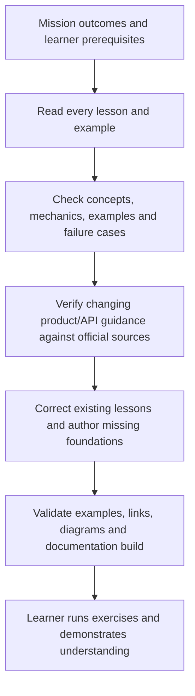

# Curriculum coverage audit

Reviewed on 2026-10-28 against the [mission](../mission.md), all 40 existing lessons and their linked implementation examples. The curriculum had broad Google Cloud service coverage, but many early lessons were short overviews, several examples were incorrect or incomplete, and important modeling/platform foundations were absent. The revised curriculum has 45 lessons.

This is an educational and documentation review. It does not establish that every cloud example has been deployed or that the learner has demonstrated mastery. The [lab conventions](lab-conventions.md) distinguish local fixtures, cloud labs and configuration fragments.

## Review criteria

Each lesson needs a clear concept and scope, an explanation of the relevant mechanism, a concrete example with expected behavior, important trade-offs/failure cases, retrieval or hands-on practice, official sources, a vertical diagram and navigation. Examples must distinguish their actual guarantee from adjacent concerns such as business deduplication, completeness or global transactions.

## Findings and changes for every original lesson

The entries describe concrete findings and resulting changes. A lesson's size alone was not a pass/fail criterion.

| Lesson | Finding | Revision or retained evidence |
| --- | --- | --- |
| [0001](../lessons/0001-cloud-storage-architecture-lifecycle.md) | Flat namespace presented as universal; undocumented internals and fixed rates; weak replay explanation | Generations/preconditions, hierarchical namespace, consistency boundaries, retention and lifecycle examples |
| [0002](../lessons/0002-bigtable-spanner-cloudsql-selection.md) | Fixed latency/size thresholds oversimplified database selection | Transaction/access-pattern reasoning, hot-key experiment and analytics/change-stream trade-offs |
| [0003](../lessons/0003-biglake-iceberg-catalogs.md) | Format, catalog and security layers conflated | Table ownership, commit protocol, delegated access, metadata freshness and retained-snapshot semantics |
| [0004](../lessons/0004-data-lake-medallion-gcs.md) | Missing `event_date` in Spark write; weak conflict/publication handling | Complete bounded Spark fixture with valid/rejected/conflicting records and explicit layer grains |
| [0005](../lessons/0005-pubsub-architecture-flow-control.md) | Subscriber flow-control example had unsupported fields; DLQ grants incomplete | Working client shape, both service-agent grants, 5–100 attempt setting, best-effort forwarding and sizing |
| [0006](../lessons/0006-pubsub-lite-vs-standard.md) | Deprecated Lite recommended for new systems | Replaced deployment advice with official shutdown notice and a migration/reconciliation lesson |
| [0007](../lessons/0007-change-data-capture-datastream-bigquery.md) | Invented destination metadata and incomplete guessed CLI setup | Actual mode/metadata boundaries, source preparation, tombstone SQL fixture, WAL monitoring and full lab link |
| [0008](../lessons/0008-bigquery-data-transfer-service-gcs-notifications.md) | Wrong transfer parameter, wrong job API name and unsafe append retries | Correct connector parameters, immutable input assumption, stable job identity and completion-aware helper |
| [0009](../lessons/0009-bigquery-internal-architecture.md) | Historical internals presented too literally; little correctness interpretation | Conceptual execution model, join-fan-out fixture and actual queue/slot diagnostics |
| [0010](../lessons/0010-partitioning-clustering-search-indexes.md) | Universal partition advice and no worked estimate | Workload-based layout, worked pruning calculation, index eligibility and comparison exercise |
| [0011](../lessons/0011-bigquery-storage-write-api.md) | Empty serialized payload example and overly broad exactly-once claims | Complete Protobuf append example, stream-scoped offsets and finalized pending-stream commit boundary |
| [0012](../lessons/0012-materialized-views-bi-engine.md) | Unsupported CLI/metadata fields and mismatched timestamp column | Supported reservation procedure, valid fields, cache/MV/BI distinctions and freshness/fallback exercises |
| [0013](../lessons/0013-bigquery-slot-management-editions.md) | Unsupported command/view examples and arbitrary cost thresholds | Reservation/assignment/commitment distinctions, actual job/timeline metrics and hypothetical break-even arithmetic |
| [0014](../lessons/0014-apache-beam-fundamentals.md) | Runner options overridden; lifecycle guarantees overstated | Executable Python and Java aggregate fixtures with assertions; distributed retry/lifecycle explanation |
| [0015](../lessons/0015-beam-event-time-watermarks.md) | Watermark example inconsistent; lateness confused with wall-clock deadlines | Explicit time domains, window expiration table and deterministic local TestStream path |
| [0016](../lessons/0016-beam-windowing-triggers.md) | Missing output identity and unsafe accumulating-pane append pattern | Runnable on-time/late/expired fixture, pane arithmetic and sink revision requirements |
| [0017](../lessons/0017-beam-stateful-processing-side-inputs.md) | Invalid Python state imports and mixed timer clocks | Correct Python state/timer API, integer-money threshold, side-input policy and schema examples |
| [0018](../lessons/0018-dataflow-execution-internals.md) | FlexRS passed as a template argument; unconditional healthy metrics | Correct SDK option, scoped exactly-once discussion, backpressure arithmetic and drain/update decisions |
| [0019](../lessons/0019-dataflow-flex-templates-cloud-build.md) | Launcher/worker dependencies conflated; code components unstated | Separate image contracts, explicit template prerequisites, immutable release artifacts and failure checks |
| [0020](../lessons/0020-dataproc-architecture-ephemeral-clusters.md) | Invalid boolean flag, old connector and fixed Spot recommendation | Supported cluster pattern, driver/executor/shuffle reasoning and deadline-based Spot/lifecycle trade-offs |
| [0021](../lessons/0021-dataproc-serverless-spark.md) | Assumed container image, fixed startup/prices and stale runtime | Supported runtime selection, batch identity, network/resource constraints and current container-contract guidance |
| [0022](../lessons/0022-pyspark-bigquery-connector.md) | Read/write paths conflated and append retry risk hidden | Explicit indirect mode, compatible connector selection, pushdown verification and bounded publication exercise |
| [0023](../lessons/0023-spark-optimization-memory-tuning-gcp.md) | Missing salting imports and universal memory/broadcast heuristics | Complete imports, explain/UI diagnosis, sizing arithmetic, driver/overhead distinctions and correctness comparison |
| [0024](../lessons/0024-dataform-foundations-workflow-settings.md) | Wrong settings nesting and automatic-isolation claim | Correct top-level vars, minimal compilable graph, explicit overrides and runtime/compilation distinction |
| [0025](../lessons/0025-writing-dataform-sqlx-assertions.md) | Event-time watermark misses changes; empty MAX case; assertions treated as automatic global gates | Arrival lookback with COALESCE, version guard, source conflict requirement and explicit assertion/publication dependencies |
| [0026](../lessons/0026-dbt-core-bigquery-models-snapshots.md) | Seeds/macros named but not taught; key-based CI auth and empty-target issue | Seed/macro/source examples, ADC/impersonation, empty-target handling and snapshot/late-data limitations |
| [0027](../lessons/0027-transformation-pipelines-cicd.md) | Dataset variable did not configure a target; missing state hidden; guessed Dataform commands | Actual CI target, state/defer contract, workload federation and reviewed compilation-result identity |
| [0028](../lessons/0028-cloud-composer-architecture-gke.md) | Old image and generation-specific internals generalized | Managed generation/version distinctions, correct DAG prefix, identity boundary and measured capacity example |
| [0029](../lessons/0029-resilient-dags-deferrable-operators.md) | Unsafe MERGE/check example and universal deferrable recommendation | Runnable deterministic DAG, classified failures, interval semantics and complete safe-publication lab link |
| [0030](../lessons/0030-dynamic-task-mapping-airflow-best-practices.md) | Invented GCS backend, fixed XCom limit and fabricated validation count | Official common-io backend, dependency requirements, mapping limits/product semantics and real fixture link |
| [0031](../lessons/0031-cloud-workflows-vs-composer.md) | Manual redundant polling and fixed latency/cost claims | Parameterized workflow, actual connector waiting, execution/error boundaries and workload-based comparison |
| [0032](../lessons/0032-dataplex-architecture-data-quality.md) | Old catalog framing and invalid scan rule/CLI fields | Current naming, entries/aspects, actual expectation rules, sampling limitations and explicit publication gate |
| [0033](../lessons/0033-fine-grained-access-control-policy-tags-rls.md) | Unsupported masking SQL and incorrect no-policy access behavior | Supported schema/data-policy procedure, effective-grant testing, row-policy unions and error behavior |
| [0034](../lessons/0034-automated-pii-masking-cloud-dlp.md) | Fake wrapped-key value and incorrect structured/text integration assumption | Complete table-shaped de-identification request, key lifecycle, transformation semantics and bounded RPC design |
| [0035](../lessons/0035-pipeline-observability-lineage.md) | Obsolete log schema and overclaimed automatic lineage | Business SLO/denominator, current audit path, actual query/CLI examples and supported integration checks |
| [0036](../lessons/0036-bigquery-finops-slot-reservations.md) | CTE materialization implied; fixed pricing and incomplete physical-storage estimate | Explicit hypothetical rates, retained-history cost, billing-versus-job metrics and unit economics |
| [0037](../lessons/0037-bigquery-ingestion-etl-elt-lab.md) | Already detailed ingestion lab with expected output and cleanup | Retained six ingestion paths, identity/version checks and error exercises; added schema-change integration task |
| [0038](../lessons/0038-bigquery-etl-architecture-load-transform-export.md) | Already detailed transactional ELT/export lab | Retained validated transaction/export/retry boundaries; added fact-grain extension and control-total reasoning |
| [0039](../lessons/0039-managed-airflow-environments-dags.md) | Already detailed managed-environment and three-DAG lab | Retained downloadable examples and failure checks; added historical-interval and upgrade assessment |
| [0040](../lessons/0040-bigquery-failed-job-recovery-backfill.md) | Already detailed bounded incident/repair lab | Retained key/value/multiplicity reconciliation and idempotent repair; added measured RPO/RTO extension |

## Missing topics now have dedicated lessons

| Lesson | Coverage added | Concrete example |
| --- | --- | --- |
| [0041: SQL and modeling](../lessons/0041-googlesql-data-modeling.md) | Fact grain, dimension/history joins, NULLs, exact money, arrays and analytical windows | Join fan-out, SCD Type 2 as-of join and UNNEST totals |
| [0042: Contracts](../lessons/0042-data-contracts-schema-evolution.md) | Schema versus business contract, serialization, compatibility and replay | Executable validator and additive/breaking-change rollout |
| [0043: Platform foundations](../lessons/0043-platform-iam-networking-infrastructure.md) | Principals, least privilege, federation, private connectivity, KMS and infrastructure state | Scoped Terraform resources and a permission/network diagnosis exercise |
| [0044: Reliability](../lessons/0044-reliability-disaster-recovery.md) | RPO/RTO, retention/catch-up, snapshots, regional recovery and writer fencing | Snapshot recovery SQL and backlog arithmetic |
| [0045: Architecture capstone](../lessons/0045-platform-architecture-capstone.md) | Requirement-driven service selection, capacity, cost, correctness and operations | Sized event platform and seven failure scenarios |

## Mission coverage after the revision

| Mission outcome | Primary lessons and evidence |
| --- | --- |
| End-to-end batch and streaming | 0005–0008, 0014–0019, 0037–0040 and architecture capstone 0045 |
| Warehouse/lakehouse design | 0001–0004, 0009–0013, 0036, SQL/modeling 0041 |
| Beam Python/Java and stream semantics | 0014 Python/Java fixtures, 0015 time model, 0016 TestStream panes, 0017 state/timers |
| Distributed Spark | 0020–0023, bounded Spark fixture in 0004 and publication integration in 0039 |
| Dataform/dbt transformations | 0024–0027, 0037–0038 and contract/modeling prerequisites 0041–0042 |
| Enterprise orchestration | 0028–0031 and managed lab 0039; version-specific APIs explicitly scoped |
| IAM, security and governance | 0032–0035, contract handling 0042 and platform foundations 0043 |
| Diagnose and operate production | 0013, 0018, 0023, 0035–0036, recovery 0040/0044 and capstone 0045 |

## Verification and remaining scope

Cloud execution remains learner work in the disposable labs; service IAM, networking, region availability, quotas and current managed images must be validated there. A local parser/build cannot prove them.

- Every numbered lesson is cataloged and has a Mermaid diagram, example, practice and bottom navigation.
- All documentation Mermaid blocks are checked with the teach skill's validator.
- The Zensical documentation build and relative links are checked.
- Local Beam fixtures and the Java counterpart have executable assertions; exact commands/results are recorded with the final audit verification.

### Validation record

| Check | Result |
| --- | --- |
| Numbered lessons, catalog entries and adjacent pagination | 45 lessons checked; no missing diagram, source, practice or navigation |
| Teach skill Mermaid validator | 76 documentation diagrams; 0 syntax errors |
| Zensical build | Passed with no reported issues; final build uses a clean output directory |
| Generated documentation links and anchors | Checked across all 72 content pages; no broken content targets |
| Python Beam 2.69.0 on Python 3.11 | `batch_totals.py`, `late_panes.py` and `threshold.py` executed; assertions passed |
| Java Beam 2.69.0 | Maven compilation and JDK 17 execution passed the aggregate `PAssert` |
| Dataform Core/CLI 3.0.0 | Settings, source declaration, models, incremental/version guard, helper and assertions compiled together |
| Standalone Python exercises | Database-key distribution, migration-set comparison, contract validation and capacity arithmetic passed |
| Embedded code syntax | 29 Python, 55 shell and 11 JSON/YAML blocks checked; no syntax errors |
| Downloadable Python syntax | All 6 files parsed successfully |
| Source links | Checked source-page reachability and replaced three broken official references |
| Patch whitespace | `git diff --check` passed |

The generated 404 error template is outside the content-link check; the checked pages correspond to the 72 Markdown documents. The local Beam fixtures run without cloud services. This review did not provision cloud resources or execute BigQuery, DLP, managed Airflow, Spark or Terraform deployments. The cloud lessons state their own prerequisites, expected results and cleanup.

Coverage is scoped to the mission. General programming/SQL fluency still benefits from further practice. This is not an exhaustive treatment of every Google Cloud product, every source-database replication limitation, Kafka administration, every Airflow 3 migration, or advanced MLOps. The mission excludes generic model training and deprecated-service deployment. Use the capstone to expose new workload-specific gaps instead of claiming the curriculum can eliminate all future learning needs.

| Previous | References | Next |
| --- | :---: | ---: |
| [Source catalog](resources.md) | [Reference index](index.md) | [Lab conventions](lab-conventions.md) |
